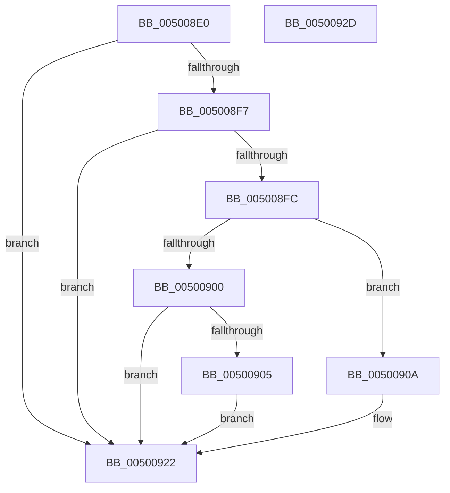

# mbtowc

- RVA: `0x005008E0`–`0x0050092E` (길이 `78` bytes)
- VA: `0x00000001405008E0`
- 실행 섹션: `.text`
- PDB 이름 있음: `예`; PDB Function 태그: `아니요`
- unwind 정보 RVA: `0x0005CAAC`
- 디코드: `27`개 명령, `78/78` bytes 표시
- 미해석 바이트: `0` (있으면 어셈블리에 `.byte`로 보존)

> 이 문서는 커널 이미지의 기계어와 PDB 기호를 분석해 생성했습니다. 4번과 5번은 함수 원형과 자료형을 바이너리 사용 방식에서 추정한 C 해석이며 원본 소스 복구 결과는 아닙니다.

## 1. Dependencies

- 직접 호출 지점: **1**; 고유 호출 대상: **1**
- 직접 호출자로 확인된 함수: **2**
- RIP 상대 이미지 참조: **0**

### Outgoing calls
- `0x00500914` → [RtlAnsiCharToUnicodeChar](../../page/90/RtlAnsiCharToUnicodeChar_function_0090D980.md) (function, `0x0090D980`)

### Direct callers
- [woutput_l](woutput_l_function_0050293C.md) at `0x00502C3C`
- [woutput_l](woutput_l_function_0050293C.md) at `0x00502EE6`
- [woutput_s](woutput_s_function_005073AC.md) at `0x005076B8`
- [woutput_s](woutput_s_function_005073AC.md) at `0x005079C1`

### Static image references
- 디코드된 RIP-relative 메모리 참조가 없습니다.

## 2. Other-region calls and transfers

- 다른 실행 섹션으로 향하는 call: **1**
  - `0x00500914` → [RtlAnsiCharToUnicodeChar](../../page/90/RtlAnsiCharToUnicodeChar_function_0090D980.md) (`.text` → `PAGE`)
- 별도 외부 분기/꼬리 이동을 확인하지 못했습니다.

## 3. Assembly (complete function range)

```asm
005008E0  48 89 5C 24 08                  mov qword ptr [rsp + 8], rbx
005008E5  57                              push rdi
005008E6  48 83 EC 20                     sub rsp, 0x20
005008EA  33 C0                           xor eax, eax
005008EC  48 8B DA                        mov rbx, rdx
005008EF  48 8B F9                        mov rdi, rcx
005008F2  48 85 D2                        test rdx, rdx
005008F5  74 2B                           je 0x140500922
005008F7  4D 85 C0                        test r8, r8
005008FA  74 26                           je 0x140500922
005008FC  38 02                           cmp byte ptr [rdx], al
005008FE  75 0A                           jne 0x14050090a
00500900  48 85 C9                        test rcx, rcx
00500903  74 1D                           je 0x140500922
00500905  66 89 01                        mov word ptr [rcx], ax
00500908  EB 18                           jmp 0x140500922
0050090A  48 8D 4C 24 38                  lea rcx, [rsp + 0x38]
0050090F  48 89 5C 24 38                  mov qword ptr [rsp + 0x38], rbx
00500914  E8 67 D0 40 00                  call 0x14090d980
00500919  66 89 07                        mov word ptr [rdi], ax
0050091C  8B 44 24 38                     mov eax, dword ptr [rsp + 0x38]
00500920  2B C3                           sub eax, ebx
00500922  48 8B 5C 24 30                  mov rbx, qword ptr [rsp + 0x30]
00500927  48 83 C4 20                     add rsp, 0x20
0050092B  5F                              pop rdi
0050092C  C3                              ret
0050092D  CC                              int3
```

## 4. C-style interpretation (structured pseudocode)

```c
__int64 __fastcall mbtowc(__int64 a1, __int64 a2, __int64 a3)
{
    __int64 result;
    __int64 v_rsp;
    unsigned __int64 v_stack_p10;
    unsigned __int64 v_stack_p8;

    v_stack_p8 = v_rbx;
    v_rsp = (v_rsp) - (32);
    result = 0;
    if (a2 == 0) goto loc_00500922;
    if (a3 == 0) goto loc_00500922;
    if ((*(unsigned __int8 *)(a2)) != 0) goto loc_0050090A;
    if (a1 == 0) goto loc_00500922;
    *(unsigned __int16 *)(a1) = 0;
    goto loc_00500922;
loc_0050090A:
    v_stack_p10 = a2;
    result = RtlAnsiCharToUnicodeChar(v_stack_p10, a2, a3, a4);
    *(unsigned __int16 *)(a1) = (unsigned __int16)(result);
    result = (unsigned int)(((unsigned int)(v_stack_p10)) - ((unsigned int)(a2)));
loc_00500922:
    v_rsp = (v_rsp) + (32);
    return result;
}
```

## 5. (Beta) C Style

```c
int64_t mbtowc(void *Arg1, int64_t Arg2, int64_t Arg3)
{
    uint8_t *arg1 = (uint8_t *)Arg1;

    int64_t result;
    int64_t local_rsp;
    uint64_t v_stack_p10;
    uint64_t v_stack_p8;

    v_stack_p8 = local_rbx;
    local_rsp = (local_rsp) - (32);
    result = 0;
    if (Arg2 == 0) goto loc_00500922;
    if (Arg3 == 0) goto loc_00500922;
    if ((*(uint8_t *)(Arg2)) != 0) goto loc_0050090A;
    if (Arg1 == NULL) goto loc_00500922;
    *(uint16_t *)(arg1) = 0;
    goto loc_00500922;
loc_0050090A:
    v_stack_p10 = Arg2;
    result = RtlAnsiCharToUnicodeChar(v_stack_p10, Arg2, Arg3, a4);
    *(uint16_t *)(arg1) = (uint16_t)(result);
    result = (uint32_t)(((uint32_t)(v_stack_p10)) - ((uint32_t)(Arg2)));
loc_00500922:
    local_rsp = (local_rsp) + (32);
    return result;
}
```

### 관측된 메모리 오프셋

구조체 형식이 확인되지 않은 접근은 인자 기준의 오프셋으로만 기록했습니다.

| 기준 인자 | 오프셋 표현 | 폭 (bit) | 접근 |
|---|---:|---:|---|
| `Arg1` | `+ 0x0` | `16` | `W` |

## 6. Execution-region graph

[열기: 2D/3D 그래프와 함수 탐색 컨트롤 패널](../../../control-panel.html?section=text&rva=0x005008E0&view=graph)

- 2D 그래프는 위에서 아래로 흐르고, 3D 그래프는 빈 공간을 드래그해 회전합니다. Shift+드래그는 이동, 휠은 확대·축소, 함수 노드 선택은 대상 보고서 이동입니다.

### Static fallback


