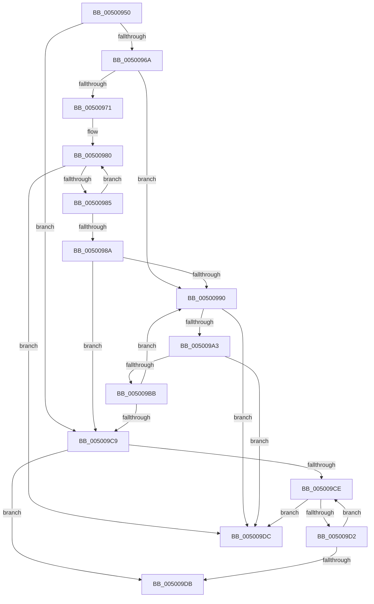

# memchr

- RVA: `0x00500950`–`0x005009E0` (길이 `144` bytes)
- VA: `0x0000000140500950`
- 실행 섹션: `.text`
- PDB 이름 있음: `예`; PDB Function 태그: `아니요`
- unwind 정보 RVA: `0x000BFAC8`
- 디코드: `45`개 명령, `144/144` bytes 표시
- 미해석 바이트: `0` (있으면 어셈블리에 `.byte`로 보존)

> 이 문서는 커널 이미지의 기계어와 PDB 기호를 분석해 생성했습니다. 4번과 5번은 함수 원형과 자료형을 바이너리 사용 방식에서 추정한 C 해석이며 원본 소스 복구 결과는 아닙니다.

## 1. Dependencies

- 직접 호출 지점: **0**; 고유 호출 대상: **0**
- 직접 호출자로 확인된 함수: **1**
- RIP 상대 이미지 참조: **0**

### Outgoing calls
- 직접 디코드된 call 명령이 없습니다.

### Direct callers
- [_asan_wrap_memchr](../5A/_asan_wrap_memchr_function_005AE460.md) at `0x005AE541`

### Static image references
- 디코드된 RIP-relative 메모리 참조가 없습니다.

## 2. Other-region calls and transfers

- 다른 실행 섹션으로 향하는 call: **0**
- 별도 외부 분기/꼬리 이동을 확인하지 못했습니다.

## 3. Assembly (complete function range)

```asm
00500950  0F B6 D2                        movzx edx, dl
00500953  69 D2 01 01 01 01               imul edx, edx, 0x1010101
00500959  66 0F 6E C2                     movd xmm0, edx
0050095D  66 0F 70 C0 00                  pshufd xmm0, xmm0, 0
00500962  33 C0                           xor eax, eax
00500964  49 83 F8 20                     cmp r8, 0x20
00500968  72 5F                           jb 0x1405009c9
0050096A  8B C1                           mov eax, ecx
0050096C  83 E0 0F                        and eax, 0xf
0050096F  74 1F                           je 0x140500990
00500971  48 83 E8 10                     sub rax, 0x10
00500975  4C 03 C0                        add r8, rax
00500978  48 2B C8                        sub rcx, rax
0050097B  0F 1F 44 00 00                  nop dword ptr [rax + rax]
00500980  3A 14 01                        cmp dl, byte ptr [rcx + rax]
00500983  74 57                           je 0x1405009dc
00500985  48 FF C0                        inc rax
00500988  75 F6                           jne 0x140500980
0050098A  49 83 F8 20                     cmp r8, 0x20
0050098E  72 39                           jb 0x1405009c9
00500990  66 0F 6F 09                     movdqa xmm1, xmmword ptr [rcx]
00500994  66 0F 74 C8                     pcmpeqb xmm1, xmm0
00500998  66 48 0F D7 C1                  pmovmskb eax, xmm1
0050099D  48 0F BC C0                     bsf rax, rax
005009A1  75 39                           jne 0x1405009dc
005009A3  66 0F 6F 49 10                  movdqa xmm1, xmmword ptr [rcx + 0x10]
005009A8  48 83 C1 10                     add rcx, 0x10
005009AC  66 0F 74 C8                     pcmpeqb xmm1, xmm0
005009B0  66 48 0F D7 C1                  pmovmskb eax, xmm1
005009B5  48 0F BC C0                     bsf rax, rax
005009B9  75 21                           jne 0x1405009dc
005009BB  48 83 C1 10                     add rcx, 0x10
005009BF  49 83 E8 20                     sub r8, 0x20
005009C3  49 83 F8 20                     cmp r8, 0x20
005009C7  73 C7                           jae 0x140500990
005009C9  4D 85 C0                        test r8, r8
005009CC  74 0D                           je 0x1405009db
005009CE  3A 11                           cmp dl, byte ptr [rcx]
005009D0  74 0A                           je 0x1405009dc
005009D2  48 FF C1                        inc rcx
005009D5  49 83 E8 01                     sub r8, 1
005009D9  75 F3                           jne 0x1405009ce
005009DB  C3                              ret
005009DC  48 03 C1                        add rax, rcx
005009DF  C3                              ret
```

## 4. C-style interpretation (structured pseudocode)

```c
__int64 __fastcall memchr(__int64 a1, unsigned __int8 a2, __int64 a3)
{
    __int64 result;

    a2 = (unsigned int)((a2) * (a2));
    result = 0;
    if (a3 < 32) goto loc_005009C9;
    result = (unsigned int)(((unsigned int)((unsigned int)(a1))) & (15));
    if (condition_is_equal) goto loc_00500990;
    result = (result) - (16);
    a3 = (a3) + (result);
    a1 = (a1) - (result);
loc_00500980:
    if (a2 == (*(unsigned __int8 *)(a1 + result * 1))) goto loc_005009DC;
    result = (result) + 1;
    if (a2 != (*(unsigned __int8 *)(a1 + result * 1))) goto loc_00500980;
    if (a3 < 32) goto loc_005009C9;
loc_00500990:
    if (a3 != 32) goto loc_005009DC;
    a1 = (a1) + (16);
    if (condition_is_not_equal) goto loc_005009DC;
    a1 = (a1) + (16);
    a3 = (a3) - (32);
    if (a3 >= 32) goto loc_00500990;
loc_005009C9:
    if (a3 == 0) goto loc_005009DB;
loc_005009CE:
    if (a2 == (*(unsigned __int8 *)(a1))) goto loc_005009DC;
    a1 = (a1) + 1;
    a3 = (a3) - (1);
    if (condition_is_not_equal) goto loc_005009CE;
loc_005009DB:
    return result;
loc_005009DC:
    result = (result) + (a1);
    return result;
}
```

## 5. (Beta) C Style

```c
int64_t memchr(void *Arg1, uint8_t Arg2, int64_t Arg3)
{
    uint8_t *arg1 = (uint8_t *)Arg1;

    int64_t result;

    Arg2 = (uint32_t)((Arg2) * (Arg2));
    result = 0;
    if (Arg3 < 32) goto loc_005009C9;
    result = (uint32_t)(((uint32_t)((uint32_t)(Arg1))) & (15));
    if (condition_is_equal) goto loc_00500990;
    result = (result) - (16);
    Arg3 = (Arg3) + (result);
    Arg1 = (Arg1) - (result);
loc_00500980:
    if (Arg2 == (*(uint8_t *)(arg1 + result * 1))) goto loc_005009DC;
    result = (result) + 1;
    if (Arg2 != (*(uint8_t *)(arg1 + result * 1))) goto loc_00500980;
    if (Arg3 < 32) goto loc_005009C9;
loc_00500990:
    if (Arg3 != 32) goto loc_005009DC;
    Arg1 = (Arg1) + (16);
    if (condition_is_not_equal) goto loc_005009DC;
    Arg1 = (Arg1) + (16);
    Arg3 = (Arg3) - (32);
    if (Arg3 >= 32) goto loc_00500990;
loc_005009C9:
    if (Arg3 == 0) goto loc_005009DB;
loc_005009CE:
    if (Arg2 == (*(uint8_t *)(arg1))) goto loc_005009DC;
    Arg1 = (Arg1) + 1;
    Arg3 = (Arg3) - (1);
    if (condition_is_not_equal) goto loc_005009CE;
loc_005009DB:
    return result;
loc_005009DC:
    result = (result) + (Arg1);
    return result;
}
```

### 관측된 메모리 오프셋

구조체 형식이 확인되지 않은 접근은 인자 기준의 오프셋으로만 기록했습니다.

| 기준 인자 | 오프셋 표현 | 폭 (bit) | 접근 |
|---|---:|---:|---|
| `Arg1` | `+ 0x0` | `128` | `R` |
| `Arg1` | `+ 0x0 + rax*1` | `8` | `R` |
| `Arg1` | `+ 0x0 + rax*1` | `32` | `R` |
| `Arg1` | `+ 0x10` | `128` | `R` |

## 6. Execution-region graph

[열기: 2D/3D 그래프와 함수 탐색 컨트롤 패널](../../../control-panel.html?section=text&rva=0x00500950&view=graph)

- 2D 그래프는 위에서 아래로 흐르고, 3D 그래프는 빈 공간을 드래그해 회전합니다. Shift+드래그는 이동, 휠은 확대·축소, 함수 노드 선택은 대상 보고서 이동입니다.

### Static fallback


