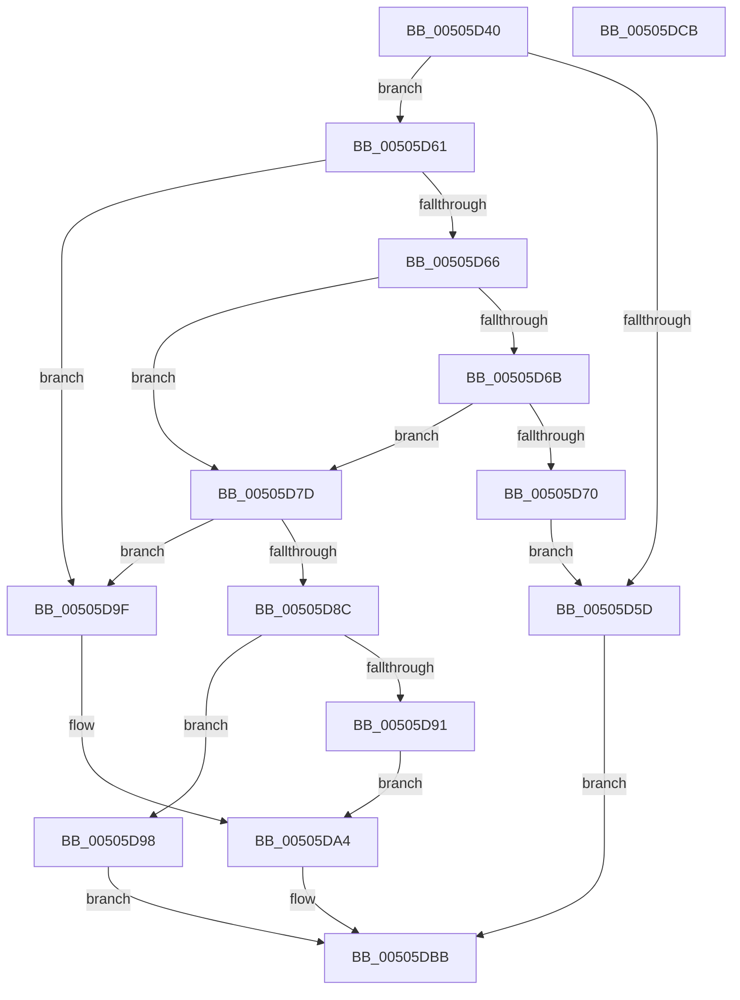

# memcpy_s

- RVA: `0x00505D40`–`0x00505DCC` (길이 `140` bytes)
- VA: `0x0000000140505D40`
- 실행 섹션: `.text`
- PDB 이름 있음: `예`; PDB Function 태그: `아니요`
- unwind 정보 RVA: `0x000794E0`
- 디코드: `46`개 명령, `140/140` bytes 표시
- 미해석 바이트: `0` (있으면 어셈블리에 `.byte`로 보존)

> 이 문서는 커널 이미지의 기계어와 PDB 기호를 분석해 생성했습니다. 4번과 5번은 함수 원형과 자료형을 바이너리 사용 방식에서 추정한 C 해석이며 원본 소스 복구 결과는 아닙니다.

## 1. Dependencies

- 직접 호출 지점: **3**; 고유 호출 대상: **3**
- 직접 호출자로 확인된 함수: **1**
- RIP 상대 이미지 참조: **0**

### Outgoing calls
- `0x00505D76` → [memcpy](../6C/memcpy_function_006C6840.md) (function, `0x006C6840`)
- `0x00505D82` → [memset](../6C/memset_function_006C6C40.md) (function, `0x006C6C40`)
- `0x00505DB4` → [EmpCheckErrataList](../49/EmpCheckErrataList_function_0049E550.md) (function, `0x0049E550`)

### Direct callers
- [IopXxxControlFile](../../page/8E/IopXxxControlFile_function_008E9AD0.md) at `0x008EABF3`

### Static image references
- 디코드된 RIP-relative 메모리 참조가 없습니다.

## 2. Other-region calls and transfers

- 다른 실행 섹션으로 향하는 call: **0**
- 별도 외부 분기/꼬리 이동을 확인하지 못했습니다.

## 3. Assembly (complete function range)

```asm
00505D40  48 89 5C 24 08                  mov qword ptr [rsp + 8], rbx
00505D45  48 89 74 24 10                  mov qword ptr [rsp + 0x10], rsi
00505D4A  57                              push rdi
00505D4B  48 83 EC 30                     sub rsp, 0x30
00505D4F  49 8B D9                        mov rbx, r9
00505D52  49 8B F0                        mov rsi, r8
00505D55  48 8B FA                        mov rdi, rdx
00505D58  4D 85 C9                        test r9, r9
00505D5B  75 04                           jne 0x140505d61
00505D5D  33 C0                           xor eax, eax
00505D5F  EB 5A                           jmp 0x140505dbb
00505D61  48 85 C9                        test rcx, rcx
00505D64  74 39                           je 0x140505d9f
00505D66  48 85 F6                        test rsi, rsi
00505D69  74 12                           je 0x140505d7d
00505D6B  48 3B FB                        cmp rdi, rbx
00505D6E  72 0D                           jb 0x140505d7d
00505D70  4C 8B C3                        mov r8, rbx
00505D73  48 8B D6                        mov rdx, rsi
00505D76  E8 C5 0A 1C 00                  call 0x1406c6840
00505D7B  EB E0                           jmp 0x140505d5d
00505D7D  4C 8B C7                        mov r8, rdi
00505D80  33 D2                           xor edx, edx
00505D82  E8 B9 0E 1C 00                  call 0x1406c6c40
00505D87  48 85 F6                        test rsi, rsi
00505D8A  74 13                           je 0x140505d9f
00505D8C  48 3B FB                        cmp rdi, rbx
00505D8F  73 07                           jae 0x140505d98
00505D91  BB 22 00 00 00                  mov ebx, 0x22
00505D96  EB 0C                           jmp 0x140505da4
00505D98  B8 16 00 00 00                  mov eax, 0x16
00505D9D  EB 1C                           jmp 0x140505dbb
00505D9F  BB 16 00 00 00                  mov ebx, 0x16
00505DA4  48 83 64 24 20 00               and qword ptr [rsp + 0x20], 0
00505DAA  45 33 C9                        xor r9d, r9d
00505DAD  45 33 C0                        xor r8d, r8d
00505DB0  33 D2                           xor edx, edx
00505DB2  33 C9                           xor ecx, ecx
00505DB4  E8 97 87 F9 FF                  call 0x14049e550
00505DB9  8B C3                           mov eax, ebx
00505DBB  48 8B 5C 24 40                  mov rbx, qword ptr [rsp + 0x40]
00505DC0  48 8B 74 24 48                  mov rsi, qword ptr [rsp + 0x48]
00505DC5  48 83 C4 30                     add rsp, 0x30
00505DC9  5F                              pop rdi
00505DCA  C3                              ret
00505DCB  CC                              int3
```

## 4. C-style interpretation (structured pseudocode)

```c
__int64 __fastcall memcpy_s(__int64 a1, __int64 a2, __int64 a3, __int64 a4)
{
    __int64 result;
    __int64 v_rsp;
    unsigned __int64 v_stack_m18;
    unsigned __int64 v_stack_p10;
    unsigned __int64 v_stack_p8;

    v_stack_p8 = v_rbx;
    v_stack_p10 = v_rsi;
    v_rsp = (v_rsp) - (48);
    if (a4 != 0) goto loc_00505D61;
loc_00505D5D:
    result = 0;
    goto loc_00505DBB;
loc_00505D61:
    if (a1 == 0) goto loc_00505D9F;
    if (a3 == 0) goto loc_00505D7D;
    if (a2 < a4) goto loc_00505D7D;
    result = memcpy(a1, a3, a4, a4);
    goto loc_00505D5D;
loc_00505D7D:
    a2 = 0;
    result = memset(a1, a2, a2, a4);
    if (a3 == 0) goto loc_00505D9F;
    if (0 >= a4) goto loc_00505D98;
    goto loc_00505DA4;
loc_00505D98:
    goto loc_00505DBB;
loc_00505D9F:
loc_00505DA4:
    a4 = 0;
    a3 = 0;
    a2 = 0;
    a1 = 0;
    result = EmpCheckErrataList(a1, a2, a3, a4);
loc_00505DBB:
    v_rsp = (v_rsp) + (48);
    return 22;
}
```

## 5. (Beta) C Style

```c
int64_t memcpy_s(int64_t Arg1, int64_t Arg2, int64_t Arg3, int64_t Arg4)
{
    int64_t result;
    int64_t local_rsp;
    uint64_t v_stack_m18;
    uint64_t v_stack_p10;
    uint64_t v_stack_p8;

    v_stack_p8 = local_rbx;
    v_stack_p10 = local_rsi;
    local_rsp = (local_rsp) - (48);
    if (Arg4 != 0) goto loc_00505D61;
loc_00505D5D:
    result = 0;
    goto loc_00505DBB;
loc_00505D61:
    if (Arg1 == 0) goto loc_00505D9F;
    if (Arg3 == 0) goto loc_00505D7D;
    if (Arg2 < Arg4) goto loc_00505D7D;
    result = memcpy(Arg1, Arg3, Arg4, Arg4);
    goto loc_00505D5D;
loc_00505D7D:
    Arg2 = 0;
    result = memset(Arg1, Arg2, Arg2, Arg4);
    if (Arg3 == 0) goto loc_00505D9F;
    if (0 >= Arg4) goto loc_00505D98;
    goto loc_00505DA4;
loc_00505D98:
    goto loc_00505DBB;
loc_00505D9F:
loc_00505DA4:
    Arg4 = 0;
    Arg3 = 0;
    Arg2 = 0;
    Arg1 = 0;
    result = EmpCheckErrataList(Arg1, Arg2, Arg3, Arg4);
loc_00505DBB:
    local_rsp = (local_rsp) + (48);
    return 22;
}
```

## 6. Execution-region graph

[열기: 2D/3D 그래프와 함수 탐색 컨트롤 패널](../../../control-panel.html?section=text&rva=0x00505D40&view=graph)

- 2D 그래프는 위에서 아래로 흐르고, 3D 그래프는 빈 공간을 드래그해 회전합니다. Shift+드래그는 이동, 휠은 확대·축소, 함수 노드 선택은 대상 보고서 이동입니다.

### Static fallback


