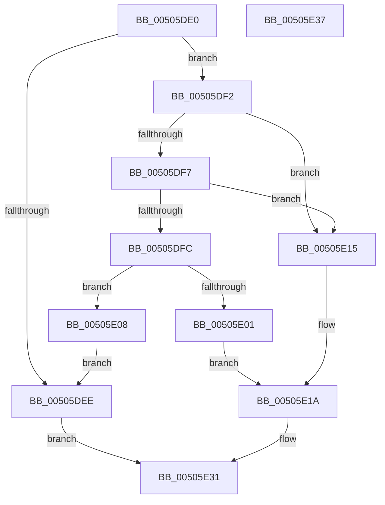

# memmove_s

- RVA: `0x00505DE0`–`0x00505E38` (길이 `88` bytes)
- VA: `0x0000000140505DE0`
- 실행 섹션: `.text`
- PDB 이름 있음: `예`; PDB Function 태그: `아니요`
- unwind 정보 RVA: `0x00064C80`
- 디코드: `31`개 명령, `88/88` bytes 표시
- 미해석 바이트: `0` (있으면 어셈블리에 `.byte`로 보존)

> 이 문서는 커널 이미지의 기계어와 PDB 기호를 분석해 생성했습니다. 4번과 5번은 함수 원형과 자료형을 바이너리 사용 방식에서 추정한 C 해석이며 원본 소스 복구 결과는 아닙니다.

## 1. Dependencies

- 직접 호출 지점: **2**; 고유 호출 대상: **2**
- 직접 호출자로 확인된 함수: **0**
- RIP 상대 이미지 참조: **0**

### Outgoing calls
- `0x00505E0E` → [memcpy](../6C/memcpy_function_006C6840.md) (function, `0x006C6840`)
- `0x00505E2A` → [EmpCheckErrataList](../49/EmpCheckErrataList_function_0049E550.md) (function, `0x0049E550`)

### Direct callers
- 이 함수 시작 RVA로 연결되는 직접 call은 확인되지 않았습니다. 간접 호출은 완전히 역산할 수 없습니다.

### Static image references
- 디코드된 RIP-relative 메모리 참조가 없습니다.

## 2. Other-region calls and transfers

- 다른 실행 섹션으로 향하는 call: **0**
- 별도 외부 분기/꼬리 이동을 확인하지 못했습니다.

## 3. Assembly (complete function range)

```asm
00505DE0  40 53                           push rbx
00505DE2  48 83 EC 30                     sub rsp, 0x30
00505DE6  49 8B C0                        mov rax, r8
00505DE9  4D 85 C9                        test r9, r9
00505DEC  75 04                           jne 0x140505df2
00505DEE  33 C0                           xor eax, eax
00505DF0  EB 3F                           jmp 0x140505e31
00505DF2  48 85 C9                        test rcx, rcx
00505DF5  74 1E                           je 0x140505e15
00505DF7  48 85 C0                        test rax, rax
00505DFA  74 19                           je 0x140505e15
00505DFC  49 3B D1                        cmp rdx, r9
00505DFF  73 07                           jae 0x140505e08
00505E01  BB 22 00 00 00                  mov ebx, 0x22
00505E06  EB 12                           jmp 0x140505e1a
00505E08  4D 8B C1                        mov r8, r9
00505E0B  48 8B D0                        mov rdx, rax
00505E0E  E8 2D 0A 1C 00                  call 0x1406c6840
00505E13  EB D9                           jmp 0x140505dee
00505E15  BB 16 00 00 00                  mov ebx, 0x16
00505E1A  48 83 64 24 20 00               and qword ptr [rsp + 0x20], 0
00505E20  45 33 C9                        xor r9d, r9d
00505E23  45 33 C0                        xor r8d, r8d
00505E26  33 D2                           xor edx, edx
00505E28  33 C9                           xor ecx, ecx
00505E2A  E8 21 87 F9 FF                  call 0x14049e550
00505E2F  8B C3                           mov eax, ebx
00505E31  48 83 C4 30                     add rsp, 0x30
00505E35  5B                              pop rbx
00505E36  C3                              ret
00505E37  CC                              int3
```

## 4. C-style interpretation (structured pseudocode)

```c
__int64 __fastcall memmove_s(__int64 a1, __int64 a2, __int64 a3, __int64 a4)
{
    __int64 result;
    __int64 v_rsp;
    unsigned __int64 v_stack_m18;

    v_rsp = (v_rsp) - (48);
    if (a4 != 0) goto loc_00505DF2;
loc_00505DEE:
    result = 0;
    goto loc_00505E31;
loc_00505DF2:
    if (a1 == 0) goto loc_00505E15;
    if (0 == 0) goto loc_00505E15;
    if (a2 >= a4) goto loc_00505E08;
    goto loc_00505E1A;
loc_00505E08:
    result = memcpy(a1, 0, a4, a4);
    goto loc_00505DEE;
loc_00505E15:
loc_00505E1A:
    a4 = 0;
    a3 = 0;
    a2 = 0;
    a1 = 0;
    result = EmpCheckErrataList(a1, a2, a3, a4);
loc_00505E31:
    v_rsp = (v_rsp) + (48);
    return 22;
}
```

## 5. (Beta) C Style

```c
int64_t memmove_s(int64_t Arg1, int64_t Arg2, int64_t Arg3, int64_t Arg4)
{
    int64_t result;
    int64_t local_rsp;
    uint64_t v_stack_m18;

    local_rsp = (local_rsp) - (48);
    if (Arg4 != 0) goto loc_00505DF2;
loc_00505DEE:
    result = 0;
    goto loc_00505E31;
loc_00505DF2:
    if (Arg1 == 0) goto loc_00505E15;
    if (0 == 0) goto loc_00505E15;
    if (Arg2 >= Arg4) goto loc_00505E08;
    goto loc_00505E1A;
loc_00505E08:
    result = memcpy(Arg1, 0, Arg4, Arg4);
    goto loc_00505DEE;
loc_00505E15:
loc_00505E1A:
    Arg4 = 0;
    Arg3 = 0;
    Arg2 = 0;
    Arg1 = 0;
    result = EmpCheckErrataList(Arg1, Arg2, Arg3, Arg4);
loc_00505E31:
    local_rsp = (local_rsp) + (48);
    return 22;
}
```

## 6. Execution-region graph

[열기: 2D/3D 그래프와 함수 탐색 컨트롤 패널](../../../control-panel.html?section=text&rva=0x00505DE0&view=graph)

- 2D 그래프는 위에서 아래로 흐르고, 3D 그래프는 빈 공간을 드래그해 회전합니다. Shift+드래그는 이동, 휠은 확대·축소, 함수 노드 선택은 대상 보고서 이동입니다.

### Static fallback


