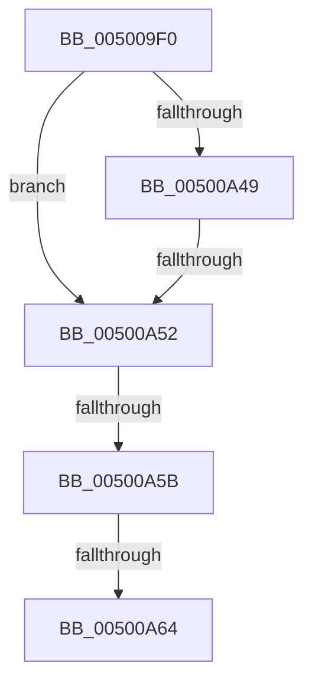

# qsort

- RVA: `0x005009F0`–`0x00500A6E` (길이 `126` bytes)
- VA: `0x00000001405009F0`
- 실행 섹션: `.text`
- PDB 이름 있음: `예`; PDB Function 태그: `아니요`
- unwind 정보 RVA: `0x000C2694`
- 디코드: `30`개 명령, `126/126` bytes 표시
- 미해석 바이트: `0` (있으면 어셈블리에 `.byte`로 보존)

> 이 문서는 커널 이미지의 기계어와 PDB 기호를 분석해 생성했습니다. 4번과 5번은 함수 원형과 자료형을 바이너리 사용 방식에서 추정한 C 해석이며 원본 소스 복구 결과는 아닙니다.

## 1. Dependencies

- 직접 호출 지점: **2**; 고유 호출 대상: **1**
- 직접 호출자로 확인된 함수: **65**
- RIP 상대 이미지 참조: **1**

### Outgoing calls
- `0x00500A2A` → [memset](../6C/memset_function_006C6C40.md) (function, `0x006C6C40`)
- `0x00500A3F` → [memset](../6C/memset_function_006C6C40.md) (function, `0x006C6C40`)

### Direct callers
- [MmSetAddressRangeModifiedEx](../23/MmSetAddressRangeModifiedEx_function_00236F20.md) at `0x00237503`
- [MiEmptyWorkingSetHelper](../24/MiEmptyWorkingSetHelper_function_00240C00.md) at `0x002410A8`
- [sub_00241476](../24/Unknown_function_00241476.md) at `0x00241960`
- [MiWalkVaRange](../24/MiWalkVaRange_function_00243BF0.md) at `0x002448FA`
- [MiReleasePtes](../24/MiReleasePtes_function_00247240.md) at `0x0024782B`
- [MiFindContiguousPagesEx](../28/MiFindContiguousPagesEx_function_0028BDE0.md) at `0x0028CDFC`
- [MiFlushSingleTbEntry](../28/MiFlushSingleTbEntry_function_0028E730.md) at `0x0028EABE`
- [sub_002901B8](../29/Unknown_function_002901B8.md) at `0x00290591`
- [sub_0029384E](../29/Unknown_function_0029384E.md) at `0x00293868`
- [MiMakePteClean](../2A/MiMakePteClean_function_002A901C.md) at `0x002A931C`
- [MiFlushTbAsNeeded](../31/MiFlushTbAsNeeded_function_00313730.md) at `0x00313BC7`
- [MiReservePtes](../31/MiReservePtes_function_00318D20.md) at `0x003194F7`
- [MiFillNoReservationCluster](../40/MiFillNoReservationCluster_function_00405B40.md) at `0x00405C6C`
- [RtlpDynamicLookasideRebalance](../41/RtlpDynamicLookasideRebalance_function_0041016C.md) at `0x00410217`
- [PpmHeteroComputeCoreParkingUtilities](../41/PpmHeteroComputeCoreParkingUtilities_function_00412AE0.md) at `0x00412CA4`
- [PpmHeteroComputeCoreParkingUtilities](../41/PpmHeteroComputeCoreParkingUtilities_function_00412AE0.md) at `0x00412CB8`
- [PpmHeteroComputeCoreParkingUtilitiesEx](../4F/PpmHeteroComputeCoreParkingUtilitiesEx_function_004F1E44.md) at `0x004F2015`
- [PpmHeteroComputeCoreParkingUtilitiesEx](../4F/PpmHeteroComputeCoreParkingUtilitiesEx_function_004F1E44.md) at `0x004F202A`
- [sub_0050BD90](Unknown_function_0050BD90.md) at `0x0050BDA3`
- [SymCryptParallelHashProcess](../52/SymCryptParallelHashProcess_function_00521BF4.md) at `0x00521D92`
- [HalpNumaAddRangeProximity](../55/HalpNumaAddRangeProximity_function_00558EC0.md) at `0x0055917D`
- [HvlStartBootLogicalProcessors](../58/HvlStartBootLogicalProcessors_function_00584E18.md) at `0x005850FC`
- [VslInitializeSecureKernelCfg](../58/VslInitializeSecureKernelCfg_function_0058E8A8.md) at `0x0058E92C`
- [IopCompactRemovePagesArray](../5A/IopCompactRemovePagesArray_function_005A1A34.md) at `0x005A1A70`
- [KiAddProcessorToCoreControlBlock](../5B/KiAddProcessorToCoreControlBlock_function_005BBECC.md) at `0x005BBF2B`
- [KiAdjustGroupConfiguration](../5B/KiAdjustGroupConfiguration_function_005BBF84.md) at `0x005BC18C`
- [KiRemoveProcessorFromCoreControlBlock](../5B/KiRemoveProcessorFromCoreControlBlock_function_005BCDFC.md) at `0x005BCE6F`
- [PpmCheckComputeHeteroResponseEx](../5D/PpmCheckComputeHeteroResponseEx_function_005DECA0.md) at `0x005DEEF3`
- [PpmCheckComputeHeteroResponseEx](../5D/PpmCheckComputeHeteroResponseEx_function_005DECA0.md) at `0x005DEF0D`
- [RtlCompareExchangePropertyStore](../5E/RtlCompareExchangePropertyStore_function_005E7F70.md) at `0x005E8141`
- [ST_STORE&lt;SM_TRAITS&gt;::StDmRegionEvict](../60/ST_STORE_SM_TRAITS_StDmRegionEvict_function_0060DF9C.md) at `0x0060E0B4`
- [AsiPopulateHashes](../66/AsiPopulateHashes_function_00662E10.md) at `0x00662ECB`
- [sub_00668991](../66/Unknown_function_00668991.md) at `0x006689B3`
- [IaapSetAecsDecompressionHuffmanTable](../66/IaapSetAecsDecompressionHuffmanTable_function_00669A28.md) at `0x00669B5A`
- [MiSortMdlFrames](../67/MiSortMdlFrames_function_006778C4.md) at `0x006778E0`
- [MiSortPageFramesRemoveDuplicates](../67/MiSortPageFramesRemoveDuplicates_function_0067A67C.md) at `0x0067A699`
- [MmKcsanGetIgnoredRangeList](../67/MmKcsanGetIgnoredRangeList_function_0067FD68.md) at `0x0067FDF5`
- [MiBuildPhysicalPageFreeChain](../68/MiBuildPhysicalPageFreeChain_function_00687C80.md) at `0x00687CFB`
- [MiCalibrateTbFlush](../69/MiCalibrateTbFlush_function_006955EC.md) at `0x00695769`
- [sub_006FA0AE](../6F/Unknown_function_006FA0AE.md) at `0x006FA19F`
- [sub_006FA0AE](../6F/Unknown_function_006FA0AE.md) at `0x006FA1B9`
- [EtwpAllocatePhysicalPages](../../page/7B/EtwpAllocatePhysicalPages_function_007B57DC.md) at `0x007B590D`
- [sub_007C87A4](../../page/7C/Unknown_function_007C87A4.md) at `0x007C89D9`
- [SLUpdateLicenseDataInternal](../../page/7C/SLUpdateLicenseDataInternal_function_007C9C04.md) at `0x007CA33F`
- [CmpLoadLayerVersions](../../page/7E/CmpLoadLayerVersions_function_007E6EC4.md) at `0x007E704F`
- [MmFreeBootRegistry](../../page/7F/MmFreeBootRegistry_function_007F7C50.md) at `0x007F7C98`
- [MiProcessPatchImageCfg](../../page/80/MiProcessPatchImageCfg_function_00806F9C.md) at `0x00807070`
- [RtlpSortAndValidateRelocations](../../page/94/RtlpSortAndValidateRelocations_function_009439BC.md) at `0x00943A02`
- [sub_009AA147](../../page/9A/Unknown_function_009AA147.md) at `0x009AA1A6`
- [EtwpUpdateDisallowedGuids](../../page/9E/EtwpUpdateDisallowedGuids_function_009EA8FC.md) at `0x009EA9AE`
- [PspBuildCreateProcessContext](../../page/9E/PspBuildCreateProcessContext_function_009ED6E0.md) at `0x009EEF3D`
- [MiProcessCrcList](../../page/9F/MiProcessCrcList_function_009F6F94.md) at `0x009F700A`
- [MiProcessCrcList](../../page/9F/MiProcessCrcList_function_009F6F94.md) at `0x009F73B2`
- [MiProcessCrcList](../../page/9F/MiProcessCrcList_function_009F6F94.md) at `0x009F74E2`
- [PipSortDeviceObjectList](../../page/A0/PipSortDeviceObjectList_function_00A06EDC.md) at `0x00A06F64`
- [CmpSortedValueEnumStackEntryStart](../../page/A3/CmpSortedValueEnumStackEntryStart_function_00A31110.md) at `0x00A31245`
- [RtlpFcUpdateUsageTriggers](../../page/A4/RtlpFcUpdateUsageTriggers_function_00A44BB0.md) at `0x00A44BEF`
- [RtlpFcUpdateFeatureConfiguration](../../page/AB/RtlpFcUpdateFeatureConfiguration_function_00ABD7A0.md) at `0x00ABD7E1`
- [IopRearrangeReqList](../../page/AB/IopRearrangeReqList_function_00ABDA24.md) at `0x00ABDA69`
- [AdtpBuildObjectTypeStrings](../../page/AD/AdtpBuildObjectTypeStrings_function_00AD0B38.md) at `0x00AD0BA7`
- [sub_00B38CDE](../../page/B3/Unknown_function_00B38CDE.md) at `0x00B38E73`
- [HalpNumaInitializeStaticConfiguration](../../init/C2/HalpNumaInitializeStaticConfiguration_function_00C220D8.md) at `0x00C224A8`
- [HalpNumaInitializeStaticConfiguration](../../init/C2/HalpNumaInitializeStaticConfiguration_function_00C220D8.md) at `0x00C224C5`
- [HalpNumaParseHmat](../../init/C2/HalpNumaParseHmat_function_00C22980.md) at `0x00C22CF8`
- [HalpChannelInitializeStaticConfiguration](../../init/C2/HalpChannelInitializeStaticConfiguration_function_00C25318.md) at `0x00C253D3`
- [HalpChannelInitializeStaticConfiguration](../../init/C2/HalpChannelInitializeStaticConfiguration_function_00C25318.md) at `0x00C2557D`
- [HalpChannelInitializeStaticConfiguration](../../init/C2/HalpChannelInitializeStaticConfiguration_function_00C25318.md) at `0x00C255A5`
- [HalpChannelInitializeStaticConfiguration](../../init/C2/HalpChannelInitializeStaticConfiguration_function_00C25318.md) at `0x00C25682`
- [KiComputeNumaCosts](../../init/C3/KiComputeNumaCosts_function_00C37AD4.md) at `0x00C38041`
- [KiPerformAutomaticGroupConfiguration](../../init/C3/KiPerformAutomaticGroupConfiguration_function_00C38BDC.md) at `0x00C38CCF`
- [PpmInitPolicyConfiguration](../../init/C4/PpmInitPolicyConfiguration_function_00C40708.md) at `0x00C408B7`
- [MiInitializeNumaGraph](../../init/C5/MiInitializeNumaGraph_function_00C5E310.md) at `0x00C5E412`
- [MiSwitchToPfns](../../init/C6/MiSwitchToPfns_function_00C62C90.md) at `0x00C62DA2`
- [MiAssignTopLevelRanges](../../init/C6/MiAssignTopLevelRanges_function_00C65560.md) at `0x00C65645`
- [MiAssignTopLevelRanges](../../init/C6/MiAssignTopLevelRanges_function_00C65560.md) at `0x00C6577E`
- [IntpAllocateProcessorContext](../../init/C6/IntpAllocateProcessorContext_function_00C6D844.md) at `0x00C6D8DE`

### Static image references
- `0x005009FF` → RVA `0x00E0A740` (`.data`; read)

## 2. Other-region calls and transfers

- 다른 실행 섹션으로 향하는 call: **0**
- call이 아닌 외부 분기/꼬리 이동: **4**
  - `0x00500A4C` → [sub_00500D66](Unknown_function_00500D66.md) (`tail-transfer`)
  - `0x00500A55` → [sub_00500D66](Unknown_function_00500D66.md) (`tail-transfer`)
  - `0x00500A5E` → [sub_00500D66](Unknown_function_00500D66.md) (`tail-transfer`)
  - `0x00500A68` → [sub_00500D9E](Unknown_function_00500D9E.md) (`tail-transfer`)

## 3. Assembly (complete function range)

```asm
005009F0  41 54                           push r12
005009F2  41 55                           push r13
005009F4  41 56                           push r14
005009F6  41 57                           push r15
005009F8  48 81 EC 58 04 00 00            sub rsp, 0x458
005009FF  48 8B 05 3A 9D 90 00            mov rax, qword ptr [rip + 0x909d3a]
00500A06  48 33 C4                        xor rax, rsp
00500A09  48 89 84 24 20 04 00 00         mov qword ptr [rsp + 0x420], rax
00500A11  4D 8B F0                        mov r14, r8
00500A14  4C 8B FA                        mov r15, rdx
00500A17  4C 8B E9                        mov r13, rcx
00500A1A  33 D2                           xor edx, edx
00500A1C  41 B8 F0 01 00 00               mov r8d, 0x1f0
00500A22  48 8D 4C 24 40                  lea rcx, [rsp + 0x40]
00500A27  4D 8B E1                        mov r12, r9
00500A2A  E8 11 62 1C 00                  call 0x1406c6c40
00500A2F  33 D2                           xor edx, edx
00500A31  48 8D 8C 24 30 02 00 00         lea rcx, [rsp + 0x230]
00500A39  41 B8 F0 01 00 00               mov r8d, 0x1f0
00500A3F  E8 FC 61 1C 00                  call 0x1406c6c40
00500A44  4D 85 ED                        test r13, r13
00500A47  75 09                           jne 0x140500a52
00500A49  4D 85 FF                        test r15, r15
00500A4C  0F 85 14 03 00 00               jne 0x140500d66
00500A52  4D 85 F6                        test r14, r14
00500A55  0F 84 0B 03 00 00               je 0x140500d66
00500A5B  4D 85 E4                        test r12, r12
00500A5E  0F 84 02 03 00 00               je 0x140500d66
00500A64  49 83 FF 02                     cmp r15, 2
00500A68  0F 82 30 03 00 00               jb 0x140500d9e
```

## 4. C-style interpretation (structured pseudocode)

```c
__int64 __fastcall qsort(__int64 a1, __int64 a2, __int64 a3, __int64 a4)
{
    __int64 result;
    __int64 v_rsp;
    unsigned __int64 v_stack_m248;
    unsigned __int64 v_stack_m438;
    unsigned __int64 v_stack_m58;

    v_rsp = (v_rsp) - (0x458ULL);
    result = (*(unsigned __int64 *)(v_rip + 9477434)) ^ (v_rsp);
    v_stack_m58 = result;
    a2 = 0;
    result = memset(v_stack_m438, a2, 496, a4);
    a2 = 0;
    result = memset(v_stack_m248, a2, 496, a4);
    if (a1 != 0) goto loc_00500A52;
loc_00500A52:
}
```

## 5. (Beta) C Style

```c
int64_t qsort(int64_t Arg1, int64_t Arg2, int64_t Arg3, int64_t Arg4)
{
    int64_t result;
    int64_t local_rsp;
    uint64_t v_stack_m248;
    uint64_t v_stack_m438;
    uint64_t v_stack_m58;

    local_rsp = (local_rsp) - (0x458ULL);
    result = (*(uint64_t *)(v_rip + 0x909D3A)) ^ (local_rsp);
    v_stack_m58 = result;
    Arg2 = 0;
    result = memset(v_stack_m438, Arg2, 496, Arg4);
    Arg2 = 0;
    result = memset(v_stack_m248, Arg2, 496, Arg4);
    if (Arg1 != 0) goto loc_00500A52;
loc_00500A52:
}
```

## 6. Execution-region graph

[열기: 2D/3D 그래프와 함수 탐색 컨트롤 패널](../../../control-panel.html?section=text&rva=0x005009F0&view=graph)

- 2D 그래프는 위에서 아래로 흐르고, 3D 그래프는 빈 공간을 드래그해 회전합니다. Shift+드래그는 이동, 휠은 확대·축소, 함수 노드 선택은 대상 보고서 이동입니다.

### Static fallback


