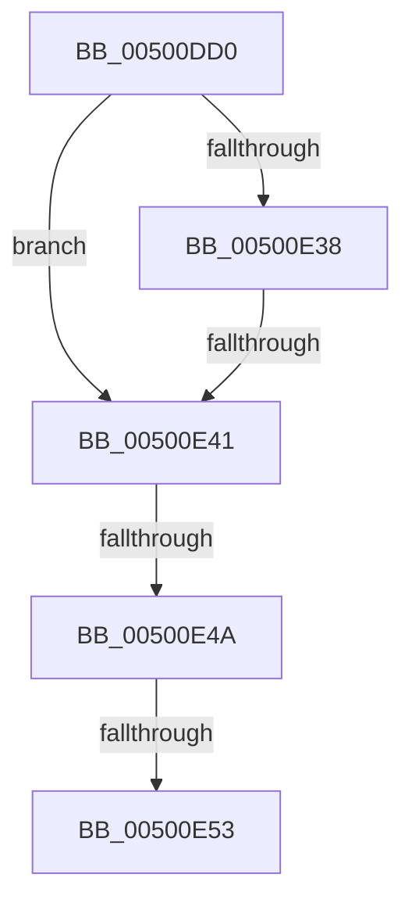

# qsort_s

- RVA: `0x00500DD0`–`0x00500E5D` (길이 `141` bytes)
- VA: `0x0000000140500DD0`
- 실행 섹션: `.text`
- PDB 이름 있음: `예`; PDB Function 태그: `아니요`
- unwind 정보 RVA: `0x000C2710`
- 디코드: `33`개 명령, `141/141` bytes 표시
- 미해석 바이트: `0` (있으면 어셈블리에 `.byte`로 보존)

> 이 문서는 커널 이미지의 기계어와 PDB 기호를 분석해 생성했습니다. 4번과 5번은 함수 원형과 자료형을 바이너리 사용 방식에서 추정한 C 해석이며 원본 소스 복구 결과는 아닙니다.

## 1. Dependencies

- 직접 호출 지점: **2**; 고유 호출 대상: **1**
- 직접 호출자로 확인된 함수: **3**
- RIP 상대 이미지 참조: **1**

### Outgoing calls
- `0x00500E19` → [memset](../6C/memset_function_006C6C40.md) (function, `0x006C6C40`)
- `0x00500E2E` → [memset](../6C/memset_function_006C6C40.md) (function, `0x006C6C40`)

### Direct callers
- [ST_STORE&lt;SM_TRAITS&gt;::StDmCombineBufferAddEntry](../4E/ST_STORE_SM_TRAITS_StDmCombineBufferAddEntry_function_004EB420.md) at `0x004EB810`
- [WheaPersistBadPageToBcd](../65/WheaPersistBadPageToBcd_function_0065F3D0.md) at `0x0065F50D`
- [WheapFormatBadPageList](../65/WheapFormatBadPageList_function_0065F7FC.md) at `0x0065F832`

### Static image references
- `0x00500DE1` → RVA `0x00E0A740` (`.data`; read)

## 2. Other-region calls and transfers

- 다른 실행 섹션으로 향하는 call: **0**
- call이 아닌 외부 분기/꼬리 이동: **4**
  - `0x00500E3B` → [sub_0050118E](Unknown_function_0050118E.md) (`tail-transfer`)
  - `0x00500E44` → [sub_0050118E](Unknown_function_0050118E.md) (`tail-transfer`)
  - `0x00500E4D` → [sub_0050118E](Unknown_function_0050118E.md) (`tail-transfer`)
  - `0x00500E57` → [sub_005011BE](Unknown_function_005011BE.md) (`tail-transfer`)

## 3. Assembly (complete function range)

```asm
00500DD0  40 56                           push rsi
00500DD2  41 54                           push r12
00500DD4  41 55                           push r13
00500DD6  41 56                           push r14
00500DD8  41 57                           push r15
00500DDA  48 81 EC 50 04 00 00            sub rsp, 0x450
00500DE1  48 8B 05 58 99 90 00            mov rax, qword ptr [rip + 0x909958]
00500DE8  48 33 C4                        xor rax, rsp
00500DEB  48 89 84 24 20 04 00 00         mov qword ptr [rsp + 0x420], rax
00500DF3  4C 8B AC 24 A0 04 00 00         mov r13, qword ptr [rsp + 0x4a0]
00500DFB  4D 8B F0                        mov r14, r8
00500DFE  4C 8B FA                        mov r15, rdx
00500E01  48 89 4C 24 38                  mov qword ptr [rsp + 0x38], rcx
00500E06  48 8B F1                        mov rsi, rcx
00500E09  33 D2                           xor edx, edx
00500E0B  41 B8 F0 01 00 00               mov r8d, 0x1f0
00500E11  48 8D 4C 24 40                  lea rcx, [rsp + 0x40]
00500E16  4D 8B E1                        mov r12, r9
00500E19  E8 22 5E 1C 00                  call 0x1406c6c40
00500E1E  33 D2                           xor edx, edx
00500E20  48 8D 8C 24 30 02 00 00         lea rcx, [rsp + 0x230]
00500E28  41 B8 F0 01 00 00               mov r8d, 0x1f0
00500E2E  E8 0D 5E 1C 00                  call 0x1406c6c40
00500E33  48 85 F6                        test rsi, rsi
00500E36  75 09                           jne 0x140500e41
00500E38  4D 85 FF                        test r15, r15
00500E3B  0F 85 4D 03 00 00               jne 0x14050118e
00500E41  4D 85 F6                        test r14, r14
00500E44  0F 84 44 03 00 00               je 0x14050118e
00500E4A  4D 85 E4                        test r12, r12
00500E4D  0F 84 3B 03 00 00               je 0x14050118e
00500E53  49 83 FF 02                     cmp r15, 2
00500E57  0F 82 61 03 00 00               jb 0x1405011be
```

## 4. C-style interpretation (structured pseudocode)

```c
__int64 __fastcall qsort_s(__int64 a1, __int64 a2, __int64 a3, __int64 a4, __int64 a5)
{
    __int64 result;
    __int64 v_rsp;
    unsigned __int64 v_stack_m248;
    unsigned __int64 v_stack_m438;
    unsigned __int64 v_stack_m440;
    unsigned __int64 v_stack_m58;

    v_rsp = (v_rsp) - (0x450ULL);
    result = (*(unsigned __int64 *)(v_rip + 9476440)) ^ (v_rsp);
    v_stack_m58 = result;
    v_stack_m440 = a1;
    a2 = 0;
    result = memset(v_stack_m438, a2, 496, a4);
    a2 = 0;
    result = memset(v_stack_m248, a2, 496, a4);
    if (a1 != 0) goto loc_00500E41;
loc_00500E41:
}
```

## 5. (Beta) C Style

```c
int64_t qsort_s(int64_t Arg1, int64_t Arg2, int64_t Arg3, int64_t Arg4, int64_t Arg5)
{
    int64_t result;
    int64_t local_rsp;
    uint64_t v_stack_m248;
    uint64_t v_stack_m438;
    uint64_t v_stack_m440;
    uint64_t v_stack_m58;

    local_rsp = (local_rsp) - (0x450ULL);
    result = (*(uint64_t *)(v_rip + 0x909958)) ^ (local_rsp);
    v_stack_m58 = result;
    v_stack_m440 = Arg1;
    Arg2 = 0;
    result = memset(v_stack_m438, Arg2, 496, Arg4);
    Arg2 = 0;
    result = memset(v_stack_m248, Arg2, 496, Arg4);
    if (Arg1 != 0) goto loc_00500E41;
loc_00500E41:
}
```

## 6. Execution-region graph

[열기: 2D/3D 그래프와 함수 탐색 컨트롤 패널](../../../control-panel.html?section=text&rva=0x00500DD0&view=graph)

- 2D 그래프는 위에서 아래로 흐르고, 3D 그래프는 빈 공간을 드래그해 회전합니다. Shift+드래그는 이동, 휠은 확대·축소, 함수 노드 선택은 대상 보고서 이동입니다.

### Static fallback


