# raise_exc_ex

- RVA: `0x00504620`–`0x00504930` (길이 `784` bytes)
- VA: `0x0000000140504620`
- 실행 섹션: `.text`
- PDB 이름 있음: `예`; PDB Function 태그: `아니요`
- unwind 정보 RVA: `0x000C2864`
- 디코드: `230`개 명령, `784/784` bytes 표시
- 미해석 바이트: `0` (있으면 어셈블리에 `.byte`로 보존)

> 이 문서는 커널 이미지의 기계어와 PDB 기호를 분석해 생성했습니다. 4번과 5번은 함수 원형과 자료형을 바이너리 사용 방식에서 추정한 C 해석이며 원본 소스 복구 결과는 아닙니다.

## 1. Dependencies

- 직접 호출 지점: **4**; 고유 호출 대상: **4**
- 직접 호출자로 확인된 함수: **2**
- RIP 상대 이미지 참조: **2**

### Outgoing calls
- `0x0050471A` → [statfp](statfp_function_00504A70.md) (function, `0x00504A70`)
- `0x005047FF` → [clrfp](clrfp_function_00504980.md) (function, `0x00504980`)
- `0x00504860` → [RtlRaiseException](../5E/RtlRaiseException_function_005E6B00.md) (function, `0x005E6B00`)
- `0x00504913` → [_security_check_cookie](../6A/_security_check_cookie_function_006AC640.md) (function, `0x006AC640`)

### Direct callers
- [raise_exc](raise_exc_function_005045E0.md) at `0x00504600`
- [raise_excf](raise_excf_function_00504940.md) at `0x00504960`

### Static image references
- `0x00504633` → RVA `0x00E0A740` (`.data`; read)
- `0x00504810` → RVA `0x00504510` (`RaiseException`; read)

## 2. Other-region calls and transfers

- 다른 실행 섹션으로 향하는 call: **0**
- 별도 외부 분기/꼬리 이동을 확인하지 못했습니다.

## 3. Assembly (complete function range)

```asm
00504620  48 89 5C 24 18                  mov qword ptr [rsp + 0x18], rbx
00504625  55                              push rbp
00504626  56                              push rsi
00504627  57                              push rdi
00504628  41 56                           push r14
0050462A  41 57                           push r15
0050462C  48 81 EC D0 00 00 00            sub rsp, 0xd0
00504633  48 8B 05 06 61 90 00            mov rax, qword ptr [rip + 0x906106]
0050463A  48 33 C4                        xor rax, rsp
0050463D  48 89 84 24 C0 00 00 00         mov qword ptr [rsp + 0xc0], rax
00504645  4C 8B B4 24 28 01 00 00         mov r14, qword ptr [rsp + 0x128]
0050464D  45 33 FF                        xor r15d, r15d
00504650  4C 89 79 04                     mov qword ptr [rcx + 4], r15
00504654  41 8B F1                        mov esi, r9d
00504657  44 89 79 0C                     mov dword ptr [rcx + 0xc], r15d
0050465B  48 8B FA                        mov rdi, rdx
0050465E  48 8B D9                        mov rbx, rcx
00504661  41 8B EF                        mov ebp, r15d
00504664  41 F6 C0 10                     test r8b, 0x10
00504668  74 09                           je 0x140504673
0050466A  83 49 04 01                     or dword ptr [rcx + 4], 1
0050466E  BD 8F 00 00 C0                  mov ebp, 0xc000008f
00504673  41 F6 C0 02                     test r8b, 2
00504677  74 09                           je 0x140504682
00504679  83 49 04 02                     or dword ptr [rcx + 4], 2
0050467D  BD 93 00 00 C0                  mov ebp, 0xc0000093
00504682  41 F6 C0 01                     test r8b, 1
00504686  74 09                           je 0x140504691
00504688  83 49 04 04                     or dword ptr [rcx + 4], 4
0050468C  BD 91 00 00 C0                  mov ebp, 0xc0000091
00504691  41 F6 C0 04                     test r8b, 4
00504695  74 09                           je 0x1405046a0
00504697  83 49 04 08                     or dword ptr [rcx + 4], 8
0050469B  BD 8E 00 00 C0                  mov ebp, 0xc000008e
005046A0  41 F6 C0 08                     test r8b, 8
005046A4  74 09                           je 0x1405046af
005046A6  83 49 04 10                     or dword ptr [rcx + 4], 0x10
005046AA  BD 90 00 00 C0                  mov ebp, 0xc0000090
005046AF  48 8B 0A                        mov rcx, qword ptr [rdx]
005046B2  48 C1 E9 07                     shr rcx, 7
005046B6  C1 E1 04                        shl ecx, 4
005046B9  F7 D1                           not ecx
005046BB  41 33 CF                        xor ecx, r15d
005046BE  83 E1 10                        and ecx, 0x10
005046C1  41 33 CF                        xor ecx, r15d
005046C4  89 4B 08                        mov dword ptr [rbx + 8], ecx
005046C7  48 8B 02                        mov rax, qword ptr [rdx]
005046CA  48 C1 E8 09                     shr rax, 9
005046CE  C1 E0 03                        shl eax, 3
005046D1  F7 D0                           not eax
005046D3  33 C1                           xor eax, ecx
005046D5  83 E0 08                        and eax, 8
005046D8  33 C1                           xor eax, ecx
005046DA  89 43 08                        mov dword ptr [rbx + 8], eax
005046DD  48 8B 12                        mov rdx, qword ptr [rdx]
005046E0  48 C1 EA 0A                     shr rdx, 0xa
005046E4  C1 E2 02                        shl edx, 2
005046E7  F7 D2                           not edx
005046E9  33 D0                           xor edx, eax
005046EB  83 E2 04                        and edx, 4
005046EE  33 D0                           xor edx, eax
005046F0  89 53 08                        mov dword ptr [rbx + 8], edx
005046F3  48 8B 0F                        mov rcx, qword ptr [rdi]
005046F6  48 C1 E9 0B                     shr rcx, 0xb
005046FA  03 C9                           add ecx, ecx
005046FC  F7 D1                           not ecx
005046FE  33 CA                           xor ecx, edx
00504700  83 E1 02                        and ecx, 2
00504703  33 CA                           xor ecx, edx
00504705  89 4B 08                        mov dword ptr [rbx + 8], ecx
00504708  8B 07                           mov eax, dword ptr [rdi]
0050470A  48 C1 E8 0C                     shr rax, 0xc
0050470E  F7 D0                           not eax
00504710  33 C1                           xor eax, ecx
00504712  83 E0 01                        and eax, 1
00504715  33 C1                           xor eax, ecx
00504717  89 43 08                        mov dword ptr [rbx + 8], eax
0050471A  E8 51 03 00 00                  call 0x140504a70
0050471F  A8 01                           test al, 1
00504721  74 04                           je 0x140504727
00504723  83 4B 0C 10                     or dword ptr [rbx + 0xc], 0x10
00504727  A8 04                           test al, 4
00504729  74 04                           je 0x14050472f
0050472B  83 4B 0C 08                     or dword ptr [rbx + 0xc], 8
0050472F  A8 08                           test al, 8
00504731  74 04                           je 0x140504737
00504733  83 4B 0C 04                     or dword ptr [rbx + 0xc], 4
00504737  A8 10                           test al, 0x10
00504739  74 04                           je 0x14050473f
0050473B  83 4B 0C 02                     or dword ptr [rbx + 0xc], 2
0050473F  A8 20                           test al, 0x20
00504741  74 04                           je 0x140504747
00504743  83 4B 0C 01                     or dword ptr [rbx + 0xc], 1
00504747  8B 07                           mov eax, dword ptr [rdi]
00504749  25 00 60 00 00                  and eax, 0x6000
0050474E  74 35                           je 0x140504785
00504750  48 3D 00 20 00 00               cmp rax, 0x2000
00504756  74 21                           je 0x140504779
00504758  48 3D 00 40 00 00               cmp rax, 0x4000
0050475E  74 0D                           je 0x14050476d
00504760  48 3D 00 60 00 00               cmp rax, 0x6000
00504766  75 20                           jne 0x140504788
00504768  83 0B 03                        or dword ptr [rbx], 3
0050476B  EB 1B                           jmp 0x140504788
0050476D  8B 03                           mov eax, dword ptr [rbx]
0050476F  83 E0 FE                        and eax, 0xfffffffe
00504772  83 C8 02                        or eax, 2
00504775  89 03                           mov dword ptr [rbx], eax
00504777  EB 0F                           jmp 0x140504788
00504779  8B 03                           mov eax, dword ptr [rbx]
0050477B  83 E0 FD                        and eax, 0xfffffffd
0050477E  83 C8 01                        or eax, 1
00504781  89 03                           mov dword ptr [rbx], eax
00504783  EB 03                           jmp 0x140504788
00504785  83 23 FC                        and dword ptr [rbx], 0xfffffffc
00504788  8B 03                           mov eax, dword ptr [rbx]
0050478A  C1 E6 05                        shl esi, 5
0050478D  33 F0                           xor esi, eax
0050478F  81 E6 E0 FF 01 00               and esi, 0x1ffe0
00504795  33 F0                           xor esi, eax
00504797  89 33                           mov dword ptr [rbx], esi
00504799  8B 43 20                        mov eax, dword ptr [rbx + 0x20]
0050479C  8B B4 24 30 01 00 00            mov esi, dword ptr [rsp + 0x130]
005047A3  83 C8 01                        or eax, 1
005047A6  85 F6                           test esi, esi
005047A8  74 27                           je 0x1405047d1
005047AA  83 E0 E1                        and eax, 0xffffffe1
005047AD  89 43 20                        mov dword ptr [rbx + 0x20], eax
005047B0  48 8B 84 24 20 01 00 00         mov rax, qword ptr [rsp + 0x120]
005047B8  8B 08                           mov ecx, dword ptr [rax]
005047BA  89 4B 10                        mov dword ptr [rbx + 0x10], ecx
005047BD  8B 43 60                        mov eax, dword ptr [rbx + 0x60]
005047C0  83 C8 01                        or eax, 1
005047C3  83 E0 E1                        and eax, 0xffffffe1
005047C6  89 43 60                        mov dword ptr [rbx + 0x60], eax
005047C9  41 8B 06                        mov eax, dword ptr [r14]
005047CC  89 43 50                        mov dword ptr [rbx + 0x50], eax
005047CF  EB 2E                           jmp 0x1405047ff
005047D1  83 E0 E3                        and eax, 0xffffffe3
005047D4  83 C8 02                        or eax, 2
005047D7  89 43 20                        mov dword ptr [rbx + 0x20], eax
005047DA  48 8B 84 24 20 01 00 00         mov rax, qword ptr [rsp + 0x120]
005047E2  48 8B 08                        mov rcx, qword ptr [rax]
005047E5  48 89 4B 10                     mov qword ptr [rbx + 0x10], rcx
005047E9  8B 43 60                        mov eax, dword ptr [rbx + 0x60]
005047EC  83 C8 01                        or eax, 1
005047EF  83 E0 E3                        and eax, 0xffffffe3
005047F2  83 C8 02                        or eax, 2
005047F5  89 43 60                        mov dword ptr [rbx + 0x60], eax
005047F8  49 8B 06                        mov rax, qword ptr [r14]
005047FB  48 89 43 50                     mov qword ptr [rbx + 0x50], rax
005047FF  E8 7C 01 00 00                  call 0x140504980
00504804  0F 57 C0                        xorps xmm0, xmm0
00504807  48 C7 44 24 38 01 00 00 00      mov qword ptr [rsp + 0x38], 1
00504810  48 8D 05 F9 FC FF FF            lea rax, [rip - 0x307]
00504817  89 6C 24 20                     mov dword ptr [rsp + 0x20], ebp
0050481B  48 8D 4C 24 20                  lea rcx, [rsp + 0x20]
00504820  48 89 44 24 30                  mov qword ptr [rsp + 0x30], rax
00504825  0F 11 44 24 48                  movups xmmword ptr [rsp + 0x48], xmm0
0050482A  44 89 7C 24 24                  mov dword ptr [rsp + 0x24], r15d
0050482F  0F 11 44 24 58                  movups xmmword ptr [rsp + 0x58], xmm0
00504834  4C 89 7C 24 28                  mov qword ptr [rsp + 0x28], r15
00504839  0F 11 44 24 68                  movups xmmword ptr [rsp + 0x68], xmm0
0050483E  48 89 5C 24 40                  mov qword ptr [rsp + 0x40], rbx
00504843  0F 11 44 24 78                  movups xmmword ptr [rsp + 0x78], xmm0
00504848  0F 11 84 24 88 00 00 00         movups xmmword ptr [rsp + 0x88], xmm0
00504850  0F 11 84 24 98 00 00 00         movups xmmword ptr [rsp + 0x98], xmm0
00504858  0F 11 84 24 A8 00 00 00         movups xmmword ptr [rsp + 0xa8], xmm0
00504860  E8 9B 22 0E 00                  call 0x1405e6b00
00504865  8B 43 08                        mov eax, dword ptr [rbx + 8]
00504868  A8 10                           test al, 0x10
0050486A  74 07                           je 0x140504873
0050486C  48 81 27 7F FF FF FF            and qword ptr [rdi], 0xffffffffffffff7f
00504873  8B 43 08                        mov eax, dword ptr [rbx + 8]
00504876  A8 08                           test al, 8
00504878  74 07                           je 0x140504881
0050487A  48 81 27 FF FD FF FF            and qword ptr [rdi], 0xfffffffffffffdff
00504881  8B 43 08                        mov eax, dword ptr [rbx + 8]
00504884  A8 04                           test al, 4
00504886  74 07                           je 0x14050488f
00504888  48 81 27 FF FB FF FF            and qword ptr [rdi], 0xfffffffffffffbff
0050488F  8B 43 08                        mov eax, dword ptr [rbx + 8]
00504892  A8 02                           test al, 2
00504894  74 07                           je 0x14050489d
00504896  48 81 27 FF F7 FF FF            and qword ptr [rdi], 0xfffffffffffff7ff
0050489D  8B 43 08                        mov eax, dword ptr [rbx + 8]
005048A0  A8 01                           test al, 1
005048A2  74 07                           je 0x1405048ab
005048A4  48 81 27 FF EF FF FF            and qword ptr [rdi], 0xffffffffffffefff
005048AB  8B 03                           mov eax, dword ptr [rbx]
005048AD  83 E0 03                        and eax, 3
005048B0  74 3C                           je 0x1405048ee
005048B2  83 E8 01                        sub eax, 1
005048B5  74 25                           je 0x1405048dc
005048B7  83 E8 01                        sub eax, 1
005048BA  74 0E                           je 0x1405048ca
005048BC  83 F8 01                        cmp eax, 1
005048BF  75 34                           jne 0x1405048f5
005048C1  48 81 0F 00 60 00 00            or qword ptr [rdi], 0x6000
005048C8  EB 2B                           jmp 0x1405048f5
005048CA  48 8B 07                        mov rax, qword ptr [rdi]
005048CD  48 0F BA F0 0D                  btr rax, 0xd
005048D2  48 0F BA E8 0E                  bts rax, 0xe
005048D7  48 89 07                        mov qword ptr [rdi], rax
005048DA  EB 19                           jmp 0x1405048f5
005048DC  48 8B 07                        mov rax, qword ptr [rdi]
005048DF  48 0F BA F0 0E                  btr rax, 0xe
005048E4  48 0F BA E8 0D                  bts rax, 0xd
005048E9  48 89 07                        mov qword ptr [rdi], rax
005048EC  EB 07                           jmp 0x1405048f5
005048EE  48 81 27 FF 9F FF FF            and qword ptr [rdi], 0xffffffffffff9fff
005048F5  85 F6                           test esi, esi
005048F7  74 08                           je 0x140504901
005048F9  8B 43 50                        mov eax, dword ptr [rbx + 0x50]
005048FC  41 89 06                        mov dword ptr [r14], eax
005048FF  EB 07                           jmp 0x140504908
00504901  48 8B 43 50                     mov rax, qword ptr [rbx + 0x50]
00504905  49 89 06                        mov qword ptr [r14], rax
00504908  48 8B 8C 24 C0 00 00 00         mov rcx, qword ptr [rsp + 0xc0]
00504910  48 33 CC                        xor rcx, rsp
00504913  E8 28 7D 1A 00                  call 0x1406ac640
00504918  48 8B 9C 24 10 01 00 00         mov rbx, qword ptr [rsp + 0x110]
00504920  48 81 C4 D0 00 00 00            add rsp, 0xd0
00504927  41 5F                           pop r15
00504929  41 5E                           pop r14
0050492B  5F                              pop rdi
0050492C  5E                              pop rsi
0050492D  5D                              pop rbp
0050492E  C3                              ret
0050492F  CC                              int3
```

## 4. C-style interpretation (structured pseudocode)

```c
__int64 __fastcall raise_exc_ex(__int64 a1, __int64 a2, unsigned __int8 a3, int a4, __int64 a5, __int64 a6, unsigned int a7)
{
    __int64 result;
    __int64 v_r15;
    __int64 v_rbp;
    __int64 v_rsi;
    __int64 v_rsp;
    unsigned __int64 v_stack_m38;
    unsigned __int64 v_stack_m50;
    unsigned __int64 v_stack_m60;
    unsigned __int64 v_stack_m70;
    unsigned __int64 v_stack_m80;
    unsigned __int64 v_stack_m90;
    unsigned __int64 v_stack_mA0;
    unsigned __int64 v_stack_mB0;
    unsigned __int64 v_stack_mB8;
    unsigned __int64 v_stack_mC0;
    unsigned __int64 v_stack_mC8;
    unsigned __int64 v_stack_mD0;
    unsigned int v_stack_mD4;
    unsigned int v_stack_mD8;
    unsigned __int64 v_stack_p18;

    v_stack_p18 = v_rbx;
    v_rsp = (v_rsp) - (208);
    result = (*(unsigned __int64 *)(v_rip + 9462022)) ^ (v_rsp);
    v_stack_m38 = result;
    v_r15 = 0;
    *(unsigned __int64 *)(a1 + 4) = 0;
    *(unsigned int *)(a1 + 12) = 0;
    v_rbp = 0;
    if (((a3) & (16)) != 0) {
        v_rbp = 0xC000008FULL;
    }
    if (((a3) & (2)) != 0) {
        v_rbp = 0xC0000093ULL;
    }
    if (((a3) & (1)) != 0) {
        v_rbp = 0xC0000091ULL;
    }
    if (((a3) & (4)) != 0) {
        v_rbp = 0xC000008EULL;
    }
    if (((a3) & (8)) != 0) {
        v_rbp = 0xC0000090ULL;
    }
    a1 = (*(unsigned __int64 *)(a2)) >> (7);
    a1 = (unsigned int)((a1) << (4));
    a1 = (unsigned int)(~(a1));
    a1 = (unsigned int)((a1) ^ (0));
    a1 = (unsigned int)((a1) & (16));
    a1 = (unsigned int)((a1) ^ (0));
    *(unsigned int *)(a1 + 8) = (unsigned int)(a1);
    result = (*(unsigned __int64 *)(a2)) >> (9);
    result = (unsigned int)((result) << (3));
    result = (unsigned int)(~(result));
    result = (unsigned int)((result) ^ ((unsigned int)(a1)));
    result = (unsigned int)((result) & (8));
    result = (unsigned int)((result) ^ ((unsigned int)(a1)));
    *(unsigned int *)(a1 + 8) = (unsigned int)(result);
    a2 = (*(unsigned __int64 *)(a2)) >> (10);
    a2 = (unsigned int)((a2) << (2));
    a2 = (unsigned int)(~(a2));
    a2 = (unsigned int)((a2) ^ ((unsigned int)(result)));
    a2 = (unsigned int)((a2) & (4));
    a2 = (unsigned int)((a2) ^ ((unsigned int)(result)));
    *(unsigned int *)(a1 + 8) = (unsigned int)(a2);
    a1 = (*(unsigned __int64 *)(a2)) >> (11);
    a1 = (unsigned int)((a1) + ((unsigned int)(a1)));
    a1 = (unsigned int)(~(a1));
    a1 = (unsigned int)((a1) ^ ((unsigned int)(a2)));
    a1 = (unsigned int)((a1) & (2));
    a1 = (unsigned int)((a1) ^ ((unsigned int)(a2)));
    *(unsigned int *)(a1 + 8) = (unsigned int)(a1);
    result = ((unsigned int)(*(unsigned int *)(a2))) >> (12);
    result = (unsigned int)(~(result));
    result = (unsigned int)((result) ^ ((unsigned int)(a1)));
    result = (unsigned int)((result) & (1));
    result = (unsigned int)((result) ^ ((unsigned int)(a1)));
    *(unsigned int *)(a1 + 8) = (unsigned int)(result);
    result = statfp(a1, a2, a3, a4);
    if ((((unsigned __int8)(result)) & (1)) != 0) {
    }
    if ((((unsigned __int8)(result)) & (4)) != 0) {
    }
    if ((((unsigned __int8)(result)) & (8)) != 0) {
    }
    if ((((unsigned __int8)(result)) & (16)) != 0) {
    }
    if ((((unsigned __int8)(result)) & (32)) != 0) {
    }
    result = (unsigned int)(((unsigned int)(*(unsigned int *)(a2))) & (0x6000ULL));
    if (condition_is_equal) goto loc_00504785;
    if (result == 0x2000ULL) goto loc_00504779;
    if (result == 0x4000ULL) goto loc_0050476D;
    if (result != 0x6000ULL) goto loc_00504788;
    goto loc_00504788;
loc_0050476D:
    result = (unsigned int)(((unsigned int)(*(unsigned int *)(a1))) & (0xFFFFFFFEULL));
    result = (unsigned int)((result) | (2));
    *(unsigned int *)(a1) = (unsigned int)(result);
    goto loc_00504788;
loc_00504779:
    result = (unsigned int)(((unsigned int)(*(unsigned int *)(a1))) & (0xFFFFFFFDULL));
    result = (unsigned int)((result) | (1));
    *(unsigned int *)(a1) = (unsigned int)(result);
    goto loc_00504788;
loc_00504785:
loc_00504788:
    v_rsi = (unsigned int)(((unsigned int)(a4)) << (5));
    v_rsi = (unsigned int)((v_rsi) ^ ((unsigned int)((unsigned int)(*(unsigned int *)(a1)))));
    v_rsi = (unsigned int)((v_rsi) & (0x1FFE0ULL));
    v_rsi = (unsigned int)((v_rsi) ^ ((unsigned int)((unsigned int)(*(unsigned int *)(a1)))));
    *(unsigned int *)(a1) = (unsigned int)(v_rsi);
    result = (unsigned int)(((unsigned int)(*(unsigned int *)(a1 + 32))) | (1));
    if ((unsigned int)((unsigned int)(a7)) == 0) goto loc_005047D1;
    result = (unsigned int)((result) & (0xFFFFFFE1ULL));
    *(unsigned int *)(a1 + 32) = (unsigned int)(result);
    *(unsigned int *)(a1 + 16) = (unsigned int)((unsigned int)(*(unsigned int *)(a5)));
    result = (unsigned int)(((unsigned int)(*(unsigned int *)(a1 + 96))) | (1));
    result = (unsigned int)((result) & (0xFFFFFFE1ULL));
    *(unsigned int *)(a1 + 96) = (unsigned int)(result);
    *(unsigned int *)(a1 + 80) = (unsigned int)((unsigned int)(*(unsigned int *)(a6)));
    goto loc_005047FF;
loc_005047D1:
    result = (unsigned int)(((unsigned int)(*(unsigned int *)(a6))) & (0xFFFFFFE3ULL));
    result = (unsigned int)((result) | (2));
    *(unsigned int *)(a1 + 32) = (unsigned int)(result);
    *(unsigned __int64 *)(a1 + 16) = *(unsigned __int64 *)(a5);
    result = (unsigned int)(((unsigned int)(*(unsigned int *)(a1 + 96))) | (1));
    result = (unsigned int)((result) & (0xFFFFFFE3ULL));
    result = (unsigned int)((result) | (2));
    *(unsigned int *)(a1 + 96) = (unsigned int)(result);
    *(unsigned __int64 *)(a1 + 80) = *(unsigned __int64 *)(a6);
loc_005047FF:
    result = clrfp(*(unsigned __int64 *)(a5), a2, a3, a4);
    v_stack_mC0 = 1;
    v_stack_mD8 = (unsigned int)(v_rbp);
    v_stack_mC8 = v_rip - 775;
    v_stack_mB0 = v_xmm0;
    v_stack_mD4 = 0;
    v_stack_mA0 = v_xmm0;
    v_stack_mD0 = 0;
    v_stack_m90 = v_xmm0;
    v_stack_mB8 = a1;
    v_stack_m80 = v_xmm0;
    v_stack_m70 = v_xmm0;
    v_stack_m60 = v_xmm0;
    v_stack_m50 = v_xmm0;
    result = RtlRaiseException(v_stack_mD8, a2, a3, a4);
    if ((((unsigned __int8)((unsigned int)(*(unsigned int *)(a1 + 8)))) & (16)) != 0) {
    }
    if ((((unsigned __int8)((unsigned int)(*(unsigned int *)(a1 + 8)))) & (8)) != 0) {
    }
    if ((((unsigned __int8)((unsigned int)(*(unsigned int *)(a1 + 8)))) & (4)) != 0) {
    }
    if ((((unsigned __int8)((unsigned int)(*(unsigned int *)(a1 + 8)))) & (2)) != 0) {
    }
    if ((((unsigned __int8)((unsigned int)(*(unsigned int *)(a1 + 8)))) & (1)) != 0) {
    }
    result = (unsigned int)(((unsigned int)(*(unsigned int *)(a1))) & (3));
    if (condition_is_equal) goto loc_005048EE;
    result = (unsigned int)((result) - (1));
    if (condition_is_equal) goto loc_005048DC;
    result = (unsigned int)((result) - (1));
    if (condition_is_equal) goto loc_005048CA;
    if (((unsigned int)(result)) != 1) goto loc_005048F5;
    goto loc_005048F5;
loc_005048CA:
    *(unsigned __int64 *)(a2) = *(unsigned __int64 *)(a2);
    goto loc_005048F5;
loc_005048DC:
    *(unsigned __int64 *)(a2) = *(unsigned __int64 *)(a2);
    goto loc_005048F5;
loc_005048EE:
loc_005048F5:
    if ((unsigned int)((unsigned int)(a7)) == 0) goto loc_00504901;
    *(unsigned int *)(a6) = (unsigned int)((unsigned int)(*(unsigned int *)(a1 + 80)));
    goto loc_00504908;
loc_00504901:
    *(unsigned __int64 *)(a6) = *(unsigned __int64 *)(a1 + 80);
loc_00504908:
    a1 = (v_stack_m38) ^ (v_rsp);
    result = _security_check_cookie(a1, a2, a3, a4);
    v_rsp = (v_rsp) + (208);
    return result;
}
```

## 5. (Beta) C Style

```c
int64_t raise_exc_ex(void *Arg1, void *Arg2, uint8_t Arg3, int32_t Arg4, void *Arg5, void *Arg6, uint32_t Arg7)
{
    uint8_t *arg1 = (uint8_t *)Arg1;
    uint8_t *arg2 = (uint8_t *)Arg2;
    uint8_t *arg5 = (uint8_t *)Arg5;
    uint8_t *arg6 = (uint8_t *)Arg6;

    int64_t result;
    int64_t local_r15;
    int64_t local_rbp;
    int64_t local_rsi;
    int64_t local_rsp;
    uint64_t v_stack_m38;
    uint64_t v_stack_m50;
    uint64_t v_stack_m60;
    uint64_t v_stack_m70;
    uint64_t v_stack_m80;
    uint64_t v_stack_m90;
    uint64_t v_stack_mA0;
    uint64_t v_stack_mB0;
    uint64_t v_stack_mB8;
    uint64_t v_stack_mC0;
    uint64_t v_stack_mC8;
    uint64_t v_stack_mD0;
    uint32_t v_stack_mD4;
    uint32_t v_stack_mD8;
    uint64_t v_stack_p18;

    v_stack_p18 = local_rbx;
    local_rsp = (local_rsp) - (208);
    result = (*(uint64_t *)(v_rip + 0x906106)) ^ (local_rsp);
    v_stack_m38 = result;
    local_r15 = 0;
    *(uint64_t *)(arg1 + 0x4) = 0;
    *(uint32_t *)(arg1 + 0xC) = 0;
    local_rbp = 0;
    if (((Arg3) & (16)) != 0) {
        local_rbp = 0xC000008FULL;
    }
    if (((Arg3) & (2)) != 0) {
        local_rbp = 0xC0000093ULL;
    }
    if (((Arg3) & (1)) != 0) {
        local_rbp = 0xC0000091ULL;
    }
    if (((Arg3) & (4)) != 0) {
        local_rbp = 0xC000008EULL;
    }
    if (((Arg3) & (8)) != 0) {
        local_rbp = 0xC0000090ULL;
    }
    Arg1 = (*(uint64_t *)(arg2)) >> (7);
    Arg1 = (uint32_t)((Arg1) << (4));
    Arg1 = (uint32_t)(~(Arg1));
    Arg1 = (uint32_t)((Arg1) ^ (0));
    Arg1 = (uint32_t)((Arg1) & (16));
    Arg1 = (uint32_t)((Arg1) ^ (0));
    *(uint32_t *)(arg1 + 0x8) = (uint32_t)(Arg1);
    result = (*(uint64_t *)(arg2)) >> (9);
    result = (uint32_t)((result) << (3));
    result = (uint32_t)(~(result));
    result = (uint32_t)((result) ^ ((uint32_t)(Arg1)));
    result = (uint32_t)((result) & (8));
    result = (uint32_t)((result) ^ ((uint32_t)(Arg1)));
    *(uint32_t *)(arg1 + 0x8) = (uint32_t)(result);
    Arg2 = (*(uint64_t *)(arg2)) >> (10);
    Arg2 = (uint32_t)((Arg2) << (2));
    Arg2 = (uint32_t)(~(Arg2));
    Arg2 = (uint32_t)((Arg2) ^ ((uint32_t)(result)));
    Arg2 = (uint32_t)((Arg2) & (4));
    Arg2 = (uint32_t)((Arg2) ^ ((uint32_t)(result)));
    *(uint32_t *)(arg1 + 0x8) = (uint32_t)(Arg2);
    Arg1 = (*(uint64_t *)(arg2)) >> (11);
    Arg1 = (uint32_t)((Arg1) + ((uint32_t)(Arg1)));
    Arg1 = (uint32_t)(~(Arg1));
    Arg1 = (uint32_t)((Arg1) ^ ((uint32_t)(Arg2)));
    Arg1 = (uint32_t)((Arg1) & (2));
    Arg1 = (uint32_t)((Arg1) ^ ((uint32_t)(Arg2)));
    *(uint32_t *)(arg1 + 0x8) = (uint32_t)(Arg1);
    result = ((uint32_t)(*(uint32_t *)(arg2))) >> (12);
    result = (uint32_t)(~(result));
    result = (uint32_t)((result) ^ ((uint32_t)(Arg1)));
    result = (uint32_t)((result) & (1));
    result = (uint32_t)((result) ^ ((uint32_t)(Arg1)));
    *(uint32_t *)(arg1 + 0x8) = (uint32_t)(result);
    result = statfp(Arg1, Arg2, Arg3, Arg4);
    if ((((uint8_t)(result)) & (1)) != 0) {
    }
    if ((((uint8_t)(result)) & (4)) != 0) {
    }
    if ((((uint8_t)(result)) & (8)) != 0) {
    }
    if ((((uint8_t)(result)) & (16)) != 0) {
    }
    if ((((uint8_t)(result)) & (32)) != 0) {
    }
    result = (uint32_t)(((uint32_t)(*(uint32_t *)(arg2))) & (0x6000ULL));
    if (condition_is_equal) goto loc_00504785;
    if (result == 0x2000ULL) goto loc_00504779;
    if (result == 0x4000ULL) goto loc_0050476D;
    if (result != 0x6000ULL) goto loc_00504788;
    goto loc_00504788;
loc_0050476D:
    result = (uint32_t)(((uint32_t)(*(uint32_t *)(arg1))) & (0xFFFFFFFEULL));
    result = (uint32_t)((result) | (2));
    *(uint32_t *)(arg1) = (uint32_t)(result);
    goto loc_00504788;
loc_00504779:
    result = (uint32_t)(((uint32_t)(*(uint32_t *)(arg1))) & (0xFFFFFFFDULL));
    result = (uint32_t)((result) | (1));
    *(uint32_t *)(arg1) = (uint32_t)(result);
    goto loc_00504788;
loc_00504785:
loc_00504788:
    local_rsi = (uint32_t)(((uint32_t)(Arg4)) << (5));
    local_rsi = (uint32_t)((local_rsi) ^ ((uint32_t)((uint32_t)(*(uint32_t *)(arg1)))));
    local_rsi = (uint32_t)((local_rsi) & (0x1FFE0ULL));
    local_rsi = (uint32_t)((local_rsi) ^ ((uint32_t)((uint32_t)(*(uint32_t *)(arg1)))));
    *(uint32_t *)(arg1) = (uint32_t)(local_rsi);
    result = (uint32_t)(((uint32_t)(*(uint32_t *)(arg1 + 0x20))) | (1));
    if ((uint32_t)((uint32_t)(Arg7)) == 0) goto loc_005047D1;
    result = (uint32_t)((result) & (0xFFFFFFE1ULL));
    *(uint32_t *)(arg1 + 0x20) = (uint32_t)(result);
    *(uint32_t *)(arg1 + 0x10) = (uint32_t)((uint32_t)(*(uint32_t *)(arg5)));
    result = (uint32_t)(((uint32_t)(*(uint32_t *)(arg1 + 0x60))) | (1));
    result = (uint32_t)((result) & (0xFFFFFFE1ULL));
    *(uint32_t *)(arg1 + 0x60) = (uint32_t)(result);
    *(uint32_t *)(arg1 + 0x50) = (uint32_t)((uint32_t)(*(uint32_t *)(arg6)));
    goto loc_005047FF;
loc_005047D1:
    result = (uint32_t)(((uint32_t)(*(uint32_t *)(arg6))) & (0xFFFFFFE3ULL));
    result = (uint32_t)((result) | (2));
    *(uint32_t *)(arg1 + 0x20) = (uint32_t)(result);
    *(uint64_t *)(arg1 + 0x10) = *(uint64_t *)(arg5);
    result = (uint32_t)(((uint32_t)(*(uint32_t *)(arg1 + 0x60))) | (1));
    result = (uint32_t)((result) & (0xFFFFFFE3ULL));
    result = (uint32_t)((result) | (2));
    *(uint32_t *)(arg1 + 0x60) = (uint32_t)(result);
    *(uint64_t *)(arg1 + 0x50) = *(uint64_t *)(arg6);
loc_005047FF:
    result = clrfp(*(uint64_t *)(arg5), Arg2, Arg3, Arg4);
    v_stack_mC0 = 1;
    v_stack_mD8 = (uint32_t)(local_rbp);
    v_stack_mC8 = v_rip - 775;
    v_stack_mB0 = v_xmm0;
    v_stack_mD4 = 0;
    v_stack_mA0 = v_xmm0;
    v_stack_mD0 = 0;
    v_stack_m90 = v_xmm0;
    v_stack_mB8 = Arg1;
    v_stack_m80 = v_xmm0;
    v_stack_m70 = v_xmm0;
    v_stack_m60 = v_xmm0;
    v_stack_m50 = v_xmm0;
    result = RtlRaiseException(v_stack_mD8, Arg2, Arg3, Arg4);
    if ((((uint8_t)((uint32_t)(*(uint32_t *)(arg1 + 0x8)))) & (16)) != 0) {
    }
    if ((((uint8_t)((uint32_t)(*(uint32_t *)(arg1 + 0x8)))) & (8)) != 0) {
    }
    if ((((uint8_t)((uint32_t)(*(uint32_t *)(arg1 + 0x8)))) & (4)) != 0) {
    }
    if ((((uint8_t)((uint32_t)(*(uint32_t *)(arg1 + 0x8)))) & (2)) != 0) {
    }
    if ((((uint8_t)((uint32_t)(*(uint32_t *)(arg1 + 0x8)))) & (1)) != 0) {
    }
    result = (uint32_t)(((uint32_t)(*(uint32_t *)(arg1))) & (3));
    if (condition_is_equal) goto loc_005048EE;
    result = (uint32_t)((result) - (1));
    if (condition_is_equal) goto loc_005048DC;
    result = (uint32_t)((result) - (1));
    if (condition_is_equal) goto loc_005048CA;
    if (((uint32_t)(result)) != 1) goto loc_005048F5;
    goto loc_005048F5;
loc_005048CA:
    *(uint64_t *)(arg2) = *(uint64_t *)(arg2);
    goto loc_005048F5;
loc_005048DC:
    *(uint64_t *)(arg2) = *(uint64_t *)(arg2);
    goto loc_005048F5;
loc_005048EE:
loc_005048F5:
    if ((uint32_t)((uint32_t)(Arg7)) == 0) goto loc_00504901;
    *(uint32_t *)(arg6) = (uint32_t)((uint32_t)(*(uint32_t *)(arg1 + 0x50)));
    goto loc_00504908;
loc_00504901:
    *(uint64_t *)(arg6) = *(uint64_t *)(arg1 + 0x50);
loc_00504908:
    Arg1 = (v_stack_m38) ^ (local_rsp);
    result = _security_check_cookie(Arg1, Arg2, Arg3, Arg4);
    local_rsp = (local_rsp) + (208);
    return result;
}
```

### 관측된 메모리 오프셋

구조체 형식이 확인되지 않은 접근은 인자 기준의 오프셋으로만 기록했습니다.

| 기준 인자 | 오프셋 표현 | 폭 (bit) | 접근 |
|---|---:|---:|---|
| `Arg1` | `+ 0x0` | `32` | `R` |
| `Arg1` | `+ 0x0` | `32` | `R/W` |
| `Arg1` | `+ 0x0` | `32` | `W` |
| `Arg1` | `+ 0x4` | `32` | `R/W` |
| `Arg1` | `+ 0x4` | `64` | `W` |
| `Arg1` | `+ 0x8` | `32` | `R` |
| `Arg1` | `+ 0x8` | `32` | `W` |
| `Arg1` | `+ 0xC` | `32` | `R/W` |
| `Arg1` | `+ 0xC` | `32` | `W` |
| `Arg1` | `+ 0x10` | `32` | `W` |
| `Arg1` | `+ 0x10` | `64` | `W` |
| `Arg1` | `+ 0x20` | `32` | `R` |
| `Arg1` | `+ 0x20` | `32` | `W` |
| `Arg1` | `+ 0x50` | `32` | `R` |
| `Arg1` | `+ 0x50` | `32` | `W` |
| `Arg1` | `+ 0x50` | `64` | `R` |
| `Arg1` | `+ 0x50` | `64` | `W` |
| `Arg1` | `+ 0x60` | `32` | `R` |
| `Arg1` | `+ 0x60` | `32` | `W` |
| `Arg2` | `+ 0x0` | `32` | `R` |
| `Arg2` | `+ 0x0` | `64` | `R` |
| `Arg2` | `+ 0x0` | `64` | `R/W` |
| `Arg2` | `+ 0x0` | `64` | `W` |
| `Arg5` | `+ 0x0` | `32` | `R` |
| `Arg5` | `+ 0x0` | `64` | `R` |
| `Arg6` | `+ 0x0` | `32` | `R` |
| `Arg6` | `+ 0x0` | `32` | `W` |
| `Arg6` | `+ 0x0` | `64` | `R` |
| `Arg6` | `+ 0x0` | `64` | `W` |

## 6. Execution-region graph

[열기: 2D/3D 그래프와 함수 탐색 컨트롤 패널](../../../control-panel.html?section=text&rva=0x00504620&view=graph)

- 2D 그래프는 위에서 아래로 흐르고, 3D 그래프는 빈 공간을 드래그해 회전합니다. Shift+드래그는 이동, 휠은 확대·축소, 함수 노드 선택은 대상 보고서 이동입니다.

### Static fallback

```mermaid
flowchart TD
  bb_00504620[BB_00504620]
  bb_0050466A[BB_0050466A]
  bb_00504673[BB_00504673]
  bb_00504679[BB_00504679]
  bb_00504682[BB_00504682]
  bb_00504688[BB_00504688]
  bb_00504691[BB_00504691]
  bb_00504697[BB_00504697]
  bb_005046A0[BB_005046A0]
  bb_005046A6[BB_005046A6]
  bb_005046AF[BB_005046AF]
  bb_00504723[BB_00504723]
  bb_00504727[BB_00504727]
  bb_0050472B[BB_0050472B]
  bb_0050472F[BB_0050472F]
  bb_00504733[BB_00504733]
  bb_00504737[BB_00504737]
  bb_0050473B[BB_0050473B]
  bb_0050473F[BB_0050473F]
  bb_00504743[BB_00504743]
  bb_00504747[BB_00504747]
  bb_00504750[BB_00504750]
  bb_00504758[BB_00504758]
  bb_00504760[BB_00504760]
  bb_00504768[BB_00504768]
  bb_0050476D[BB_0050476D]
  bb_00504779[BB_00504779]
  bb_00504785[BB_00504785]
  bb_00504788[BB_00504788]
  bb_005047AA[BB_005047AA]
  bb_005047D1[BB_005047D1]
  bb_005047FF[BB_005047FF]
  bb_0050486C[BB_0050486C]
  bb_00504873[BB_00504873]
  bb_0050487A[BB_0050487A]
  bb_00504881[BB_00504881]
  bb_00504888[BB_00504888]
  bb_0050488F[BB_0050488F]
  bb_00504896[BB_00504896]
  bb_0050489D[BB_0050489D]
  bb_005048A4[BB_005048A4]
  bb_005048AB[BB_005048AB]
  bb_005048B2[BB_005048B2]
  bb_005048B7[BB_005048B7]
  bb_005048BC[BB_005048BC]
  bb_005048C1[BB_005048C1]
  bb_005048CA[BB_005048CA]
  bb_005048DC[BB_005048DC]
  bb_005048EE[BB_005048EE]
  bb_005048F5[BB_005048F5]
  bb_005048F9[BB_005048F9]
  bb_00504901[BB_00504901]
  bb_00504908[BB_00504908]
  bb_0050492F[BB_0050492F]
  bb_00504620 -->|branch| bb_00504673
  bb_00504620 -->|fallthrough| bb_0050466A
  bb_0050466A -->|flow| bb_00504673
  bb_00504673 -->|branch| bb_00504682
  bb_00504673 -->|fallthrough| bb_00504679
  bb_00504679 -->|flow| bb_00504682
  bb_00504682 -->|branch| bb_00504691
  bb_00504682 -->|fallthrough| bb_00504688
  bb_00504688 -->|flow| bb_00504691
  bb_00504691 -->|branch| bb_005046A0
  bb_00504691 -->|fallthrough| bb_00504697
  bb_00504697 -->|flow| bb_005046A0
  bb_005046A0 -->|branch| bb_005046AF
  bb_005046A0 -->|fallthrough| bb_005046A6
  bb_005046A6 -->|flow| bb_005046AF
  bb_005046AF -->|branch| bb_00504727
  bb_005046AF -->|fallthrough| bb_00504723
  bb_00504723 -->|flow| bb_00504727
  bb_00504727 -->|branch| bb_0050472F
  bb_00504727 -->|fallthrough| bb_0050472B
  bb_0050472B -->|flow| bb_0050472F
  bb_0050472F -->|branch| bb_00504737
  bb_0050472F -->|fallthrough| bb_00504733
  bb_00504733 -->|flow| bb_00504737
  bb_00504737 -->|branch| bb_0050473F
  bb_00504737 -->|fallthrough| bb_0050473B
  bb_0050473B -->|flow| bb_0050473F
  bb_0050473F -->|branch| bb_00504747
  bb_0050473F -->|fallthrough| bb_00504743
  bb_00504743 -->|flow| bb_00504747
  bb_00504747 -->|branch| bb_00504785
  bb_00504747 -->|fallthrough| bb_00504750
  bb_00504750 -->|branch| bb_00504779
  bb_00504750 -->|fallthrough| bb_00504758
  bb_00504758 -->|branch| bb_0050476D
  bb_00504758 -->|fallthrough| bb_00504760
  bb_00504760 -->|branch| bb_00504788
  bb_00504760 -->|fallthrough| bb_00504768
  bb_00504768 -->|branch| bb_00504788
  bb_0050476D -->|branch| bb_00504788
  bb_00504779 -->|branch| bb_00504788
  bb_00504785 -->|flow| bb_00504788
  bb_00504788 -->|branch| bb_005047D1
  bb_00504788 -->|fallthrough| bb_005047AA
  bb_005047AA -->|branch| bb_005047FF
  bb_005047D1 -->|flow| bb_005047FF
  bb_005047FF -->|branch| bb_00504873
  bb_005047FF -->|fallthrough| bb_0050486C
  bb_0050486C -->|flow| bb_00504873
  bb_00504873 -->|branch| bb_00504881
  bb_00504873 -->|fallthrough| bb_0050487A
  bb_0050487A -->|flow| bb_00504881
  bb_00504881 -->|branch| bb_0050488F
  bb_00504881 -->|fallthrough| bb_00504888
  bb_00504888 -->|flow| bb_0050488F
  bb_0050488F -->|branch| bb_0050489D
  bb_0050488F -->|fallthrough| bb_00504896
  bb_00504896 -->|flow| bb_0050489D
  bb_0050489D -->|branch| bb_005048AB
  bb_0050489D -->|fallthrough| bb_005048A4
  bb_005048A4 -->|flow| bb_005048AB
  bb_005048AB -->|branch| bb_005048EE
  bb_005048AB -->|fallthrough| bb_005048B2
  bb_005048B2 -->|branch| bb_005048DC
  bb_005048B2 -->|fallthrough| bb_005048B7
  bb_005048B7 -->|branch| bb_005048CA
  bb_005048B7 -->|fallthrough| bb_005048BC
  bb_005048BC -->|branch| bb_005048F5
  bb_005048BC -->|fallthrough| bb_005048C1
  bb_005048C1 -->|branch| bb_005048F5
  bb_005048CA -->|branch| bb_005048F5
  bb_005048DC -->|branch| bb_005048F5
  bb_005048EE -->|flow| bb_005048F5
  bb_005048F5 -->|branch| bb_00504901
  bb_005048F5 -->|fallthrough| bb_005048F9
  bb_005048F9 -->|branch| bb_00504908
  bb_00504901 -->|flow| bb_00504908
```


