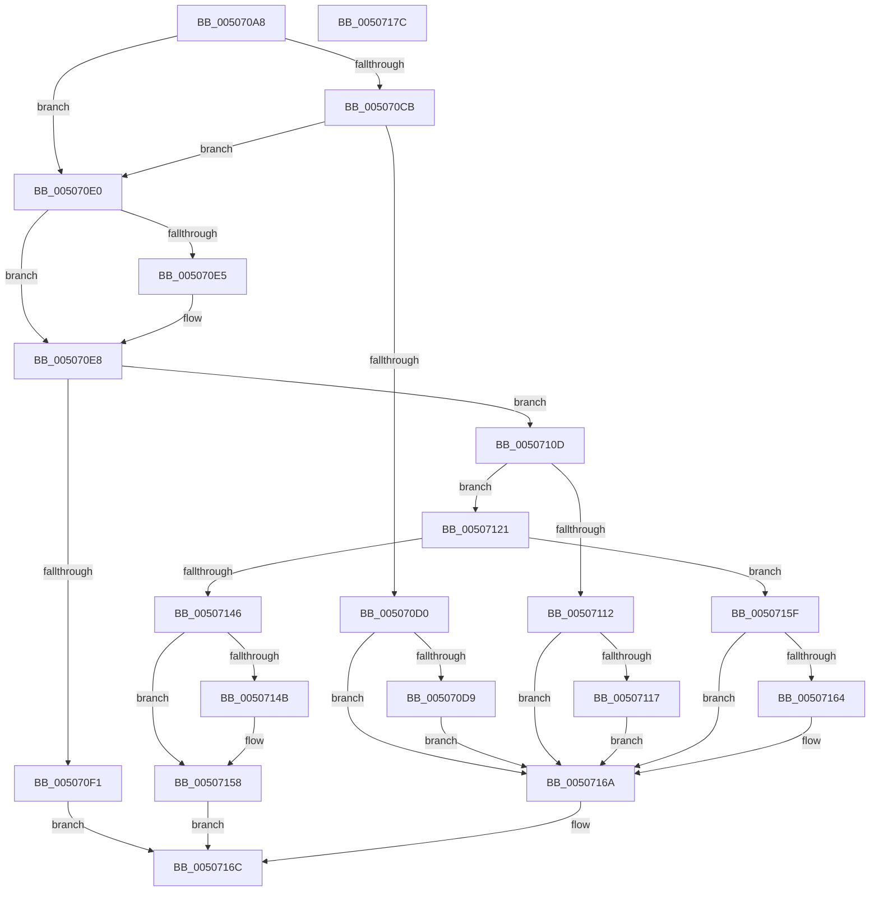

# safecrt_wctomb_s

- RVA: `0x005070A8`–`0x0050717D` (길이 `213` bytes)
- VA: `0x00000001405070A8`
- 실행 섹션: `.text`
- PDB 이름 있음: `예`; PDB Function 태그: `아니요`
- unwind 정보 RVA: `0x000C2974`
- 디코드: `64`개 명령, `213/213` bytes 표시
- 미해석 바이트: `0` (있으면 어셈블리에 `.byte`로 보존)

> 이 문서는 커널 이미지의 기계어와 PDB 기호를 분석해 생성했습니다. 4번과 5번은 함수 원형과 자료형을 바이너리 사용 방식에서 추정한 C 해석이며 원본 소스 복구 결과는 아닙니다.

## 1. Dependencies

- 직접 호출 지점: **3**; 고유 호출 대상: **3**
- 직접 호출자로 확인된 함수: **1**
- RIP 상대 이미지 참조: **1**

### Outgoing calls
- `0x00507101` → [EmpCheckErrataList](../49/EmpCheckErrataList_function_0049E550.md) (function, `0x0049E550`)
- `0x0050713D` → [RtlUnicodeToMultiByteN](../../page/90/RtlUnicodeToMultiByteN_function_0090D820.md) (function, `0x0090D820`)
- `0x00507153` → [memset](../6C/memset_function_006C6C40.md) (function, `0x006C6C40`)

### Direct callers
- [output_s](output_s_function_00506854.md) at `0x00506B19`
- [output_s](output_s_function_00506854.md) at `0x00506DE0`

### Static image references
- `0x00507117` → RVA `0x00E0A700` (`.data`; read)

## 2. Other-region calls and transfers

- 다른 실행 섹션으로 향하는 call: **1**
  - `0x0050713D` → [RtlUnicodeToMultiByteN](../../page/90/RtlUnicodeToMultiByteN_function_0090D820.md) (`.text` → `PAGE`)
- 별도 외부 분기/꼬리 이동을 확인하지 못했습니다.

## 3. Assembly (complete function range)

```asm
005070A8  48 89 5C 24 08                  mov qword ptr [rsp + 8], rbx
005070AD  48 89 74 24 18                  mov qword ptr [rsp + 0x18], rsi
005070B2  66 44 89 4C 24 20               mov word ptr [rsp + 0x20], r9w
005070B8  57                              push rdi
005070B9  48 83 EC 30                     sub rsp, 0x30
005070BD  49 8B F8                        mov rdi, r8
005070C0  48 8B F2                        mov rsi, rdx
005070C3  48 8B D9                        mov rbx, rcx
005070C6  48 85 D2                        test rdx, rdx
005070C9  75 15                           jne 0x1405070e0
005070CB  4D 85 C0                        test r8, r8
005070CE  74 10                           je 0x1405070e0
005070D0  48 85 C9                        test rcx, rcx
005070D3  0F 84 91 00 00 00               je 0x14050716a
005070D9  21 11                           and dword ptr [rcx], edx
005070DB  E9 8A 00 00 00                  jmp 0x14050716a
005070E0  48 85 DB                        test rbx, rbx
005070E3  74 03                           je 0x1405070e8
005070E5  83 09 FF                        or dword ptr [rcx], 0xffffffff
005070E8  48 81 FF FF FF FF 7F            cmp rdi, 0x7fffffff
005070EF  76 1C                           jbe 0x14050710d
005070F1  48 83 64 24 20 00               and qword ptr [rsp + 0x20], 0
005070F7  45 33 C9                        xor r9d, r9d
005070FA  45 33 C0                        xor r8d, r8d
005070FD  33 D2                           xor edx, edx
005070FF  33 C9                           xor ecx, ecx
00507101  E8 4A 74 F9 FF                  call 0x14049e550
00507106  B8 16 00 00 00                  mov eax, 0x16
0050710B  EB 5F                           jmp 0x14050716c
0050710D  48 85 F6                        test rsi, rsi
00507110  75 0F                           jne 0x140507121
00507112  48 85 DB                        test rbx, rbx
00507115  74 53                           je 0x14050716a
00507117  8B 05 E3 35 90 00               mov eax, dword ptr [rip + 0x9035e3]
0050711D  89 01                           mov dword ptr [rcx], eax
0050711F  EB 49                           jmp 0x14050716a
00507121  83 64 24 48 00                  and dword ptr [rsp + 0x48], 0
00507126  4C 8D 4C 24 58                  lea r9, [rsp + 0x58]
0050712B  4C 8D 44 24 48                  lea r8, [rsp + 0x48]
00507130  C7 44 24 20 02 00 00 00         mov dword ptr [rsp + 0x20], 2
00507138  8B D7                           mov edx, edi
0050713A  48 8B CE                        mov rcx, rsi
0050713D  E8 DE 66 40 00                  call 0x14090d820
00507142  85 C0                           test eax, eax
00507144  79 19                           jns 0x14050715f
00507146  48 85 FF                        test rdi, rdi
00507149  74 0D                           je 0x140507158
0050714B  4C 8B C7                        mov r8, rdi
0050714E  33 D2                           xor edx, edx
00507150  48 8B CE                        mov rcx, rsi
00507153  E8 E8 FA 1B 00                  call 0x1406c6c40
00507158  B8 2A 00 00 00                  mov eax, 0x2a
0050715D  EB 0D                           jmp 0x14050716c
0050715F  48 85 DB                        test rbx, rbx
00507162  74 06                           je 0x14050716a
00507164  8B 44 24 48                     mov eax, dword ptr [rsp + 0x48]
00507168  89 03                           mov dword ptr [rbx], eax
0050716A  33 C0                           xor eax, eax
0050716C  48 8B 5C 24 40                  mov rbx, qword ptr [rsp + 0x40]
00507171  48 8B 74 24 50                  mov rsi, qword ptr [rsp + 0x50]
00507176  48 83 C4 30                     add rsp, 0x30
0050717A  5F                              pop rdi
0050717B  C3                              ret
0050717C  CC                              int3
```

## 4. C-style interpretation (structured pseudocode)

```c
__int64 __fastcall safecrt_wctomb_s(__int64 a1, __int64 a2, __int64 a3, int a4)
{
    __int64 result;
    __int64 v_rsp;
    unsigned __int64 v_stack_m18;
    unsigned int v_stack_p10;
    unsigned __int64 v_stack_p18;
    unsigned __int16 v_stack_p20;
    unsigned __int64 v_stack_p8;

    v_stack_p8 = v_rbx;
    v_stack_p18 = v_rsi;
    v_stack_p20 = (unsigned __int16)(a4);
    v_rsp = (v_rsp) - (48);
    if (a2 != 0) goto loc_005070E0;
    if (a3 == 0) goto loc_005070E0;
    if (a1 == 0) goto loc_0050716A;
    goto loc_0050716A;
loc_005070E0:
    if (a1 != 0) {
    }
    if (a3 <= 0x7FFFFFFFULL) goto loc_0050710D;
    a4 = 0;
    a3 = 0;
    a2 = 0;
    a1 = 0;
    result = EmpCheckErrataList(a1, a2, a3, a4);
    goto loc_0050716C;
loc_0050710D:
    if (0 != 0) goto loc_00507121;
    if (0 == 0) goto loc_0050716A;
    *(unsigned int *)(a1) = (unsigned int)((unsigned int)(*(unsigned int *)(v_rip + 9450979)));
    goto loc_0050716A;
loc_00507121:
    v_stack_m18 = 2;
    result = RtlUnicodeToMultiByteN(0, 0, v_stack_p10, v_stack_p20);
    if (!sign_flag) goto loc_0050715F;
    if (0 != 0) {
        a3 = 0;
        a2 = 0;
        a1 = 0;
        result = memset(a1, a2, a3, v_stack_p20);
    }
    goto loc_0050716C;
loc_0050715F:
    result = 42;
    if (a1 != 0) {
        result = v_stack_p10;
        *(unsigned int *)(a1) = (unsigned int)(result);
    }
    result = 0;
loc_0050716C:
    v_rsp = (v_rsp) + (48);
    return result;
}
```

## 5. (Beta) C Style

```c
int64_t safecrt_wctomb_s(void *Arg1, int64_t Arg2, int64_t Arg3, int32_t Arg4)
{
    uint8_t *arg1 = (uint8_t *)Arg1;

    int64_t result;
    int64_t local_rsp;
    uint64_t v_stack_m18;
    uint32_t v_stack_p10;
    uint64_t v_stack_p18;
    uint16_t v_stack_p20;
    uint64_t v_stack_p8;

    v_stack_p8 = local_rbx;
    v_stack_p18 = local_rsi;
    v_stack_p20 = (uint16_t)(Arg4);
    local_rsp = (local_rsp) - (48);
    if (Arg2 != 0) goto loc_005070E0;
    if (Arg3 == 0) goto loc_005070E0;
    if (Arg1 == NULL) goto loc_0050716A;
    goto loc_0050716A;
loc_005070E0:
    if (Arg1 != NULL) {
    }
    if (Arg3 <= 0x7FFFFFFFULL) goto loc_0050710D;
    Arg4 = 0;
    Arg3 = 0;
    Arg2 = 0;
    Arg1 = 0;
    result = EmpCheckErrataList(Arg1, Arg2, Arg3, Arg4);
    goto loc_0050716C;
loc_0050710D:
    if (0 != 0) goto loc_00507121;
    if (0 == 0) goto loc_0050716A;
    *(uint32_t *)(arg1) = (uint32_t)((uint32_t)(*(uint32_t *)(v_rip + 0x9035E3)));
    goto loc_0050716A;
loc_00507121:
    v_stack_m18 = 2;
    result = RtlUnicodeToMultiByteN(0, 0, v_stack_p10, v_stack_p20);
    if (!sign_flag) goto loc_0050715F;
    if (0 != 0) {
        Arg3 = 0;
        Arg2 = 0;
        Arg1 = 0;
        result = memset(Arg1, Arg2, Arg3, v_stack_p20);
    }
    goto loc_0050716C;
loc_0050715F:
    result = 42;
    if (Arg1 != NULL) {
        result = v_stack_p10;
        *(uint32_t *)(arg1) = (uint32_t)(result);
    }
    result = 0;
loc_0050716C:
    local_rsp = (local_rsp) + (48);
    return result;
}
```

### 관측된 메모리 오프셋

구조체 형식이 확인되지 않은 접근은 인자 기준의 오프셋으로만 기록했습니다.

| 기준 인자 | 오프셋 표현 | 폭 (bit) | 접근 |
|---|---:|---:|---|
| `Arg1` | `+ 0x0` | `32` | `R/W` |
| `Arg1` | `+ 0x0` | `32` | `W` |

## 6. Execution-region graph

[열기: 2D/3D 그래프와 함수 탐색 컨트롤 패널](../../../control-panel.html?section=text&rva=0x005070A8&view=graph)

- 2D 그래프는 위에서 아래로 흐르고, 3D 그래프는 빈 공간을 드래그해 회전합니다. Shift+드래그는 이동, 휠은 확대·축소, 함수 노드 선택은 대상 보고서 이동입니다.

### Static fallback


