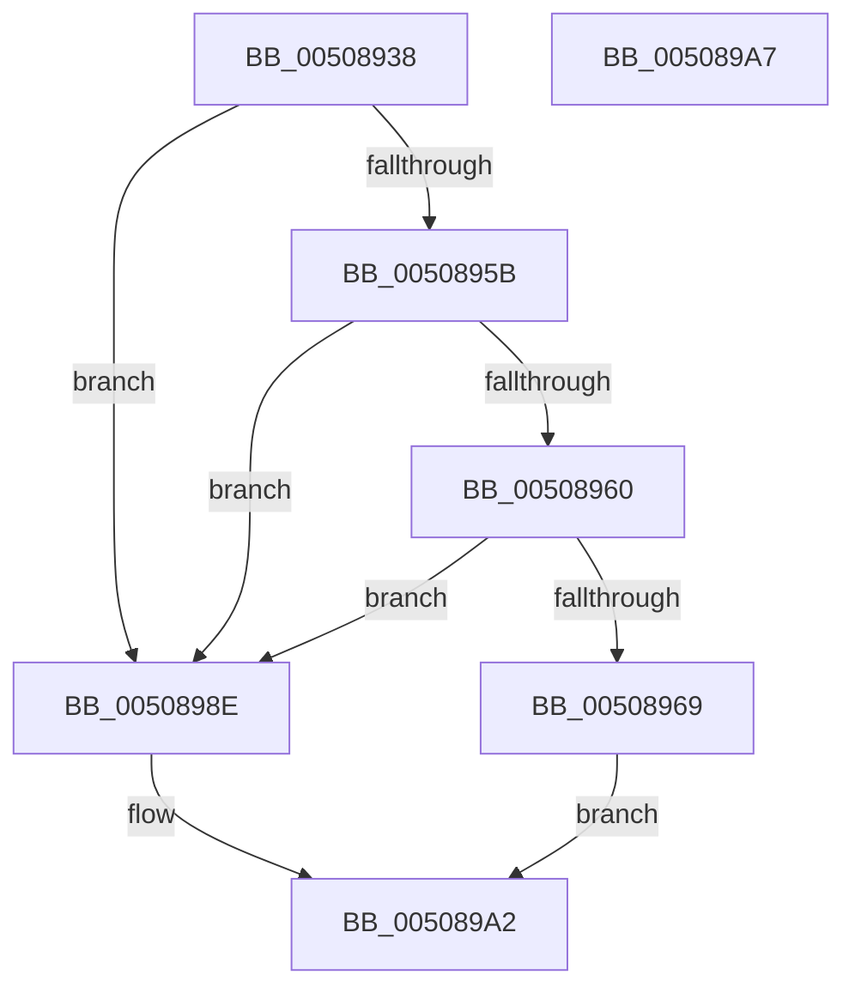

# sinput_s

- RVA: `0x00508938`–`0x005089A8` (길이 `112` bytes)
- VA: `0x0000000140508938`
- 실행 섹션: `.text`
- PDB 이름 있음: `예`; PDB Function 태그: `아니요`
- unwind 정보 RVA: `0x0007A034`
- 디코드: `32`개 명령, `112/112` bytes 표시
- 미해석 바이트: `0` (있으면 어셈블리에 `.byte`로 보존)

> 이 문서는 커널 이미지의 기계어와 PDB 기호를 분석해 생성했습니다. 4번과 5번은 함수 원형과 자료형을 바이너리 사용 방식에서 추정한 C 해석이며 원본 소스 복구 결과는 아닙니다.

## 1. Dependencies

- 직접 호출 지점: **2**; 고유 호출 대상: **2**
- 직접 호출자로 확인된 함수: **2**
- RIP 상대 이미지 참조: **0**

### Outgoing calls
- `0x00508987` → [input_s](input_s_function_00508090.md) (function, `0x00508090`)
- `0x0050899A` → [EmpCheckErrataList](../49/EmpCheckErrataList_function_0049E550.md) (function, `0x0049E550`)

### Direct callers
- [snscanf_s](snscanf_s_function_00505400.md) at `0x0050542E`
- [sscanf_s](sscanf_s_function_00505EC0.md) at `0x00505F02`

### Static image references
- 디코드된 RIP-relative 메모리 참조가 없습니다.

## 2. Other-region calls and transfers

- 다른 실행 섹션으로 향하는 call: **0**
- 별도 외부 분기/꼬리 이동을 확인하지 못했습니다.

## 3. Assembly (complete function range)

```asm
00508938  4C 8B DC                        mov r11, rsp
0050893B  48 83 EC 68                     sub rsp, 0x68
0050893F  49 8B C0                        mov rax, r8
00508942  0F 57 C0                        xorps xmm0, xmm0
00508945  45 33 C0                        xor r8d, r8d
00508948  45 89 43 D4                     mov dword ptr [r11 - 0x2c], r8d
0050894C  F3 0F 7F 44 24 4C               movdqu xmmword ptr [rsp + 0x4c], xmm0
00508952  45 89 43 F4                     mov dword ptr [r11 - 0xc], r8d
00508956  48 85 C9                        test rcx, rcx
00508959  74 33                           je 0x14050898e
0050895B  48 85 C0                        test rax, rax
0050895E  74 2E                           je 0x14050898e
00508960  48 81 FA FF FF FF 7F            cmp rdx, 0x7fffffff
00508967  77 25                           ja 0x14050898e
00508969  C7 44 24 48 49 00 00 00         mov dword ptr [rsp + 0x48], 0x49
00508971  4D 8B C1                        mov r8, r9
00508974  49 89 4B D8                     mov qword ptr [r11 - 0x28], rcx
00508978  49 89 4B C8                     mov qword ptr [r11 - 0x38], rcx
0050897C  49 8D 4B C8                     lea rcx, [r11 - 0x38]
00508980  89 54 24 38                     mov dword ptr [rsp + 0x38], edx
00508984  48 8B D0                        mov rdx, rax
00508987  E8 04 F7 FF FF                  call 0x140508090
0050898C  EB 14                           jmp 0x1405089a2
0050898E  45 33 C9                        xor r9d, r9d
00508991  4C 89 44 24 20                  mov qword ptr [rsp + 0x20], r8
00508996  33 D2                           xor edx, edx
00508998  33 C9                           xor ecx, ecx
0050899A  E8 B1 5B F9 FF                  call 0x14049e550
0050899F  83 C8 FF                        or eax, 0xffffffff
005089A2  48 83 C4 68                     add rsp, 0x68
005089A6  C3                              ret
005089A7  CC                              int3
```

## 4. C-style interpretation (structured pseudocode)

```c
__int64 __fastcall sinput_s(__int64 a1, __int64 a2, __int64 a3, __int64 a4)
{
    __int64 result;
    __int64 v_rsp;
    unsigned __int64 v_stack_m1C;
    unsigned int v_stack_m20;
    unsigned int v_stack_m30;
    unsigned __int64 v_stack_m48;

    v_rsp = (v_rsp) - (104);
    a3 = 0;
    *(unsigned int *)(v_rsp - 44) = 0;
    v_stack_m1C = v_xmm0;
    *(unsigned int *)(v_rsp - 12) = 0;
    if (a1 == 0) goto loc_0050898E;
    if (0 == 0) goto loc_0050898E;
    if (a2 > 0x7FFFFFFFULL) goto loc_0050898E;
    v_stack_m20 = 73;
    *(unsigned __int64 *)(v_rsp - 40) = a1;
    *(unsigned __int64 *)(v_rsp - 56) = a1;
    v_stack_m30 = (unsigned int)(a2);
    result = input_s(v_rsp - 56, 0, a4, a4);
    goto loc_005089A2;
loc_0050898E:
    a4 = 0;
    v_stack_m48 = 0;
    a2 = 0;
    a1 = 0;
    result = EmpCheckErrataList(a1, a2, a4, a4);
    result = (unsigned int)((result) | (0xFFFFFFFFULL));
loc_005089A2:
    v_rsp = (v_rsp) + (104);
    return result;
}
```

## 5. (Beta) C Style

```c
int64_t sinput_s(int64_t Arg1, int64_t Arg2, int64_t Arg3, int64_t Arg4)
{
    int64_t result;
    int64_t local_rsp;
    uint64_t v_stack_m1C;
    uint32_t v_stack_m20;
    uint32_t v_stack_m30;
    uint64_t v_stack_m48;

    local_rsp = (local_rsp) - (104);
    Arg3 = 0;
    *(uint32_t *)(local_rsp - 0x2C) = 0;
    v_stack_m1C = v_xmm0;
    *(uint32_t *)(local_rsp - 0xC) = 0;
    if (Arg1 == 0) goto loc_0050898E;
    if (0 == 0) goto loc_0050898E;
    if (Arg2 > 0x7FFFFFFFULL) goto loc_0050898E;
    v_stack_m20 = 73;
    *(uint64_t *)(local_rsp - 0x28) = Arg1;
    *(uint64_t *)(local_rsp - 0x38) = Arg1;
    v_stack_m30 = (uint32_t)(Arg2);
    result = input_s(local_rsp - 56, 0, Arg4, Arg4);
    goto loc_005089A2;
loc_0050898E:
    Arg4 = 0;
    v_stack_m48 = 0;
    Arg2 = 0;
    Arg1 = 0;
    result = EmpCheckErrataList(Arg1, Arg2, Arg4, Arg4);
    result = (uint32_t)((result) | (0xFFFFFFFFULL));
loc_005089A2:
    local_rsp = (local_rsp) + (104);
    return result;
}
```

## 6. Execution-region graph

[열기: 2D/3D 그래프와 함수 탐색 컨트롤 패널](../../../control-panel.html?section=text&rva=0x00508938&view=graph)

- 2D 그래프는 위에서 아래로 흐르고, 3D 그래프는 빈 공간을 드래그해 회전합니다. Shift+드래그는 이동, 휠은 확대·축소, 함수 노드 선택은 대상 보고서 이동입니다.

### Static fallback


