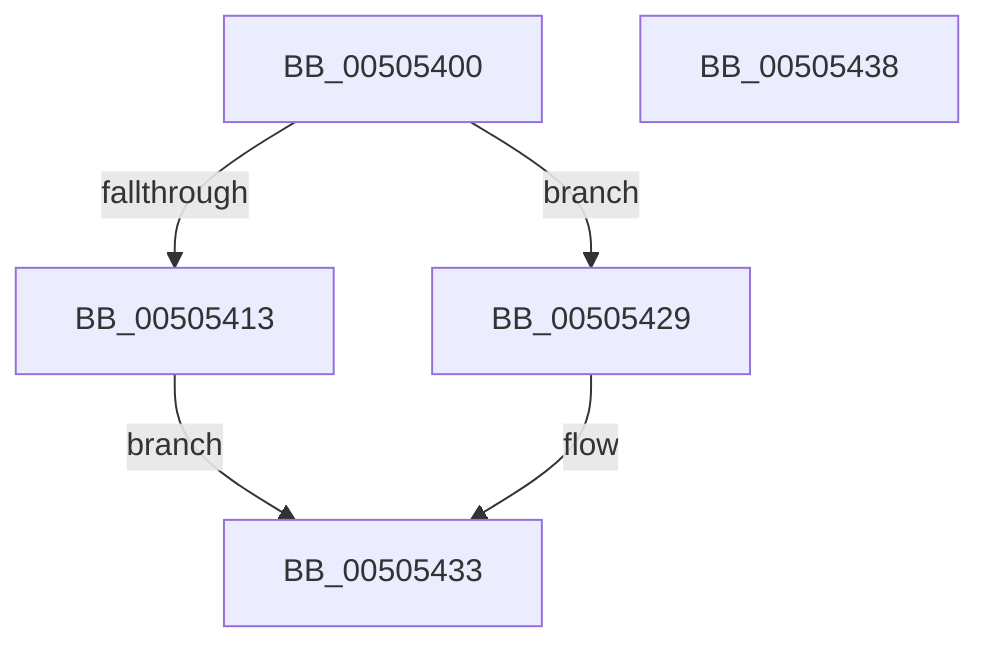

# snscanf_s

- RVA: `0x00505400`–`0x00505439` (길이 `57` bytes)
- VA: `0x0000000140505400`
- 실행 섹션: `.text`
- PDB 이름 있음: `예`; PDB Function 태그: `아니요`
- unwind 정보 RVA: `0x000C389C`
- 디코드: `17`개 명령, `57/57` bytes 표시
- 미해석 바이트: `0` (있으면 어셈블리에 `.byte`로 보존)

> 이 문서는 커널 이미지의 기계어와 PDB 기호를 분석해 생성했습니다. 4번과 5번은 함수 원형과 자료형을 바이너리 사용 방식에서 추정한 C 해석이며 원본 소스 복구 결과는 아닙니다.

## 1. Dependencies

- 직접 호출 지점: **2**; 고유 호출 대상: **2**
- 직접 호출자로 확인된 함수: **0**
- RIP 상대 이미지 참조: **0**

### Outgoing calls
- `0x0050541F` → [EmpCheckErrataList](../49/EmpCheckErrataList_function_0049E550.md) (function, `0x0049E550`)
- `0x0050542E` → [sinput_s](sinput_s_function_00508938.md) (function, `0x00508938`)

### Direct callers
- 이 함수 시작 RVA로 연결되는 직접 call은 확인되지 않았습니다. 간접 호출은 완전히 역산할 수 없습니다.

### Static image references
- 디코드된 RIP-relative 메모리 참조가 없습니다.

## 2. Other-region calls and transfers

- 다른 실행 섹션으로 향하는 call: **0**
- 별도 외부 분기/꼬리 이동을 확인하지 못했습니다.

## 3. Assembly (complete function range)

```asm
00505400  4C 89 44 24 18                  mov qword ptr [rsp + 0x18], r8
00505405  4C 89 4C 24 20                  mov qword ptr [rsp + 0x20], r9
0050540A  48 83 EC 48                     sub rsp, 0x48
0050540E  4D 85 C0                        test r8, r8
00505411  75 16                           jne 0x140505429
00505413  4C 21 44 24 20                  and qword ptr [rsp + 0x20], r8
00505418  45 33 C9                        xor r9d, r9d
0050541B  33 D2                           xor edx, edx
0050541D  33 C9                           xor ecx, ecx
0050541F  E8 2C 91 F9 FF                  call 0x14049e550
00505424  83 C8 FF                        or eax, 0xffffffff
00505427  EB 0A                           jmp 0x140505433
00505429  4C 8D 4C 24 68                  lea r9, [rsp + 0x68]
0050542E  E8 05 35 00 00                  call 0x140508938
00505433  48 83 C4 48                     add rsp, 0x48
00505437  C3                              ret
00505438  CC                              int3
```

## 4. C-style interpretation (structured pseudocode)

```c
__int64 __fastcall snscanf_s(int a1, int a2, __int64 a3, __int64 a4)
{
    __int64 result;
    __int64 v_rsp;
    unsigned __int64 v_stack_m28;
    unsigned __int64 v_stack_p18;
    unsigned __int64 v_stack_p20;

    v_stack_p18 = a3;
    v_stack_p20 = a4;
    v_rsp = (v_rsp) - (72);
    if (a3 != 0) goto loc_00505429;
    a4 = 0;
    a2 = 0;
    a1 = 0;
    result = EmpCheckErrataList(a1, a2, a3, a4);
    result = (unsigned int)((result) | (0xFFFFFFFFULL));
    goto loc_00505433;
loc_00505429:
    result = sinput_s(a1, a2, a3, v_stack_p20);
loc_00505433:
    v_rsp = (v_rsp) + (72);
    return result;
}
```

## 5. (Beta) C Style

```c
int64_t snscanf_s(int32_t Arg1, int32_t Arg2, int64_t Arg3, int64_t Arg4)
{
    int64_t result;
    int64_t local_rsp;
    uint64_t v_stack_m28;
    uint64_t v_stack_p18;
    uint64_t v_stack_p20;

    v_stack_p18 = Arg3;
    v_stack_p20 = Arg4;
    local_rsp = (local_rsp) - (72);
    if (Arg3 != 0) goto loc_00505429;
    Arg4 = 0;
    Arg2 = 0;
    Arg1 = 0;
    result = EmpCheckErrataList(Arg1, Arg2, Arg3, Arg4);
    result = (uint32_t)((result) | (0xFFFFFFFFULL));
    goto loc_00505433;
loc_00505429:
    result = sinput_s(Arg1, Arg2, Arg3, v_stack_p20);
loc_00505433:
    local_rsp = (local_rsp) + (72);
    return result;
}
```

## 6. Execution-region graph

[열기: 2D/3D 그래프와 함수 탐색 컨트롤 패널](../../../control-panel.html?section=text&rva=0x00505400&view=graph)

- 2D 그래프는 위에서 아래로 흐르고, 3D 그래프는 빈 공간을 드래그해 회전합니다. Shift+드래그는 이동, 휠은 확대·축소, 함수 노드 선택은 대상 보고서 이동입니다.

### Static fallback


