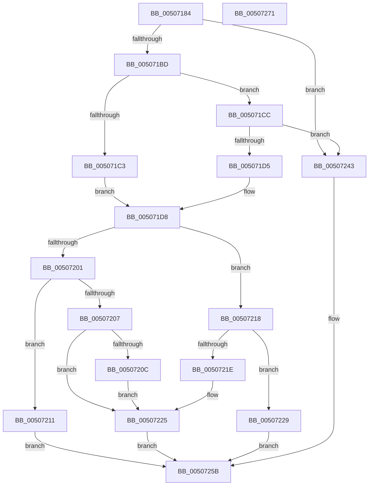

# soutput_s

- RVA: `0x00507184`–`0x00507272` (길이 `238` bytes)
- VA: `0x0000000140507184`
- 실행 섹션: `.text`
- PDB 이름 있음: `예`; PDB Function 태그: `아니요`
- unwind 정보 RVA: `0x000BF5C8`
- 디코드: `70`개 명령, `238/238` bytes 표시
- 미해석 바이트: `0` (있으면 어셈블리에 `.byte`로 보존)

> 이 문서는 커널 이미지의 기계어와 PDB 기호를 분석해 생성했습니다. 4번과 5번은 함수 원형과 자료형을 바이너리 사용 방식에서 추정한 C 해석이며 원본 소스 복구 결과는 아닙니다.

## 1. Dependencies

- 직접 호출 지점: **3**; 고유 호출 대상: **3**
- 직접 호출자로 확인된 함수: **2**
- RIP 상대 이미지 참조: **0**

### Outgoing calls
- `0x005071F1` → [output_s](output_s_function_00506854.md) (function, `0x00506854`)
- `0x0050722F` → [flsbuf](flsbuf_function_0050292C.md) (function, `0x0050292C`)
- `0x00507253` → [EmpCheckErrataList](../49/EmpCheckErrataList_function_0049E550.md) (function, `0x0049E550`)

### Direct callers
- [vsnprintf_s](vsnprintf_s_function_00505360.md) at `0x005053A6`
- [vsnprintf_s](vsnprintf_s_function_00505360.md) at `0x005053E3`
- [vsprintf_s](vsprintf_s_function_00505E70.md) at `0x00505E88`

### Static image references
- 디코드된 RIP-relative 메모리 참조가 없습니다.

## 2. Other-region calls and transfers

- 다른 실행 섹션으로 향하는 call: **0**
- 별도 외부 분기/꼬리 이동을 확인하지 못했습니다.

## 3. Assembly (complete function range)

```asm
00507184  48 89 5C 24 08                  mov qword ptr [rsp + 8], rbx
00507189  48 89 74 24 10                  mov qword ptr [rsp + 0x10], rsi
0050718E  48 89 7C 24 18                  mov qword ptr [rsp + 0x18], rdi
00507193  55                              push rbp
00507194  48 8B EC                        mov rbp, rsp
00507197  48 83 EC 60                     sub rsp, 0x60
0050719B  83 65 DC 00                     and dword ptr [rbp - 0x24], 0
0050719F  0F 57 C0                        xorps xmm0, xmm0
005071A2  83 65 FC 00                     and dword ptr [rbp - 4], 0
005071A6  49 8B C0                        mov rax, r8
005071A9  48 8B FA                        mov rdi, rdx
005071AC  48 8B D9                        mov rbx, rcx
005071AF  F3 0F 7F 45 EC                  movdqu xmmword ptr [rbp - 0x14], xmm0
005071B4  48 85 D2                        test rdx, rdx
005071B7  0F 84 86 00 00 00               je 0x140507243
005071BD  48 83 FA FF                     cmp rdx, -1
005071C1  75 09                           jne 0x1405071cc
005071C3  C7 45 D8 FF FF FF 7F            mov dword ptr [rbp - 0x28], 0x7fffffff
005071CA  EB 0C                           jmp 0x1405071d8
005071CC  48 81 FF FF FF FF 7F            cmp rdi, 0x7fffffff
005071D3  77 6E                           ja 0x140507243
005071D5  89 7D D8                        mov dword ptr [rbp - 0x28], edi
005071D8  4D 8B C1                        mov r8, r9
005071DB  48 89 5D E0                     mov qword ptr [rbp - 0x20], rbx
005071DF  48 8B D0                        mov rdx, rax
005071E2  48 89 5D D0                     mov qword ptr [rbp - 0x30], rbx
005071E6  48 8D 4D D0                     lea rcx, [rbp - 0x30]
005071EA  C7 45 E8 42 00 00 00            mov dword ptr [rbp - 0x18], 0x42
005071F1  E8 5E F6 FF FF                  call 0x140506854
005071F6  C6 44 3B FF 00                  mov byte ptr [rbx + rdi - 1], 0
005071FB  8B F0                           mov esi, eax
005071FD  85 C0                           test eax, eax
005071FF  79 17                           jns 0x140507218
00507201  83 7D D8 00                     cmp dword ptr [rbp - 0x28], 0
00507205  7C 0A                           jl 0x140507211
00507207  48 85 DB                        test rbx, rbx
0050720A  74 19                           je 0x140507225
0050720C  C6 03 00                        mov byte ptr [rbx], 0
0050720F  EB 14                           jmp 0x140507225
00507211  B8 FE FF FF FF                  mov eax, 0xfffffffe
00507216  EB 43                           jmp 0x14050725b
00507218  83 6D D8 01                     sub dword ptr [rbp - 0x28], 1
0050721C  78 0B                           js 0x140507229
0050721E  48 8B 45 D0                     mov rax, qword ptr [rbp - 0x30]
00507222  C6 00 00                        mov byte ptr [rax], 0
00507225  8B C6                           mov eax, esi
00507227  EB 32                           jmp 0x14050725b
00507229  48 8D 55 D0                     lea rdx, [rbp - 0x30]
0050722D  33 C9                           xor ecx, ecx
0050722F  E8 F8 B6 FF FF                  call 0x14050292c
00507234  83 F8 FF                        cmp eax, -1
00507237  B9 FE FF FF FF                  mov ecx, 0xfffffffe
0050723C  0F 45 CE                        cmovne ecx, esi
0050723F  8B C1                           mov eax, ecx
00507241  EB 18                           jmp 0x14050725b
00507243  48 83 64 24 20 00               and qword ptr [rsp + 0x20], 0
00507249  45 33 C9                        xor r9d, r9d
0050724C  45 33 C0                        xor r8d, r8d
0050724F  33 D2                           xor edx, edx
00507251  33 C9                           xor ecx, ecx
00507253  E8 F8 72 F9 FF                  call 0x14049e550
00507258  83 C8 FF                        or eax, 0xffffffff
0050725B  4C 8D 5C 24 60                  lea r11, [rsp + 0x60]
00507260  49 8B 5B 10                     mov rbx, qword ptr [r11 + 0x10]
00507264  49 8B 73 18                     mov rsi, qword ptr [r11 + 0x18]
00507268  49 8B 7B 20                     mov rdi, qword ptr [r11 + 0x20]
0050726C  49 8B E3                        mov rsp, r11
0050726F  5D                              pop rbp
00507270  C3                              ret
00507271  CC                              int3
```

## 4. C-style interpretation (structured pseudocode)

```c
__int64 __fastcall soutput_s(__int64 a1, __int64 a2, __int64 a3, __int64 a4)
{
    __int64 result;
    __int64 v_rsp;
    unsigned __int64 v_stack_m1C;
    unsigned int v_stack_m20;
    unsigned __int64 v_stack_m28;
    unsigned int v_stack_m2C;
    unsigned int v_stack_m30;
    unsigned __int64 v_stack_m38;
    unsigned __int64 v_stack_m48;
    unsigned __int64 v_stack_m8;
    unsigned int v_stack_mC;
    unsigned __int64 v_stack_p10;
    unsigned __int64 v_stack_p18;
    unsigned __int64 v_stack_p8;

    v_stack_p8 = v_rbx;
    v_stack_p10 = v_rsi;
    v_stack_p18 = v_rdi;
    v_rsp = (v_rsp) - (96);
    v_stack_m1C = v_xmm0;
    if (a2 == 0) goto loc_00507243;
    if (a2 != -1) goto loc_005071CC;
    v_stack_m30 = 0x7FFFFFFFULL;
    goto loc_005071D8;
loc_005071CC:
    if (a2 > 0x7FFFFFFFULL) goto loc_00507243;
    v_stack_m30 = (unsigned int)(a2);
loc_005071D8:
    v_stack_m28 = a1;
    v_stack_m38 = a1;
    v_stack_m20 = 66;
    result = output_s(v_stack_m38, a3, a4, a4);
    *(unsigned __int8 *)(a1 + a2 * 1 - 1) = 0;
    if (!sign_flag) goto loc_00507218;
    if (v_stack_m30 < 0) goto loc_00507211;
    if (a1 == 0) goto loc_00507225;
    *(unsigned __int8 *)(a1) = 0;
    goto loc_00507225;
loc_00507211:
    goto loc_0050725B;
loc_00507218:
    if (sign_flag) goto loc_00507229;
    *(unsigned __int8 *)(v_stack_m38) = 0;
loc_00507225:
    goto loc_0050725B;
loc_00507229:
    a1 = 0;
    result = flsbuf(a1, v_stack_m38, a4, a4);
    a1 = (unsigned int)(0xFFFFFFFEULL);
    if (((unsigned int)(result)) != -1) { a1 = (unsigned int)((unsigned int)((unsigned int)(result))); }
    goto loc_0050725B;
loc_00507243:
    a4 = 0;
    a3 = 0;
    a2 = 0;
    a1 = 0;
    result = EmpCheckErrataList(a1, a2, a3, a4);
    result = (unsigned int)((result) | (0xFFFFFFFFULL));
loc_0050725B:
    return result;
}
```

## 5. (Beta) C Style

```c
int64_t soutput_s(void *Arg1, int64_t Arg2, int64_t Arg3, int64_t Arg4)
{
    uint8_t *arg1 = (uint8_t *)Arg1;

    int64_t result;
    int64_t local_rsp;
    uint64_t v_stack_m1C;
    uint32_t v_stack_m20;
    uint64_t v_stack_m28;
    uint32_t v_stack_m2C;
    uint32_t v_stack_m30;
    uint64_t v_stack_m38;
    uint64_t v_stack_m48;
    uint64_t v_stack_m8;
    uint32_t v_stack_mC;
    uint64_t v_stack_p10;
    uint64_t v_stack_p18;
    uint64_t v_stack_p8;

    v_stack_p8 = local_rbx;
    v_stack_p10 = local_rsi;
    v_stack_p18 = local_rdi;
    local_rsp = (local_rsp) - (96);
    v_stack_m1C = v_xmm0;
    if (Arg2 == 0) goto loc_00507243;
    if (Arg2 != -1) goto loc_005071CC;
    v_stack_m30 = 0x7FFFFFFFULL;
    goto loc_005071D8;
loc_005071CC:
    if (Arg2 > 0x7FFFFFFFULL) goto loc_00507243;
    v_stack_m30 = (uint32_t)(Arg2);
loc_005071D8:
    v_stack_m28 = Arg1;
    v_stack_m38 = Arg1;
    v_stack_m20 = 66;
    result = output_s(v_stack_m38, Arg3, Arg4, Arg4);
    *(uint8_t *)(arg1 + Arg2 * 1 - 0x1) = 0;
    if (!sign_flag) goto loc_00507218;
    if (v_stack_m30 < 0) goto loc_00507211;
    if (Arg1 == NULL) goto loc_00507225;
    *(uint8_t *)(arg1) = 0;
    goto loc_00507225;
loc_00507211:
    goto loc_0050725B;
loc_00507218:
    if (sign_flag) goto loc_00507229;
    *(uint8_t *)(v_stack_m38) = 0;
loc_00507225:
    goto loc_0050725B;
loc_00507229:
    Arg1 = 0;
    result = flsbuf(Arg1, v_stack_m38, Arg4, Arg4);
    Arg1 = (uint32_t)(0xFFFFFFFEULL);
    if (((uint32_t)(result)) != -1) { Arg1 = (uint32_t)((uint32_t)((uint32_t)(result))); }
    goto loc_0050725B;
loc_00507243:
    Arg4 = 0;
    Arg3 = 0;
    Arg2 = 0;
    Arg1 = 0;
    result = EmpCheckErrataList(Arg1, Arg2, Arg3, Arg4);
    result = (uint32_t)((result) | (0xFFFFFFFFULL));
loc_0050725B:
    return result;
}
```

### 관측된 메모리 오프셋

구조체 형식이 확인되지 않은 접근은 인자 기준의 오프셋으로만 기록했습니다.

| 기준 인자 | 오프셋 표현 | 폭 (bit) | 접근 |
|---|---:|---:|---|
| `Arg1` | `- 0x1 + rdi*1` | `8` | `W` |

## 6. Execution-region graph

[열기: 2D/3D 그래프와 함수 탐색 컨트롤 패널](../../../control-panel.html?section=text&rva=0x00507184&view=graph)

- 2D 그래프는 위에서 아래로 흐르고, 3D 그래프는 빈 공간을 드래그해 회전합니다. Shift+드래그는 이동, 휠은 확대·축소, 함수 노드 선택은 대상 보고서 이동입니다.

### Static fallback


