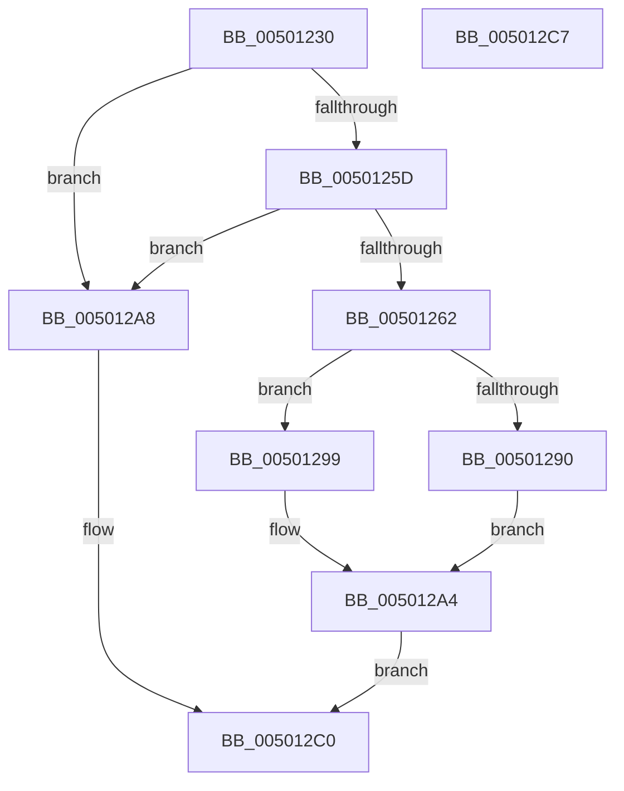

# sprintf

- RVA: `0x00501230`–`0x005012C8` (길이 `152` bytes)
- VA: `0x0000000140501230`
- 실행 섹션: `.text`
- PDB 이름 있음: `예`; PDB Function 태그: `아니요`
- unwind 정보 RVA: `0x000C2654`
- 디코드: `46`개 명령, `152/152` bytes 표시
- 미해석 바이트: `0` (있으면 어셈블리에 `.byte`로 보존)

> 이 문서는 커널 이미지의 기계어와 PDB 기호를 분석해 생성했습니다. 4번과 5번은 함수 원형과 자료형을 바이너리 사용 방식에서 추정한 C 해석이며 원본 소스 복구 결과는 아닙니다.

## 1. Dependencies

- 직접 호출 지점: **3**; 고유 호출 대상: **3**
- 직접 호출자로 확인된 함수: **0**
- RIP 상대 이미지 참조: **0**

### Outgoing calls
- `0x00501283` → [output_l](output_l_function_00503368.md) (function, `0x00503368`)
- `0x0050129F` → [flsbuf](flsbuf_function_0050292C.md) (function, `0x0050292C`)
- `0x005012B8` → [EmpCheckErrataList](../49/EmpCheckErrataList_function_0049E550.md) (function, `0x0049E550`)

### Direct callers
- 이 함수 시작 RVA로 연결되는 직접 call은 확인되지 않았습니다. 간접 호출은 완전히 역산할 수 없습니다.

### Static image references
- 디코드된 RIP-relative 메모리 참조가 없습니다.

## 2. Other-region calls and transfers

- 다른 실행 섹션으로 향하는 call: **0**
- 별도 외부 분기/꼬리 이동을 확인하지 못했습니다.

## 3. Assembly (complete function range)

```asm
00501230  48 89 54 24 10                  mov qword ptr [rsp + 0x10], rdx
00501235  4C 89 44 24 18                  mov qword ptr [rsp + 0x18], r8
0050123A  4C 89 4C 24 20                  mov qword ptr [rsp + 0x20], r9
0050123F  55                              push rbp
00501240  53                              push rbx
00501241  48 8B EC                        mov rbp, rsp
00501244  48 83 EC 78                     sub rsp, 0x78
00501248  83 65 CC 00                     and dword ptr [rbp - 0x34], 0
0050124C  0F 57 C0                        xorps xmm0, xmm0
0050124F  83 65 EC 00                     and dword ptr [rbp - 0x14], 0
00501253  F3 0F 7F 45 DC                  movdqu xmmword ptr [rbp - 0x24], xmm0
00501258  48 85 D2                        test rdx, rdx
0050125B  74 4B                           je 0x1405012a8
0050125D  48 85 C9                        test rcx, rcx
00501260  74 46                           je 0x1405012a8
00501262  48 89 4D D0                     mov qword ptr [rbp - 0x30], rcx
00501266  4C 8D 4D 28                     lea r9, [rbp + 0x28]
0050126A  48 89 4D C0                     mov qword ptr [rbp - 0x40], rcx
0050126E  45 33 C0                        xor r8d, r8d
00501271  48 8D 4D C0                     lea rcx, [rbp - 0x40]
00501275  C7 45 C8 FF FF FF 7F            mov dword ptr [rbp - 0x38], 0x7fffffff
0050127C  C7 45 D8 42 00 00 00            mov dword ptr [rbp - 0x28], 0x42
00501283  E8 E0 20 00 00                  call 0x140503368
00501288  83 6D C8 01                     sub dword ptr [rbp - 0x38], 1
0050128C  8B D8                           mov ebx, eax
0050128E  78 09                           js 0x140501299
00501290  48 8B 4D C0                     mov rcx, qword ptr [rbp - 0x40]
00501294  C6 01 00                        mov byte ptr [rcx], 0
00501297  EB 0B                           jmp 0x1405012a4
00501299  48 8D 55 C0                     lea rdx, [rbp - 0x40]
0050129D  33 C9                           xor ecx, ecx
0050129F  E8 88 16 00 00                  call 0x14050292c
005012A4  8B C3                           mov eax, ebx
005012A6  EB 18                           jmp 0x1405012c0
005012A8  48 83 64 24 20 00               and qword ptr [rsp + 0x20], 0
005012AE  45 33 C9                        xor r9d, r9d
005012B1  45 33 C0                        xor r8d, r8d
005012B4  33 D2                           xor edx, edx
005012B6  33 C9                           xor ecx, ecx
005012B8  E8 93 D2 F9 FF                  call 0x14049e550
005012BD  83 C8 FF                        or eax, 0xffffffff
005012C0  48 83 C4 78                     add rsp, 0x78
005012C4  5B                              pop rbx
005012C5  5D                              pop rbp
005012C6  C3                              ret
005012C7  CC                              int3
```

## 4. C-style interpretation (structured pseudocode)

```c
__int64 __fastcall sprintf(__int64 a1, __int64 a2, __int64 a3, __int64 a4)
{
    __int64 result;
    __int64 v_rsp;
    unsigned int v_stack_m24;
    unsigned __int64 v_stack_m34;
    unsigned int v_stack_m38;
    unsigned __int64 v_stack_m40;
    unsigned int v_stack_m44;
    unsigned int v_stack_m48;
    unsigned __int64 v_stack_m50;
    unsigned __int64 v_stack_m68;
    unsigned __int64 v_stack_p10;
    unsigned __int64 v_stack_p18;
    unsigned __int64 v_stack_p20;

    v_stack_p10 = a2;
    v_stack_p18 = a3;
    v_stack_p20 = a4;
    v_rsp = (v_rsp) - (120);
    v_stack_m34 = v_xmm0;
    if (a2 == 0) goto loc_005012A8;
    if (a1 == 0) goto loc_005012A8;
    v_stack_m40 = a1;
    v_stack_m50 = a1;
    a3 = 0;
    v_stack_m48 = 0x7FFFFFFFULL;
    v_stack_m38 = 66;
    result = output_l(v_stack_m50, a2, a3, v_stack_p18);
    if (sign_flag) goto loc_00501299;
    *(unsigned __int8 *)(v_stack_m50) = 0;
    goto loc_005012A4;
loc_00501299:
    a1 = 0;
    result = flsbuf(a1, v_stack_m50, a3, v_stack_p18);
loc_005012A4:
    goto loc_005012C0;
loc_005012A8:
    a4 = 0;
    a3 = 0;
    a2 = 0;
    a1 = 0;
    result = EmpCheckErrataList(a1, a2, a3, a4);
    result = (unsigned int)((result) | (0xFFFFFFFFULL));
loc_005012C0:
    v_rsp = (v_rsp) + (120);
    return result;
}
```

## 5. (Beta) C Style

```c
int64_t sprintf(int64_t Arg1, int64_t Arg2, int64_t Arg3, int64_t Arg4)
{
    int64_t result;
    int64_t local_rsp;
    uint32_t v_stack_m24;
    uint64_t v_stack_m34;
    uint32_t v_stack_m38;
    uint64_t v_stack_m40;
    uint32_t v_stack_m44;
    uint32_t v_stack_m48;
    uint64_t v_stack_m50;
    uint64_t v_stack_m68;
    uint64_t v_stack_p10;
    uint64_t v_stack_p18;
    uint64_t v_stack_p20;

    v_stack_p10 = Arg2;
    v_stack_p18 = Arg3;
    v_stack_p20 = Arg4;
    local_rsp = (local_rsp) - (120);
    v_stack_m34 = v_xmm0;
    if (Arg2 == 0) goto loc_005012A8;
    if (Arg1 == 0) goto loc_005012A8;
    v_stack_m40 = Arg1;
    v_stack_m50 = Arg1;
    Arg3 = 0;
    v_stack_m48 = 0x7FFFFFFFULL;
    v_stack_m38 = 66;
    result = output_l(v_stack_m50, Arg2, Arg3, v_stack_p18);
    if (sign_flag) goto loc_00501299;
    *(uint8_t *)(v_stack_m50) = 0;
    goto loc_005012A4;
loc_00501299:
    Arg1 = 0;
    result = flsbuf(Arg1, v_stack_m50, Arg3, v_stack_p18);
loc_005012A4:
    goto loc_005012C0;
loc_005012A8:
    Arg4 = 0;
    Arg3 = 0;
    Arg2 = 0;
    Arg1 = 0;
    result = EmpCheckErrataList(Arg1, Arg2, Arg3, Arg4);
    result = (uint32_t)((result) | (0xFFFFFFFFULL));
loc_005012C0:
    local_rsp = (local_rsp) + (120);
    return result;
}
```

## 6. Execution-region graph

[열기: 2D/3D 그래프와 함수 탐색 컨트롤 패널](../../../control-panel.html?section=text&rva=0x00501230&view=graph)

- 2D 그래프는 위에서 아래로 흐르고, 3D 그래프는 빈 공간을 드래그해 회전합니다. Shift+드래그는 이동, 휠은 확대·축소, 함수 노드 선택은 대상 보고서 이동입니다.

### Static fallback


