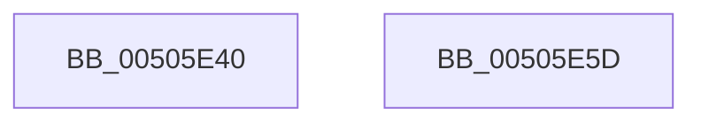

# sprintf_s

- RVA: `0x00505E40`–`0x00505E5E` (길이 `30` bytes)
- VA: `0x0000000140505E40`
- 실행 섹션: `.text`
- PDB 이름 있음: `예`; PDB Function 태그: `아니요`
- unwind 정보 RVA: `0x000C28C4`
- 디코드: `8`개 명령, `30/30` bytes 표시
- 미해석 바이트: `0` (있으면 어셈블리에 `.byte`로 보존)

> 이 문서는 커널 이미지의 기계어와 PDB 기호를 분석해 생성했습니다. 4번과 5번은 함수 원형과 자료형을 바이너리 사용 방식에서 추정한 C 해석이며 원본 소스 복구 결과는 아닙니다.

## 1. Dependencies

- 직접 호출 지점: **1**; 고유 호출 대상: **1**
- 직접 호출자로 확인된 함수: **14**
- RIP 상대 이미지 참조: **0**

### Outgoing calls
- `0x00505E53` → [vsprintf_s](vsprintf_s_function_00505E70.md) (function, `0x00505E70`)

### Direct callers
- [RtlIpv6AddressToStringExA](../46/RtlIpv6AddressToStringExA_function_00466800.md) at `0x0046689B`
- [RtlIpv6AddressToStringExA](../46/RtlIpv6AddressToStringExA_function_00466800.md) at `0x0046690D`
- [RtlIpv6AddressToStringA](../46/RtlIpv6AddressToStringA_function_00466930.md) at `0x004669F3`
- [RtlIpv6AddressToStringA](../46/RtlIpv6AddressToStringA_function_00466930.md) at `0x00466A1A`
- [RtlIpv6AddressToStringA](../46/RtlIpv6AddressToStringA_function_00466930.md) at `0x00466A71`
- [RtlIpv6AddressToStringA](../46/RtlIpv6AddressToStringA_function_00466930.md) at `0x00466B49`
- [RtlIpv6AddressToStringA](../46/RtlIpv6AddressToStringA_function_00466930.md) at `0x00466B9D`
- [RtlIpv6AddressToStringA](../46/RtlIpv6AddressToStringA_function_00466930.md) at `0x00466BD3`
- [RtlIpv4AddressToStringA](../47/RtlIpv4AddressToStringA_function_0047BA00.md) at `0x0047BA3C`
- [RtlIpv4AddressToStringExA](../47/RtlIpv4AddressToStringExA_function_0047C800.md) at `0x0047C875`
- [RtlIpv4AddressToStringExA](../47/RtlIpv4AddressToStringExA_function_0047C800.md) at `0x0047C8A4`
- [RtlEthernetAddressToStringA](../5E/RtlEthernetAddressToStringA_function_005EBDE0.md) at `0x005EBE2E`
- [CmpAddProcessorConfigurationEntry](../../page/7E/CmpAddProcessorConfigurationEntry_function_007E4CF8.md) at `0x007E4DF8`
- [CmpSetVersionData](../../page/7E/CmpSetVersionData_function_007E7854.md) at `0x007E7B8C`
- [CmpSetVersionData](../../page/7E/CmpSetVersionData_function_007E7854.md) at `0x007E7C6B`
- [CmpFindControlSet](../../page/7F/CmpFindControlSet_function_007F1A34.md) at `0x007F1D26`
- [CmpAddRemoveContainerToCLFSLog](../../page/7F/CmpAddRemoveContainerToCLFSLog_function_007F69FC.md) at `0x007F6AF3`
- [HdlspDispatch](../../pagehdls/BB/HdlspDispatch_function_00BBD320.md) at `0x00BBD659`
- [HdlspGetLine](../../pagehdls/BB/HdlspGetLine_function_00BBDAA4.md) at `0x00BBDBDC`
- [HdlspGetLine](../../pagehdls/BB/HdlspGetLine_function_00BBDAA4.md) at `0x00BBDBFD`
- [HdlspProcessDumpCommand](../../pagehdls/BB/HdlspProcessDumpCommand_function_00BBDFDC.md) at `0x00BBE0BE`
- [HdlspSendBlueScreenInfo](../../pagehdls/BB/HdlspSendBlueScreenInfo_function_00BBE528.md) at `0x00BBE571`
- [CmpGetAcpiBiosVersion](../../init/C5/CmpGetAcpiBiosVersion_function_00C59BF4.md) at `0x00C59C66`

### Static image references
- 디코드된 RIP-relative 메모리 참조가 없습니다.

## 2. Other-region calls and transfers

- 다른 실행 섹션으로 향하는 call: **0**
- 별도 외부 분기/꼬리 이동을 확인하지 못했습니다.

## 3. Assembly (complete function range)

```asm
00505E40  4C 89 44 24 18                  mov qword ptr [rsp + 0x18], r8
00505E45  4C 89 4C 24 20                  mov qword ptr [rsp + 0x20], r9
00505E4A  48 83 EC 38                     sub rsp, 0x38
00505E4E  4C 8D 4C 24 58                  lea r9, [rsp + 0x58]
00505E53  E8 18 00 00 00                  call 0x140505e70
00505E58  48 83 C4 38                     add rsp, 0x38
00505E5C  C3                              ret
00505E5D  CC                              int3
```

## 4. C-style interpretation (structured pseudocode)

```c
__int64 __fastcall sprintf_s(__int64 a1, __int64 a2, __int64 a3, __int64 a4)
{
    __int64 result;
    __int64 v_rsp;
    unsigned __int64 v_stack_p18;
    unsigned __int64 v_stack_p20;

    v_stack_p18 = a3;
    v_stack_p20 = a4;
    v_rsp = (v_rsp) - (56);
    result = vsprintf_s(a1, a2, a3, v_stack_p20);
    v_rsp = (v_rsp) + (56);
    return result;
}
```

## 5. (Beta) C Style

```c
int64_t sprintf_s(int64_t Arg1, int64_t Arg2, int64_t Arg3, int64_t Arg4)
{
    int64_t result;
    int64_t local_rsp;
    uint64_t v_stack_p18;
    uint64_t v_stack_p20;

    v_stack_p18 = Arg3;
    v_stack_p20 = Arg4;
    local_rsp = (local_rsp) - (56);
    result = vsprintf_s(Arg1, Arg2, Arg3, v_stack_p20);
    local_rsp = (local_rsp) + (56);
    return result;
}
```

## 6. Execution-region graph

[열기: 2D/3D 그래프와 함수 탐색 컨트롤 패널](../../../control-panel.html?section=text&rva=0x00505E40&view=graph)

- 2D 그래프는 위에서 아래로 흐르고, 3D 그래프는 빈 공간을 드래그해 회전합니다. Shift+드래그는 이동, 휠은 확대·축소, 함수 노드 선택은 대상 보고서 이동입니다.

### Static fallback


