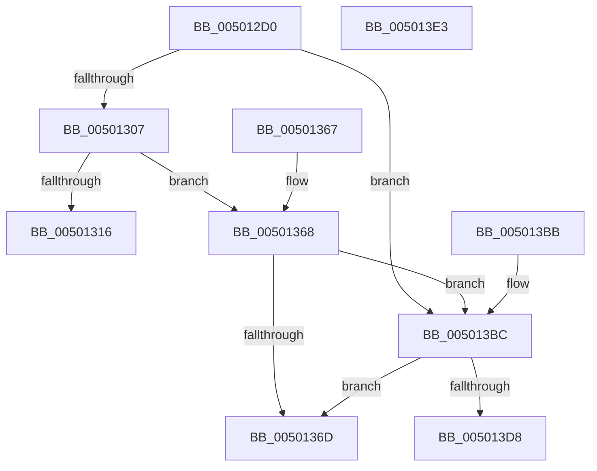

# sqrt

- RVA: `0x005012D0`–`0x005013E4` (길이 `276` bytes)
- VA: `0x00000001405012D0`
- 실행 섹션: `.text`
- PDB 이름 있음: `예`; PDB Function 태그: `아니요`
- unwind 정보 RVA: `0x000C2788`
- 디코드: `56`개 명령, `276/276` bytes 표시
- 미해석 바이트: `0` (있으면 어셈블리에 `.byte`로 보존)

> 이 문서는 커널 이미지의 기계어와 PDB 기호를 분석해 생성했습니다. 4번과 5번은 함수 원형과 자료형을 바이너리 사용 방식에서 추정한 C 해석이며 원본 소스 복구 결과는 아닙니다.

## 1. Dependencies

- 직접 호출 지점: **2**; 고유 호출 대상: **1**
- 직접 호출자로 확인된 함수: **0**
- RIP 상대 이미지 참조: **1**

### Outgoing calls
- `0x0050135D` → [handle_error](handle_error_function_00503FE0.md) (function, `0x00503FE0`)
- `0x005013B1` → [handle_error](handle_error_function_00503FE0.md) (function, `0x00503FE0`)

### Direct callers
- 이 함수 시작 RVA로 연결되는 직접 call은 확인되지 않았습니다. 간접 호출은 완전히 역산할 수 없습니다.

### Static image references
- `0x0050131C` → RVA `0x0001EF88` (`.rdata`; read)

## 2. Other-region calls and transfers

- 다른 실행 섹션으로 향하는 call: **0**
- 별도 외부 분기/꼬리 이동을 확인하지 못했습니다.

## 3. Assembly (complete function range)

```asm
005012D0  F2 0F 11 44 24 08               movsd qword ptr [rsp + 8], xmm0
005012D6  48 83 EC 58                     sub rsp, 0x58
005012DA  48 B9 00 00 00 00 00 00 F0 7F   movabs rcx, 0x7ff0000000000000
005012E4  0F 57 C9                        xorps xmm1, xmm1
005012E7  F2 0F 11 4C 24 68               movsd qword ptr [rsp + 0x68], xmm1
005012ED  F2 0F 11 44 24 68               movsd qword ptr [rsp + 0x68], xmm0
005012F3  48 8B 54 24 68                  mov rdx, qword ptr [rsp + 0x68]
005012F8  48 8B C2                        mov rax, rdx
005012FB  48 23 C1                        and rax, rcx
005012FE  48 3B C1                        cmp rax, rcx
00501301  0F 85 B5 00 00 00               jne 0x1405013bc
00501307  48 B8 FF FF FF FF FF FF 0F 00   movabs rax, 0xfffffffffffff
00501311  48 85 D0                        test rax, rdx
00501314  74 52                           je 0x140501368
00501316  F2 0F 10 44 24 60               movsd xmm0, qword ptr [rsp + 0x60]
0050131C  48 8D 0D 65 DC B1 FF            lea rcx, [rip - 0x4e239b]
00501323  C7 44 24 40 01 00 00 00         mov dword ptr [rsp + 0x40], 1
0050132B  49 B8 00 00 00 00 00 00 08 00   movabs r8, 0x8000000000000
00501335  F2 0F 11 4C 24 38               movsd qword ptr [rsp + 0x38], xmm1
0050133B  4C 0B C2                        or r8, rdx
0050133E  F2 0F 11 44 24 30               movsd qword ptr [rsp + 0x30], xmm0
00501344  BA 05 00 00 00                  mov edx, 5
00501349  C7 44 24 28 21 00 00 00         mov dword ptr [rsp + 0x28], 0x21
00501351  C7 44 24 20 00 00 00 00         mov dword ptr [rsp + 0x20], 0
00501359  44 8D 4A FC                     lea r9d, [rdx - 4]
0050135D  E8 7E 2C 00 00                  call 0x140503fe0
00501362  48 83 C4 58                     add rsp, 0x58
00501366  C3                              ret
00501367  CC                              int3
00501368  48 85 D2                        test rdx, rdx
0050136B  79 4F                           jns 0x1405013bc
0050136D  F2 0F 10 44 24 60               movsd xmm0, qword ptr [rsp + 0x60]
00501373  48 8D 0D 0E DC B1 FF            lea rcx, [rip - 0x4e23f2]
0050137A  C7 44 24 40 01 00 00 00         mov dword ptr [rsp + 0x40], 1
00501382  BA 05 00 00 00                  mov edx, 5
00501387  F2 0F 11 4C 24 38               movsd qword ptr [rsp + 0x38], xmm1
0050138D  49 B8 00 00 00 00 00 00 F8 FF   movabs r8, 0xfff8000000000000
00501397  F2 0F 11 44 24 30               movsd qword ptr [rsp + 0x30], xmm0
0050139D  C7 44 24 28 21 00 00 00         mov dword ptr [rsp + 0x28], 0x21
005013A5  44 8D 4A FC                     lea r9d, [rdx - 4]
005013A9  C7 44 24 20 08 00 00 00         mov dword ptr [rsp + 0x20], 8
005013B1  E8 2A 2C 00 00                  call 0x140503fe0
005013B6  48 83 C4 58                     add rsp, 0x58
005013BA  C3                              ret
005013BB  CC                              int3
005013BC  48 B8 FF FF FF FF FF FF FF 7F   movabs rax, 0x7fffffffffffffff
005013C6  48 85 D0                        test rax, rdx
005013C9  0F 95 C1                        setne cl
005013CC  48 0F BA E2 3F                  bt rdx, 0x3f
005013D1  0F 92 C0                        setb al
005013D4  84 C8                           test al, cl
005013D6  75 95                           jne 0x14050136d
005013D8  F2 0F 51 44 24 60               sqrtsd xmm0, qword ptr [rsp + 0x60]
005013DE  48 83 C4 58                     add rsp, 0x58
005013E2  C3                              ret
005013E3  CC                              int3
```

## 4. C-style interpretation (structured pseudocode)

```c
__int64 __fastcall sqrt(void)
{
    __int64 result;
    __int64 v_rsp;
    unsigned int v_stack_m18;
    unsigned __int64 v_stack_m20;
    unsigned __int64 v_stack_m28;
    unsigned int v_stack_m30;
    unsigned int v_stack_m38;
    unsigned __int64 v_stack_p10;
    unsigned int v_stack_p20;
    unsigned int v_stack_p28;
    unsigned __int64 v_stack_p30;
    unsigned __int64 v_stack_p38;
    unsigned int v_stack_p40;
    unsigned __int64 v_stack_p60;
    unsigned __int64 v_stack_p8;
    unsigned __int64 v_stack_pB8;

    v_stack_p8 = v_xmm0;
    v_rsp = (v_rsp) - (88);
    v_stack_p10 = v_xmm1;
    v_stack_p10 = v_xmm0;
    result = (v_stack_p10) & (a1);
    if (result != a1) goto loc_005013BC;
    if (((result) & (v_stack_p10)) == 0) goto loc_00501368;
    v_stack_m18 = 1;
    v_stack_m20 = v_xmm1;
    a3 = (a3) | (v_stack_p10);
    v_stack_m28 = v_xmm0;
    v_stack_m30 = 33;
    v_stack_m38 = 0;
    result = handle_error(v_rip - 5120923, 5, a3, 5 - 4);
    v_rsp = (v_rsp) + (88);
    return result;
loc_00501368:
    if (!sign_flag) goto loc_005013BC;
loc_0050136D:
    v_stack_p40 = 1;
    v_stack_p38 = v_xmm1;
    v_stack_p30 = v_xmm0;
    v_stack_p28 = 33;
    v_stack_p20 = 8;
    result = handle_error(v_rip - 5121010, 5, a3, 5 - 4);
    v_rsp = (v_rsp) + (88);
    return result;
loc_005013BC:
    a1 = (((result) & (5)) != 0) ? 1 : 0;
    result = (condition_is_below) ? 1 : 0;
    if ((((unsigned __int8)(result)) & ((unsigned __int8)(a1))) != 0) goto loc_0050136D;
    v_rsp = (v_rsp) + (88);
    return result;
}
```

## 5. (Beta) C Style

```c
void sqrt(void)
{
    int64_t result;
    int64_t local_rsp;
    uint32_t v_stack_m18;
    uint64_t v_stack_m20;
    uint64_t v_stack_m28;
    uint32_t v_stack_m30;
    uint32_t v_stack_m38;
    uint64_t v_stack_p10;
    uint32_t v_stack_p20;
    uint32_t v_stack_p28;
    uint64_t v_stack_p30;
    uint64_t v_stack_p38;
    uint32_t v_stack_p40;
    uint64_t v_stack_p60;
    uint64_t v_stack_p8;
    uint64_t v_stack_pB8;

    v_stack_p8 = v_xmm0;
    local_rsp = (local_rsp) - (88);
    v_stack_p10 = v_xmm1;
    v_stack_p10 = v_xmm0;
    result = (v_stack_p10) & (a1);
    if (result != a1) goto loc_005013BC;
    if (((result) & (v_stack_p10)) == 0) goto loc_00501368;
    v_stack_m18 = 1;
    v_stack_m20 = v_xmm1;
    a3 = (a3) | (v_stack_p10);
    v_stack_m28 = v_xmm0;
    v_stack_m30 = 33;
    v_stack_m38 = 0;
    result = handle_error(v_rip - 5120923, 5, a3, 5 - 4);
    local_rsp = (local_rsp) + (88);
    return result;
loc_00501368:
    if (!sign_flag) goto loc_005013BC;
loc_0050136D:
    v_stack_p40 = 1;
    v_stack_p38 = v_xmm1;
    v_stack_p30 = v_xmm0;
    v_stack_p28 = 33;
    v_stack_p20 = 8;
    result = handle_error(v_rip - 5121010, 5, a3, 5 - 4);
    local_rsp = (local_rsp) + (88);
    return result;
loc_005013BC:
    a1 = (((result) & (5)) != 0) ? 1 : 0;
    result = (condition_is_below) ? 1 : 0;
    if ((((uint8_t)(result)) & ((uint8_t)(a1))) != 0) goto loc_0050136D;
    local_rsp = (local_rsp) + (88);
    return result;
}
```

## 6. Execution-region graph

[열기: 2D/3D 그래프와 함수 탐색 컨트롤 패널](../../../control-panel.html?section=text&rva=0x005012D0&view=graph)

- 2D 그래프는 위에서 아래로 흐르고, 3D 그래프는 빈 공간을 드래그해 회전합니다. Shift+드래그는 이동, 휠은 확대·축소, 함수 노드 선택은 대상 보고서 이동입니다.

### Static fallback


