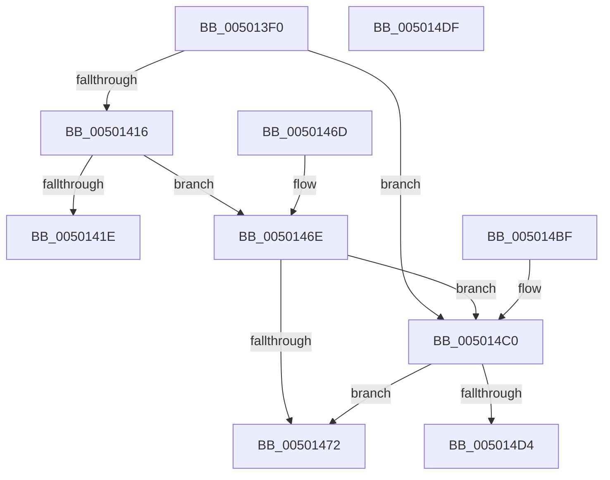

# sqrtf

- RVA: `0x005013F0`–`0x005014E0` (길이 `240` bytes)
- VA: `0x00000001405013F0`
- 실행 섹션: `.text`
- PDB 이름 있음: `예`; PDB Function 태그: `아니요`
- unwind 정보 RVA: `0x000C2798`
- 디코드: `53`개 명령, `240/240` bytes 표시
- 미해석 바이트: `0` (있으면 어셈블리에 `.byte`로 보존)

> 이 문서는 커널 이미지의 기계어와 PDB 기호를 분석해 생성했습니다. 4번과 5번은 함수 원형과 자료형을 바이너리 사용 방식에서 추정한 C 해석이며 원본 소스 복구 결과는 아닙니다.

## 1. Dependencies

- 직접 호출 지점: **2**; 고유 호출 대상: **1**
- 직접 호출자로 확인된 함수: **0**
- RIP 상대 이미지 참조: **1**

### Outgoing calls
- `0x00501463` → [handle_errorf](handle_errorf_function_00504160.md) (function, `0x00504160`)
- `0x005014B5` → [handle_errorf](handle_errorf_function_00504160.md) (function, `0x00504160`)

### Direct callers
- 이 함수 시작 RVA로 연결되는 직접 call은 확인되지 않았습니다. 간접 호출은 완전히 역산할 수 없습니다.

### Static image references
- `0x00501426` → RVA `0x0001EF90` (`.rdata`; read)

## 2. Other-region calls and transfers

- 다른 실행 섹션으로 향하는 call: **0**
- 별도 외부 분기/꼬리 이동을 확인하지 못했습니다.

## 3. Assembly (complete function range)

```asm
005013F0  F3 0F 11 44 24 08               movss dword ptr [rsp + 8], xmm0
005013F6  48 83 EC 58                     sub rsp, 0x58
005013FA  F3 0F 11 44 24 68               movss dword ptr [rsp + 0x68], xmm0
00501400  8B 54 24 68                     mov edx, dword ptr [rsp + 0x68]
00501404  8B C2                           mov eax, edx
00501406  25 00 00 80 7F                  and eax, 0x7f800000
0050140B  3D 00 00 80 7F                  cmp eax, 0x7f800000
00501410  0F 85 AA 00 00 00               jne 0x1405014c0
00501416  F7 C2 FF FF 7F 00               test edx, 0x7fffff
0050141C  74 50                           je 0x14050146e
0050141E  C7 44 24 40 01 00 00 00         mov dword ptr [rsp + 0x40], 1
00501426  48 8D 0D 63 DB B1 FF            lea rcx, [rip - 0x4e249d]
0050142D  44 8B C2                        mov r8d, edx
00501430  0F 57 C0                        xorps xmm0, xmm0
00501433  F3 0F 11 44 24 38               movss dword ptr [rsp + 0x38], xmm0
00501439  BA 05 00 00 00                  mov edx, 5
0050143E  F3 0F 10 44 24 60               movss xmm0, dword ptr [rsp + 0x60]
00501444  49 0F BA E8 16                  bts r8, 0x16
00501449  F3 0F 11 44 24 30               movss dword ptr [rsp + 0x30], xmm0
0050144F  C7 44 24 28 21 00 00 00         mov dword ptr [rsp + 0x28], 0x21
00501457  44 8D 4A FC                     lea r9d, [rdx - 4]
0050145B  C7 44 24 20 00 00 00 00         mov dword ptr [rsp + 0x20], 0
00501463  E8 F8 2C 00 00                  call 0x140504160
00501468  48 83 C4 58                     add rsp, 0x58
0050146C  C3                              ret
0050146D  CC                              int3
0050146E  85 D2                           test edx, edx
00501470  79 4E                           jns 0x1405014c0
00501472  C7 44 24 40 01 00 00 00         mov dword ptr [rsp + 0x40], 1
0050147A  48 8D 0D 0F DB B1 FF            lea rcx, [rip - 0x4e24f1]
00501481  0F 57 C0                        xorps xmm0, xmm0
00501484  BA 05 00 00 00                  mov edx, 5
00501489  F3 0F 11 44 24 38               movss dword ptr [rsp + 0x38], xmm0
0050148F  41 B8 00 00 C0 FF               mov r8d, 0xffc00000
00501495  F3 0F 10 44 24 60               movss xmm0, dword ptr [rsp + 0x60]
0050149B  F3 0F 11 44 24 30               movss dword ptr [rsp + 0x30], xmm0
005014A1  C7 44 24 28 21 00 00 00         mov dword ptr [rsp + 0x28], 0x21
005014A9  44 8D 4A FC                     lea r9d, [rdx - 4]
005014AD  C7 44 24 20 08 00 00 00         mov dword ptr [rsp + 0x20], 8
005014B5  E8 A6 2C 00 00                  call 0x140504160
005014BA  48 83 C4 58                     add rsp, 0x58
005014BE  C3                              ret
005014BF  CC                              int3
005014C0  F7 C2 FF FF FF 7F               test edx, 0x7fffffff
005014C6  0F 95 C1                        setne cl
005014C9  0F BA E2 1F                     bt edx, 0x1f
005014CD  0F 92 C0                        setb al
005014D0  84 C8                           test al, cl
005014D2  75 9E                           jne 0x140501472
005014D4  F3 0F 51 44 24 60               sqrtss xmm0, dword ptr [rsp + 0x60]
005014DA  48 83 C4 58                     add rsp, 0x58
005014DE  C3                              ret
005014DF  CC                              int3
```

## 4. C-style interpretation (structured pseudocode)

```c
__int64 __fastcall sqrtf(void)
{
    __int64 result;
    __int64 v_rsp;
    unsigned int v_stack_m18;
    unsigned int v_stack_m20;
    unsigned int v_stack_m28;
    unsigned int v_stack_m30;
    unsigned int v_stack_m38;
    unsigned int v_stack_p10;
    unsigned int v_stack_p20;
    unsigned int v_stack_p28;
    unsigned int v_stack_p30;
    unsigned int v_stack_p38;
    unsigned int v_stack_p40;
    unsigned int v_stack_p60;
    unsigned int v_stack_p8;
    unsigned int v_stack_pB8;

    v_stack_p8 = v_xmm0;
    v_rsp = (v_rsp) - (88);
    v_stack_p10 = v_xmm0;
    result = (unsigned int)(((unsigned int)((unsigned int)((unsigned int)(v_stack_p10)))) & (0x7F800000ULL));
    if (((unsigned int)(result)) != 0x7F800000ULL) goto loc_005014C0;
    if ((((unsigned int)((unsigned int)(v_stack_p10))) & (0x7FFFFFULL)) == 0) goto loc_0050146E;
    v_stack_m18 = 1;
    v_stack_m20 = v_xmm0;
    v_stack_m28 = v_xmm0;
    v_stack_m30 = 33;
    v_stack_m38 = 0;
    result = handle_errorf(v_rip - 5121181, 5, (unsigned int)((unsigned int)((unsigned int)(v_stack_p10))), 5 - 4);
    v_rsp = (v_rsp) + (88);
    return result;
loc_0050146E:
    if (!sign_flag) goto loc_005014C0;
loc_00501472:
    v_stack_p40 = 1;
    v_stack_p38 = v_xmm0;
    v_stack_p30 = v_xmm0;
    v_stack_p28 = 33;
    v_stack_p20 = 8;
    result = handle_errorf(v_rip - 5121265, 5, (unsigned int)(0xFFC00000ULL), 5 - 4);
    v_rsp = (v_rsp) + (88);
    return result;
loc_005014C0:
    a1 = (((5) & (0x7FFFFFFFULL)) != 0) ? 1 : 0;
    result = (condition_is_below) ? 1 : 0;
    if ((((unsigned __int8)(result)) & ((unsigned __int8)(a1))) != 0) goto loc_00501472;
    v_rsp = (v_rsp) + (88);
    return result;
}
```

## 5. (Beta) C Style

```c
void sqrtf(void)
{
    int64_t result;
    int64_t local_rsp;
    uint32_t v_stack_m18;
    uint32_t v_stack_m20;
    uint32_t v_stack_m28;
    uint32_t v_stack_m30;
    uint32_t v_stack_m38;
    uint32_t v_stack_p10;
    uint32_t v_stack_p20;
    uint32_t v_stack_p28;
    uint32_t v_stack_p30;
    uint32_t v_stack_p38;
    uint32_t v_stack_p40;
    uint32_t v_stack_p60;
    uint32_t v_stack_p8;
    uint32_t v_stack_pB8;

    v_stack_p8 = v_xmm0;
    local_rsp = (local_rsp) - (88);
    v_stack_p10 = v_xmm0;
    result = (uint32_t)(((uint32_t)((uint32_t)((uint32_t)(v_stack_p10)))) & (0x7F800000ULL));
    if (((uint32_t)(result)) != 0x7F800000ULL) goto loc_005014C0;
    if ((((uint32_t)((uint32_t)(v_stack_p10))) & (0x7FFFFFULL)) == 0) goto loc_0050146E;
    v_stack_m18 = 1;
    v_stack_m20 = v_xmm0;
    v_stack_m28 = v_xmm0;
    v_stack_m30 = 33;
    v_stack_m38 = 0;
    result = handle_errorf(v_rip - 5121181, 5, (uint32_t)((uint32_t)((uint32_t)(v_stack_p10))), 5 - 4);
    local_rsp = (local_rsp) + (88);
    return result;
loc_0050146E:
    if (!sign_flag) goto loc_005014C0;
loc_00501472:
    v_stack_p40 = 1;
    v_stack_p38 = v_xmm0;
    v_stack_p30 = v_xmm0;
    v_stack_p28 = 33;
    v_stack_p20 = 8;
    result = handle_errorf(v_rip - 5121265, 5, (uint32_t)(0xFFC00000ULL), 5 - 4);
    local_rsp = (local_rsp) + (88);
    return result;
loc_005014C0:
    a1 = (((5) & (0x7FFFFFFFULL)) != 0) ? 1 : 0;
    result = (condition_is_below) ? 1 : 0;
    if ((((uint8_t)(result)) & ((uint8_t)(a1))) != 0) goto loc_00501472;
    local_rsp = (local_rsp) + (88);
    return result;
}
```

## 6. Execution-region graph

[열기: 2D/3D 그래프와 함수 탐색 컨트롤 패널](../../../control-panel.html?section=text&rva=0x005013F0&view=graph)

- 2D 그래프는 위에서 아래로 흐르고, 3D 그래프는 빈 공간을 드래그해 회전합니다. Shift+드래그는 이동, 휠은 확대·축소, 함수 노드 선택은 대상 보고서 이동입니다.

### Static fallback


