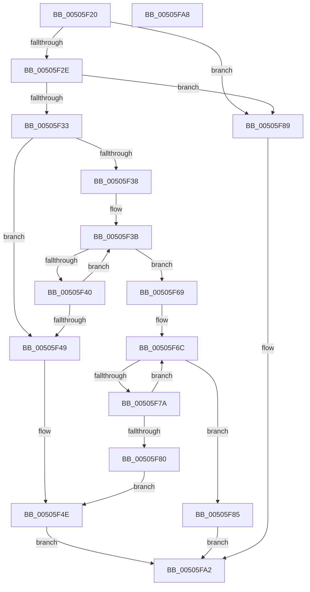

# strcat_s

- RVA: `0x00505F20`–`0x00505FA9` (길이 `137` bytes)
- VA: `0x0000000140505F20`
- 실행 섹션: `.text`
- PDB 이름 있음: `예`; PDB Function 태그: `아니요`
- unwind 정보 RVA: `0x00064C80`
- 디코드: `48`개 명령, `137/137` bytes 표시
- 미해석 바이트: `0` (있으면 어셈블리에 `.byte`로 보존)

> 이 문서는 커널 이미지의 기계어와 PDB 기호를 분석해 생성했습니다. 4번과 5번은 함수 원형과 자료형을 바이너리 사용 방식에서 추정한 C 해석이며 원본 소스 복구 결과는 아닙니다.

## 1. Dependencies

- 직접 호출 지점: **2**; 고유 호출 대상: **1**
- 직접 호출자로 확인된 함수: **1**
- RIP 상대 이미지 참조: **0**

### Outgoing calls
- `0x00505F60` → [EmpCheckErrataList](../49/EmpCheckErrataList_function_0049E550.md) (function, `0x0049E550`)
- `0x00505F98` → [EmpCheckErrataList](../49/EmpCheckErrataList_function_0049E550.md) (function, `0x0049E550`)

### Direct callers
- [ExpSystemErrorHandler2](../../pagelk/B7/ExpSystemErrorHandler2_function_00B72C30.md) at `0x00B72D37`
- [ExpSystemErrorHandler2](../../pagelk/B7/ExpSystemErrorHandler2_function_00B72C30.md) at `0x00B72DB6`
- [ExpSystemErrorHandler2](../../pagelk/B7/ExpSystemErrorHandler2_function_00B72C30.md) at `0x00B72DD6`

### Static image references
- 디코드된 RIP-relative 메모리 참조가 없습니다.

## 2. Other-region calls and transfers

- 다른 실행 섹션으로 향하는 call: **0**
- 별도 외부 분기/꼬리 이동을 확인하지 못했습니다.

## 3. Assembly (complete function range)

```asm
00505F20  40 53                           push rbx
00505F22  48 83 EC 30                     sub rsp, 0x30
00505F26  45 33 D2                        xor r10d, r10d
00505F29  48 85 C9                        test rcx, rcx
00505F2C  74 5B                           je 0x140505f89
00505F2E  48 85 D2                        test rdx, rdx
00505F31  74 56                           je 0x140505f89
00505F33  4D 85 C0                        test r8, r8
00505F36  74 11                           je 0x140505f49
00505F38  4C 8B C9                        mov r9, rcx
00505F3B  45 38 11                        cmp byte ptr [r9], r10b
00505F3E  74 29                           je 0x140505f69
00505F40  49 FF C1                        inc r9
00505F43  48 83 EA 01                     sub rdx, 1
00505F47  75 F2                           jne 0x140505f3b
00505F49  BB 16 00 00 00                  mov ebx, 0x16
00505F4E  44 88 11                        mov byte ptr [rcx], r10b
00505F51  45 33 C9                        xor r9d, r9d
00505F54  33 C9                           xor ecx, ecx
00505F56  4C 89 54 24 20                  mov qword ptr [rsp + 0x20], r10
00505F5B  45 33 C0                        xor r8d, r8d
00505F5E  33 D2                           xor edx, edx
00505F60  E8 EB 85 F9 FF                  call 0x14049e550
00505F65  8B C3                           mov eax, ebx
00505F67  EB 39                           jmp 0x140505fa2
00505F69  4D 2B C8                        sub r9, r8
00505F6C  41 8A 00                        mov al, byte ptr [r8]
00505F6F  43 88 04 01                     mov byte ptr [r9 + r8], al
00505F73  49 FF C0                        inc r8
00505F76  84 C0                           test al, al
00505F78  74 0B                           je 0x140505f85
00505F7A  48 83 EA 01                     sub rdx, 1
00505F7E  75 EC                           jne 0x140505f6c
00505F80  8D 5A 22                        lea ebx, [rdx + 0x22]
00505F83  EB C9                           jmp 0x140505f4e
00505F85  33 C0                           xor eax, eax
00505F87  EB 19                           jmp 0x140505fa2
00505F89  45 33 C9                        xor r9d, r9d
00505F8C  4C 89 54 24 20                  mov qword ptr [rsp + 0x20], r10
00505F91  45 33 C0                        xor r8d, r8d
00505F94  33 D2                           xor edx, edx
00505F96  33 C9                           xor ecx, ecx
00505F98  E8 B3 85 F9 FF                  call 0x14049e550
00505F9D  B8 16 00 00 00                  mov eax, 0x16
00505FA2  48 83 C4 30                     add rsp, 0x30
00505FA6  5B                              pop rbx
00505FA7  C3                              ret
00505FA8  CC                              int3
```

## 4. C-style interpretation (structured pseudocode)

```c
__int64 __fastcall strcat_s(__int64 a1, __int64 a2, __int64 a3)
{
    __int64 result;
    __int64 v_r10;
    __int64 v_rsp;
    unsigned __int64 v_stack_m18;

    v_rsp = (v_rsp) - (48);
    v_r10 = 0;
    if (a1 == 0) goto loc_00505F89;
    if (a2 == 0) goto loc_00505F89;
    if (a3 == 0) goto loc_00505F49;
loc_00505F3B:
    if ((*(unsigned __int8 *)(a1)) == 0) goto loc_00505F69;
    a4 = (a1) + 1;
    a2 = (a2) - (1);
    if (condition_is_not_equal) goto loc_00505F3B;
loc_00505F49:
loc_00505F4E:
    *(unsigned __int8 *)(a1) = 0;
    a4 = 0;
    a1 = 0;
    v_stack_m18 = 0;
    a3 = 0;
    a2 = 0;
    result = EmpCheckErrataList(a1, a2, a3, a4);
    goto loc_00505FA2;
loc_00505F69:
    a4 = (a4) - (0);
loc_00505F6C:
    *(unsigned __int8 *)(a4 + a3 * 1) = (unsigned __int8)(*(unsigned __int8 *)(a3));
    a3 = (a3) + 1;
    if ((unsigned __int8)(*(unsigned __int8 *)(a3)) == 0) goto loc_00505F85;
    a2 = (a2) - (1);
    if (condition_is_not_equal) goto loc_00505F6C;
    goto loc_00505F4E;
loc_00505F85:
    result = 0;
    goto loc_00505FA2;
loc_00505F89:
    a4 = 0;
    v_stack_m18 = 0;
    a3 = 0;
    a2 = 0;
    a1 = 0;
    result = EmpCheckErrataList(a1, a2, a3, a4);
loc_00505FA2:
    v_rsp = (v_rsp) + (48);
    return 22;
}
```

## 5. (Beta) C Style

```c
int64_t strcat_s(int64_t Arg1, int64_t Arg2, int64_t Arg3)
{
    int64_t result;
    int64_t local_r10;
    int64_t local_rsp;
    uint64_t v_stack_m18;

    local_rsp = (local_rsp) - (48);
    local_r10 = 0;
    if (Arg1 == 0) goto loc_00505F89;
    if (Arg2 == 0) goto loc_00505F89;
    if (Arg3 == 0) goto loc_00505F49;
loc_00505F3B:
    if ((*(uint8_t *)(Arg1)) == 0) goto loc_00505F69;
    a4 = (Arg1) + 1;
    Arg2 = (Arg2) - (1);
    if (condition_is_not_equal) goto loc_00505F3B;
loc_00505F49:
loc_00505F4E:
    *(uint8_t *)(Arg1) = 0;
    a4 = 0;
    Arg1 = 0;
    v_stack_m18 = 0;
    Arg3 = 0;
    Arg2 = 0;
    result = EmpCheckErrataList(Arg1, Arg2, Arg3, a4);
    goto loc_00505FA2;
loc_00505F69:
    a4 = (a4) - (0);
loc_00505F6C:
    *(uint8_t *)(a4 + Arg3 * 1) = (uint8_t)(*(uint8_t *)(Arg3));
    Arg3 = (Arg3) + 1;
    if ((uint8_t)(*(uint8_t *)(Arg3)) == 0) goto loc_00505F85;
    Arg2 = (Arg2) - (1);
    if (condition_is_not_equal) goto loc_00505F6C;
    goto loc_00505F4E;
loc_00505F85:
    result = 0;
    goto loc_00505FA2;
loc_00505F89:
    a4 = 0;
    v_stack_m18 = 0;
    Arg3 = 0;
    Arg2 = 0;
    Arg1 = 0;
    result = EmpCheckErrataList(Arg1, Arg2, Arg3, a4);
loc_00505FA2:
    local_rsp = (local_rsp) + (48);
    return 22;
}
```

## 6. Execution-region graph

[열기: 2D/3D 그래프와 함수 탐색 컨트롤 패널](../../../control-panel.html?section=text&rva=0x00505F20&view=graph)

- 2D 그래프는 위에서 아래로 흐르고, 3D 그래프는 빈 공간을 드래그해 회전합니다. Shift+드래그는 이동, 휠은 확대·축소, 함수 노드 선택은 대상 보고서 이동입니다.

### Static fallback


