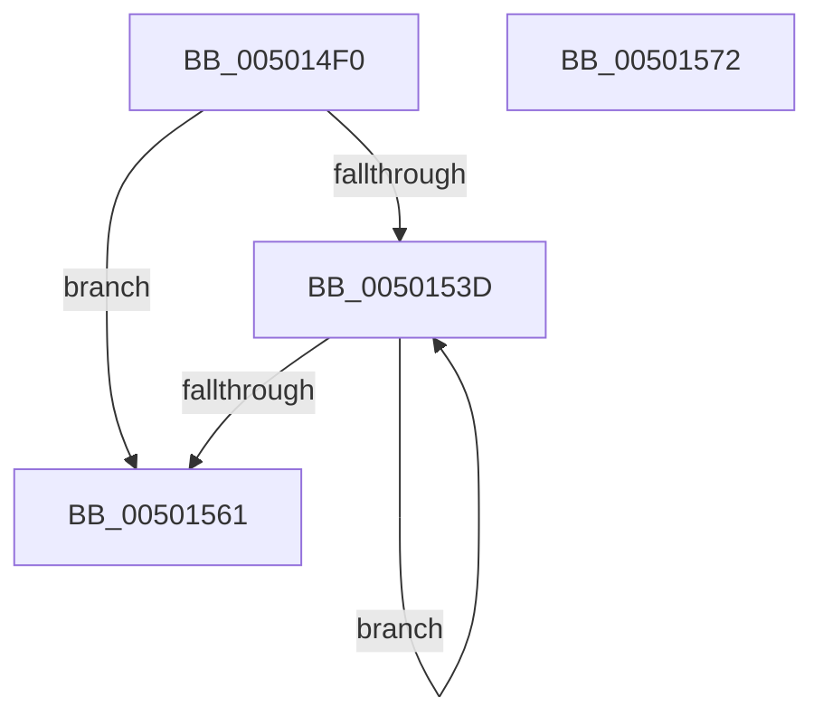

# strchr

- RVA: `0x005014F0`–`0x00501573` (길이 `131` bytes)
- VA: `0x00000001405014F0`
- 실행 섹션: `.text`
- PDB 이름 있음: `예`; PDB Function 태그: `아니요`
- unwind 정보 RVA: `0x000DB714`
- 디코드: `38`개 명령, `131/131` bytes 표시
- 미해석 바이트: `0` (있으면 어셈블리에 `.byte`로 보존)

> 이 문서는 커널 이미지의 기계어와 PDB 기호를 분석해 생성했습니다. 4번과 5번은 함수 원형과 자료형을 바이너리 사용 방식에서 추정한 C 해석이며 원본 소스 복구 결과는 아닙니다.

## 1. Dependencies

- 직접 호출 지점: **0**; 고유 호출 대상: **0**
- 직접 호출자로 확인된 함수: **6**
- RIP 상대 이미지 참조: **1**

### Outgoing calls
- 직접 디코드된 call 명령이 없습니다.

### Direct callers
- [WmipSMBiosFindStringAndZero](../../page/7B/WmipSMBiosFindStringAndZero_function_007B3250.md) at `0x007B3286`
- [MiSnapThunk](../../page/A2/MiSnapThunk_function_00A24004.md) at `0x00A24184`
- [EmpParseRuleTerm](../../init/C2/EmpParseRuleTerm_function_00C26FC0.md) at `0x00C2700D`
- [EmpParseTargetRuleStringIndexList](../../init/C2/EmpParseTargetRuleStringIndexList_function_00C2795C.md) at `0x00C27A61`
- [CmpGetToken](../../init/C2/CmpGetToken_function_00C28488.md) at `0x00C285ED`
- [CmpGetToken](../../init/C2/CmpGetToken_function_00C28488.md) at `0x00C286CD`
- [PipSmBiosGetString](../../init/C3/PipSmBiosGetString_function_00C3259C.md) at `0x00C32652`
- [PipSmBiosGetString](../../init/C3/PipSmBiosGetString_function_00C3259C.md) at `0x00C32686`

### Static image references
- `0x0050154A` → RVA `0x00010400` (`.rdata`; read)

## 2. Other-region calls and transfers

- 다른 실행 섹션으로 향하는 call: **0**
- 별도 외부 분기/꼬리 이동을 확인하지 못했습니다.

## 3. Assembly (complete function range)

```asm
005014F0  0F B6 C2                        movzx eax, dl
005014F3  4C 8B C1                        mov r8, rcx
005014F6  44 8B D0                        mov r10d, eax
005014F9  49 83 E0 F0                     and r8, 0xfffffffffffffff0
005014FD  41 C1 E2 08                     shl r10d, 8
00501501  83 E1 0F                        and ecx, 0xf
00501504  44 0B D0                        or r10d, eax
00501507  45 33 C9                        xor r9d, r9d
0050150A  83 C8 FF                        or eax, 0xffffffff
0050150D  F3 41 0F 6F 10                  movdqu xmm2, xmmword ptr [r8]
00501512  D3 E0                           shl eax, cl
00501514  66 41 0F 6E C2                  movd xmm0, r10d
00501519  F2 0F 70 C8 00                  pshuflw xmm1, xmm0, 0
0050151E  0F 57 C0                        xorps xmm0, xmm0
00501521  66 0F 70 D9 00                  pshufd xmm3, xmm1, 0
00501526  66 0F 74 C2                     pcmpeqb xmm0, xmm2
0050152A  66 0F 6F CB                     movdqa xmm1, xmm3
0050152E  66 0F 74 CA                     pcmpeqb xmm1, xmm2
00501532  0F 56 C8                        orps xmm1, xmm0
00501535  66 0F D7 D1                     pmovmskb edx, xmm1
00501539  23 D0                           and edx, eax
0050153B  75 24                           jne 0x140501561
0050153D  49 83 C0 10                     add r8, 0x10
00501541  F3 41 0F 6F 00                  movdqu xmm0, xmmword ptr [r8]
00501546  66 0F 6F C8                     movdqa xmm1, xmm0
0050154A  66 0F 74 05 AE EE B0 FF         pcmpeqb xmm0, xmmword ptr [rip - 0x4f1152]
00501552  66 0F 74 CB                     pcmpeqb xmm1, xmm3
00501556  0F 56 C8                        orps xmm1, xmm0
00501559  66 0F D7 D1                     pmovmskb edx, xmm1
0050155D  85 D2                           test edx, edx
0050155F  74 DC                           je 0x14050153d
00501561  0F BC D2                        bsf edx, edx
00501564  49 03 D0                        add rdx, r8
00501567  44 38 12                        cmp byte ptr [rdx], r10b
0050156A  4C 0F 44 CA                     cmove r9, rdx
0050156E  49 8B C1                        mov rax, r9
00501571  C3                              ret
00501572  CC                              int3
```

## 4. C-style interpretation (structured pseudocode)

```c
__int64 __fastcall strchr(__int64 a1, unsigned __int8 a2, __int64 a3, int a4)
{
    __int64 result;
    __int64 v_r10;

    a3 = (a1) & (-16);
    v_r10 = (unsigned int)(((unsigned int)(a2)) << (8));
    a1 = (unsigned int)((a1) & (15));
    v_r10 = (unsigned int)((v_r10) | (a2));
    a4 = 0;
    result = (unsigned int)((a2) | (0xFFFFFFFFULL));
    result = (unsigned int)((result) << ((unsigned __int8)(a1)));
    a2 = (unsigned int)((a2) & ((unsigned int)(result)));
    if (condition_is_not_equal) goto loc_00501561;
loc_0050153D:
    a3 = (a3) + (16);
    if (a2 == 0) goto loc_0050153D;
loc_00501561:
    a2 = (a2) + (a3);
    if ((*(unsigned __int8 *)(a2)) == ((unsigned __int8)(v_r10))) { a4 = a2; }
    return a4;
}
```

## 5. (Beta) C Style

```c
int64_t strchr(void *Arg1, uint8_t Arg2, int64_t Arg3, int32_t Arg4)
{
    uint8_t *arg1 = (uint8_t *)Arg1;

    int64_t result;
    int64_t local_r10;

    Arg3 = (Arg1) & (-16);
    local_r10 = (uint32_t)(((uint32_t)(Arg2)) << (8));
    Arg1 = (uint32_t)((Arg1) & (15));
    local_r10 = (uint32_t)((local_r10) | (Arg2));
    Arg4 = 0;
    result = (uint32_t)((Arg2) | (0xFFFFFFFFULL));
    result = (uint32_t)((result) << ((uint8_t)(Arg1)));
    Arg2 = (uint32_t)((Arg2) & ((uint32_t)(result)));
    if (condition_is_not_equal) goto loc_00501561;
loc_0050153D:
    Arg3 = (Arg3) + (16);
    if (Arg2 == 0) goto loc_0050153D;
loc_00501561:
    Arg2 = (Arg2) + (Arg3);
    if ((*(uint8_t *)(Arg2)) == ((uint8_t)(local_r10))) { Arg4 = Arg2; }
    return Arg4;
}
```

### 관측된 메모리 오프셋

구조체 형식이 확인되지 않은 접근은 인자 기준의 오프셋으로만 기록했습니다.

| 기준 인자 | 오프셋 표현 | 폭 (bit) | 접근 |
|---|---:|---:|---|
| `Arg1` | `+ 0x0` | `128` | `R` |

## 6. Execution-region graph

[열기: 2D/3D 그래프와 함수 탐색 컨트롤 패널](../../../control-panel.html?section=text&rva=0x005014F0&view=graph)

- 2D 그래프는 위에서 아래로 흐르고, 3D 그래프는 빈 공간을 드래그해 회전합니다. Shift+드래그는 이동, 휠은 확대·축소, 함수 노드 선택은 대상 보고서 이동입니다.

### Static fallback


