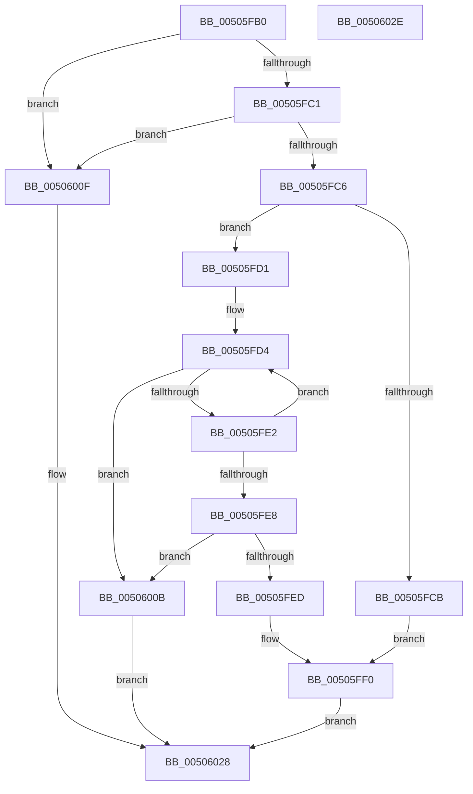

# strcpy_s

- RVA: `0x00505FB0`–`0x0050602F` (길이 `127` bytes)
- VA: `0x0000000140505FB0`
- 실행 섹션: `.text`
- PDB 이름 있음: `예`; PDB Function 태그: `아니요`
- unwind 정보 RVA: `0x00064C80`
- 디코드: `45`개 명령, `127/127` bytes 표시
- 미해석 바이트: `0` (있으면 어셈블리에 `.byte`로 보존)

> 이 문서는 커널 이미지의 기계어와 PDB 기호를 분석해 생성했습니다. 4번과 5번은 함수 원형과 자료형을 바이너리 사용 방식에서 추정한 C 해석이며 원본 소스 복구 결과는 아닙니다.

## 1. Dependencies

- 직접 호출 지점: **2**; 고유 호출 대상: **1**
- 직접 호출자로 확인된 함수: **9**
- RIP 상대 이미지 참조: **0**

### Outgoing calls
- `0x00506002` → [EmpCheckErrataList](../49/EmpCheckErrataList_function_0049E550.md) (function, `0x0049E550`)
- `0x0050601E` → [EmpCheckErrataList](../49/EmpCheckErrataList_function_0049E550.md) (function, `0x0049E550`)

### Direct callers
- [CmpAddProcessorConfigurationEntry](../../page/7E/CmpAddProcessorConfigurationEntry_function_007E4CF8.md) at `0x007E4E92`
- [BiConvertBootEnvironmentDeviceToNt](../../page/82/BiConvertBootEnvironmentDeviceToNt_function_00823E44.md) at `0x00824066`
- [BiConvertNtDeviceToBootEnvironment](../../page/A4/BiConvertNtDeviceToBootEnvironment_function_00A41760.md) at `0x00A41BA8`
- [RtlIncrementCorrelationVector](../../page/AB/RtlIncrementCorrelationVector_function_00AB9430.md) at `0x00AB94DE`
- [ExpSystemErrorHandler2](../../pagelk/B7/ExpSystemErrorHandler2_function_00B72C30.md) at `0x00B72F54`
- [HdlspGetLine](../../pagehdls/BB/HdlspGetLine_function_00BBDAA4.md) at `0x00BBDD03`
- [HdlspSetBlueScreenInformation](../../pagehdls/BB/HdlspSetBlueScreenInformation_function_00BBE600.md) at `0x00BBE6FB`
- [HdlspSetBlueScreenInformation](../../pagehdls/BB/HdlspSetBlueScreenInformation_function_00BBE600.md) at `0x00BBE7B4`
- [HdlspSetBlueScreenInformation](../../pagehdls/BB/HdlspSetBlueScreenInformation_function_00BBE600.md) at `0x00BBE7ED`
- [PspCreateSecureSystemProcess](../../init/C4/PspCreateSecureSystemProcess_function_00C452E4.md) at `0x00C45393`
- [PspInitPhase0](../../init/C7/PspInitPhase0_function_00C77E2C.md) at `0x00C78976`
- [PspInitPhase0](../../init/C7/PspInitPhase0_function_00C77E2C.md) at `0x00C78992`

### Static image references
- 디코드된 RIP-relative 메모리 참조가 없습니다.

## 2. Other-region calls and transfers

- 다른 실행 섹션으로 향하는 call: **0**
- 별도 외부 분기/꼬리 이동을 확인하지 못했습니다.

## 3. Assembly (complete function range)

```asm
00505FB0  40 53                           push rbx
00505FB2  48 83 EC 30                     sub rsp, 0x30
00505FB6  45 33 D2                        xor r10d, r10d
00505FB9  4C 8B C9                        mov r9, rcx
00505FBC  48 85 C9                        test rcx, rcx
00505FBF  74 4E                           je 0x14050600f
00505FC1  48 85 D2                        test rdx, rdx
00505FC4  74 49                           je 0x14050600f
00505FC6  4D 85 C0                        test r8, r8
00505FC9  75 06                           jne 0x140505fd1
00505FCB  41 8D 5A 16                     lea ebx, [r10 + 0x16]
00505FCF  EB 1F                           jmp 0x140505ff0
00505FD1  49 2B C8                        sub rcx, r8
00505FD4  41 8A 00                        mov al, byte ptr [r8]
00505FD7  42 88 04 01                     mov byte ptr [rcx + r8], al
00505FDB  49 FF C0                        inc r8
00505FDE  84 C0                           test al, al
00505FE0  74 29                           je 0x14050600b
00505FE2  48 83 EA 01                     sub rdx, 1
00505FE6  75 EC                           jne 0x140505fd4
00505FE8  48 85 D2                        test rdx, rdx
00505FEB  75 1E                           jne 0x14050600b
00505FED  8D 5A 22                        lea ebx, [rdx + 0x22]
00505FF0  45 88 11                        mov byte ptr [r9], r10b
00505FF3  45 33 C0                        xor r8d, r8d
00505FF6  45 33 C9                        xor r9d, r9d
00505FF9  4C 89 54 24 20                  mov qword ptr [rsp + 0x20], r10
00505FFE  33 D2                           xor edx, edx
00506000  33 C9                           xor ecx, ecx
00506002  E8 49 85 F9 FF                  call 0x14049e550
00506007  8B C3                           mov eax, ebx
00506009  EB 1D                           jmp 0x140506028
0050600B  33 C0                           xor eax, eax
0050600D  EB 19                           jmp 0x140506028
0050600F  45 33 C9                        xor r9d, r9d
00506012  4C 89 54 24 20                  mov qword ptr [rsp + 0x20], r10
00506017  45 33 C0                        xor r8d, r8d
0050601A  33 D2                           xor edx, edx
0050601C  33 C9                           xor ecx, ecx
0050601E  E8 2D 85 F9 FF                  call 0x14049e550
00506023  B8 16 00 00 00                  mov eax, 0x16
00506028  48 83 C4 30                     add rsp, 0x30
0050602C  5B                              pop rbx
0050602D  C3                              ret
0050602E  CC                              int3
```

## 4. C-style interpretation (structured pseudocode)

```c
__int64 __fastcall strcpy_s(__int64 a1, __int64 a2, __int64 a3)
{
    __int64 result;
    __int64 v_r10;
    __int64 v_rsp;
    unsigned __int64 v_stack_m18;

    v_rsp = (v_rsp) - (48);
    v_r10 = 0;
    if (a1 == 0) goto loc_0050600F;
    if (a2 == 0) goto loc_0050600F;
    if (a3 != 0) goto loc_00505FD1;
    goto loc_00505FF0;
loc_00505FD1:
    a1 = (a1) - (a3);
loc_00505FD4:
    *(unsigned __int8 *)(a1 + a3 * 1) = (unsigned __int8)(*(unsigned __int8 *)(a3));
    a3 = (a3) + 1;
    if ((unsigned __int8)(*(unsigned __int8 *)(a3)) == 0) goto loc_0050600B;
    a2 = (a2) - (1);
    if (condition_is_not_equal) goto loc_00505FD4;
    if (a2 != 0) goto loc_0050600B;
loc_00505FF0:
    *(unsigned __int8 *)(a1) = 0;
    a3 = 0;
    a4 = 0;
    v_stack_m18 = 0;
    a2 = 0;
    a1 = 0;
    result = EmpCheckErrataList(a1, a2, a3, a4);
    goto loc_00506028;
loc_0050600B:
    result = 0;
    goto loc_00506028;
loc_0050600F:
    a4 = 0;
    v_stack_m18 = 0;
    a3 = 0;
    a2 = 0;
    a1 = 0;
    result = EmpCheckErrataList(a1, a2, a3, a4);
loc_00506028:
    v_rsp = (v_rsp) + (48);
    return 22;
}
```

## 5. (Beta) C Style

```c
int64_t strcpy_s(void *Arg1, int64_t Arg2, int64_t Arg3)
{
    uint8_t *arg1 = (uint8_t *)Arg1;

    int64_t result;
    int64_t local_r10;
    int64_t local_rsp;
    uint64_t v_stack_m18;

    local_rsp = (local_rsp) - (48);
    local_r10 = 0;
    if (Arg1 == NULL) goto loc_0050600F;
    if (Arg2 == 0) goto loc_0050600F;
    if (Arg3 != 0) goto loc_00505FD1;
    goto loc_00505FF0;
loc_00505FD1:
    Arg1 = (Arg1) - (Arg3);
loc_00505FD4:
    *(uint8_t *)(arg1 + Arg3 * 1) = (uint8_t)(*(uint8_t *)(Arg3));
    Arg3 = (Arg3) + 1;
    if ((uint8_t)(*(uint8_t *)(Arg3)) == 0) goto loc_0050600B;
    Arg2 = (Arg2) - (1);
    if (condition_is_not_equal) goto loc_00505FD4;
    if (Arg2 != 0) goto loc_0050600B;
loc_00505FF0:
    *(uint8_t *)(arg1) = 0;
    Arg3 = 0;
    a4 = 0;
    v_stack_m18 = 0;
    Arg2 = 0;
    Arg1 = 0;
    result = EmpCheckErrataList(Arg1, Arg2, Arg3, a4);
    goto loc_00506028;
loc_0050600B:
    result = 0;
    goto loc_00506028;
loc_0050600F:
    a4 = 0;
    v_stack_m18 = 0;
    Arg3 = 0;
    Arg2 = 0;
    Arg1 = 0;
    result = EmpCheckErrataList(Arg1, Arg2, Arg3, a4);
loc_00506028:
    local_rsp = (local_rsp) + (48);
    return 22;
}
```

### 관측된 메모리 오프셋

구조체 형식이 확인되지 않은 접근은 인자 기준의 오프셋으로만 기록했습니다.

| 기준 인자 | 오프셋 표현 | 폭 (bit) | 접근 |
|---|---:|---:|---|
| `Arg1` | `+ 0x0` | `8` | `W` |

## 6. Execution-region graph

[열기: 2D/3D 그래프와 함수 탐색 컨트롤 패널](../../../control-panel.html?section=text&rva=0x00505FB0&view=graph)

- 2D 그래프는 위에서 아래로 흐르고, 3D 그래프는 빈 공간을 드래그해 회전합니다. Shift+드래그는 이동, 휠은 확대·축소, 함수 노드 선택은 대상 보고서 이동입니다.

### Static fallback


