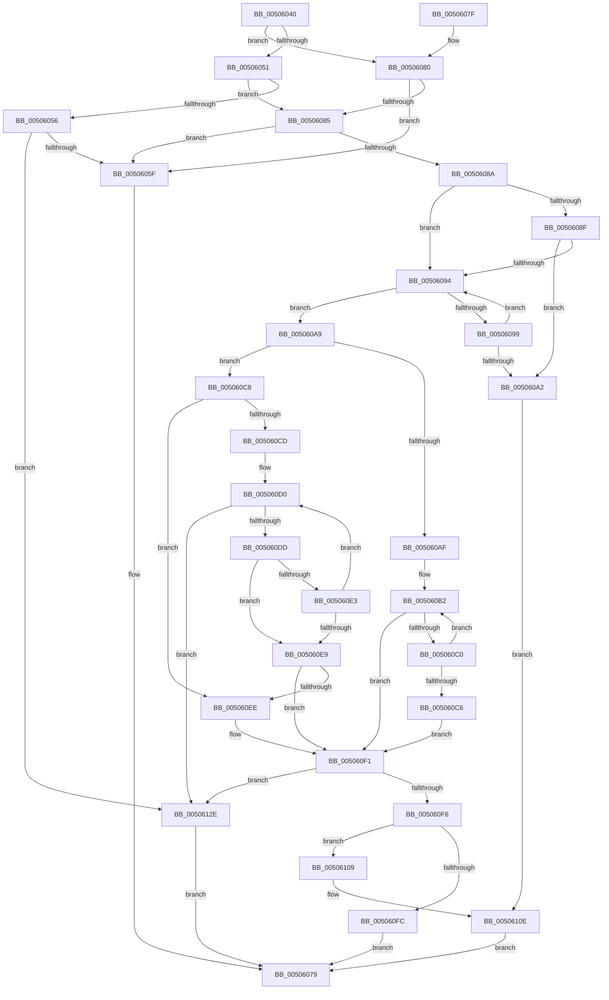

# strncat_s

- RVA: `0x00506040`–`0x00506135` (길이 `245` bytes)
- VA: `0x0000000140506040`
- 실행 섹션: `.text`
- PDB 이름 있음: `예`; PDB Function 태그: `아니요`
- unwind 정보 RVA: `0x000C290C`
- 디코드: `81`개 명령, `245/245` bytes 표시
- 미해석 바이트: `0` (있으면 어셈블리에 `.byte`로 보존)

> 이 문서는 커널 이미지의 기계어와 PDB 기호를 분석해 생성했습니다. 4번과 5번은 함수 원형과 자료형을 바이너리 사용 방식에서 추정한 C 해석이며 원본 소스 복구 결과는 아닙니다.

## 1. Dependencies

- 직접 호출 지점: **2**; 고유 호출 대상: **1**
- 직접 호출자로 확인된 함수: **0**
- RIP 상대 이미지 참조: **0**

### Outgoing calls
- `0x0050606F` → [EmpCheckErrataList](../49/EmpCheckErrataList_function_0049E550.md) (function, `0x0049E550`)
- `0x00506122` → [EmpCheckErrataList](../49/EmpCheckErrataList_function_0049E550.md) (function, `0x0049E550`)

### Direct callers
- 이 함수 시작 RVA로 연결되는 직접 call은 확인되지 않았습니다. 간접 호출은 완전히 역산할 수 없습니다.

### Static image references
- 디코드된 RIP-relative 메모리 참조가 없습니다.

## 2. Other-region calls and transfers

- 다른 실행 섹션으로 향하는 call: **0**
- 별도 외부 분기/꼬리 이동을 확인하지 못했습니다.

## 3. Assembly (complete function range)

```asm
00506040  40 53                           push rbx
00506042  48 83 EC 30                     sub rsp, 0x30
00506046  4C 8B DA                        mov r11, rdx
00506049  4C 8B D1                        mov r10, rcx
0050604C  4D 85 C9                        test r9, r9
0050604F  75 2F                           jne 0x140506080
00506051  48 85 C9                        test rcx, rcx
00506054  75 2F                           jne 0x140506085
00506056  48 85 D2                        test rdx, rdx
00506059  0F 84 CF 00 00 00               je 0x14050612e
0050605F  48 83 64 24 20 00               and qword ptr [rsp + 0x20], 0
00506065  45 33 C9                        xor r9d, r9d
00506068  45 33 C0                        xor r8d, r8d
0050606B  33 D2                           xor edx, edx
0050606D  33 C9                           xor ecx, ecx
0050606F  E8 DC 84 F9 FF                  call 0x14049e550
00506074  B8 16 00 00 00                  mov eax, 0x16
00506079  48 83 C4 30                     add rsp, 0x30
0050607D  5B                              pop rbx
0050607E  C3                              ret
0050607F  CC                              int3
00506080  4D 85 D2                        test r10, r10
00506083  74 DA                           je 0x14050605f
00506085  4D 85 DB                        test r11, r11
00506088  74 D5                           je 0x14050605f
0050608A  4D 85 C9                        test r9, r9
0050608D  74 05                           je 0x140506094
0050608F  4D 85 C0                        test r8, r8
00506092  74 0E                           je 0x1405060a2
00506094  80 39 00                        cmp byte ptr [rcx], 0
00506097  74 10                           je 0x1405060a9
00506099  48 FF C1                        inc rcx
0050609C  48 83 EA 01                     sub rdx, 1
005060A0  75 F2                           jne 0x140506094
005060A2  BB 16 00 00 00                  mov ebx, 0x16
005060A7  EB 65                           jmp 0x14050610e
005060A9  49 83 F9 FF                     cmp r9, -1
005060AD  75 19                           jne 0x1405060c8
005060AF  49 2B C8                        sub rcx, r8
005060B2  41 8A 00                        mov al, byte ptr [r8]
005060B5  42 88 04 01                     mov byte ptr [rcx + r8], al
005060B9  49 FF C0                        inc r8
005060BC  84 C0                           test al, al
005060BE  74 31                           je 0x1405060f1
005060C0  48 83 EA 01                     sub rdx, 1
005060C4  75 EC                           jne 0x1405060b2
005060C6  EB 29                           jmp 0x1405060f1
005060C8  4D 85 C9                        test r9, r9
005060CB  74 21                           je 0x1405060ee
005060CD  4C 2B C1                        sub r8, rcx
005060D0  41 8A 04 08                     mov al, byte ptr [r8 + rcx]
005060D4  88 01                           mov byte ptr [rcx], al
005060D6  48 FF C1                        inc rcx
005060D9  84 C0                           test al, al
005060DB  74 51                           je 0x14050612e
005060DD  48 83 EA 01                     sub rdx, 1
005060E1  74 06                           je 0x1405060e9
005060E3  49 83 E9 01                     sub r9, 1
005060E7  75 E7                           jne 0x1405060d0
005060E9  4D 85 C9                        test r9, r9
005060EC  75 03                           jne 0x1405060f1
005060EE  C6 01 00                        mov byte ptr [rcx], 0
005060F1  48 85 D2                        test rdx, rdx
005060F4  75 38                           jne 0x14050612e
005060F6  49 83 F9 FF                     cmp r9, -1
005060FA  75 0D                           jne 0x140506109
005060FC  43 88 54 1A FF                  mov byte ptr [r10 + r11 - 1], dl
00506101  8D 42 50                        lea eax, [rdx + 0x50]
00506104  E9 70 FF FF FF                  jmp 0x140506079
00506109  BB 22 00 00 00                  mov ebx, 0x22
0050610E  48 83 64 24 20 00               and qword ptr [rsp + 0x20], 0
00506114  45 33 C9                        xor r9d, r9d
00506117  45 33 C0                        xor r8d, r8d
0050611A  41 C6 02 00                     mov byte ptr [r10], 0
0050611E  33 D2                           xor edx, edx
00506120  33 C9                           xor ecx, ecx
00506122  E8 29 84 F9 FF                  call 0x14049e550
00506127  8B C3                           mov eax, ebx
00506129  E9 4B FF FF FF                  jmp 0x140506079
0050612E  33 C0                           xor eax, eax
00506130  E9 44 FF FF FF                  jmp 0x140506079
```

## 4. C-style interpretation (structured pseudocode)

```c
__int64 __fastcall strncat_s(__int64 a1, __int64 a2, int a3, __int64 a4)
{
    __int64 result;
    __int64 v_rsp;
    unsigned __int64 v_stack_m18;
    unsigned __int64 v_stack_p20;

    v_rsp = (v_rsp) - (48);
    if (a4 != 0) goto loc_00506080;
    if (a1 != 0) goto loc_00506085;
    if (a2 == 0) goto loc_0050612E;
loc_0050605F:
    a4 = 0;
    a3 = 0;
    a2 = 0;
    a1 = 0;
    result = EmpCheckErrataList(a1, a2, a3, a4);
loc_00506079:
    v_rsp = (v_rsp) + (48);
    return 22;
loc_00506080:
    if (0 == 0) goto loc_0050605F;
loc_00506085:
    if (0 == 0) goto loc_0050605F;
    if (0 == 0) goto loc_00506094;
    if (0 == 0) goto loc_005060A2;
loc_00506094:
    if ((*(unsigned __int8 *)(a1)) == 0) goto loc_005060A9;
    a1 = (a1) + 1;
    a2 = (a2) - (1);
    if (condition_is_not_equal) goto loc_00506094;
loc_005060A2:
    goto loc_0050610E;
loc_005060A9:
    if (0 != -1) goto loc_005060C8;
    a1 = (a1) - (0);
loc_005060B2:
    *(unsigned __int8 *)(a1 + a3 * 1) = (unsigned __int8)(*(unsigned __int8 *)(a3));
    a3 = (a3) + 1;
    if ((unsigned __int8)(*(unsigned __int8 *)(a3)) == 0) goto loc_005060F1;
    a2 = (a2) - (1);
    if (condition_is_not_equal) goto loc_005060B2;
    goto loc_005060F1;
loc_005060C8:
    if (0 == 0) goto loc_005060EE;
    a3 = (a3) - (a1);
loc_005060D0:
    *(unsigned __int8 *)(a1) = (unsigned __int8)(*(unsigned __int8 *)(a3 + a1 * 1));
    a1 = (a1) + 1;
    if ((unsigned __int8)(*(unsigned __int8 *)(a3 + a1 * 1)) == 0) goto loc_0050612E;
    a2 = (a2) - (1);
    if (condition_is_equal) goto loc_005060E9;
    a4 = (a4) - (1);
    if (condition_is_not_equal) goto loc_005060D0;
loc_005060E9:
    if (a4 == 0) {
        *(unsigned __int8 *)(a1) = 0;
    }
    if (a2 != 0) goto loc_0050612E;
    if (a4 != -1) goto loc_00506109;
    *(unsigned __int8 *)(a1 + a2 * 1 - 1) = (unsigned __int8)(a2);
    goto loc_00506079;
loc_00506109:
loc_0050610E:
    a4 = 0;
    a3 = 0;
    *(unsigned __int8 *)(a1) = 0;
    a2 = 0;
    a1 = 0;
    result = EmpCheckErrataList(a1, a2, a3, a4);
    goto loc_00506079;
loc_0050612E:
    result = 0;
    goto loc_00506079;
}
```

## 5. (Beta) C Style

```c
int64_t strncat_s(int64_t Arg1, int64_t Arg2, int32_t Arg3, int64_t Arg4)
{
    int64_t result;
    int64_t local_rsp;
    uint64_t v_stack_m18;
    uint64_t v_stack_p20;

    local_rsp = (local_rsp) - (48);
    if (Arg4 != 0) goto loc_00506080;
    if (Arg1 != 0) goto loc_00506085;
    if (Arg2 == 0) goto loc_0050612E;
loc_0050605F:
    Arg4 = 0;
    Arg3 = 0;
    Arg2 = 0;
    Arg1 = 0;
    result = EmpCheckErrataList(Arg1, Arg2, Arg3, Arg4);
loc_00506079:
    local_rsp = (local_rsp) + (48);
    return 22;
loc_00506080:
    if (0 == 0) goto loc_0050605F;
loc_00506085:
    if (0 == 0) goto loc_0050605F;
    if (0 == 0) goto loc_00506094;
    if (0 == 0) goto loc_005060A2;
loc_00506094:
    if ((*(uint8_t *)(Arg1)) == 0) goto loc_005060A9;
    Arg1 = (Arg1) + 1;
    Arg2 = (Arg2) - (1);
    if (condition_is_not_equal) goto loc_00506094;
loc_005060A2:
    goto loc_0050610E;
loc_005060A9:
    if (0 != -1) goto loc_005060C8;
    Arg1 = (Arg1) - (0);
loc_005060B2:
    *(uint8_t *)(Arg1 + Arg3 * 1) = (uint8_t)(*(uint8_t *)(Arg3));
    Arg3 = (Arg3) + 1;
    if ((uint8_t)(*(uint8_t *)(Arg3)) == 0) goto loc_005060F1;
    Arg2 = (Arg2) - (1);
    if (condition_is_not_equal) goto loc_005060B2;
    goto loc_005060F1;
loc_005060C8:
    if (0 == 0) goto loc_005060EE;
    Arg3 = (Arg3) - (Arg1);
loc_005060D0:
    *(uint8_t *)(Arg1) = (uint8_t)(*(uint8_t *)(Arg3 + Arg1 * 1));
    Arg1 = (Arg1) + 1;
    if ((uint8_t)(*(uint8_t *)(Arg3 + Arg1 * 1)) == 0) goto loc_0050612E;
    Arg2 = (Arg2) - (1);
    if (condition_is_equal) goto loc_005060E9;
    Arg4 = (Arg4) - (1);
    if (condition_is_not_equal) goto loc_005060D0;
loc_005060E9:
    if (Arg4 == 0) {
        *(uint8_t *)(Arg1) = 0;
    }
    if (Arg2 != 0) goto loc_0050612E;
    if (Arg4 != -1) goto loc_00506109;
    *(uint8_t *)(Arg1 + Arg2 * 1 - 0x1) = (uint8_t)(Arg2);
    goto loc_00506079;
loc_00506109:
loc_0050610E:
    Arg4 = 0;
    Arg3 = 0;
    *(uint8_t *)(Arg1) = 0;
    Arg2 = 0;
    Arg1 = 0;
    result = EmpCheckErrataList(Arg1, Arg2, Arg3, Arg4);
    goto loc_00506079;
loc_0050612E:
    result = 0;
    goto loc_00506079;
}
```

## 6. Execution-region graph

[열기: 2D/3D 그래프와 함수 탐색 컨트롤 패널](../../../control-panel.html?section=text&rva=0x00506040&view=graph)

- 2D 그래프는 위에서 아래로 흐르고, 3D 그래프는 빈 공간을 드래그해 회전합니다. Shift+드래그는 이동, 휠은 확대·축소, 함수 노드 선택은 대상 보고서 이동입니다.

### Static fallback


