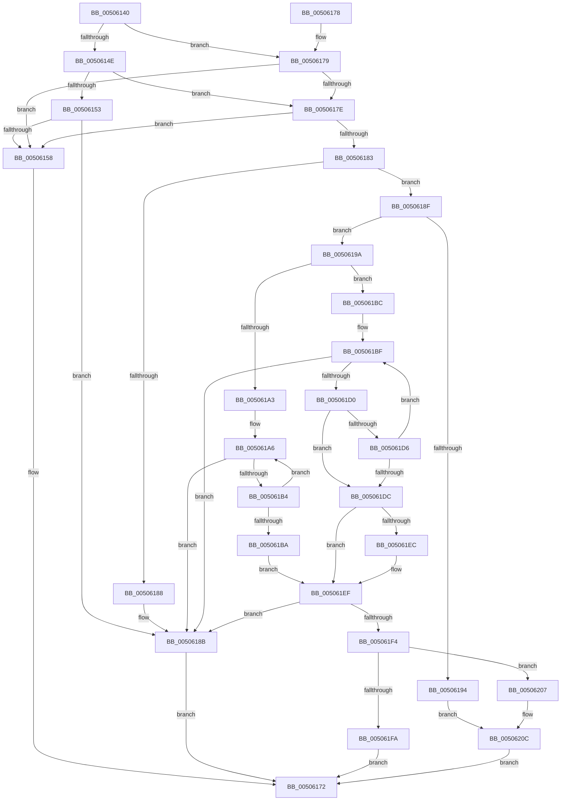

# strncpy_s

- RVA: `0x00506140`–`0x0050622B` (길이 `235` bytes)
- VA: `0x0000000140506140`
- 실행 섹션: `.text`
- PDB 이름 있음: `예`; PDB Function 태그: `아니요`
- unwind 정보 RVA: `0x000C2918`
- 디코드: `79`개 명령, `235/235` bytes 표시
- 미해석 바이트: `0` (있으면 어셈블리에 `.byte`로 보존)

> 이 문서는 커널 이미지의 기계어와 PDB 기호를 분석해 생성했습니다. 4번과 5번은 함수 원형과 자료형을 바이너리 사용 방식에서 추정한 C 해석이며 원본 소스 복구 결과는 아닙니다.

## 1. Dependencies

- 직접 호출 지점: **2**; 고유 호출 대상: **1**
- 직접 호출자로 확인된 함수: **4**
- RIP 상대 이미지 참조: **0**

### Outgoing calls
- `0x00506168` → [EmpCheckErrataList](../49/EmpCheckErrataList_function_0049E550.md) (function, `0x0049E550`)
- `0x0050621F` → [EmpCheckErrataList](../49/EmpCheckErrataList_function_0049E550.md) (function, `0x0049E550`)

### Direct callers
- [splitpath_s](splitpath_s_function_00505560.md) at `0x00505644`
- [splitpath_s](splitpath_s_function_00505560.md) at `0x005056B7`
- [splitpath_s](splitpath_s_function_00505560.md) at `0x005056F9`
- [splitpath_s](splitpath_s_function_00505560.md) at `0x00505723`
- [splitpath_s](splitpath_s_function_00505560.md) at `0x0050574D`
- [HalGetEnvironmentVariable](../54/HalGetEnvironmentVariable_function_005430E0.md) at `0x00543156`
- [PspCatchCriticalBreak](../../page/78/PspCatchCriticalBreak_function_00786408.md) at `0x0078655B`
- [CmpGetToken](../../init/C2/CmpGetToken_function_00C28488.md) at `0x00C2865E`

### Static image references
- 디코드된 RIP-relative 메모리 참조가 없습니다.

## 2. Other-region calls and transfers

- 다른 실행 섹션으로 향하는 call: **0**
- 별도 외부 분기/꼬리 이동을 확인하지 못했습니다.

## 3. Assembly (complete function range)

```asm
00506140  40 53                           push rbx
00506142  48 83 EC 30                     sub rsp, 0x30
00506146  4C 8B D2                        mov r10, rdx
00506149  4D 85 C9                        test r9, r9
0050614C  75 2B                           jne 0x140506179
0050614E  48 85 C9                        test rcx, rcx
00506151  75 2B                           jne 0x14050617e
00506153  48 85 D2                        test rdx, rdx
00506156  74 33                           je 0x14050618b
00506158  48 83 64 24 20 00               and qword ptr [rsp + 0x20], 0
0050615E  45 33 C9                        xor r9d, r9d
00506161  45 33 C0                        xor r8d, r8d
00506164  33 D2                           xor edx, edx
00506166  33 C9                           xor ecx, ecx
00506168  E8 E3 83 F9 FF                  call 0x14049e550
0050616D  B8 16 00 00 00                  mov eax, 0x16
00506172  48 83 C4 30                     add rsp, 0x30
00506176  5B                              pop rbx
00506177  C3                              ret
00506178  CC                              int3
00506179  48 85 C9                        test rcx, rcx
0050617C  74 DA                           je 0x140506158
0050617E  4D 85 D2                        test r10, r10
00506181  74 D5                           je 0x140506158
00506183  4D 85 C9                        test r9, r9
00506186  75 07                           jne 0x14050618f
00506188  44 88 09                        mov byte ptr [rcx], r9b
0050618B  33 C0                           xor eax, eax
0050618D  EB E3                           jmp 0x140506172
0050618F  4D 85 C0                        test r8, r8
00506192  75 06                           jne 0x14050619a
00506194  41 8D 58 16                     lea ebx, [r8 + 0x16]
00506198  EB 72                           jmp 0x14050620c
0050619A  4C 8B D9                        mov r11, rcx
0050619D  49 83 F9 FF                     cmp r9, -1
005061A1  75 19                           jne 0x1405061bc
005061A3  4D 2B D8                        sub r11, r8
005061A6  41 8A 00                        mov al, byte ptr [r8]
005061A9  43 88 04 03                     mov byte ptr [r11 + r8], al
005061AD  49 FF C0                        inc r8
005061B0  84 C0                           test al, al
005061B2  74 D7                           je 0x14050618b
005061B4  48 83 EA 01                     sub rdx, 1
005061B8  75 EC                           jne 0x1405061a6
005061BA  EB 33                           jmp 0x1405061ef
005061BC  4C 2B C1                        sub r8, rcx
005061BF  43 8A 04 18                     mov al, byte ptr [r8 + r11]
005061C3  49 8B D9                        mov rbx, r9
005061C6  41 88 03                        mov byte ptr [r11], al
005061C9  49 FF C3                        inc r11
005061CC  84 C0                           test al, al
005061CE  74 BB                           je 0x14050618b
005061D0  48 83 EA 01                     sub rdx, 1
005061D4  74 06                           je 0x1405061dc
005061D6  49 83 E9 01                     sub r9, 1
005061DA  75 E3                           jne 0x1405061bf
005061DC  48 85 D2                        test rdx, rdx
005061DF  4C 8D 4B FF                     lea r9, [rbx - 1]
005061E3  4C 0F 44 CB                     cmove r9, rbx
005061E7  4D 85 C9                        test r9, r9
005061EA  75 03                           jne 0x1405061ef
005061EC  45 88 0B                        mov byte ptr [r11], r9b
005061EF  48 85 D2                        test rdx, rdx
005061F2  75 97                           jne 0x14050618b
005061F4  49 83 F9 FF                     cmp r9, -1
005061F8  75 0D                           jne 0x140506207
005061FA  42 88 54 11 FF                  mov byte ptr [rcx + r10 - 1], dl
005061FF  8D 42 50                        lea eax, [rdx + 0x50]
00506202  E9 6B FF FF FF                  jmp 0x140506172
00506207  BB 22 00 00 00                  mov ebx, 0x22
0050620C  48 83 64 24 20 00               and qword ptr [rsp + 0x20], 0
00506212  45 33 C9                        xor r9d, r9d
00506215  C6 01 00                        mov byte ptr [rcx], 0
00506218  45 33 C0                        xor r8d, r8d
0050621B  33 C9                           xor ecx, ecx
0050621D  33 D2                           xor edx, edx
0050621F  E8 2C 83 F9 FF                  call 0x14049e550
00506224  8B C3                           mov eax, ebx
00506226  E9 47 FF FF FF                  jmp 0x140506172
```

## 4. C-style interpretation (structured pseudocode)

```c
__int64 __fastcall strncpy_s(__int64 a1, __int64 a2, int a3, __int64 a4)
{
    __int64 result;
    __int64 v_r11;
    __int64 v_rsp;
    unsigned __int64 v_stack_m18;
    unsigned __int64 v_stack_p20;

    v_rsp = (v_rsp) - (48);
    if (a4 != 0) goto loc_00506179;
    if (a1 != 0) goto loc_0050617E;
    if (a2 == 0) goto loc_0050618B;
loc_00506158:
    a4 = 0;
    a3 = 0;
    a2 = 0;
    a1 = 0;
    result = EmpCheckErrataList(a1, a2, a3, a4);
loc_00506172:
    v_rsp = (v_rsp) + (48);
    return 22;
loc_00506179:
    if (0 == 0) goto loc_00506158;
loc_0050617E:
    if (0 == 0) goto loc_00506158;
    if (0 != 0) goto loc_0050618F;
    *(unsigned __int8 *)(a1) = 0;
loc_0050618B:
    result = 0;
    goto loc_00506172;
loc_0050618F:
    if (0 != 0) goto loc_0050619A;
    goto loc_0050620C;
loc_0050619A:
    if (0 != -1) goto loc_005061BC;
    v_r11 = (0) - (0);
loc_005061A6:
    *(unsigned __int8 *)(v_r11 + a3 * 1) = (unsigned __int8)(*(unsigned __int8 *)(a3));
    a3 = (a3) + 1;
    if ((unsigned __int8)(*(unsigned __int8 *)(a3)) == 0) goto loc_0050618B;
    a2 = (a2) - (1);
    if (condition_is_not_equal) goto loc_005061A6;
    goto loc_005061EF;
loc_005061BC:
    a3 = (a3) - (0);
loc_005061BF:
    *(unsigned __int8 *)(v_r11) = (unsigned __int8)(*(unsigned __int8 *)(a3 + v_r11 * 1));
    v_r11 = (v_r11) + 1;
    if ((unsigned __int8)(*(unsigned __int8 *)(a3 + v_r11 * 1)) == 0) goto loc_0050618B;
    a2 = (a2) - (1);
    if (condition_is_equal) goto loc_005061DC;
    a4 = (a4) - (1);
    if (condition_is_not_equal) goto loc_005061BF;
loc_005061DC:
    a4 = 0 - 1;
    if (a2 == 0) { a4 = 0; }
    if (a4 == 0) {
        *(unsigned __int8 *)(v_r11) = (unsigned __int8)(a4);
    }
    if (a2 != 0) goto loc_0050618B;
    if (a4 != -1) goto loc_00506207;
    *(unsigned __int8 *)(a1 + a2 * 1 - 1) = (unsigned __int8)(a2);
    goto loc_00506172;
loc_00506207:
loc_0050620C:
    a4 = 0;
    *(unsigned __int8 *)(a1) = 0;
    a3 = 0;
    a1 = 0;
    a2 = 0;
    result = EmpCheckErrataList(a1, a2, a3, a4);
    goto loc_00506172;
}
```

## 5. (Beta) C Style

```c
int64_t strncpy_s(int64_t Arg1, int64_t Arg2, int32_t Arg3, int64_t Arg4)
{
    int64_t result;
    int64_t local_r11;
    int64_t local_rsp;
    uint64_t v_stack_m18;
    uint64_t v_stack_p20;

    local_rsp = (local_rsp) - (48);
    if (Arg4 != 0) goto loc_00506179;
    if (Arg1 != 0) goto loc_0050617E;
    if (Arg2 == 0) goto loc_0050618B;
loc_00506158:
    Arg4 = 0;
    Arg3 = 0;
    Arg2 = 0;
    Arg1 = 0;
    result = EmpCheckErrataList(Arg1, Arg2, Arg3, Arg4);
loc_00506172:
    local_rsp = (local_rsp) + (48);
    return 22;
loc_00506179:
    if (0 == 0) goto loc_00506158;
loc_0050617E:
    if (0 == 0) goto loc_00506158;
    if (0 != 0) goto loc_0050618F;
    *(uint8_t *)(Arg1) = 0;
loc_0050618B:
    result = 0;
    goto loc_00506172;
loc_0050618F:
    if (0 != 0) goto loc_0050619A;
    goto loc_0050620C;
loc_0050619A:
    if (0 != -1) goto loc_005061BC;
    local_r11 = (0) - (0);
loc_005061A6:
    *(uint8_t *)(local_r11 + Arg3 * 1) = (uint8_t)(*(uint8_t *)(Arg3));
    Arg3 = (Arg3) + 1;
    if ((uint8_t)(*(uint8_t *)(Arg3)) == 0) goto loc_0050618B;
    Arg2 = (Arg2) - (1);
    if (condition_is_not_equal) goto loc_005061A6;
    goto loc_005061EF;
loc_005061BC:
    Arg3 = (Arg3) - (0);
loc_005061BF:
    *(uint8_t *)(local_r11) = (uint8_t)(*(uint8_t *)(Arg3 + local_r11 * 1));
    local_r11 = (local_r11) + 1;
    if ((uint8_t)(*(uint8_t *)(Arg3 + local_r11 * 1)) == 0) goto loc_0050618B;
    Arg2 = (Arg2) - (1);
    if (condition_is_equal) goto loc_005061DC;
    Arg4 = (Arg4) - (1);
    if (condition_is_not_equal) goto loc_005061BF;
loc_005061DC:
    Arg4 = 0 - 1;
    if (Arg2 == 0) { Arg4 = 0; }
    if (Arg4 == 0) {
        *(uint8_t *)(local_r11) = (uint8_t)(Arg4);
    }
    if (Arg2 != 0) goto loc_0050618B;
    if (Arg4 != -1) goto loc_00506207;
    *(uint8_t *)(Arg1 + Arg2 * 1 - 0x1) = (uint8_t)(Arg2);
    goto loc_00506172;
loc_00506207:
loc_0050620C:
    Arg4 = 0;
    *(uint8_t *)(Arg1) = 0;
    Arg3 = 0;
    Arg1 = 0;
    Arg2 = 0;
    result = EmpCheckErrataList(Arg1, Arg2, Arg3, Arg4);
    goto loc_00506172;
}
```

## 6. Execution-region graph

[열기: 2D/3D 그래프와 함수 탐색 컨트롤 패널](../../../control-panel.html?section=text&rva=0x00506140&view=graph)

- 2D 그래프는 위에서 아래로 흐르고, 3D 그래프는 빈 공간을 드래그해 회전합니다. Shift+드래그는 이동, 휠은 확대·축소, 함수 노드 선택은 대상 보고서 이동입니다.

### Static fallback


