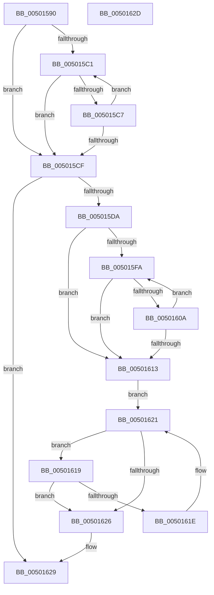

# strnlen

- RVA: `0x00501590`–`0x0050162E` (길이 `158` bytes)
- VA: `0x0000000140501590`
- 실행 섹션: `.text`
- PDB 이름 있음: `예`; PDB Function 태그: `아니요`
- unwind 정보 RVA: `0x000DB714`
- 디코드: `54`개 명령, `158/158` bytes 표시
- 미해석 바이트: `0` (있으면 어셈블리에 `.byte`로 보존)

> 이 문서는 커널 이미지의 기계어와 PDB 기호를 분석해 생성했습니다. 4번과 5번은 함수 원형과 자료형을 바이너리 사용 방식에서 추정한 C 해석이며 원본 소스 복구 결과는 아닙니다.

## 1. Dependencies

- 직접 호출 지점: **0**; 고유 호출 대상: **0**
- 직접 호출자로 확인된 함수: **4**
- RIP 상대 이미지 참조: **0**

### Outgoing calls
- 직접 디코드된 call 명령이 없습니다.

### Direct callers
- [EtwpGetEventNameFromEventMetadata](../3F/EtwpGetEventNameFromEventMetadata_function_003F1590.md) at `0x003F15DE`
- [EtwpSetProviderTraitsCommon](../../page/9F/EtwpSetProviderTraitsCommon_function_009F36EC.md) at `0x009F3766`
- [EtwpGetProviderGroupFromTraits](../../page/9F/EtwpGetProviderGroupFromTraits_function_009F42AC.md) at `0x009F42C8`
- [EtwpAllocateEventNameFilter](../../page/9F/EtwpAllocateEventNameFilter_function_009FCBA4.md) at `0x009FCCF7`

### Static image references
- 디코드된 RIP-relative 메모리 참조가 없습니다.

## 2. Other-region calls and transfers

- 다른 실행 섹션으로 향하는 call: **0**
- 별도 외부 분기/꼬리 이동을 확인하지 못했습니다.

## 3. Assembly (complete function range)

```asm
00501590  4C 8B C1                        mov r8, rcx
00501593  B8 10 00 00 00                  mov eax, 0x10
00501598  41 83 E0 0F                     and r8d, 0xf
0050159C  4C 8B DA                        mov r11, rdx
0050159F  49 2B C0                        sub rax, r8
005015A2  4C 8B C9                        mov r9, rcx
005015A5  49 F7 D8                        neg r8
005015A8  4C 8B C1                        mov r8, rcx
005015AB  4D 1B D2                        sbb r10, r10
005015AE  4C 23 D0                        and r10, rax
005015B1  49 3B D2                        cmp rdx, r10
005015B4  4C 0F 42 D2                     cmovb r10, rdx
005015B8  49 8D 04 0A                     lea rax, [r10 + rcx]
005015BC  48 3B C8                        cmp rcx, rax
005015BF  74 0E                           je 0x1405015cf
005015C1  41 80 38 00                     cmp byte ptr [r8], 0
005015C5  74 08                           je 0x1405015cf
005015C7  49 FF C0                        inc r8
005015CA  4C 3B C0                        cmp r8, rax
005015CD  75 F2                           jne 0x1405015c1
005015CF  49 8B D0                        mov rdx, r8
005015D2  49 2B D1                        sub rdx, r9
005015D5  49 3B D2                        cmp rdx, r10
005015D8  75 4F                           jne 0x140501629
005015DA  49 8B CB                        mov rcx, r11
005015DD  49 8B D0                        mov rdx, r8
005015E0  49 2B CA                        sub rcx, r10
005015E3  0F 57 C9                        xorps xmm1, xmm1
005015E6  48 8B C1                        mov rax, rcx
005015E9  4D 8B D0                        mov r10, r8
005015EC  83 E0 0F                        and eax, 0xf
005015EF  4C 2B D0                        sub r10, rax
005015F2  4C 03 D1                        add r10, rcx
005015F5  4D 3B C2                        cmp r8, r10
005015F8  74 19                           je 0x140501613
005015FA  66 0F 6F C1                     movdqa xmm0, xmm1
005015FE  66 0F 74 02                     pcmpeqb xmm0, xmmword ptr [rdx]
00501602  66 0F D7 C0                     pmovmskb eax, xmm0
00501606  85 C0                           test eax, eax
00501608  75 09                           jne 0x140501613
0050160A  48 83 C2 10                     add rdx, 0x10
0050160E  49 3B D2                        cmp rdx, r10
00501611  75 E7                           jne 0x1405015fa
00501613  4B 8D 04 19                     lea rax, [r9 + r11]
00501617  EB 08                           jmp 0x140501621
00501619  80 3A 00                        cmp byte ptr [rdx], 0
0050161C  74 08                           je 0x140501626
0050161E  48 FF C2                        inc rdx
00501621  48 3B D0                        cmp rdx, rax
00501624  75 F3                           jne 0x140501619
00501626  49 2B D1                        sub rdx, r9
00501629  48 8B C2                        mov rax, rdx
0050162C  C3                              ret
0050162D  CC                              int3
```

## 4. C-style interpretation (structured pseudocode)

```c
__int64 __fastcall strnlen(__int64 a1, __int64 a2)
{
    __int64 result;
    __int64 v_r10;

    a3 = (unsigned int)((a1) & (15));
    result = (16) - (a3);
    a3 = -(a3);
    v_r10 = (v_r10) & (result);
    if (a2 < v_r10) { v_r10 = a2; }
    if (a1 == (v_r10 + a1 * 1)) goto loc_005015CF;
loc_005015C1:
    if ((*(unsigned __int8 *)(a1)) == 0) goto loc_005015CF;
    a3 = (a1) + 1;
    if (a3 != (v_r10 + a1 * 1)) goto loc_005015C1;
loc_005015CF:
    a2 = (a3) - (a1);
    if (a2 != v_r10) goto loc_00501629;
    a1 = (a2) - (v_r10);
    result = (unsigned int)((a1) & (15));
    v_r10 = (a3) - (result);
    v_r10 = (v_r10) + (a1);
    if (a3 == v_r10) goto loc_00501613;
loc_005015FA:
    if ((unsigned int)(result) != 0) goto loc_00501613;
    a2 = (a3) + (16);
    if (a2 != v_r10) goto loc_005015FA;
loc_00501613:
    goto loc_00501621;
loc_00501619:
    if ((*(unsigned __int8 *)(a2)) == 0) goto loc_00501626;
    a2 = (a2) + 1;
loc_00501621:
    if (a2 != (a1 + a2 * 1)) goto loc_00501619;
loc_00501626:
    a2 = (a2) - (a1);
loc_00501629:
    return a2;
}
```

## 5. (Beta) C Style

```c
int64_t strnlen(void *Arg1, int64_t Arg2)
{
    uint8_t *arg1 = (uint8_t *)Arg1;

    int64_t result;
    int64_t local_r10;

    a3 = (uint32_t)((Arg1) & (15));
    result = (16) - (a3);
    a3 = -(a3);
    local_r10 = (local_r10) & (result);
    if (Arg2 < local_r10) { local_r10 = Arg2; }
    if (Arg1 == (local_r10 + Arg1 * 1)) goto loc_005015CF;
loc_005015C1:
    if ((*(uint8_t *)(arg1)) == 0) goto loc_005015CF;
    a3 = (Arg1) + 1;
    if (a3 != (local_r10 + Arg1 * 1)) goto loc_005015C1;
loc_005015CF:
    Arg2 = (a3) - (Arg1);
    if (Arg2 != local_r10) goto loc_00501629;
    Arg1 = (Arg2) - (local_r10);
    result = (uint32_t)((Arg1) & (15));
    local_r10 = (a3) - (result);
    local_r10 = (local_r10) + (Arg1);
    if (a3 == local_r10) goto loc_00501613;
loc_005015FA:
    if ((uint32_t)(result) != 0) goto loc_00501613;
    Arg2 = (a3) + (16);
    if (Arg2 != local_r10) goto loc_005015FA;
loc_00501613:
    goto loc_00501621;
loc_00501619:
    if ((*(uint8_t *)(Arg2)) == 0) goto loc_00501626;
    Arg2 = (Arg2) + 1;
loc_00501621:
    if (Arg2 != (Arg1 + Arg2 * 1)) goto loc_00501619;
loc_00501626:
    Arg2 = (Arg2) - (Arg1);
loc_00501629:
    return Arg2;
}
```

### 관측된 메모리 오프셋

구조체 형식이 확인되지 않은 접근은 인자 기준의 오프셋으로만 기록했습니다.

| 기준 인자 | 오프셋 표현 | 폭 (bit) | 접근 |
|---|---:|---:|---|
| `Arg1` | `+ 0x0 + r11*1` | `64` | `R` |

## 6. Execution-region graph

[열기: 2D/3D 그래프와 함수 탐색 컨트롤 패널](../../../control-panel.html?section=text&rva=0x00501590&view=graph)

- 2D 그래프는 위에서 아래로 흐르고, 3D 그래프는 빈 공간을 드래그해 회전합니다. Shift+드래그는 이동, 휠은 확대·축소, 함수 노드 선택은 대상 보고서 이동입니다.

### Static fallback


