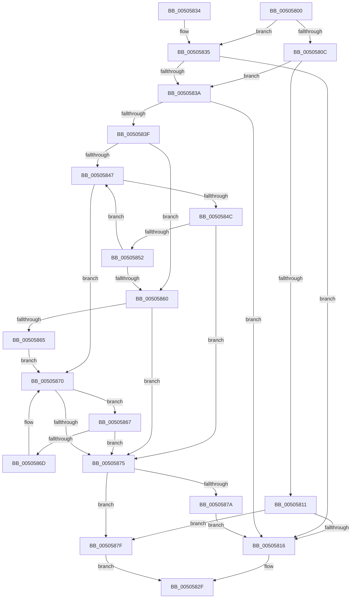

# strnset_s

- RVA: `0x00505800`–`0x00505883` (길이 `131` bytes)
- VA: `0x0000000140505800`
- 실행 섹션: `.text`
- PDB 이름 있음: `예`; PDB Function 태그: `아니요`
- unwind 정보 RVA: `0x000C2900`
- 디코드: `48`개 명령, `131/131` bytes 표시
- 미해석 바이트: `0` (있으면 어셈블리에 `.byte`로 보존)

> 이 문서는 커널 이미지의 기계어와 PDB 기호를 분석해 생성했습니다. 4번과 5번은 함수 원형과 자료형을 바이너리 사용 방식에서 추정한 C 해석이며 원본 소스 복구 결과는 아닙니다.

## 1. Dependencies

- 직접 호출 지점: **1**; 고유 호출 대상: **1**
- 직접 호출자로 확인된 함수: **0**
- RIP 상대 이미지 참조: **0**

### Outgoing calls
- `0x00505825` → [EmpCheckErrataList](../49/EmpCheckErrataList_function_0049E550.md) (function, `0x0049E550`)

### Direct callers
- 이 함수 시작 RVA로 연결되는 직접 call은 확인되지 않았습니다. 간접 호출은 완전히 역산할 수 없습니다.

### Static image references
- 디코드된 RIP-relative 메모리 참조가 없습니다.

## 2. Other-region calls and transfers

- 다른 실행 섹션으로 향하는 call: **0**
- 별도 외부 분기/꼬리 이동을 확인하지 못했습니다.

## 3. Assembly (complete function range)

```asm
00505800  48 83 EC 38                     sub rsp, 0x38
00505804  45 33 D2                        xor r10d, r10d
00505807  4D 85 C9                        test r9, r9
0050580A  75 29                           jne 0x140505835
0050580C  48 85 C9                        test rcx, rcx
0050580F  75 29                           jne 0x14050583a
00505811  48 85 D2                        test rdx, rdx
00505814  74 69                           je 0x14050587f
00505816  45 33 C9                        xor r9d, r9d
00505819  4C 89 54 24 20                  mov qword ptr [rsp + 0x20], r10
0050581E  45 33 C0                        xor r8d, r8d
00505821  33 D2                           xor edx, edx
00505823  33 C9                           xor ecx, ecx
00505825  E8 26 8D F9 FF                  call 0x14049e550
0050582A  B8 16 00 00 00                  mov eax, 0x16
0050582F  48 83 C4 38                     add rsp, 0x38
00505833  C3                              ret
00505834  CC                              int3
00505835  48 85 C9                        test rcx, rcx
00505838  74 DC                           je 0x140505816
0050583A  48 85 D2                        test rdx, rdx
0050583D  74 D7                           je 0x140505816
0050583F  48 8B C1                        mov rax, rcx
00505842  44 38 11                        cmp byte ptr [rcx], r10b
00505845  74 19                           je 0x140505860
00505847  4D 85 C9                        test r9, r9
0050584A  74 24                           je 0x140505870
0050584C  48 83 EA 01                     sub rdx, 1
00505850  74 23                           je 0x140505875
00505852  44 88 00                        mov byte ptr [rax], r8b
00505855  49 FF C9                        dec r9
00505858  48 FF C0                        inc rax
0050585B  44 38 10                        cmp byte ptr [rax], r10b
0050585E  75 E7                           jne 0x140505847
00505860  4D 85 C9                        test r9, r9
00505863  75 10                           jne 0x140505875
00505865  EB 09                           jmp 0x140505870
00505867  48 83 EA 01                     sub rdx, 1
0050586B  74 08                           je 0x140505875
0050586D  48 FF C0                        inc rax
00505870  44 38 10                        cmp byte ptr [rax], r10b
00505873  75 F2                           jne 0x140505867
00505875  48 85 D2                        test rdx, rdx
00505878  75 05                           jne 0x14050587f
0050587A  44 88 11                        mov byte ptr [rcx], r10b
0050587D  EB 97                           jmp 0x140505816
0050587F  33 C0                           xor eax, eax
00505881  EB AC                           jmp 0x14050582f
```

## 4. C-style interpretation (structured pseudocode)

```c
__int64 __fastcall strnset_s(__int64 a1, __int64 a2, int a3, __int64 a4)
{
    __int64 result;
    __int64 v_r10;
    __int64 v_rsp;
    unsigned __int64 v_stack_m18;

    v_rsp = (v_rsp) - (56);
    v_r10 = 0;
    if (a4 != 0) goto loc_00505835;
    if (a1 != 0) goto loc_0050583A;
    if (a2 == 0) goto loc_0050587F;
loc_00505816:
    a4 = 0;
    v_stack_m18 = 0;
    a3 = 0;
    a2 = 0;
    a1 = 0;
    result = EmpCheckErrataList(a1, a2, a3, a4);
loc_0050582F:
    v_rsp = (v_rsp) + (56);
    return 22;
loc_00505835:
    if (0 == 0) goto loc_00505816;
loc_0050583A:
    if (0 == 0) goto loc_00505816;
    if ((*(unsigned __int8 *)(a1)) == 0) goto loc_00505860;
loc_00505847:
    if (0 == 0) goto loc_00505870;
    a2 = (a2) - (1);
    if (condition_is_equal) goto loc_00505875;
    *(unsigned __int8 *)(0) = 0;
    a4 = (a4) - 1;
    result = (0) + 1;
    if ((*(unsigned __int8 *)(result)) != 0) goto loc_00505847;
loc_00505860:
    if (a4 != 0) goto loc_00505875;
    goto loc_00505870;
loc_00505867:
    a2 = (a2) - (1);
    if (condition_is_equal) goto loc_00505875;
    result = (result) + 1;
loc_00505870:
    if ((*(unsigned __int8 *)(result)) != 0) goto loc_00505867;
loc_00505875:
    if (a2 != 0) goto loc_0050587F;
    *(unsigned __int8 *)(a1) = 0;
    goto loc_00505816;
loc_0050587F:
    result = 0;
    goto loc_0050582F;
}
```

## 5. (Beta) C Style

```c
int64_t strnset_s(int64_t Arg1, int64_t Arg2, int32_t Arg3, int64_t Arg4)
{
    int64_t result;
    int64_t local_r10;
    int64_t local_rsp;
    uint64_t v_stack_m18;

    local_rsp = (local_rsp) - (56);
    local_r10 = 0;
    if (Arg4 != 0) goto loc_00505835;
    if (Arg1 != 0) goto loc_0050583A;
    if (Arg2 == 0) goto loc_0050587F;
loc_00505816:
    Arg4 = 0;
    v_stack_m18 = 0;
    Arg3 = 0;
    Arg2 = 0;
    Arg1 = 0;
    result = EmpCheckErrataList(Arg1, Arg2, Arg3, Arg4);
loc_0050582F:
    local_rsp = (local_rsp) + (56);
    return 22;
loc_00505835:
    if (0 == 0) goto loc_00505816;
loc_0050583A:
    if (0 == 0) goto loc_00505816;
    if ((*(uint8_t *)(Arg1)) == 0) goto loc_00505860;
loc_00505847:
    if (0 == 0) goto loc_00505870;
    Arg2 = (Arg2) - (1);
    if (condition_is_equal) goto loc_00505875;
    *(uint8_t *)(0) = 0;
    Arg4 = (Arg4) - 1;
    result = (0) + 1;
    if ((*(uint8_t *)(result)) != 0) goto loc_00505847;
loc_00505860:
    if (Arg4 != 0) goto loc_00505875;
    goto loc_00505870;
loc_00505867:
    Arg2 = (Arg2) - (1);
    if (condition_is_equal) goto loc_00505875;
    result = (result) + 1;
loc_00505870:
    if ((*(uint8_t *)(result)) != 0) goto loc_00505867;
loc_00505875:
    if (Arg2 != 0) goto loc_0050587F;
    *(uint8_t *)(Arg1) = 0;
    goto loc_00505816;
loc_0050587F:
    result = 0;
    goto loc_0050582F;
}
```

## 6. Execution-region graph

[열기: 2D/3D 그래프와 함수 탐색 컨트롤 패널](../../../control-panel.html?section=text&rva=0x00505800&view=graph)

- 2D 그래프는 위에서 아래로 흐르고, 3D 그래프는 빈 공간을 드래그해 회전합니다. Shift+드래그는 이동, 휠은 확대·축소, 함수 노드 선택은 대상 보고서 이동입니다.

### Static fallback


