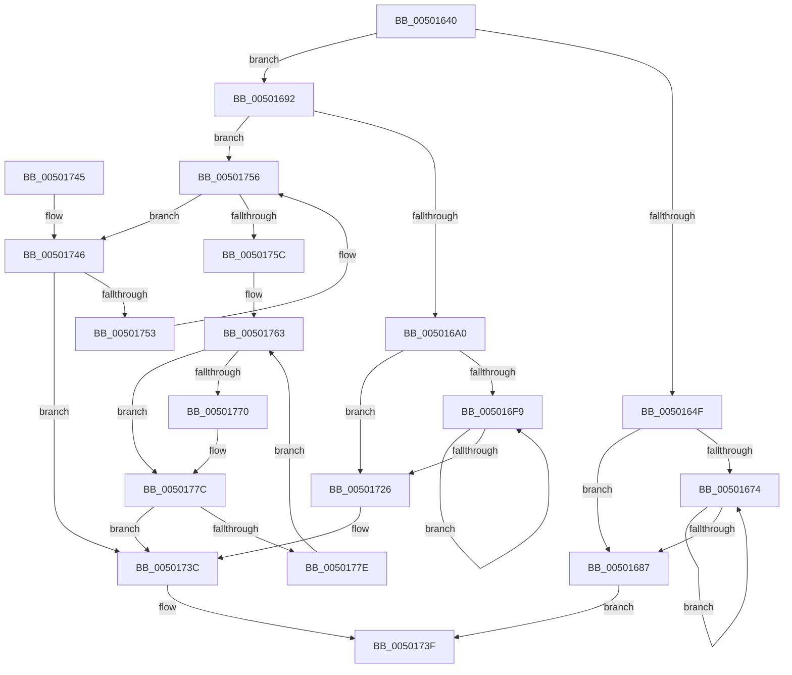

# strrchr

- RVA: `0x00501640`–`0x00501784` (길이 `324` bytes)
- VA: `0x0000000140501640`
- 실행 섹션: `.text`
- PDB 이름 있음: `예`; PDB Function 태그: `아니요`
- unwind 정보 RVA: `0x000C27A8`
- 디코드: `99`개 명령, `324/324` bytes 표시
- 미해석 바이트: `0` (있으면 어셈블리에 `.byte`로 보존)

> 이 문서는 커널 이미지의 기계어와 PDB 기호를 분석해 생성했습니다. 4번과 5번은 함수 원형과 자료형을 바이너리 사용 방식에서 추정한 C 해석이며 원본 소스 복구 결과는 아닙니다.

## 1. Dependencies

- 직접 호출 지점: **0**; 고유 호출 대상: **0**
- 직접 호출자로 확인된 함수: **0**
- RIP 상대 이미지 참조: **1**

### Outgoing calls
- 직접 디코드된 call 명령이 없습니다.

### Direct callers
- 이 함수 시작 RVA로 연결되는 직접 call은 확인되지 않았습니다. 간접 호출은 완전히 역산할 수 없습니다.

### Static image references
- `0x00501692` → RVA `0x00E0A6C0` (`.data`; read)

## 2. Other-region calls and transfers

- 다른 실행 섹션으로 향하는 call: **0**
- 별도 외부 분기/꼬리 이동을 확인하지 못했습니다.

## 3. Assembly (complete function range)

```asm
00501640  48 89 5C 24 08                  mov qword ptr [rsp + 8], rbx
00501645  45 33 C9                        xor r9d, r9d
00501648  4C 8B C1                        mov r8, rcx
0050164B  84 D2                           test dl, dl
0050164D  75 43                           jne 0x140501692
0050164F  48 8B D1                        mov rdx, rcx
00501652  41 83 E0 0F                     and r8d, 0xf
00501656  48 83 E2 F0                     and rdx, 0xfffffffffffffff0
0050165A  41 83 CB FF                     or r11d, 0xffffffff
0050165E  0F 57 C0                        xorps xmm0, xmm0
00501661  41 8B C8                        mov ecx, r8d
00501664  41 D3 E3                        shl r11d, cl
00501667  66 0F 74 02                     pcmpeqb xmm0, xmmword ptr [rdx]
0050166B  66 0F D7 C0                     pmovmskb eax, xmm0
0050166F  41 23 C3                        and eax, r11d
00501672  75 13                           jne 0x140501687
00501674  48 83 C2 10                     add rdx, 0x10
00501678  0F 57 C0                        xorps xmm0, xmm0
0050167B  66 0F 74 02                     pcmpeqb xmm0, xmmword ptr [rdx]
0050167F  66 0F D7 C0                     pmovmskb eax, xmm0
00501683  85 C0                           test eax, eax
00501685  74 ED                           je 0x140501674
00501687  0F BC C0                        bsf eax, eax
0050168A  48 03 C2                        add rax, rdx
0050168D  E9 AD 00 00 00                  jmp 0x14050173f
00501692  8A 05 28 90 90 00               mov al, byte ptr [rip + 0x909028]
00501698  A8 08                           test al, 8
0050169A  0F 85 B6 00 00 00               jne 0x140501756
005016A0  0F B6 C2                        movzx eax, dl
005016A3  41 83 CB FF                     or r11d, 0xffffffff
005016A7  8B C8                           mov ecx, eax
005016A9  4D 8B D0                        mov r10, r8
005016AC  C1 E1 08                        shl ecx, 8
005016AF  49 83 E2 F0                     and r10, 0xfffffffffffffff0
005016B3  0B C8                           or ecx, eax
005016B5  41 83 E0 0F                     and r8d, 0xf
005016B9  41 8B C3                        mov eax, r11d
005016BC  0F 57 DB                        xorps xmm3, xmm3
005016BF  F3 41 0F 6F 12                  movdqu xmm2, xmmword ptr [r10]
005016C4  66 0F 6E C1                     movd xmm0, ecx
005016C8  41 8B C8                        mov ecx, r8d
005016CB  F2 0F 70 C8 00                  pshuflw xmm1, xmm0, 0
005016D0  66 0F 6F C2                     movdqa xmm0, xmm2
005016D4  66 0F 74 C3                     pcmpeqb xmm0, xmm3
005016D8  41 D3 E3                        shl r11d, cl
005016DB  66 0F D7 D8                     pmovmskb ebx, xmm0
005016DF  66 0F 70 E1 00                  pshufd xmm4, xmm1, 0
005016E4  66 0F 6F C4                     movdqa xmm0, xmm4
005016E8  D3 E0                           shl eax, cl
005016EA  66 0F 74 C2                     pcmpeqb xmm0, xmm2
005016EE  66 0F D7 D0                     pmovmskb edx, xmm0
005016F2  41 23 D3                        and edx, r11d
005016F5  23 D8                           and ebx, eax
005016F7  75 2D                           jne 0x140501726
005016F9  0F BD CA                        bsr ecx, edx
005016FC  49 03 CA                        add rcx, r10
005016FF  85 D2                           test edx, edx
00501701  4C 0F 45 C9                     cmovne r9, rcx
00501705  49 83 C2 10                     add r10, 0x10
00501709  F3 41 0F 6F 0A                  movdqu xmm1, xmmword ptr [r10]
0050170E  66 0F 6F C1                     movdqa xmm0, xmm1
00501712  66 0F 74 CB                     pcmpeqb xmm1, xmm3
00501716  66 0F D7 D9                     pmovmskb ebx, xmm1
0050171A  66 0F 74 C4                     pcmpeqb xmm0, xmm4
0050171E  66 0F D7 D0                     pmovmskb edx, xmm0
00501722  85 DB                           test ebx, ebx
00501724  74 D3                           je 0x1405016f9
00501726  8B C3                           mov eax, ebx
00501728  F7 D8                           neg eax
0050172A  23 C3                           and eax, ebx
0050172C  FF C8                           dec eax
0050172E  23 D0                           and edx, eax
00501730  0F BD CA                        bsr ecx, edx
00501733  49 03 CA                        add rcx, r10
00501736  85 D2                           test edx, edx
00501738  4C 0F 45 C9                     cmovne r9, rcx
0050173C  49 8B C1                        mov rax, r9
0050173F  48 8B 5C 24 08                  mov rbx, qword ptr [rsp + 8]
00501744  C3                              ret
00501745  CC                              int3
00501746  41 8A 00                        mov al, byte ptr [r8]
00501749  3A C2                           cmp al, dl
0050174B  4D 0F 44 C8                     cmove r9, r8
0050174F  84 C0                           test al, al
00501751  74 E9                           je 0x14050173c
00501753  49 FF C0                        inc r8
00501756  41 F6 C0 0F                     test r8b, 0xf
0050175A  75 EA                           jne 0x140501746
0050175C  0F B6 C2                        movzx eax, dl
0050175F  66 0F 6E C8                     movd xmm1, eax
00501763  F3 41 0F 6F 00                  movdqu xmm0, xmmword ptr [r8]
00501768  66 0F 3A 63 C8 40               pcmpistri xmm1, xmm0, 0x40
0050176E  73 0C                           jae 0x14050177c
00501770  4C 63 C9                        movsxd r9, ecx
00501773  4D 03 C8                        add r9, r8
00501776  66 0F 3A 63 C8 40               pcmpistri xmm1, xmm0, 0x40
0050177C  74 BE                           je 0x14050173c
0050177E  49 83 C0 10                     add r8, 0x10
00501782  EB DF                           jmp 0x140501763
```

## 4. C-style interpretation (structured pseudocode)

```c
__int64 __fastcall strrchr(__int64 a1, unsigned __int8 a2, __int64 a3, int a4)
{
    __int64 result;
    __int64 v_r10;
    __int64 v_r11;
    __int64 v_rbx;
    unsigned __int64 v_stack_p8;

    v_stack_p8 = v_rbx;
    a4 = 0;
    if (a2 != 0) goto loc_00501692;
    a3 = (unsigned int)((a1) & (15));
    a2 = (a1) & (-16);
    v_r11 = (unsigned int)((v_r11) | (0xFFFFFFFFULL));
    v_r11 = (unsigned int)((v_r11) << ((unsigned __int8)((unsigned int)((unsigned int)(a3)))));
    result = (unsigned int)((result) & ((unsigned int)(v_r11)));
    if (condition_is_not_equal) goto loc_00501687;
loc_00501674:
    a2 = (a2) + (16);
    if ((unsigned int)(result) == 0) goto loc_00501674;
loc_00501687:
    result = (result) + (a2);
    goto loc_0050173F;
loc_00501692:
    if ((((unsigned __int8)(*(unsigned __int8 *)(v_rip + 9474088))) & (8)) != 0) goto loc_00501756;
    v_r11 = (unsigned int)((v_r11) | (0xFFFFFFFFULL));
    a1 = (unsigned int)(((unsigned int)(a2)) << (8));
    v_r10 = (a3) & (-16);
    a1 = (unsigned int)((a1) | (a2));
    a3 = (unsigned int)((a3) & (15));
    v_r11 = (unsigned int)((v_r11) << ((unsigned __int8)((unsigned int)((unsigned int)(a3)))));
    result = (unsigned int)(((unsigned int)((unsigned int)(v_r11))) << ((unsigned __int8)((unsigned int)((unsigned int)(a3)))));
    a2 = (unsigned int)((a2) & ((unsigned int)(v_r11)));
    v_rbx = (unsigned int)((v_rbx) & ((unsigned int)(result)));
    if (condition_is_not_equal) goto loc_00501726;
loc_005016F9:
    a1 = ((unsigned int)((unsigned int)(a3))) + (v_r10);
    if (a2 != 0) { a4 = a1; }
    v_r10 = (v_r10) + (16);
    if ((unsigned int)(v_rbx) == 0) goto loc_005016F9;
loc_00501726:
    result = (unsigned int)(-((unsigned int)((unsigned int)(v_rbx))));
    result = (unsigned int)((result) & ((unsigned int)(v_rbx)));
    result = (unsigned int)((result) - 1);
    a2 = (unsigned int)((a2) & ((unsigned int)(result)));
    a1 = (a1) + (v_r10);
    if (a2 != 0) { a4 = a1; }
loc_0050173C:
loc_0050173F:
    return a4;
loc_00501746:
    if (((unsigned __int8)(*(unsigned __int8 *)(a3))) == a2) { a4 = a3; }
    if ((unsigned __int8)(*(unsigned __int8 *)(a3)) == 0) goto loc_0050173C;
    a3 = (a3) + 1;
loc_00501756:
    if ((((unsigned __int8)(a3)) & (15)) != 0) goto loc_00501746;
loc_00501763:
    if (!(condition_is_above_or_equal)) {
        a4 = (int)((unsigned int)(a1));
        a4 = (a4) + (a3);
    }
    if (condition_is_equal) goto loc_0050173C;
    a3 = (a3) + (16);
    goto loc_00501763;
}
```

## 5. (Beta) C Style

```c
int64_t strrchr(void *Arg1, uint8_t Arg2, int64_t Arg3, int32_t Arg4)
{
    uint8_t *arg1 = (uint8_t *)Arg1;

    int64_t result;
    int64_t local_r10;
    int64_t local_r11;
    int64_t local_rbx;
    uint64_t v_stack_p8;

    v_stack_p8 = local_rbx;
    Arg4 = 0;
    if (Arg2 != 0) goto loc_00501692;
    Arg3 = (uint32_t)((Arg1) & (15));
    Arg2 = (Arg1) & (-16);
    local_r11 = (uint32_t)((local_r11) | (0xFFFFFFFFULL));
    local_r11 = (uint32_t)((local_r11) << ((uint8_t)((uint32_t)((uint32_t)(Arg3)))));
    result = (uint32_t)((result) & ((uint32_t)(local_r11)));
    if (condition_is_not_equal) goto loc_00501687;
loc_00501674:
    Arg2 = (Arg2) + (16);
    if ((uint32_t)(result) == 0) goto loc_00501674;
loc_00501687:
    result = (result) + (Arg2);
    goto loc_0050173F;
loc_00501692:
    if ((((uint8_t)(*(uint8_t *)(v_rip + 0x909028))) & (8)) != 0) goto loc_00501756;
    local_r11 = (uint32_t)((local_r11) | (0xFFFFFFFFULL));
    Arg1 = (uint32_t)(((uint32_t)(Arg2)) << (8));
    local_r10 = (Arg3) & (-16);
    Arg1 = (uint32_t)((Arg1) | (Arg2));
    Arg3 = (uint32_t)((Arg3) & (15));
    local_r11 = (uint32_t)((local_r11) << ((uint8_t)((uint32_t)((uint32_t)(Arg3)))));
    result = (uint32_t)(((uint32_t)((uint32_t)(local_r11))) << ((uint8_t)((uint32_t)((uint32_t)(Arg3)))));
    Arg2 = (uint32_t)((Arg2) & ((uint32_t)(local_r11)));
    local_rbx = (uint32_t)((local_rbx) & ((uint32_t)(result)));
    if (condition_is_not_equal) goto loc_00501726;
loc_005016F9:
    Arg1 = ((uint32_t)((uint32_t)(Arg3))) + (local_r10);
    if (Arg2 != 0) { Arg4 = Arg1; }
    local_r10 = (local_r10) + (16);
    if ((uint32_t)(local_rbx) == 0) goto loc_005016F9;
loc_00501726:
    result = (uint32_t)(-((uint32_t)((uint32_t)(local_rbx))));
    result = (uint32_t)((result) & ((uint32_t)(local_rbx)));
    result = (uint32_t)((result) - 1);
    Arg2 = (uint32_t)((Arg2) & ((uint32_t)(result)));
    Arg1 = (Arg1) + (local_r10);
    if (Arg2 != 0) { Arg4 = Arg1; }
loc_0050173C:
loc_0050173F:
    return Arg4;
loc_00501746:
    if (((uint8_t)(*(uint8_t *)(Arg3))) == Arg2) { Arg4 = Arg3; }
    if ((uint8_t)(*(uint8_t *)(Arg3)) == 0) goto loc_0050173C;
    Arg3 = (Arg3) + 1;
loc_00501756:
    if ((((uint8_t)(Arg3)) & (15)) != 0) goto loc_00501746;
loc_00501763:
    if (!(condition_is_above_or_equal)) {
        Arg4 = (int32_t)((uint32_t)(Arg1));
        Arg4 = (Arg4) + (Arg3);
    }
    if (condition_is_equal) goto loc_0050173C;
    Arg3 = (Arg3) + (16);
    goto loc_00501763;
}
```

### 관측된 메모리 오프셋

구조체 형식이 확인되지 않은 접근은 인자 기준의 오프셋으로만 기록했습니다.

| 기준 인자 | 오프셋 표현 | 폭 (bit) | 접근 |
|---|---:|---:|---|
| `Arg1` | `+ 0x0` | `128` | `R` |

## 6. Execution-region graph

[열기: 2D/3D 그래프와 함수 탐색 컨트롤 패널](../../../control-panel.html?section=text&rva=0x00501640&view=graph)

- 2D 그래프는 위에서 아래로 흐르고, 3D 그래프는 빈 공간을 드래그해 회전합니다. Shift+드래그는 이동, 휠은 확대·축소, 함수 노드 선택은 대상 보고서 이동입니다.

### Static fallback


