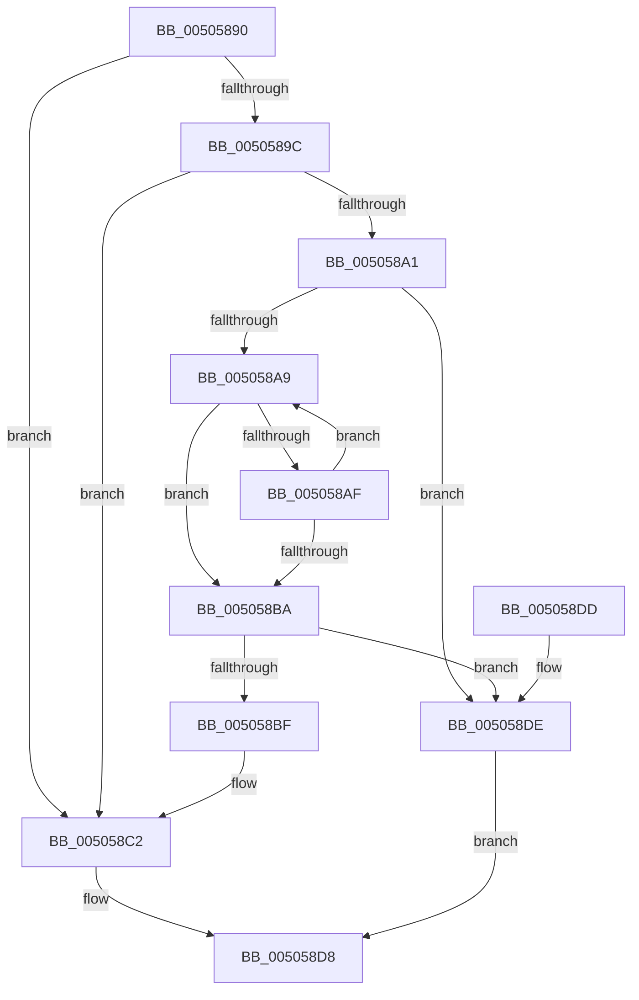

# strset_s

- RVA: `0x00505890`–`0x005058E2` (길이 `82` bytes)
- VA: `0x0000000140505890`
- 실행 섹션: `.text`
- PDB 이름 있음: `예`; PDB Function 태그: `아니요`
- unwind 정보 RVA: `0x0008EE54`
- 디코드: `29`개 명령, `82/82` bytes 표시
- 미해석 바이트: `0` (있으면 어셈블리에 `.byte`로 보존)

> 이 문서는 커널 이미지의 기계어와 PDB 기호를 분석해 생성했습니다. 4번과 5번은 함수 원형과 자료형을 바이너리 사용 방식에서 추정한 C 해석이며 원본 소스 복구 결과는 아닙니다.

## 1. Dependencies

- 직접 호출 지점: **1**; 고유 호출 대상: **1**
- 직접 호출자로 확인된 함수: **0**
- RIP 상대 이미지 참조: **0**

### Outgoing calls
- `0x005058CE` → [EmpCheckErrataList](../49/EmpCheckErrataList_function_0049E550.md) (function, `0x0049E550`)

### Direct callers
- 이 함수 시작 RVA로 연결되는 직접 call은 확인되지 않았습니다. 간접 호출은 완전히 역산할 수 없습니다.

### Static image references
- 디코드된 RIP-relative 메모리 참조가 없습니다.

## 2. Other-region calls and transfers

- 다른 실행 섹션으로 향하는 call: **0**
- 별도 외부 분기/꼬리 이동을 확인하지 못했습니다.

## 3. Assembly (complete function range)

```asm
00505890  48 83 EC 38                     sub rsp, 0x38
00505894  45 33 C9                        xor r9d, r9d
00505897  48 85 C9                        test rcx, rcx
0050589A  74 26                           je 0x1405058c2
0050589C  48 85 D2                        test rdx, rdx
0050589F  74 21                           je 0x1405058c2
005058A1  48 8B C1                        mov rax, rcx
005058A4  44 38 09                        cmp byte ptr [rcx], r9b
005058A7  74 35                           je 0x1405058de
005058A9  48 83 EA 01                     sub rdx, 1
005058AD  74 0B                           je 0x1405058ba
005058AF  44 88 00                        mov byte ptr [rax], r8b
005058B2  48 FF C0                        inc rax
005058B5  44 38 08                        cmp byte ptr [rax], r9b
005058B8  75 EF                           jne 0x1405058a9
005058BA  48 85 D2                        test rdx, rdx
005058BD  75 1F                           jne 0x1405058de
005058BF  44 88 09                        mov byte ptr [rcx], r9b
005058C2  45 33 C0                        xor r8d, r8d
005058C5  4C 89 4C 24 20                  mov qword ptr [rsp + 0x20], r9
005058CA  33 D2                           xor edx, edx
005058CC  33 C9                           xor ecx, ecx
005058CE  E8 7D 8C F9 FF                  call 0x14049e550
005058D3  B8 16 00 00 00                  mov eax, 0x16
005058D8  48 83 C4 38                     add rsp, 0x38
005058DC  C3                              ret
005058DD  CC                              int3
005058DE  33 C0                           xor eax, eax
005058E0  EB F6                           jmp 0x1405058d8
```

## 4. C-style interpretation (structured pseudocode)

```c
__int64 __fastcall strset_s(__int64 a1, __int64 a2, int a3, int a4)
{
    __int64 result;
    __int64 v_rsp;
    unsigned __int64 v_stack_m18;

    v_rsp = (v_rsp) - (56);
    a4 = 0;
    if (a1 == 0) goto loc_005058C2;
    if (a2 == 0) goto loc_005058C2;
    if ((*(unsigned __int8 *)(a1)) == 0) goto loc_005058DE;
loc_005058A9:
    a2 = (a2) - (1);
    if (condition_is_equal) goto loc_005058BA;
    *(unsigned __int8 *)(a1) = (unsigned __int8)(a3);
    result = (a1) + 1;
    if ((*(unsigned __int8 *)(result)) != 0) goto loc_005058A9;
loc_005058BA:
    if (a2 != 0) goto loc_005058DE;
    *(unsigned __int8 *)(a1) = 0;
loc_005058C2:
    a3 = 0;
    v_stack_m18 = 0;
    a2 = 0;
    a1 = 0;
    result = EmpCheckErrataList(a1, a2, a3, a4);
loc_005058D8:
    v_rsp = (v_rsp) + (56);
    return 22;
loc_005058DE:
    result = 0;
    goto loc_005058D8;
}
```

## 5. (Beta) C Style

```c
int64_t strset_s(int64_t Arg1, int64_t Arg2, int32_t Arg3, int32_t Arg4)
{
    int64_t result;
    int64_t local_rsp;
    uint64_t v_stack_m18;

    local_rsp = (local_rsp) - (56);
    Arg4 = 0;
    if (Arg1 == 0) goto loc_005058C2;
    if (Arg2 == 0) goto loc_005058C2;
    if ((*(uint8_t *)(Arg1)) == 0) goto loc_005058DE;
loc_005058A9:
    Arg2 = (Arg2) - (1);
    if (condition_is_equal) goto loc_005058BA;
    *(uint8_t *)(Arg1) = (uint8_t)(Arg3);
    result = (Arg1) + 1;
    if ((*(uint8_t *)(result)) != 0) goto loc_005058A9;
loc_005058BA:
    if (Arg2 != 0) goto loc_005058DE;
    *(uint8_t *)(Arg1) = 0;
loc_005058C2:
    Arg3 = 0;
    v_stack_m18 = 0;
    Arg2 = 0;
    Arg1 = 0;
    result = EmpCheckErrataList(Arg1, Arg2, Arg3, Arg4);
loc_005058D8:
    local_rsp = (local_rsp) + (56);
    return 22;
loc_005058DE:
    result = 0;
    goto loc_005058D8;
}
```

## 6. Execution-region graph

[열기: 2D/3D 그래프와 함수 탐색 컨트롤 패널](../../../control-panel.html?section=text&rva=0x00505890&view=graph)

- 2D 그래프는 위에서 아래로 흐르고, 3D 그래프는 빈 공간을 드래그해 회전합니다. Shift+드래그는 이동, 휠은 확대·축소, 함수 노드 선택은 대상 보고서 이동입니다.

### Static fallback


