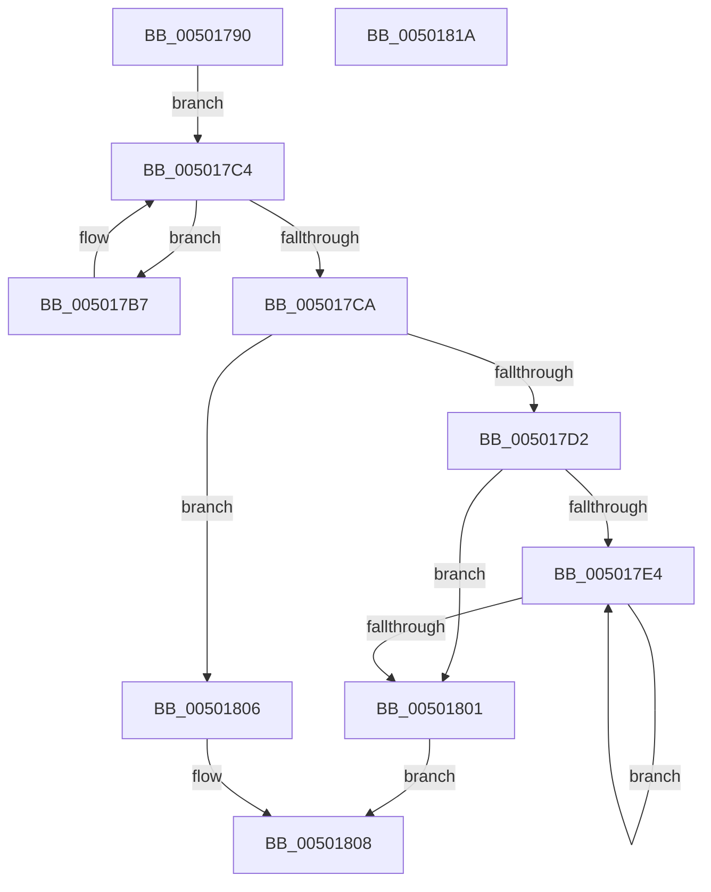

# strspn

- RVA: `0x00501790`–`0x0050181B` (길이 `139` bytes)
- VA: `0x0000000140501790`
- 실행 섹션: `.text`
- PDB 이름 있음: `예`; PDB Function 태그: `아니요`
- unwind 정보 RVA: `0x000C27B4`
- 디코드: `46`개 명령, `139/139` bytes 표시
- 미해석 바이트: `0` (있으면 어셈블리에 `.byte`로 보존)

> 이 문서는 커널 이미지의 기계어와 PDB 기호를 분석해 생성했습니다. 4번과 5번은 함수 원형과 자료형을 바이너리 사용 방식에서 추정한 C 해석이며 원본 소스 복구 결과는 아닙니다.

## 1. Dependencies

- 직접 호출 지점: **1**; 고유 호출 대상: **1**
- 직접 호출자로 확인된 함수: **0**
- RIP 상대 이미지 참조: **1**

### Outgoing calls
- `0x00501810` → [_security_check_cookie](../6A/_security_check_cookie_function_006AC640.md) (function, `0x006AC640`)

### Direct callers
- 이 함수 시작 RVA로 연결되는 직접 call은 확인되지 않았습니다. 간접 호출은 완전히 역산할 수 없습니다.

### Static image references
- `0x00501794` → RVA `0x00E0A740` (`.data`; read)

## 2. Other-region calls and transfers

- 다른 실행 섹션으로 향하는 call: **0**
- 별도 외부 분기/꼬리 이동을 확인하지 못했습니다.

## 3. Assembly (complete function range)

```asm
00501790  48 83 EC 38                     sub rsp, 0x38
00501794  48 8B 05 A5 8F 90 00            mov rax, qword ptr [rip + 0x908fa5]
0050179B  48 33 C4                        xor rax, rsp
0050179E  48 89 44 24 20                  mov qword ptr [rsp + 0x20], rax
005017A3  0F 57 C0                        xorps xmm0, xmm0
005017A6  4C 8B C9                        mov r9, rcx
005017A9  0F 11 04 24                     movups xmmword ptr [rsp], xmm0
005017AD  45 33 C0                        xor r8d, r8d
005017B0  0F 11 44 24 10                  movups xmmword ptr [rsp + 0x10], xmm0
005017B5  EB 0D                           jmp 0x1405017c4
005017B7  0F B6 C0                        movzx eax, al
005017BA  48 8D 0C 24                     lea rcx, [rsp]
005017BE  0F AB 01                        bts dword ptr [rcx], eax
005017C1  48 FF C2                        inc rdx
005017C4  8A 02                           mov al, byte ptr [rdx]
005017C6  84 C0                           test al, al
005017C8  75 ED                           jne 0x1405017b7
005017CA  41 0F B6 09                     movzx ecx, byte ptr [r9]
005017CE  84 C9                           test cl, cl
005017D0  74 34                           je 0x140501806
005017D2  8B C1                           mov eax, ecx
005017D4  80 E1 07                        and cl, 7
005017D7  48 C1 E8 03                     shr rax, 3
005017DB  8A 04 04                        mov al, byte ptr [rsp + rax]
005017DE  D2 E8                           shr al, cl
005017E0  A8 01                           test al, 1
005017E2  74 1D                           je 0x140501801
005017E4  49 FF C1                        inc r9
005017E7  41 FF C0                        inc r8d
005017EA  41 0F B6 09                     movzx ecx, byte ptr [r9]
005017EE  8B C1                           mov eax, ecx
005017F0  80 E1 07                        and cl, 7
005017F3  48 C1 E8 03                     shr rax, 3
005017F7  8A 14 04                        mov dl, byte ptr [rsp + rax]
005017FA  D2 EA                           shr dl, cl
005017FC  F6 C2 01                        test dl, 1
005017FF  75 E3                           jne 0x1405017e4
00501801  49 63 C0                        movsxd rax, r8d
00501804  EB 02                           jmp 0x140501808
00501806  33 C0                           xor eax, eax
00501808  48 8B 4C 24 20                  mov rcx, qword ptr [rsp + 0x20]
0050180D  48 33 CC                        xor rcx, rsp
00501810  E8 2B AE 1A 00                  call 0x1406ac640
00501815  48 83 C4 38                     add rsp, 0x38
00501819  C3                              ret
0050181A  CC                              int3
```

## 4. C-style interpretation (structured pseudocode)

```c
__int64 __fastcall strspn(__int64 a1, __int64 a2, int a3)
{
    __int64 result;
    __int64 v_rsp;
    unsigned __int64 v_stack_m18;
    unsigned __int64 v_stack_m28;
    unsigned __int64 v_stack_m38;

    v_rsp = (v_rsp) - (56);
    result = (*(unsigned __int64 *)(v_rip + 9473957)) ^ (v_rsp);
    v_stack_m18 = result;
    v_stack_m38 = v_xmm0;
    a3 = 0;
    v_stack_m28 = v_xmm0;
    goto loc_005017C4;
loc_005017B7:
    a2 = (a2) + 1;
loc_005017C4:
    if ((unsigned __int8)(*(unsigned __int8 *)(a2)) != 0) goto loc_005017B7;
    if ((unsigned __int8)(*(unsigned __int8 *)(a1)) == 0) goto loc_00501806;
    a1 = (unsigned __int8)((*(unsigned __int8 *)(a1)) & (7));
    result = ((unsigned int)((unsigned int)(*(unsigned __int8 *)(a1)))) >> (3);
    result = (unsigned __int8)((*(unsigned __int8 *)(v_rsp + result * 1)) >> ((unsigned __int8)(a1)));
    if ((((unsigned __int8)(result)) & (1)) == 0) goto loc_00501801;
loc_005017E4:
    a4 = (a1) + 1;
    a3 = (unsigned int)((a3) + 1);
    a1 = (unsigned __int8)((*(unsigned __int8 *)(a4)) & (7));
    result = ((unsigned int)((unsigned int)(*(unsigned __int8 *)(a4)))) >> (3);
    a2 = (unsigned __int8)((*(unsigned __int8 *)(v_rsp + result * 1)) >> ((unsigned __int8)(a1)));
    if ((((unsigned __int8)(a2)) & (1)) != 0) goto loc_005017E4;
loc_00501801:
    goto loc_00501808;
loc_00501806:
    result = 0;
loc_00501808:
    a1 = (v_stack_m18) ^ (v_rsp);
    result = _security_check_cookie(a1, a2, a3, a4);
    v_rsp = (v_rsp) + (56);
    return result;
}
```

## 5. (Beta) C Style

```c
int64_t strspn(void *Arg1, int64_t Arg2, int32_t Arg3)
{
    uint8_t *arg1 = (uint8_t *)Arg1;

    int64_t result;
    int64_t local_rsp;
    uint64_t v_stack_m18;
    uint64_t v_stack_m28;
    uint64_t v_stack_m38;

    local_rsp = (local_rsp) - (56);
    result = (*(uint64_t *)(v_rip + 0x908FA5)) ^ (local_rsp);
    v_stack_m18 = result;
    v_stack_m38 = v_xmm0;
    Arg3 = 0;
    v_stack_m28 = v_xmm0;
    goto loc_005017C4;
loc_005017B7:
    Arg2 = (Arg2) + 1;
loc_005017C4:
    if ((uint8_t)(*(uint8_t *)(Arg2)) != 0) goto loc_005017B7;
    if ((uint8_t)(*(uint8_t *)(arg1)) == 0) goto loc_00501806;
    Arg1 = (uint8_t)((*(uint8_t *)(arg1)) & (7));
    result = ((uint32_t)((uint32_t)(*(uint8_t *)(arg1)))) >> (3);
    result = (uint8_t)((*(uint8_t *)(local_rsp + result * 1)) >> ((uint8_t)(Arg1)));
    if ((((uint8_t)(result)) & (1)) == 0) goto loc_00501801;
loc_005017E4:
    a4 = (Arg1) + 1;
    Arg3 = (uint32_t)((Arg3) + 1);
    Arg1 = (uint8_t)((*(uint8_t *)(a4)) & (7));
    result = ((uint32_t)((uint32_t)(*(uint8_t *)(a4)))) >> (3);
    Arg2 = (uint8_t)((*(uint8_t *)(local_rsp + result * 1)) >> ((uint8_t)(Arg1)));
    if ((((uint8_t)(Arg2)) & (1)) != 0) goto loc_005017E4;
loc_00501801:
    goto loc_00501808;
loc_00501806:
    result = 0;
loc_00501808:
    Arg1 = (v_stack_m18) ^ (local_rsp);
    result = _security_check_cookie(Arg1, Arg2, Arg3, a4);
    local_rsp = (local_rsp) + (56);
    return result;
}
```

### 관측된 메모리 오프셋

구조체 형식이 확인되지 않은 접근은 인자 기준의 오프셋으로만 기록했습니다.

| 기준 인자 | 오프셋 표현 | 폭 (bit) | 접근 |
|---|---:|---:|---|
| `Arg1` | `+ 0x0` | `8` | `R` |

## 6. Execution-region graph

[열기: 2D/3D 그래프와 함수 탐색 컨트롤 패널](../../../control-panel.html?section=text&rva=0x00501790&view=graph)

- 2D 그래프는 위에서 아래로 흐르고, 3D 그래프는 빈 공간을 드래그해 회전합니다. Shift+드래그는 이동, 휠은 확대·축소, 함수 노드 선택은 대상 보고서 이동입니다.

### Static fallback


