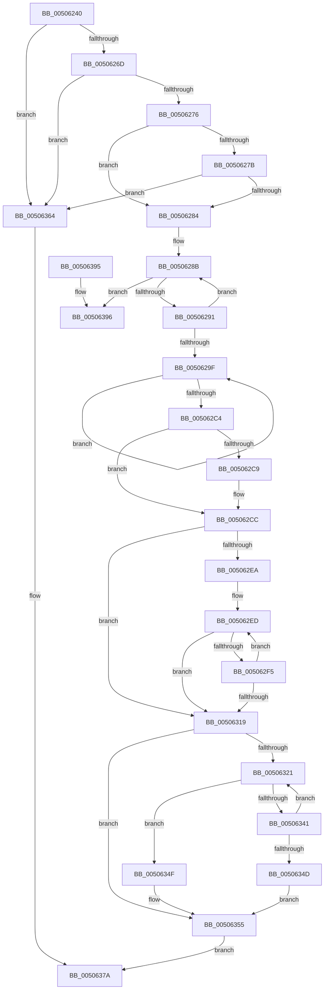

# strtok_s

- RVA: `0x00506240`–`0x0050639C` (길이 `348` bytes)
- VA: `0x0000000140506240`
- 실행 섹션: `.text`
- PDB 이름 있음: `예`; PDB Function 태그: `아니요`
- unwind 정보 RVA: `0x000C2924`
- 디코드: `105`개 명령, `348/348` bytes 표시
- 미해석 바이트: `0` (있으면 어셈블리에 `.byte`로 보존)

> 이 문서는 커널 이미지의 기계어와 PDB 기호를 분석해 생성했습니다. 4번과 5번은 함수 원형과 자료형을 바이너리 사용 방식에서 추정한 C 해석이며 원본 소스 복구 결과는 아닙니다.

## 1. Dependencies

- 직접 호출 지점: **3**; 고유 호출 대상: **3**
- 직접 호출자로 확인된 함수: **0**
- RIP 상대 이미지 참조: **1**

### Outgoing calls
- `0x00506373` → [EmpCheckErrataList](../49/EmpCheckErrataList_function_0049E550.md) (function, `0x0049E550`)
- `0x00506382` → [_security_check_cookie](../6A/_security_check_cookie_function_006AC640.md) (function, `0x006AC640`)
- `0x00506396` → [_report_rangecheckfailure](../4F/_report_rangecheckfailure_function_004F5FDC.md) (function, `0x004F5FDC`)

### Direct callers
- 이 함수 시작 RVA로 연결되는 직접 call은 확인되지 않았습니다. 간접 호출은 완전히 역산할 수 없습니다.

### Static image references
- `0x0050624A` → RVA `0x00E0A740` (`.data`; read)

## 2. Other-region calls and transfers

- 다른 실행 섹션으로 향하는 call: **0**
- 별도 외부 분기/꼬리 이동을 확인하지 못했습니다.

## 3. Assembly (complete function range)

```asm
00506240  48 89 5C 24 20                  mov qword ptr [rsp + 0x20], rbx
00506245  57                              push rdi
00506246  48 83 EC 60                     sub rsp, 0x60
0050624A  48 8B 05 EF 44 90 00            mov rax, qword ptr [rip + 0x9044ef]
00506251  48 33 C4                        xor rax, rsp
00506254  48 89 44 24 50                  mov qword ptr [rsp + 0x50], rax
00506259  33 FF                           xor edi, edi
0050625B  4D 8B D8                        mov r11, r8
0050625E  4C 8B D2                        mov r10, rdx
00506261  4C 8B C9                        mov r9, rcx
00506264  4D 85 C0                        test r8, r8
00506267  0F 84 F7 00 00 00               je 0x140506364
0050626D  48 85 D2                        test rdx, rdx
00506270  0F 84 EE 00 00 00               je 0x140506364
00506276  48 85 C9                        test rcx, rcx
00506279  75 09                           jne 0x140506284
0050627B  49 39 38                        cmp qword ptr [r8], rdi
0050627E  0F 84 E0 00 00 00               je 0x140506364
00506284  48 8B C7                        mov rax, rdi
00506287  48 83 F8 20                     cmp rax, 0x20
0050628B  0F 83 05 01 00 00               jae 0x140506396
00506291  40 88 7C 04 30                  mov byte ptr [rsp + rax + 0x30], dil
00506296  48 FF C0                        inc rax
00506299  48 83 F8 20                     cmp rax, 0x20
0050629D  7C EC                           jl 0x14050628b
0050629F  45 0F B6 02                     movzx r8d, byte ptr [r10]
005062A3  49 FF C2                        inc r10
005062A6  41 8B D0                        mov edx, r8d
005062A9  41 8B C0                        mov eax, r8d
005062AC  48 C1 EA 03                     shr rdx, 3
005062B0  83 E0 07                        and eax, 7
005062B3  0F B6 4C 14 30                  movzx ecx, byte ptr [rsp + rdx + 0x30]
005062B8  0F AB C1                        bts ecx, eax
005062BB  88 4C 14 30                     mov byte ptr [rsp + rdx + 0x30], cl
005062BF  45 84 C0                        test r8b, r8b
005062C2  75 DB                           jne 0x14050629f
005062C4  4D 85 C9                        test r9, r9
005062C7  75 03                           jne 0x1405062cc
005062C9  4D 8B 0B                        mov r9, qword ptr [r11]
005062CC  45 0F B6 01                     movzx r8d, byte ptr [r9]
005062D0  BA 01 00 00 00                  mov edx, 1
005062D5  41 8B C0                        mov eax, r8d
005062D8  41 8B C8                        mov ecx, r8d
005062DB  83 E1 07                        and ecx, 7
005062DE  48 C1 E8 03                     shr rax, 3
005062E2  D3 E2                           shl edx, cl
005062E4  84 54 04 30                     test byte ptr [rsp + rax + 0x30], dl
005062E8  74 2F                           je 0x140506319
005062EA  45 8A D0                        mov r10b, r8b
005062ED  45 8A C2                        mov r8b, r10b
005062F0  45 84 D2                        test r10b, r10b
005062F3  74 24                           je 0x140506319
005062F5  49 FF C1                        inc r9
005062F8  BA 01 00 00 00                  mov edx, 1
005062FD  45 0F B6 11                     movzx r10d, byte ptr [r9]
00506301  41 8B C2                        mov eax, r10d
00506304  41 8B CA                        mov ecx, r10d
00506307  83 E1 07                        and ecx, 7
0050630A  48 C1 E8 03                     shr rax, 3
0050630E  D3 E2                           shl edx, cl
00506310  45 8A C2                        mov r8b, r10b
00506313  84 54 04 30                     test byte ptr [rsp + rax + 0x30], dl
00506317  75 D4                           jne 0x1405062ed
00506319  4D 8B D1                        mov r10, r9
0050631C  45 84 C0                        test r8b, r8b
0050631F  74 34                           je 0x140506355
00506321  41 0F B6 C0                     movzx eax, r8b
00506325  49 8D 59 01                     lea rbx, [r9 + 1]
00506329  41 0F B6 C8                     movzx ecx, r8b
0050632D  BA 01 00 00 00                  mov edx, 1
00506332  83 E1 07                        and ecx, 7
00506335  48 C1 E8 03                     shr rax, 3
00506339  D3 E2                           shl edx, cl
0050633B  84 54 04 30                     test byte ptr [rsp + rax + 0x30], dl
0050633F  75 0E                           jne 0x14050634f
00506341  8A 03                           mov al, byte ptr [rbx]
00506343  4C 8B CB                        mov r9, rbx
00506346  44 8A C0                        mov r8b, al
00506349  84 C0                           test al, al
0050634B  75 D4                           jne 0x140506321
0050634D  EB 06                           jmp 0x140506355
0050634F  41 88 39                        mov byte ptr [r9], dil
00506352  4C 8B CB                        mov r9, rbx
00506355  4D 3B D1                        cmp r10, r9
00506358  4D 89 0B                        mov qword ptr [r11], r9
0050635B  4C 0F 44 D7                     cmove r10, rdi
0050635F  49 8B C2                        mov rax, r10
00506362  EB 16                           jmp 0x14050637a
00506364  45 33 C9                        xor r9d, r9d
00506367  48 89 7C 24 20                  mov qword ptr [rsp + 0x20], rdi
0050636C  45 33 C0                        xor r8d, r8d
0050636F  33 D2                           xor edx, edx
00506371  33 C9                           xor ecx, ecx
00506373  E8 D8 81 F9 FF                  call 0x14049e550
00506378  33 C0                           xor eax, eax
0050637A  48 8B 4C 24 50                  mov rcx, qword ptr [rsp + 0x50]
0050637F  48 33 CC                        xor rcx, rsp
00506382  E8 B9 62 1A 00                  call 0x1406ac640
00506387  48 8B 9C 24 88 00 00 00         mov rbx, qword ptr [rsp + 0x88]
0050638F  48 83 C4 60                     add rsp, 0x60
00506393  5F                              pop rdi
00506394  C3                              ret
00506395  CC                              int3
00506396  E8 41 FC FE FF                  call 0x1404f5fdc
0050639B  CC                              int3
```

## 4. C-style interpretation (structured pseudocode)

```c
__int64 __fastcall strtok_s(__int64 a1, __int64 a2, __int64 a3)
{
    __int64 result;
    __int64 v_r10;
    __int64 v_rdi;
    __int64 v_rsp;
    unsigned __int64 v_stack_m18;
    unsigned __int64 v_stack_m48;
    unsigned __int64 v_stack_p20;

    v_stack_p20 = v_rbx;
    v_rsp = (v_rsp) - (96);
    result = (*(unsigned __int64 *)(v_rip + 9454831)) ^ (v_rsp);
    v_stack_m18 = result;
    v_rdi = 0;
    if (a3 == 0) goto loc_00506364;
    if (a2 == 0) goto loc_00506364;
    if (a1 != 0) goto loc_00506284;
    if ((*(unsigned __int64 *)(a3)) == 0) goto loc_00506364;
loc_00506284:
loc_0050628B:
    if (0 >= 32) goto loc_00506396;
    *(unsigned __int8 *)(v_rsp + 0 * 1 + 48) = 0;
    result = (0) + 1;
    if (result < 32) goto loc_0050628B;
loc_0050629F:
    v_r10 = (a2) + 1;
    a2 = ((unsigned int)((unsigned int)(*(unsigned __int8 *)(a2)))) >> (3);
    result = (unsigned int)(((unsigned int)((unsigned int)(*(unsigned __int8 *)(a2)))) & (7));
    *(unsigned __int8 *)(v_rsp + a2 * 1 + 48) = (unsigned __int8)(*(unsigned __int8 *)(v_rsp + a2 * 1 + 48));
    if ((unsigned __int8)(*(unsigned __int8 *)(a2)) != 0) goto loc_0050629F;
    if (a1 == 0) {
        a4 = *(unsigned __int64 *)(a3);
    }
    a1 = (unsigned int)(((unsigned int)((unsigned int)(*(unsigned __int8 *)(a4)))) & (7));
    result = ((unsigned int)((unsigned int)(*(unsigned __int8 *)(a4)))) >> (3);
    a2 = (unsigned int)((1) << ((unsigned __int8)(a1)));
    if (((*(unsigned __int8 *)(v_rsp + result * 1 + 48)) & ((unsigned __int8)(a2))) == 0) goto loc_00506319;
loc_005062ED:
    if ((unsigned __int8)((unsigned __int8)(*(unsigned __int8 *)(a4))) == 0) goto loc_00506319;
    a4 = (a4) + 1;
    a1 = (unsigned int)(((unsigned int)((unsigned int)(*(unsigned __int8 *)(a4)))) & (7));
    result = ((unsigned int)((unsigned int)(*(unsigned __int8 *)(a4)))) >> (3);
    a2 = (unsigned int)((1) << ((unsigned __int8)(a1)));
    if (((*(unsigned __int8 *)(v_rsp + result * 1 + 48)) & ((unsigned __int8)(a2))) != 0) goto loc_005062ED;
loc_00506319:
    if ((unsigned __int8)((unsigned __int8)(*(unsigned __int8 *)(a4))) == 0) goto loc_00506355;
loc_00506321:
    a1 = (unsigned int)(((unsigned __int8)((unsigned __int8)(*(unsigned __int8 *)(a4)))) & (7));
    result = ((unsigned __int8)((unsigned __int8)(*(unsigned __int8 *)(a4)))) >> (3);
    a2 = (unsigned int)((1) << ((unsigned __int8)(a1)));
    if (((*(unsigned __int8 *)(v_rsp + result * 1 + 48)) & ((unsigned __int8)(a2))) != 0) goto loc_0050634F;
    if ((unsigned __int8)(*(unsigned __int8 *)(a4 + 1)) != 0) goto loc_00506321;
    goto loc_00506355;
loc_0050634F:
    *(unsigned __int8 *)(a4 + 1) = 0;
loc_00506355:
    *(unsigned __int64 *)(a3) = a4 + 1;
    if (a4 == (a4 + 1)) { a4 = 0; }
    goto loc_0050637A;
loc_00506364:
    a4 = 0;
    v_stack_m48 = 0;
    a3 = 0;
    a2 = 0;
    a1 = 0;
    result = EmpCheckErrataList(a1, a2, a3, a4);
    result = 0;
loc_0050637A:
    a1 = (v_stack_m18) ^ (v_rsp);
    result = _security_check_cookie(a1, a2, a3, a4);
    v_rsp = (v_rsp) + (96);
    return result;
loc_00506396:
    result = _report_rangecheckfailure(a1, a2, a3, a4);
    return result;
}
```

## 5. (Beta) C Style

```c
int64_t strtok_s(int64_t Arg1, int64_t Arg2, void *Arg3)
{
    uint8_t *arg3 = (uint8_t *)Arg3;

    int64_t result;
    int64_t local_r10;
    int64_t local_rdi;
    int64_t local_rsp;
    uint64_t v_stack_m18;
    uint64_t v_stack_m48;
    uint64_t v_stack_p20;

    v_stack_p20 = local_rbx;
    local_rsp = (local_rsp) - (96);
    result = (*(uint64_t *)(v_rip + 0x9044EF)) ^ (local_rsp);
    v_stack_m18 = result;
    local_rdi = 0;
    if (Arg3 == NULL) goto loc_00506364;
    if (Arg2 == 0) goto loc_00506364;
    if (Arg1 != 0) goto loc_00506284;
    if ((*(uint64_t *)(arg3)) == 0) goto loc_00506364;
loc_00506284:
loc_0050628B:
    if (0 >= 32) goto loc_00506396;
    *(uint8_t *)(local_rsp + 0x0 * 1 + 0x30) = 0;
    result = (0) + 1;
    if (result < 32) goto loc_0050628B;
loc_0050629F:
    local_r10 = (Arg2) + 1;
    Arg2 = ((uint32_t)((uint32_t)(*(uint8_t *)(Arg2)))) >> (3);
    result = (uint32_t)(((uint32_t)((uint32_t)(*(uint8_t *)(Arg2)))) & (7));
    *(uint8_t *)(local_rsp + Arg2 * 1 + 0x30) = (uint8_t)(*(uint8_t *)(local_rsp + Arg2 * 1 + 0x30));
    if ((uint8_t)(*(uint8_t *)(Arg2)) != 0) goto loc_0050629F;
    if (Arg1 == 0) {
        a4 = *(uint64_t *)(arg3);
    }
    Arg1 = (uint32_t)(((uint32_t)((uint32_t)(*(uint8_t *)(a4)))) & (7));
    result = ((uint32_t)((uint32_t)(*(uint8_t *)(a4)))) >> (3);
    Arg2 = (uint32_t)((1) << ((uint8_t)(Arg1)));
    if (((*(uint8_t *)(local_rsp + result * 1 + 0x30)) & ((uint8_t)(Arg2))) == 0) goto loc_00506319;
loc_005062ED:
    if ((uint8_t)((uint8_t)(*(uint8_t *)(a4))) == 0) goto loc_00506319;
    a4 = (a4) + 1;
    Arg1 = (uint32_t)(((uint32_t)((uint32_t)(*(uint8_t *)(a4)))) & (7));
    result = ((uint32_t)((uint32_t)(*(uint8_t *)(a4)))) >> (3);
    Arg2 = (uint32_t)((1) << ((uint8_t)(Arg1)));
    if (((*(uint8_t *)(local_rsp + result * 1 + 0x30)) & ((uint8_t)(Arg2))) != 0) goto loc_005062ED;
loc_00506319:
    if ((uint8_t)((uint8_t)(*(uint8_t *)(a4))) == 0) goto loc_00506355;
loc_00506321:
    Arg1 = (uint32_t)(((uint8_t)((uint8_t)(*(uint8_t *)(a4)))) & (7));
    result = ((uint8_t)((uint8_t)(*(uint8_t *)(a4)))) >> (3);
    Arg2 = (uint32_t)((1) << ((uint8_t)(Arg1)));
    if (((*(uint8_t *)(local_rsp + result * 1 + 0x30)) & ((uint8_t)(Arg2))) != 0) goto loc_0050634F;
    if ((uint8_t)(*(uint8_t *)(a4 + 0x1)) != 0) goto loc_00506321;
    goto loc_00506355;
loc_0050634F:
    *(uint8_t *)(a4 + 0x1) = 0;
loc_00506355:
    *(uint64_t *)(arg3) = a4 + 1;
    if (a4 == (a4 + 1)) { a4 = 0; }
    goto loc_0050637A;
loc_00506364:
    a4 = 0;
    v_stack_m48 = 0;
    Arg3 = 0;
    Arg2 = 0;
    Arg1 = 0;
    result = EmpCheckErrataList(Arg1, Arg2, Arg3, a4);
    result = 0;
loc_0050637A:
    Arg1 = (v_stack_m18) ^ (local_rsp);
    result = _security_check_cookie(Arg1, Arg2, Arg3, a4);
    local_rsp = (local_rsp) + (96);
    return result;
loc_00506396:
    result = _report_rangecheckfailure(Arg1, Arg2, Arg3, a4);
    return result;
}
```

### 관측된 메모리 오프셋

구조체 형식이 확인되지 않은 접근은 인자 기준의 오프셋으로만 기록했습니다.

| 기준 인자 | 오프셋 표현 | 폭 (bit) | 접근 |
|---|---:|---:|---|
| `Arg3` | `+ 0x0` | `64` | `R` |
| `Arg3` | `+ 0x0` | `64` | `W` |

## 6. Execution-region graph

[열기: 2D/3D 그래프와 함수 탐색 컨트롤 패널](../../../control-panel.html?section=text&rva=0x00506240&view=graph)

- 2D 그래프는 위에서 아래로 흐르고, 3D 그래프는 빈 공간을 드래그해 회전합니다. Shift+드래그는 이동, 휠은 확대·축소, 함수 노드 선택은 대상 보고서 이동입니다.

### Static fallback


