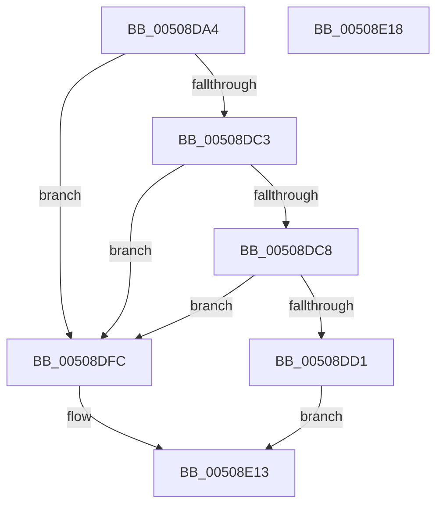

# swinput_s

- RVA: `0x00508DA4`–`0x00508E19` (길이 `117` bytes)
- VA: `0x0000000140508DA4`
- 실행 섹션: `.text`
- PDB 이름 있음: `예`; PDB Function 태그: `아니요`
- unwind 정보 RVA: `0x0006E590`
- 디코드: `33`개 명령, `117/117` bytes 표시
- 미해석 바이트: `0` (있으면 어셈블리에 `.byte`로 보존)

> 이 문서는 커널 이미지의 기계어와 PDB 기호를 분석해 생성했습니다. 4번과 5번은 함수 원형과 자료형을 바이너리 사용 방식에서 추정한 C 해석이며 원본 소스 복구 결과는 아닙니다.

## 1. Dependencies

- 직접 호출 지점: **2**; 고유 호출 대상: **2**
- 직접 호출자로 확인된 함수: **2**
- RIP 상대 이미지 참조: **0**

### Outgoing calls
- `0x00508DF5` → [winput_s](winput_s_function_00508E78.md) (function, `0x00508E78`)
- `0x00508E0B` → [EmpCheckErrataList](../49/EmpCheckErrataList_function_0049E550.md) (function, `0x0049E550`)

### Direct callers
- [snwscanf_s](snwscanf_s_function_00505520.md) at `0x0050554E`
- [swscanf_s](swscanf_s_function_005063B0.md) at `0x005063F3`

### Static image references
- 디코드된 RIP-relative 메모리 참조가 없습니다.

## 2. Other-region calls and transfers

- 다른 실행 섹션으로 향하는 call: **0**
- 별도 외부 분기/꼬리 이동을 확인하지 못했습니다.

## 3. Assembly (complete function range)

```asm
00508DA4  48 83 EC 68                     sub rsp, 0x68
00508DA8  33 C0                           xor eax, eax
00508DAA  0F 57 C0                        xorps xmm0, xmm0
00508DAD  89 44 24 3C                     mov dword ptr [rsp + 0x3c], eax
00508DB1  4D 8B D0                        mov r10, r8
00508DB4  89 44 24 5C                     mov dword ptr [rsp + 0x5c], eax
00508DB8  F3 0F 7F 44 24 4C               movdqu xmmword ptr [rsp + 0x4c], xmm0
00508DBE  48 85 C9                        test rcx, rcx
00508DC1  74 39                           je 0x140508dfc
00508DC3  4D 85 C0                        test r8, r8
00508DC6  74 34                           je 0x140508dfc
00508DC8  48 81 FA FF FF FF 3F            cmp rdx, 0x3fffffff
00508DCF  77 2B                           ja 0x140508dfc
00508DD1  8D 04 12                        lea eax, [rdx + rdx]
00508DD4  48 89 4C 24 40                  mov qword ptr [rsp + 0x40], rcx
00508DD9  48 89 4C 24 30                  mov qword ptr [rsp + 0x30], rcx
00508DDE  49 8B D2                        mov rdx, r10
00508DE1  48 8D 4C 24 30                  lea rcx, [rsp + 0x30]
00508DE6  89 44 24 38                     mov dword ptr [rsp + 0x38], eax
00508DEA  4D 8B C1                        mov r8, r9
00508DED  C7 44 24 48 49 00 00 00         mov dword ptr [rsp + 0x48], 0x49
00508DF5  E8 7E 00 00 00                  call 0x140508e78
00508DFA  EB 17                           jmp 0x140508e13
00508DFC  45 33 C9                        xor r9d, r9d
00508DFF  48 89 44 24 20                  mov qword ptr [rsp + 0x20], rax
00508E04  45 33 C0                        xor r8d, r8d
00508E07  33 D2                           xor edx, edx
00508E09  33 C9                           xor ecx, ecx
00508E0B  E8 40 57 F9 FF                  call 0x14049e550
00508E10  83 C8 FF                        or eax, 0xffffffff
00508E13  48 83 C4 68                     add rsp, 0x68
00508E17  C3                              ret
00508E18  CC                              int3
```

## 4. C-style interpretation (structured pseudocode)

```c
__int64 __fastcall swinput_s(__int64 a1, __int64 a2, __int64 a3, __int64 a4)
{
    __int64 result;
    __int64 v_rsp;
    unsigned __int64 v_stack_m1C;
    unsigned int v_stack_m20;
    unsigned __int64 v_stack_m28;
    unsigned int v_stack_m2C;
    unsigned int v_stack_m30;
    unsigned __int64 v_stack_m38;
    unsigned __int64 v_stack_m48;
    unsigned int v_stack_mC;

    v_rsp = (v_rsp) - (104);
    result = 0;
    v_stack_m2C = 0;
    v_stack_mC = 0;
    v_stack_m1C = v_xmm0;
    if (a1 == 0) goto loc_00508DFC;
    if (a3 == 0) goto loc_00508DFC;
    if (a2 > 0x3FFFFFFFULL) goto loc_00508DFC;
    v_stack_m28 = a1;
    v_stack_m38 = a1;
    v_stack_m30 = (unsigned int)(a2 + a2 * 1);
    v_stack_m20 = 73;
    result = winput_s(v_stack_m38, a3, a4, a4);
    goto loc_00508E13;
loc_00508DFC:
    a4 = 0;
    v_stack_m48 = result;
    a3 = 0;
    a2 = 0;
    a1 = 0;
    result = EmpCheckErrataList(a1, a2, a3, a4);
    result = (unsigned int)((result) | (0xFFFFFFFFULL));
loc_00508E13:
    v_rsp = (v_rsp) + (104);
    return result;
}
```

## 5. (Beta) C Style

```c
int64_t swinput_s(int64_t Arg1, int64_t Arg2, int64_t Arg3, int64_t Arg4)
{
    int64_t result;
    int64_t local_rsp;
    uint64_t v_stack_m1C;
    uint32_t v_stack_m20;
    uint64_t v_stack_m28;
    uint32_t v_stack_m2C;
    uint32_t v_stack_m30;
    uint64_t v_stack_m38;
    uint64_t v_stack_m48;
    uint32_t v_stack_mC;

    local_rsp = (local_rsp) - (104);
    result = 0;
    v_stack_m2C = 0;
    v_stack_mC = 0;
    v_stack_m1C = v_xmm0;
    if (Arg1 == 0) goto loc_00508DFC;
    if (Arg3 == 0) goto loc_00508DFC;
    if (Arg2 > 0x3FFFFFFFULL) goto loc_00508DFC;
    v_stack_m28 = Arg1;
    v_stack_m38 = Arg1;
    v_stack_m30 = (uint32_t)(Arg2 + Arg2 * 1);
    v_stack_m20 = 73;
    result = winput_s(v_stack_m38, Arg3, Arg4, Arg4);
    goto loc_00508E13;
loc_00508DFC:
    Arg4 = 0;
    v_stack_m48 = result;
    Arg3 = 0;
    Arg2 = 0;
    Arg1 = 0;
    result = EmpCheckErrataList(Arg1, Arg2, Arg3, Arg4);
    result = (uint32_t)((result) | (0xFFFFFFFFULL));
loc_00508E13:
    local_rsp = (local_rsp) + (104);
    return result;
}
```

## 6. Execution-region graph

[열기: 2D/3D 그래프와 함수 탐색 컨트롤 패널](../../../control-panel.html?section=text&rva=0x00508DA4&view=graph)

- 2D 그래프는 위에서 아래로 흐르고, 3D 그래프는 빈 공간을 드래그해 회전합니다. Shift+드래그는 이동, 휠은 확대·축소, 함수 노드 선택은 대상 보고서 이동입니다.

### Static fallback


