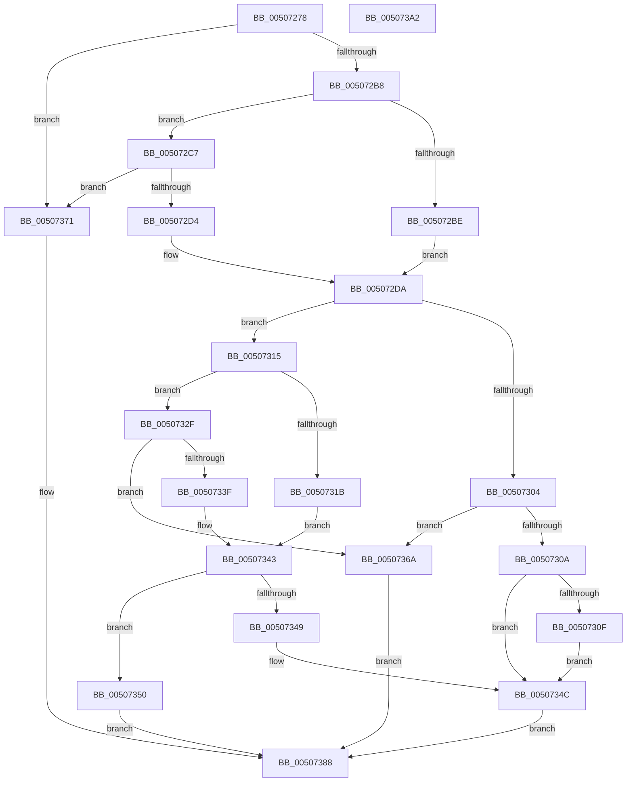

# swoutput_s

- RVA: `0x00507278`–`0x005073A3` (길이 `299` bytes)
- VA: `0x0000000140507278`
- 실행 섹션: `.text`
- PDB 이름 있음: `예`; PDB Function 태그: `아니요`
- unwind 정보 RVA: `0x00083BEC`
- 디코드: `88`개 명령, `299/299` bytes 표시
- 미해석 바이트: `0` (있으면 어셈블리에 `.byte`로 보존)

> 이 문서는 커널 이미지의 기계어와 PDB 기호를 분석해 생성했습니다. 4번과 5번은 함수 원형과 자료형을 바이너리 사용 방식에서 추정한 C 해석이며 원본 소스 복구 결과는 아닙니다.

## 1. Dependencies

- 직접 호출 지점: **4**; 고유 호출 대상: **3**
- 직접 호출자로 확인된 함수: **2**
- RIP 상대 이미지 참조: **0**

### Outgoing calls
- `0x005072F3` → [woutput_s](woutput_s_function_005073AC.md) (function, `0x005073AC`)
- `0x00507335` → [flsbuf](flsbuf_function_0050292C.md) (function, `0x0050292C`)
- `0x00507356` → [flsbuf](flsbuf_function_0050292C.md) (function, `0x0050292C`)
- `0x00507380` → [EmpCheckErrataList](../49/EmpCheckErrataList_function_0049E550.md) (function, `0x0049E550`)

### Direct callers
- [vswprintf_s](vswprintf_s_function_00504B50.md) at `0x00504B6E`
- [vsnwprintf_s](vsnwprintf_s_function_00505470.md) at `0x005054BD`
- [vsnwprintf_s](vsnwprintf_s_function_00505470.md) at `0x005054FE`

### Static image references
- 디코드된 RIP-relative 메모리 참조가 없습니다.

## 2. Other-region calls and transfers

- 다른 실행 섹션으로 향하는 call: **0**
- 별도 외부 분기/꼬리 이동을 확인하지 못했습니다.

## 3. Assembly (complete function range)

```asm
00507278  48 8B C4                        mov rax, rsp
0050727B  48 89 58 08                     mov qword ptr [rax + 8], rbx
0050727F  48 89 70 10                     mov qword ptr [rax + 0x10], rsi
00507283  48 89 78 18                     mov qword ptr [rax + 0x18], rdi
00507287  4C 89 70 20                     mov qword ptr [rax + 0x20], r14
0050728B  55                              push rbp
0050728C  48 8B EC                        mov rbp, rsp
0050728F  48 83 EC 60                     sub rsp, 0x60
00507293  45 33 F6                        xor r14d, r14d
00507296  0F 57 C0                        xorps xmm0, xmm0
00507299  44 89 75 DC                     mov dword ptr [rbp - 0x24], r14d
0050729D  4D 8B D0                        mov r10, r8
005072A0  44 89 75 FC                     mov dword ptr [rbp - 4], r14d
005072A4  48 8B DA                        mov rbx, rdx
005072A7  48 8B F9                        mov rdi, rcx
005072AA  F3 0F 7F 45 EC                  movdqu xmmword ptr [rbp - 0x14], xmm0
005072AF  48 85 D2                        test rdx, rdx
005072B2  0F 84 B9 00 00 00               je 0x140507371
005072B8  48 83 FA FF                     cmp rdx, -1
005072BC  75 09                           jne 0x1405072c7
005072BE  C7 45 D8 FF FF FF 7F            mov dword ptr [rbp - 0x28], 0x7fffffff
005072C5  EB 13                           jmp 0x1405072da
005072C7  48 81 FB FF FF FF 3F            cmp rbx, 0x3fffffff
005072CE  0F 87 9D 00 00 00               ja 0x140507371
005072D4  8D 04 12                        lea eax, [rdx + rdx]
005072D7  89 45 D8                        mov dword ptr [rbp - 0x28], eax
005072DA  4D 8B C1                        mov r8, r9
005072DD  48 89 7D E0                     mov qword ptr [rbp - 0x20], rdi
005072E1  49 8B D2                        mov rdx, r10
005072E4  48 89 7D D0                     mov qword ptr [rbp - 0x30], rdi
005072E8  48 8D 4D D0                     lea rcx, [rbp - 0x30]
005072EC  C7 45 E8 42 00 00 00            mov dword ptr [rbp - 0x18], 0x42
005072F3  E8 B4 00 00 00                  call 0x1405073ac
005072F8  66 44 89 74 5F FE               mov word ptr [rdi + rbx*2 - 2], r14w
005072FE  8B F0                           mov esi, eax
00507300  85 C0                           test eax, eax
00507302  79 11                           jns 0x140507315
00507304  44 39 75 D8                     cmp dword ptr [rbp - 0x28], r14d
00507308  7C 60                           jl 0x14050736a
0050730A  48 85 FF                        test rdi, rdi
0050730D  74 3D                           je 0x14050734c
0050730F  66 44 89 37                     mov word ptr [rdi], r14w
00507313  EB 37                           jmp 0x14050734c
00507315  83 6D D8 01                     sub dword ptr [rbp - 0x28], 1
00507319  78 14                           js 0x14050732f
0050731B  48 8B 45 D0                     mov rax, qword ptr [rbp - 0x30]
0050731F  44 88 30                        mov byte ptr [rax], r14b
00507322  48 8B 45 D0                     mov rax, qword ptr [rbp - 0x30]
00507326  48 FF C0                        inc rax
00507329  48 89 45 D0                     mov qword ptr [rbp - 0x30], rax
0050732D  EB 14                           jmp 0x140507343
0050732F  48 8D 55 D0                     lea rdx, [rbp - 0x30]
00507333  33 C9                           xor ecx, ecx
00507335  E8 F2 B5 FF FF                  call 0x14050292c
0050733A  83 F8 FF                        cmp eax, -1
0050733D  74 2B                           je 0x14050736a
0050733F  48 8B 45 D0                     mov rax, qword ptr [rbp - 0x30]
00507343  83 6D D8 01                     sub dword ptr [rbp - 0x28], 1
00507347  78 07                           js 0x140507350
00507349  44 88 30                        mov byte ptr [rax], r14b
0050734C  8B C6                           mov eax, esi
0050734E  EB 38                           jmp 0x140507388
00507350  48 8D 55 D0                     lea rdx, [rbp - 0x30]
00507354  33 C9                           xor ecx, ecx
00507356  E8 D1 B5 FF FF                  call 0x14050292c
0050735B  83 F8 FF                        cmp eax, -1
0050735E  B9 FE FF FF FF                  mov ecx, 0xfffffffe
00507363  0F 45 CE                        cmovne ecx, esi
00507366  8B C1                           mov eax, ecx
00507368  EB 1E                           jmp 0x140507388
0050736A  B8 FE FF FF FF                  mov eax, 0xfffffffe
0050736F  EB 17                           jmp 0x140507388
00507371  45 33 C9                        xor r9d, r9d
00507374  4C 89 74 24 20                  mov qword ptr [rsp + 0x20], r14
00507379  45 33 C0                        xor r8d, r8d
0050737C  33 D2                           xor edx, edx
0050737E  33 C9                           xor ecx, ecx
00507380  E8 CB 71 F9 FF                  call 0x14049e550
00507385  83 C8 FF                        or eax, 0xffffffff
00507388  4C 8D 5C 24 60                  lea r11, [rsp + 0x60]
0050738D  49 8B 5B 10                     mov rbx, qword ptr [r11 + 0x10]
00507391  49 8B 73 18                     mov rsi, qword ptr [r11 + 0x18]
00507395  49 8B 7B 20                     mov rdi, qword ptr [r11 + 0x20]
00507399  4D 8B 73 28                     mov r14, qword ptr [r11 + 0x28]
0050739D  49 8B E3                        mov rsp, r11
005073A0  5D                              pop rbp
005073A1  C3                              ret
005073A2  CC                              int3
```

## 4. C-style interpretation (structured pseudocode)

```c
__int64 __fastcall swoutput_s(__int64 a1, __int64 a2, __int64 a3, __int64 a4)
{
    __int64 result;
    __int64 v_r14;
    __int64 v_rsp;
    unsigned __int64 v_stack_m1C;
    unsigned int v_stack_m20;
    unsigned __int64 v_stack_m28;
    unsigned int v_stack_m2C;
    unsigned int v_stack_m30;
    unsigned __int64 v_stack_m38;
    unsigned __int64 v_stack_m48;
    unsigned __int64 v_stack_m8;
    unsigned int v_stack_mC;

    *(unsigned __int64 *)(v_rsp + 8) = v_rbx;
    *(unsigned __int64 *)(v_rsp + 16) = v_rsi;
    *(unsigned __int64 *)(v_rsp + 24) = v_rdi;
    *(unsigned __int64 *)(v_rsp + 32) = v_r14;
    v_rsp = (v_rsp) - (96);
    v_r14 = 0;
    v_stack_m2C = 0;
    v_stack_mC = 0;
    v_stack_m1C = v_xmm0;
    if (a2 == 0) goto loc_00507371;
    if (a2 != -1) goto loc_005072C7;
    v_stack_m30 = 0x7FFFFFFFULL;
    goto loc_005072DA;
loc_005072C7:
    if (a2 > 0x3FFFFFFFULL) goto loc_00507371;
    v_stack_m30 = (unsigned int)(a2 + a2 * 1);
loc_005072DA:
    v_stack_m28 = a1;
    v_stack_m38 = a1;
    v_stack_m20 = 66;
    result = woutput_s(v_stack_m38, a3, a4, a4);
    *(unsigned __int16 *)(a1 + a2 * 2 - 2) = 0;
    if (!sign_flag) goto loc_00507315;
    if (v_stack_m30 < 0) goto loc_0050736A;
    if (a1 == 0) goto loc_0050734C;
    *(unsigned __int16 *)(a1) = 0;
    goto loc_0050734C;
loc_00507315:
    if (sign_flag) goto loc_0050732F;
    *(unsigned __int8 *)(v_stack_m38) = 0;
    result = (v_stack_m38) + 1;
    v_stack_m38 = result;
    goto loc_00507343;
loc_0050732F:
    a1 = 0;
    result = flsbuf(a1, v_stack_m38, a4, a4);
    if (((unsigned int)(result)) == -1) goto loc_0050736A;
loc_00507343:
    if (sign_flag) goto loc_00507350;
    *(unsigned __int8 *)(v_stack_m38) = 0;
loc_0050734C:
    goto loc_00507388;
loc_00507350:
    a1 = 0;
    result = flsbuf(a1, v_stack_m38, a4, a4);
    a1 = (unsigned int)(0xFFFFFFFEULL);
    if (((unsigned int)(result)) != -1) { a1 = (unsigned int)((unsigned int)((unsigned int)(result))); }
    goto loc_00507388;
loc_0050736A:
    goto loc_00507388;
loc_00507371:
    a4 = 0;
    v_stack_m48 = 0;
    a3 = 0;
    a2 = 0;
    a1 = 0;
    result = EmpCheckErrataList(a1, a2, a3, a4);
    result = (unsigned int)((result) | (0xFFFFFFFFULL));
loc_00507388:
    return result;
}
```

## 5. (Beta) C Style

```c
int64_t swoutput_s(void *Arg1, int64_t Arg2, int64_t Arg3, int64_t Arg4)
{
    uint8_t *arg1 = (uint8_t *)Arg1;

    int64_t result;
    int64_t local_r14;
    int64_t local_rsp;
    uint64_t v_stack_m1C;
    uint32_t v_stack_m20;
    uint64_t v_stack_m28;
    uint32_t v_stack_m2C;
    uint32_t v_stack_m30;
    uint64_t v_stack_m38;
    uint64_t v_stack_m48;
    uint64_t v_stack_m8;
    uint32_t v_stack_mC;

    *(uint64_t *)(local_rsp + 0x8) = local_rbx;
    *(uint64_t *)(local_rsp + 0x10) = local_rsi;
    *(uint64_t *)(local_rsp + 0x18) = local_rdi;
    *(uint64_t *)(local_rsp + 0x20) = local_r14;
    local_rsp = (local_rsp) - (96);
    local_r14 = 0;
    v_stack_m2C = 0;
    v_stack_mC = 0;
    v_stack_m1C = v_xmm0;
    if (Arg2 == 0) goto loc_00507371;
    if (Arg2 != -1) goto loc_005072C7;
    v_stack_m30 = 0x7FFFFFFFULL;
    goto loc_005072DA;
loc_005072C7:
    if (Arg2 > 0x3FFFFFFFULL) goto loc_00507371;
    v_stack_m30 = (uint32_t)(Arg2 + Arg2 * 1);
loc_005072DA:
    v_stack_m28 = Arg1;
    v_stack_m38 = Arg1;
    v_stack_m20 = 66;
    result = woutput_s(v_stack_m38, Arg3, Arg4, Arg4);
    *(uint16_t *)(arg1 + Arg2 * 2 - 0x2) = 0;
    if (!sign_flag) goto loc_00507315;
    if (v_stack_m30 < 0) goto loc_0050736A;
    if (Arg1 == NULL) goto loc_0050734C;
    *(uint16_t *)(arg1) = 0;
    goto loc_0050734C;
loc_00507315:
    if (sign_flag) goto loc_0050732F;
    *(uint8_t *)(v_stack_m38) = 0;
    result = (v_stack_m38) + 1;
    v_stack_m38 = result;
    goto loc_00507343;
loc_0050732F:
    Arg1 = 0;
    result = flsbuf(Arg1, v_stack_m38, Arg4, Arg4);
    if (((uint32_t)(result)) == -1) goto loc_0050736A;
loc_00507343:
    if (sign_flag) goto loc_00507350;
    *(uint8_t *)(v_stack_m38) = 0;
loc_0050734C:
    goto loc_00507388;
loc_00507350:
    Arg1 = 0;
    result = flsbuf(Arg1, v_stack_m38, Arg4, Arg4);
    Arg1 = (uint32_t)(0xFFFFFFFEULL);
    if (((uint32_t)(result)) != -1) { Arg1 = (uint32_t)((uint32_t)((uint32_t)(result))); }
    goto loc_00507388;
loc_0050736A:
    goto loc_00507388;
loc_00507371:
    Arg4 = 0;
    v_stack_m48 = 0;
    Arg3 = 0;
    Arg2 = 0;
    Arg1 = 0;
    result = EmpCheckErrataList(Arg1, Arg2, Arg3, Arg4);
    result = (uint32_t)((result) | (0xFFFFFFFFULL));
loc_00507388:
    return result;
}
```

### 관측된 메모리 오프셋

구조체 형식이 확인되지 않은 접근은 인자 기준의 오프셋으로만 기록했습니다.

| 기준 인자 | 오프셋 표현 | 폭 (bit) | 접근 |
|---|---:|---:|---|
| `Arg1` | `- 0x2 + rbx*2` | `16` | `W` |

## 6. Execution-region graph

[열기: 2D/3D 그래프와 함수 탐색 컨트롤 패널](../../../control-panel.html?section=text&rva=0x00507278&view=graph)

- 2D 그래프는 위에서 아래로 흐르고, 3D 그래프는 빈 공간을 드래그해 회전합니다. Shift+드래그는 이동, 휠은 확대·축소, 함수 노드 선택은 대상 보고서 이동입니다.

### Static fallback


