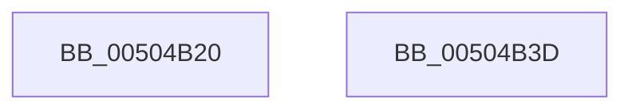

# swprintf_s

- RVA: `0x00504B20`–`0x00504B3E` (길이 `30` bytes)
- VA: `0x0000000140504B20`
- 실행 섹션: `.text`
- PDB 이름 있음: `예`; PDB Function 태그: `아니요`
- unwind 정보 RVA: `0x000C28C4`
- 디코드: `8`개 명령, `30/30` bytes 표시
- 미해석 바이트: `0` (있으면 어셈블리에 `.byte`로 보존)

> 이 문서는 커널 이미지의 기계어와 PDB 기호를 분석해 생성했습니다. 4번과 5번은 함수 원형과 자료형을 바이너리 사용 방식에서 추정한 C 해석이며 원본 소스 복구 결과는 아닙니다.

## 1. Dependencies

- 직접 호출 지점: **1**; 고유 호출 대상: **1**
- 직접 호출자로 확인된 함수: **42**
- RIP 상대 이미지 참조: **0**

### Outgoing calls
- `0x00504B33` → [vswprintf_s](vswprintf_s_function_00504B50.md) (function, `0x00504B50`)

### Direct callers
- [RtlIpv4AddressToStringExW](../46/RtlIpv4AddressToStringExW_function_00467760.md) at `0x004677CC`
- [RtlIpv4AddressToStringW](../46/RtlIpv4AddressToStringW_function_00467840.md) at `0x0046787C`
- [RtlIpv6AddressToStringExW](../48/RtlIpv6AddressToStringExW_function_00480CF0.md) at `0x00480D92`
- [RtlIpv6AddressToStringExW](../48/RtlIpv6AddressToStringExW_function_00480CF0.md) at `0x00480E0B`
- [RtlIpv6AddressToStringW](../48/RtlIpv6AddressToStringW_function_00480E40.md) at `0x00480F2B`
- [RtlIpv6AddressToStringW](../48/RtlIpv6AddressToStringW_function_00480E40.md) at `0x00480F56`
- [RtlIpv6AddressToStringW](../48/RtlIpv6AddressToStringW_function_00480E40.md) at `0x00480FB0`
- [RtlIpv6AddressToStringW](../48/RtlIpv6AddressToStringW_function_00480E40.md) at `0x00481064`
- [RtlIpv6AddressToStringW](../48/RtlIpv6AddressToStringW_function_00480E40.md) at `0x004810BA`
- [RtlIpv6AddressToStringW](../48/RtlIpv6AddressToStringW_function_00480E40.md) at `0x004810F3`
- [RtlEthernetAddressToStringW](../4D/RtlEthernetAddressToStringW_function_004D4710.md) at `0x004D475E`
- [HalpExtBuildResourceIdString](../54/HalpExtBuildResourceIdString_function_0054E494.md) at `0x0054E4F6`
- [HalpExtBuildResourceIdString](../54/HalpExtBuildResourceIdString_function_0054E494.md) at `0x0054E545`
- [HalpExtBuildResourceIdString](../54/HalpExtBuildResourceIdString_function_0054E494.md) at `0x0054E56D`
- [BiSpacesUpdatePhysicalDevicePath](../69/BiSpacesUpdatePhysicalDevicePath_function_0069E6F8.md) at `0x0069E7FA`
- [BiSpacesUpdatePhysicalDevicePath](../69/BiSpacesUpdatePhysicalDevicePath_function_0069E6F8.md) at `0x0069E89A`
- [SddlpUuidToString](../../page/7A/SddlpUuidToString_function_007A53F4.md) at `0x007A54A1`
- [ExpConvertSignatureName](../../page/7C/ExpConvertSignatureName_function_007CB0C8.md) at `0x007CB276`
- [ExpCreateOutputSIGNATURE](../../page/7C/ExpCreateOutputSIGNATURE_function_007CB404.md) at `0x007CB520`
- [ExpCreateOutputSIGNATURE](../../page/7C/ExpCreateOutputSIGNATURE_function_007CB404.md) at `0x007CB574`
- [ExpSetBootEntry](../../page/7C/ExpSetBootEntry_function_007CBD2C.md) at `0x007CC1D2`
- [ExpSetBootEntry](../../page/7C/ExpSetBootEntry_function_007CBD2C.md) at `0x007CC229`
- [ExpSetBootEntry](../../page/7C/ExpSetBootEntry_function_007CBD2C.md) at `0x007CC2A8`
- [ExpSetBootEntry](../../page/7C/ExpSetBootEntry_function_007CBD2C.md) at `0x007CC30D`
- [ExpSetDriverEntry](../../page/7C/ExpSetDriverEntry_function_007CC424.md) at `0x007CC75F`
- [ExpSetDriverEntry](../../page/7C/ExpSetDriverEntry_function_007CC424.md) at `0x007CC7B4`
- [ExpSetDriverEntry](../../page/7C/ExpSetDriverEntry_function_007CC424.md) at `0x007CC83B`
- [ExpSetDriverEntry](../../page/7C/ExpSetDriverEntry_function_007CC424.md) at `0x007CC89E`
- [NtDeleteBootEntry](../../page/7C/NtDeleteBootEntry_function_007CD2B0.md) at `0x007CD355`
- [NtDeleteBootEntry](../../page/7C/NtDeleteBootEntry_function_007CD2B0.md) at `0x007CD3AC`
- [NtDeleteDriverEntry](../../page/7C/NtDeleteDriverEntry_function_007CD440.md) at `0x007CD4E5`
- [NtDeleteDriverEntry](../../page/7C/NtDeleteDriverEntry_function_007CD440.md) at `0x007CD53C`
- [CmSetAcpiHwProfile](../../page/7E/CmSetAcpiHwProfile_function_007E2584.md) at `0x007E2A13`
- [CmpAddAcpiAliasEntry](../../page/7E/CmpAddAcpiAliasEntry_function_007E2DC4.md) at `0x007E2EB5`
- [CmpCloneHwProfile](../../page/7E/CmpCloneHwProfile_function_007E303C.md) at `0x007E311D`
- [CmpCloneHwProfile](../../page/7E/CmpCloneHwProfile_function_007E303C.md) at `0x007E327D`
- [CmpCreateHwProfileFriendlyName](../../page/7E/CmpCreateHwProfileFriendlyName_function_007E3840.md) at `0x007E3A93`
- [CmpCreateHwProfileFriendlyName](../../page/7E/CmpCreateHwProfileFriendlyName_function_007E3840.md) at `0x007E3AD9`
- [CmpMoveBiosAliasTable](../../page/7E/CmpMoveBiosAliasTable_function_007E4578.md) at `0x007E4996`
- [CmpMoveBiosAliasTable](../../page/7E/CmpMoveBiosAliasTable_function_007E4578.md) at `0x007E4AEF`
- [CmpRestampVersion](../../page/7E/CmpRestampVersion_function_007E769C.md) at `0x007E76F4`
- [CmpUpdateReorganizeRegistryValues](../../page/7E/CmpUpdateReorganizeRegistryValues_function_007EA7D4.md) at `0x007EA8E5`
- [BiGetNtPartitionPath](../../page/82/BiGetNtPartitionPath_function_0082546C.md) at `0x008256AD`
- [BiGetNtPartitionPath](../../page/82/BiGetNtPartitionPath_function_0082546C.md) at `0x0082575C`
- [BiGetNtPartitionPath](../../page/82/BiGetNtPartitionPath_function_0082546C.md) at `0x0082583A`
- [BiCreateBootEntry](../../page/82/BiCreateBootEntry_function_00826510.md) at `0x008267FE`
- [SiFindSystemPartition](../../page/82/SiFindSystemPartition_function_00827754.md) at `0x0082778E`
- [SiGetBiosSystemPartition](../../page/82/SiGetBiosSystemPartition_function_008286C0.md) at `0x008287A8`
- [RtlStringFromGUIDEx](../../page/91/RtlStringFromGUIDEx_function_00915450.md) at `0x00915519`
- [LocalConvertSDToStringSD_Rev1](../../page/92/LocalConvertSDToStringSD_Rev1_function_00924428.md) at `0x0092456D`
- [LocalConvertSDToStringSD_Rev1](../../page/92/LocalConvertSDToStringSD_Rev1_function_00924428.md) at `0x00924656`
- [LocalConvertSDToStringSD_Rev1](../../page/92/LocalConvertSDToStringSD_Rev1_function_00924428.md) at `0x00924693`
- [LocalConvertSDToStringSD_Rev1](../../page/92/LocalConvertSDToStringSD_Rev1_function_00924428.md) at `0x009246E2`
- [LocalConvertSDToStringSD_Rev1](../../page/92/LocalConvertSDToStringSD_Rev1_function_00924428.md) at `0x00924770`
- [LocalConvertSDToStringSD_Rev1](../../page/92/LocalConvertSDToStringSD_Rev1_function_00924428.md) at `0x009247BC`
- [PnpSetPropertyWorker](../../page/99/PnpSetPropertyWorker_function_00991C08.md) at `0x00991D30`
- [SiGetBootDeviceName](../../page/A3/SiGetBootDeviceName_function_00A378FC.md) at `0x00A379FC`
- [BiAddStoreFromFile](../../page/A4/BiAddStoreFromFile_function_00A40C54.md) at `0x00A40CBF`
- [_CmCreateOrdinalInstanceKey](../../page/A7/_CmCreateOrdinalInstanceKey_function_00A77838.md) at `0x00A778D7`
- [ExpFindDiskSignature](../../page/A7/ExpFindDiskSignature_function_00A7B608.md) at `0x00A7B6C5`
- [SepCleanupLUIDDeviceMapDirectory](../../page/A9/SepCleanupLUIDDeviceMapDirectory_function_00A98F24.md) at `0x00A98FF9`
- [PopPotsLogPowerTransitionReliability](../../page/AA/PopPotsLogPowerTransitionReliability_function_00AAE1C4.md) at `0x00AAE2E2`
- [BcdEnumerateDisks](../../page/AB/BcdEnumerateDisks_function_00AB04CC.md) at `0x00AB0644`
- [ExpGetDriveGeometry](../../page/AC/ExpGetDriveGeometry_function_00ACA760.md) at `0x00ACA7CB`
- [BiGetPhysicalDriveName](../../page/AC/BiGetPhysicalDriveName_function_00ACD5BC.md) at `0x00ACD6AE`
- [sub_00B2884E](../../page/B2/Unknown_function_00B2884E.md) at `0x00B288CE`
- [sub_00B3AB32](../../page/B3/Unknown_function_00B3AB32.md) at `0x00B3AB4E`
- [sub_00B42460](../../page/B4/Unknown_function_00B42460.md) at `0x00B424D7`
- [CreateMiniNtBootKey](../../init/C1/CreateMiniNtBootKey_function_00C1A840.md) at `0x00C1A8AE`
- [PopPotsLogDirtyPowerTransition](../../init/C4/PopPotsLogDirtyPowerTransition_function_00C43EE8.md) at `0x00C43F3D`

### Static image references
- 디코드된 RIP-relative 메모리 참조가 없습니다.

## 2. Other-region calls and transfers

- 다른 실행 섹션으로 향하는 call: **0**
- 별도 외부 분기/꼬리 이동을 확인하지 못했습니다.

## 3. Assembly (complete function range)

```asm
00504B20  4C 89 44 24 18                  mov qword ptr [rsp + 0x18], r8
00504B25  4C 89 4C 24 20                  mov qword ptr [rsp + 0x20], r9
00504B2A  48 83 EC 38                     sub rsp, 0x38
00504B2E  4C 8D 4C 24 58                  lea r9, [rsp + 0x58]
00504B33  E8 18 00 00 00                  call 0x140504b50
00504B38  48 83 C4 38                     add rsp, 0x38
00504B3C  C3                              ret
00504B3D  CC                              int3
```

## 4. C-style interpretation (structured pseudocode)

```c
__int64 __fastcall swprintf_s(__int64 a1, __int64 a2, __int64 a3, __int64 a4)
{
    __int64 result;
    __int64 v_rsp;
    unsigned __int64 v_stack_p18;
    unsigned __int64 v_stack_p20;

    v_stack_p18 = a3;
    v_stack_p20 = a4;
    v_rsp = (v_rsp) - (56);
    result = vswprintf_s(a1, a2, a3, v_stack_p20);
    v_rsp = (v_rsp) + (56);
    return result;
}
```

## 5. (Beta) C Style

```c
int64_t swprintf_s(int64_t Arg1, int64_t Arg2, int64_t Arg3, int64_t Arg4)
{
    int64_t result;
    int64_t local_rsp;
    uint64_t v_stack_p18;
    uint64_t v_stack_p20;

    v_stack_p18 = Arg3;
    v_stack_p20 = Arg4;
    local_rsp = (local_rsp) - (56);
    result = vswprintf_s(Arg1, Arg2, Arg3, v_stack_p20);
    local_rsp = (local_rsp) + (56);
    return result;
}
```

## 6. Execution-region graph

[열기: 2D/3D 그래프와 함수 탐색 컨트롤 패널](../../../control-panel.html?section=text&rva=0x00504B20&view=graph)

- 2D 그래프는 위에서 아래로 흐르고, 3D 그래프는 빈 공간을 드래그해 회전합니다. Shift+드래그는 이동, 휠은 확대·축소, 함수 노드 선택은 대상 보고서 이동입니다.

### Static fallback


