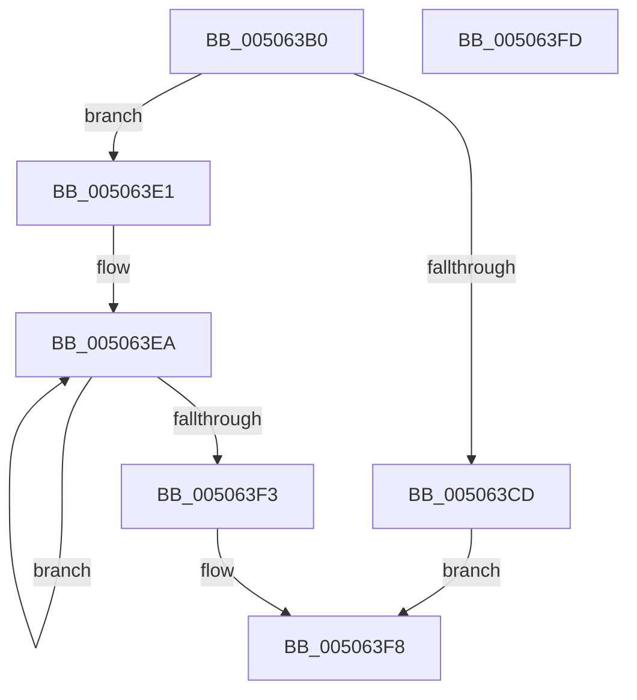

# swscanf_s

- RVA: `0x005063B0`–`0x005063FE` (길이 `78` bytes)
- VA: `0x00000001405063B0`
- 실행 섹션: `.text`
- PDB 이름 있음: `예`; PDB Function 태그: `아니요`
- unwind 정보 RVA: `0x000B29D0`
- 디코드: `24`개 명령, `78/78` bytes 표시
- 미해석 바이트: `0` (있으면 어셈블리에 `.byte`로 보존)

> 이 문서는 커널 이미지의 기계어와 PDB 기호를 분석해 생성했습니다. 4번과 5번은 함수 원형과 자료형을 바이너리 사용 방식에서 추정한 C 해석이며 원본 소스 복구 결과는 아닙니다.

## 1. Dependencies

- 직접 호출 지점: **2**; 고유 호출 대상: **2**
- 직접 호출자로 확인된 함수: **3**
- RIP 상대 이미지 참조: **0**

### Outgoing calls
- `0x005063D6` → [EmpCheckErrataList](../49/EmpCheckErrataList_function_0049E550.md) (function, `0x0049E550`)
- `0x005063F3` → [swinput_s](swinput_s_function_00508DA4.md) (function, `0x00508DA4`)

### Direct callers
- [PiDevCfgParseVersionString](../../page/73/PiDevCfgParseVersionString_function_00733FAC.md) at `0x0073402A`
- [PiDevCfgParseVersionString](../../page/73/PiDevCfgParseVersionString_function_00733FAC.md) at `0x00734048`
- [PiDevCfgParseVersionString](../../page/73/PiDevCfgParseVersionString_function_00733FAC.md) at `0x0073405D`
- [PiDevCfgSplitDriverConfigurationId](../../page/73/PiDevCfgSplitDriverConfigurationId_function_00736568.md) at `0x00736719`
- [ExProcessorCounterSetCallback](../../page/9E/ExProcessorCounterSetCallback_function_009E4880.md) at `0x009E49AC`

### Static image references
- 디코드된 RIP-relative 메모리 참조가 없습니다.

## 2. Other-region calls and transfers

- 다른 실행 섹션으로 향하는 call: **0**
- 별도 외부 분기/꼬리 이동을 확인하지 못했습니다.

## 3. Assembly (complete function range)

```asm
005063B0  4C 8B DC                        mov r11, rsp
005063B3  49 89 53 10                     mov qword ptr [r11 + 0x10], rdx
005063B7  4D 89 43 18                     mov qword ptr [r11 + 0x18], r8
005063BB  4D 89 4B 20                     mov qword ptr [r11 + 0x20], r9
005063BF  48 83 EC 48                     sub rsp, 0x48
005063C3  33 C0                           xor eax, eax
005063C5  4C 8B C2                        mov r8, rdx
005063C8  48 85 D2                        test rdx, rdx
005063CB  75 14                           jne 0x1405063e1
005063CD  45 33 C9                        xor r9d, r9d
005063D0  49 89 43 D8                     mov qword ptr [r11 - 0x28], rax
005063D4  33 C9                           xor ecx, ecx
005063D6  E8 75 81 F9 FF                  call 0x14049e550
005063DB  48 83 C8 FF                     or rax, 0xffffffffffffffff
005063DF  EB 17                           jmp 0x1405063f8
005063E1  4C 8D 4C 24 60                  lea r9, [rsp + 0x60]
005063E6  48 83 CA FF                     or rdx, 0xffffffffffffffff
005063EA  48 FF C2                        inc rdx
005063ED  66 39 04 51                     cmp word ptr [rcx + rdx*2], ax
005063F1  75 F7                           jne 0x1405063ea
005063F3  E8 AC 29 00 00                  call 0x140508da4
005063F8  48 83 C4 48                     add rsp, 0x48
005063FC  C3                              ret
005063FD  CC                              int3
```

## 4. C-style interpretation (structured pseudocode)

```c
__int64 __fastcall swscanf_s(int a1, __int64 a2, __int64 a3, __int64 a4)
{
    __int64 result;
    __int64 v_rsp;
    unsigned __int64 v_stack_p18;

    *(unsigned __int64 *)(v_rsp + 16) = a2;
    *(unsigned __int64 *)(v_rsp + 24) = a3;
    *(unsigned __int64 *)(v_rsp + 32) = a4;
    v_rsp = (v_rsp) - (72);
    result = 0;
    if (a2 != 0) goto loc_005063E1;
    a4 = 0;
    *(unsigned __int64 *)(v_rsp - 40) = 0;
    a1 = 0;
    result = EmpCheckErrataList(a1, a2, a2, a4);
    result = (result) | (-1);
    goto loc_005063F8;
loc_005063E1:
    a2 = (a2) | (-1);
loc_005063EA:
    a2 = (a2) + 1;
    if ((*(unsigned __int16 *)(a1 + a2 * 2)) != ((unsigned __int16)(result))) goto loc_005063EA;
    result = swinput_s(a1, a2, a2, v_stack_p18);
loc_005063F8:
    v_rsp = (v_rsp) + (72);
    return result;
}
```

## 5. (Beta) C Style

```c
int64_t swscanf_s(void *Arg1, int64_t Arg2, int64_t Arg3, int64_t Arg4)
{
    uint8_t *arg1 = (uint8_t *)Arg1;

    int64_t result;
    int64_t local_rsp;
    uint64_t v_stack_p18;

    *(uint64_t *)(local_rsp + 0x10) = Arg2;
    *(uint64_t *)(local_rsp + 0x18) = Arg3;
    *(uint64_t *)(local_rsp + 0x20) = Arg4;
    local_rsp = (local_rsp) - (72);
    result = 0;
    if (Arg2 != 0) goto loc_005063E1;
    Arg4 = 0;
    *(uint64_t *)(local_rsp - 0x28) = 0;
    Arg1 = 0;
    result = EmpCheckErrataList(Arg1, Arg2, Arg2, Arg4);
    result = (result) | (-1);
    goto loc_005063F8;
loc_005063E1:
    Arg2 = (Arg2) | (-1);
loc_005063EA:
    Arg2 = (Arg2) + 1;
    if ((*(uint16_t *)(arg1 + Arg2 * 2)) != ((uint16_t)(result))) goto loc_005063EA;
    result = swinput_s(Arg1, Arg2, Arg2, v_stack_p18);
loc_005063F8:
    local_rsp = (local_rsp) + (72);
    return result;
}
```

### 관측된 메모리 오프셋

구조체 형식이 확인되지 않은 접근은 인자 기준의 오프셋으로만 기록했습니다.

| 기준 인자 | 오프셋 표현 | 폭 (bit) | 접근 |
|---|---:|---:|---|
| `Arg1` | `+ 0x0 + rdx*2` | `16` | `R` |

## 6. Execution-region graph

[열기: 2D/3D 그래프와 함수 탐색 컨트롤 패널](../../../control-panel.html?section=text&rva=0x005063B0&view=graph)

- 2D 그래프는 위에서 아래로 흐르고, 3D 그래프는 빈 공간을 드래그해 회전합니다. Shift+드래그는 이동, 휠은 확대·축소, 함수 노드 선택은 대상 보고서 이동입니다.

### Static fallback


