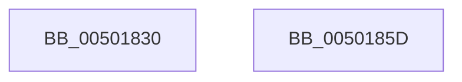

# tolower

- RVA: `0x00501830`–`0x0050185E` (길이 `46` bytes)
- VA: `0x0000000140501830`
- 실행 섹션: `.text`
- PDB 이름 있음: `예`; PDB Function 태그: `아니요`
- unwind 정보 RVA: `0x0005CF00`
- 디코드: `17`개 명령, `46/46` bytes 표시
- 미해석 바이트: `0` (있으면 어셈블리에 `.byte`로 보존)

> 이 문서는 커널 이미지의 기계어와 PDB 기호를 분석해 생성했습니다. 4번과 5번은 함수 원형과 자료형을 바이너리 사용 방식에서 추정한 C 해석이며 원본 소스 복구 결과는 아닙니다.

## 1. Dependencies

- 직접 호출 지점: **1**; 고유 호출 대상: **1**
- 직접 호출자로 확인된 함수: **0**
- RIP 상대 이미지 참조: **0**

### Outgoing calls
- `0x00501838` → [_pctype_func](_pctype_func_function_00503CFC.md) (function, `0x00503CFC`)

### Direct callers
- 이 함수 시작 RVA로 연결되는 직접 call은 확인되지 않았습니다. 간접 호출은 완전히 역산할 수 없습니다.

### Static image references
- 디코드된 RIP-relative 메모리 참조가 없습니다.

## 2. Other-region calls and transfers

- 다른 실행 섹션으로 향하는 call: **0**
- 별도 외부 분기/꼬리 이동을 확인하지 못했습니다.

## 3. Assembly (complete function range)

```asm
00501830  40 53                           push rbx
00501832  48 83 EC 20                     sub rsp, 0x20
00501836  8B D9                           mov ebx, ecx
00501838  E8 BF 24 00 00                  call 0x140503cfc
0050183D  83 C9 FF                        or ecx, 0xffffffff
00501840  0F B6 D3                        movzx edx, bl
00501843  3B D9                           cmp ebx, ecx
00501845  0F 44 D1                        cmove edx, ecx
00501848  48 63 D2                        movsxd rdx, edx
0050184B  F6 04 50 01                     test byte ptr [rax + rdx*2], 1
0050184F  8D 43 20                        lea eax, [rbx + 0x20]
00501852  0F 45 D8                        cmovne ebx, eax
00501855  8B C3                           mov eax, ebx
00501857  48 83 C4 20                     add rsp, 0x20
0050185B  5B                              pop rbx
0050185C  C3                              ret
0050185D  CC                              int3
```

## 4. C-style interpretation (structured pseudocode)

```c
__int64 __fastcall tolower(int a1)
{
    __int64 result;
    __int64 v_rbx;
    __int64 v_rsp;

    v_rsp = (v_rsp) - (32);
    result = _pctype_func(a1, a2, a3, a4);
    a1 = (unsigned int)((a1) | (0xFFFFFFFFULL));
    a2 = (unsigned __int8)((unsigned int)(a1));
    if (((unsigned int)((unsigned int)(a1))) == a1) { a2 = a1; }
    v_rbx = (unsigned int)(a1);
    if (((*(unsigned __int8 *)(result + (int)((unsigned int)(a2)) * 2)) & (1)) != 0) { v_rbx = (unsigned int)((unsigned int)(a1) + 32); }
    v_rsp = (v_rsp) + (32);
    return (unsigned int)((unsigned int)(v_rbx));
}
```

## 5. (Beta) C Style

```c
int64_t tolower(int32_t Arg1)
{
    int64_t result;
    int64_t local_rbx;
    int64_t local_rsp;

    local_rsp = (local_rsp) - (32);
    result = _pctype_func(Arg1, a2, a3, a4);
    Arg1 = (uint32_t)((Arg1) | (0xFFFFFFFFULL));
    a2 = (uint8_t)((uint32_t)(Arg1));
    if (((uint32_t)((uint32_t)(Arg1))) == Arg1) { a2 = Arg1; }
    local_rbx = (uint32_t)(Arg1);
    if (((*(uint8_t *)(result + (int32_t)((uint32_t)(a2)) * 2)) & (1)) != 0) { local_rbx = (uint32_t)((uint32_t)(Arg1) + 32); }
    local_rsp = (local_rsp) + (32);
    return (uint32_t)((uint32_t)(local_rbx));
}
```

## 6. Execution-region graph

[열기: 2D/3D 그래프와 함수 탐색 컨트롤 패널](../../../control-panel.html?section=text&rva=0x00501830&view=graph)

- 2D 그래프는 위에서 아래로 흐르고, 3D 그래프는 빈 공간을 드래그해 회전합니다. Shift+드래그는 이동, 휠은 확대·축소, 함수 노드 선택은 대상 보고서 이동입니다.

### Static fallback


