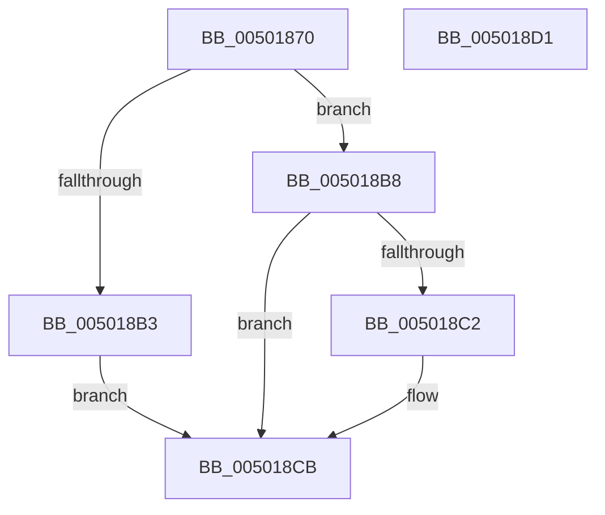

# toupper

- RVA: `0x00501870`–`0x005018D2` (길이 `98` bytes)
- VA: `0x0000000140501870`
- 실행 섹션: `.text`
- PDB 이름 있음: `예`; PDB Function 태그: `아니요`
- unwind 정보 RVA: `0x000C27C8`
- 디코드: `30`개 명령, `98/98` bytes 표시
- 미해석 바이트: `0` (있으면 어셈블리에 `.byte`로 보존)

> 이 문서는 커널 이미지의 기계어와 PDB 기호를 분석해 생성했습니다. 4번과 5번은 함수 원형과 자료형을 바이너리 사용 방식에서 추정한 C 해석이며 원본 소스 복구 결과는 아닙니다.

## 1. Dependencies

- 직접 호출 지점: **2**; 고유 호출 대상: **2**
- 직접 호출자로 확인된 함수: **2**
- RIP 상대 이미지 참조: **0**

### Outgoing calls
- `0x0050188C` → [RtlAnsiCharToUnicodeChar](../../page/90/RtlAnsiCharToUnicodeChar_function_0090D980.md) (function, `0x0090D980`)
- `0x005018AA` → [RtlUpcaseUnicodeToMultiByteN](../../page/90/RtlUpcaseUnicodeToMultiByteN_function_0090D760.md) (function, `0x0090D760`)

### Direct callers
- [SdbpMergeAreTagValuesEqual](../../page/81/SdbpMergeAreTagValuesEqual_function_00819524.md) at `0x00819687`
- [SdbpMergeAreTagValuesEqual](../../page/81/SdbpMergeAreTagValuesEqual_function_00819524.md) at `0x00819691`
- [AslStringPatternMatchExA](../../page/95/AslStringPatternMatchExA_function_0095E0A0.md) at `0x0095E112`
- [AslStringPatternMatchExA](../../page/95/AslStringPatternMatchExA_function_0095E0A0.md) at `0x0095E11C`
- [AslStringPatternMatchExA](../../page/95/AslStringPatternMatchExA_function_0095E0A0.md) at `0x0095E144`
- [AslStringPatternMatchExA](../../page/95/AslStringPatternMatchExA_function_0095E0A0.md) at `0x0095E14E`

### Static image references
- 디코드된 RIP-relative 메모리 참조가 없습니다.

## 2. Other-region calls and transfers

- 다른 실행 섹션으로 향하는 call: **2**
  - `0x0050188C` → [RtlAnsiCharToUnicodeChar](../../page/90/RtlAnsiCharToUnicodeChar_function_0090D980.md) (`.text` → `PAGE`)
  - `0x005018AA` → [RtlUpcaseUnicodeToMultiByteN](../../page/90/RtlUpcaseUnicodeToMultiByteN_function_0090D760.md) (`.text` → `PAGE`)
- 별도 외부 분기/꼬리 이동을 확인하지 못했습니다.

## 3. Assembly (complete function range)

```asm
00501870  89 4C 24 08                     mov dword ptr [rsp + 8], ecx
00501874  55                              push rbp
00501875  48 8B EC                        mov rbp, rsp
00501878  48 83 EC 40                     sub rsp, 0x40
0050187C  83 65 28 00                     and dword ptr [rbp + 0x28], 0
00501880  48 8D 45 10                     lea rax, [rbp + 0x10]
00501884  48 8D 4D F0                     lea rcx, [rbp - 0x10]
00501888  48 89 45 F0                     mov qword ptr [rbp - 0x10], rax
0050188C  E8 EF C0 40 00                  call 0x14090d980
00501891  BA 02 00 00 00                  mov edx, 2
00501896  66 89 45 20                     mov word ptr [rbp + 0x20], ax
0050189A  4C 8D 4D 20                     lea r9, [rbp + 0x20]
0050189E  89 54 24 20                     mov dword ptr [rsp + 0x20], edx
005018A2  4C 8D 45 28                     lea r8, [rbp + 0x28]
005018A6  48 8D 4D 18                     lea rcx, [rbp + 0x18]
005018AA  E8 B1 BE 40 00                  call 0x14090d760
005018AF  85 C0                           test eax, eax
005018B1  79 05                           jns 0x1405018b8
005018B3  8B 45 10                        mov eax, dword ptr [rbp + 0x10]
005018B6  EB 13                           jmp 0x1405018cb
005018B8  83 7D 28 01                     cmp dword ptr [rbp + 0x28], 1
005018BC  0F B6 45 18                     movzx eax, byte ptr [rbp + 0x18]
005018C0  74 09                           je 0x1405018cb
005018C2  0F B6 4D 19                     movzx ecx, byte ptr [rbp + 0x19]
005018C6  C1 E0 08                        shl eax, 8
005018C9  0B C1                           or eax, ecx
005018CB  48 83 C4 40                     add rsp, 0x40
005018CF  5D                              pop rbp
005018D0  C3                              ret
005018D1  CC                              int3
```

## 4. C-style interpretation (structured pseudocode)

```c
__int64 __fastcall toupper(int a1)
{
    __int64 result;
    __int64 v_rsp;
    unsigned __int64 v_stack_m18;
    unsigned int v_stack_m28;
    unsigned __int64 v_stack_p10;
    unsigned __int8 v_stack_p11;
    unsigned __int16 v_stack_p18;
    unsigned int v_stack_p20;
    unsigned int v_stack_p8;

    v_stack_p8 = a1;
    v_rsp = (v_rsp) - (64);
    v_stack_m18 = v_stack_p8;
    result = RtlAnsiCharToUnicodeChar(v_stack_m18, a2, a3, a4);
    v_stack_p18 = (unsigned __int16)(result);
    v_stack_m28 = 2;
    result = RtlUpcaseUnicodeToMultiByteN(v_stack_p10, 2, v_stack_p20, v_stack_p18);
    if (!sign_flag) goto loc_005018B8;
    goto loc_005018CB;
loc_005018B8:
    result = v_stack_p10;
    if (v_stack_p20 != 1) {
        a1 = v_stack_p11;
        result = (unsigned int)((v_stack_p10) << (8));
        result = (unsigned int)((result) | (a1));
    }
    v_rsp = (v_rsp) + (64);
    return result;
}
```

## 5. (Beta) C Style

```c
int64_t toupper(int32_t Arg1)
{
    int64_t result;
    int64_t local_rsp;
    uint64_t v_stack_m18;
    uint32_t v_stack_m28;
    uint64_t v_stack_p10;
    uint8_t v_stack_p11;
    uint16_t v_stack_p18;
    uint32_t v_stack_p20;
    uint32_t v_stack_p8;

    v_stack_p8 = Arg1;
    local_rsp = (local_rsp) - (64);
    v_stack_m18 = v_stack_p8;
    result = RtlAnsiCharToUnicodeChar(v_stack_m18, a2, a3, a4);
    v_stack_p18 = (uint16_t)(result);
    v_stack_m28 = 2;
    result = RtlUpcaseUnicodeToMultiByteN(v_stack_p10, 2, v_stack_p20, v_stack_p18);
    if (!sign_flag) goto loc_005018B8;
    goto loc_005018CB;
loc_005018B8:
    result = v_stack_p10;
    if (v_stack_p20 != 1) {
        Arg1 = v_stack_p11;
        result = (uint32_t)((v_stack_p10) << (8));
        result = (uint32_t)((result) | (Arg1));
    }
    local_rsp = (local_rsp) + (64);
    return result;
}
```

## 6. Execution-region graph

[열기: 2D/3D 그래프와 함수 탐색 컨트롤 패널](../../../control-panel.html?section=text&rva=0x00501870&view=graph)

- 2D 그래프는 위에서 아래로 흐르고, 3D 그래프는 빈 공간을 드래그해 회전합니다. Shift+드래그는 이동, 휠은 확대·축소, 함수 노드 선택은 대상 보고서 이동입니다.

### Static fallback


