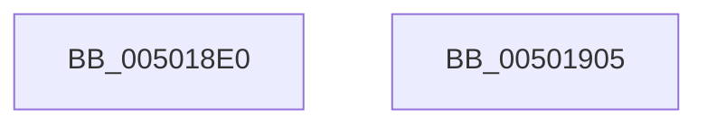

# towlower

- RVA: `0x005018E0`–`0x00501906` (길이 `38` bytes)
- VA: `0x00000001405018E0`
- 실행 섹션: `.text`
- PDB 이름 있음: `예`; PDB Function 태그: `아니요`
- unwind 정보 RVA: `0x0005CF00`
- 디코드: `13`개 명령, `38/38` bytes 표시
- 미해석 바이트: `0` (있으면 어셈블리에 `.byte`로 보존)

> 이 문서는 커널 이미지의 기계어와 PDB 기호를 분석해 생성했습니다. 4번과 5번은 함수 원형과 자료형을 바이너리 사용 방식에서 추정한 C 해석이며 원본 소스 복구 결과는 아닙니다.

## 1. Dependencies

- 직접 호출 지점: **1**; 고유 호출 대상: **1**
- 직접 호출자로 확인된 함수: **7**
- RIP 상대 이미지 참조: **0**

### Outgoing calls
- `0x005018EE` → [iswctype](iswctype_function_00502900.md) (function, `0x00502900`)

### Direct callers
- [ExpParseArcPathName](../../page/7C/ExpParseArcPathName_function_007CB908.md) at `0x007CB978`
- [ExpTranslateDriverEntryNameToId](../../page/7C/ExpTranslateDriverEntryNameToId_function_007CCB40.md) at `0x007CCB62`
- [ExpTranslateDriverEntryNameToId](../../page/7C/ExpTranslateDriverEntryNameToId_function_007CCB40.md) at `0x007CCB75`
- [ExpTranslateDriverEntryNameToId](../../page/7C/ExpTranslateDriverEntryNameToId_function_007CCB40.md) at `0x007CCB88`
- [ExpTranslateDriverEntryNameToId](../../page/7C/ExpTranslateDriverEntryNameToId_function_007CCB40.md) at `0x007CCB97`
- [ExpTranslateDriverEntryNameToId](../../page/7C/ExpTranslateDriverEntryNameToId_function_007CCB40.md) at `0x007CCBA6`
- [ExpTranslateDriverEntryNameToId](../../page/7C/ExpTranslateDriverEntryNameToId_function_007CCB40.md) at `0x007CCBB5`
- [ExpTranslateDriverEntryNameToId](../../page/7C/ExpTranslateDriverEntryNameToId_function_007CCB40.md) at `0x007CCBD2`
- [ExpTranslateHexStringToGUID](../../page/7C/ExpTranslateHexStringToGUID_function_007CCC34.md) at `0x007CCCA2`
- [ExpTranslateHexStringToULONG](../../page/7C/ExpTranslateHexStringToULONG_function_007CCDB4.md) at `0x007CCDF4`
- [ExpTranslateHexStringToULONGLONG](../../page/7C/ExpTranslateHexStringToULONGLONG_function_007CCE50.md) at `0x007CCE90`
- [EtwpCovSampCheckForSegments](../../page/A0/EtwpCovSampCheckForSegments_function_00A0F990.md) at `0x00A0FA09`
- [ExpTranslateBootEntryNameToId](../../page/A2/ExpTranslateBootEntryNameToId_function_00A25718.md) at `0x00A2573A`
- [ExpTranslateBootEntryNameToId](../../page/A2/ExpTranslateBootEntryNameToId_function_00A25718.md) at `0x00A25767`
- [ExpTranslateBootEntryNameToId](../../page/A2/ExpTranslateBootEntryNameToId_function_00A25718.md) at `0x00A25776`
- [ExpTranslateBootEntryNameToId](../../page/A2/ExpTranslateBootEntryNameToId_function_00A25718.md) at `0x00A25785`
- [ExpTranslateBootEntryNameToId](../../page/A2/ExpTranslateBootEntryNameToId_function_00A25718.md) at `0x00A257A2`

### Static image references
- 디코드된 RIP-relative 메모리 참조가 없습니다.

## 2. Other-region calls and transfers

- 다른 실행 섹션으로 향하는 call: **0**
- 별도 외부 분기/꼬리 이동을 확인하지 못했습니다.

## 3. Assembly (complete function range)

```asm
005018E0  40 53                           push rbx
005018E2  48 83 EC 20                     sub rsp, 0x20
005018E6  BA 01 00 00 00                  mov edx, 1
005018EB  0F B7 D9                        movzx ebx, cx
005018EE  E8 0D 10 00 00                  call 0x140502900
005018F3  85 C0                           test eax, eax
005018F5  8D 4B 20                        lea ecx, [rbx + 0x20]
005018F8  66 0F 45 D9                     cmovne bx, cx
005018FC  0F B7 C3                        movzx eax, bx
005018FF  48 83 C4 20                     add rsp, 0x20
00501903  5B                              pop rbx
00501904  C3                              ret
00501905  CC                              int3
```

## 4. C-style interpretation (structured pseudocode)

```c
__int64 __fastcall towlower(unsigned __int16 a1)
{
    __int64 result;
    __int64 v_rsp;

    v_rsp = (v_rsp) - (32);
    result = iswctype(a1, 1, a3, a4);
    if ((unsigned int)(result) != 0) { a1 = (unsigned __int16)(a1 + 32); }
    v_rsp = (v_rsp) + (32);
    return a1;
}
```

## 5. (Beta) C Style

```c
void *towlower(void *Arg1)
{
    uint8_t *arg1 = (uint8_t *)Arg1;

    int64_t result;
    int64_t local_rsp;

    local_rsp = (local_rsp) - (32);
    result = iswctype(Arg1, 1, a3, a4);
    if ((uint32_t)(result) != 0) { Arg1 = (uint16_t)(Arg1 + 32); }
    local_rsp = (local_rsp) + (32);
    return Arg1;
}
```

### 관측된 메모리 오프셋

구조체 형식이 확인되지 않은 접근은 인자 기준의 오프셋으로만 기록했습니다.

| 기준 인자 | 오프셋 표현 | 폭 (bit) | 접근 |
|---|---:|---:|---|
| `Arg1` | `+ 0x20` | `32` | `R` |

## 6. Execution-region graph

[열기: 2D/3D 그래프와 함수 탐색 컨트롤 패널](../../../control-panel.html?section=text&rva=0x005018E0&view=graph)

- 2D 그래프는 위에서 아래로 흐르고, 3D 그래프는 빈 공간을 드래그해 회전합니다. Shift+드래그는 이동, 휠은 확대·축소, 함수 노드 선택은 대상 보고서 이동입니다.

### Static fallback


