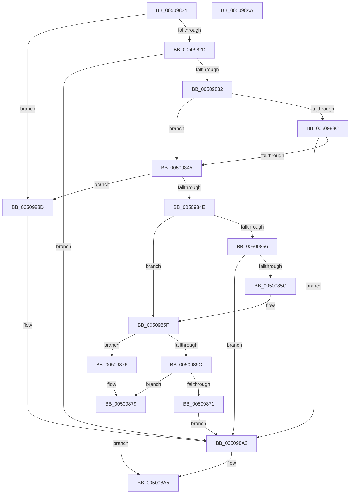

# ungetc_nolock

- RVA: `0x00509824`–`0x005098AB` (길이 `135` bytes)
- VA: `0x0000000140509824`
- 실행 섹션: `.text`
- PDB 이름 있음: `예`; PDB Function 태그: `아니요`
- unwind 정보 RVA: `0x0005D2F4`
- 디코드: `47`개 명령, `135/135` bytes 표시
- 미해석 바이트: `0` (있으면 어셈블리에 `.byte`로 보존)

> 이 문서는 커널 이미지의 기계어와 PDB 기호를 분석해 생성했습니다. 4번과 5번은 함수 원형과 자료형을 바이너리 사용 방식에서 추정한 C 해석이며 원본 소스 복구 결과는 아닙니다.

## 1. Dependencies

- 직접 호출 지점: **1**; 고유 호출 대상: **1**
- 직접 호출자로 확인된 함수: **2**
- RIP 상대 이미지 참조: **0**

### Outgoing calls
- `0x0050989D` → [EmpCheckErrataList](../49/EmpCheckErrataList_function_0049E550.md) (function, `0x0049E550`)

### Direct callers
- [ReadString](ReadString_function_00507D40.md) at `0x00507D90`
- [ReadString](ReadString_function_00507D40.md) at `0x00507EC1`
- [input_s](input_s_function_00508090.md) at `0x00508144`
- [input_s](input_s_function_00508090.md) at `0x00508529`
- [input_s](input_s_function_00508090.md) at `0x00508673`
- [input_s](input_s_function_00508090.md) at `0x00508747`
- [input_s](input_s_function_00508090.md) at `0x0050887D`
- [input_s](input_s_function_00508090.md) at `0x005088C9`

### Static image references
- 디코드된 RIP-relative 메모리 참조가 없습니다.

## 2. Other-region calls and transfers

- 다른 실행 섹션으로 향하는 call: **0**
- 별도 외부 분기/꼬리 이동을 확인하지 못했습니다.

## 3. Assembly (complete function range)

```asm
00509824  48 83 EC 38                     sub rsp, 0x38
00509828  48 85 D2                        test rdx, rdx
0050982B  74 60                           je 0x14050988d
0050982D  83 F9 FF                        cmp ecx, -1
00509830  74 70                           je 0x1405098a2
00509832  44 8B 4A 18                     mov r9d, dword ptr [rdx + 0x18]
00509836  41 F6 C1 01                     test r9b, 1
0050983A  75 09                           jne 0x140509845
0050983C  41 8B C1                        mov eax, r9d
0050983F  24 82                           and al, 0x82
00509841  3C 80                           cmp al, 0x80
00509843  75 5D                           jne 0x1405098a2
00509845  4C 8B 42 10                     mov r8, qword ptr [rdx + 0x10]
00509849  4D 85 C0                        test r8, r8
0050984C  74 3F                           je 0x14050988d
0050984E  48 8B 02                        mov rax, qword ptr [rdx]
00509851  49 3B C0                        cmp rax, r8
00509854  75 09                           jne 0x14050985f
00509856  83 7A 08 00                     cmp dword ptr [rdx + 8], 0
0050985A  75 46                           jne 0x1405098a2
0050985C  48 FF C0                        inc rax
0050985F  4C 8D 40 FF                     lea r8, [rax - 1]
00509863  4C 89 02                        mov qword ptr [rdx], r8
00509866  41 F6 C1 40                     test r9b, 0x40
0050986A  74 0A                           je 0x140509876
0050986C  41 38 08                        cmp byte ptr [r8], cl
0050986F  74 08                           je 0x140509879
00509871  48 89 02                        mov qword ptr [rdx], rax
00509874  EB 2C                           jmp 0x1405098a2
00509876  41 88 08                        mov byte ptr [r8], cl
00509879  8B 42 18                        mov eax, dword ptr [rdx + 0x18]
0050987C  FF 42 08                        inc dword ptr [rdx + 8]
0050987F  83 E0 EF                        and eax, 0xffffffef
00509882  83 C8 01                        or eax, 1
00509885  89 42 18                        mov dword ptr [rdx + 0x18], eax
00509888  0F B6 C1                        movzx eax, cl
0050988B  EB 18                           jmp 0x1405098a5
0050988D  48 83 64 24 20 00               and qword ptr [rsp + 0x20], 0
00509893  45 33 C9                        xor r9d, r9d
00509896  45 33 C0                        xor r8d, r8d
00509899  33 D2                           xor edx, edx
0050989B  33 C9                           xor ecx, ecx
0050989D  E8 AE 4C F9 FF                  call 0x14049e550
005098A2  83 C8 FF                        or eax, 0xffffffff
005098A5  48 83 C4 38                     add rsp, 0x38
005098A9  C3                              ret
005098AA  CC                              int3
```

## 4. C-style interpretation (structured pseudocode)

```c
__int64 __fastcall ungetc_nolock(int a1, __int64 a2)
{
    __int64 result;
    __int64 v_rsp;
    unsigned __int64 v_stack_m18;

    v_rsp = (v_rsp) - (56);
    if (a2 == 0) goto loc_0050988D;
    if (a1 == -1) goto loc_005098A2;
    if ((((unsigned __int8)((unsigned int)(*(unsigned int *)(a2 + 24)))) & (1)) != 0) goto loc_00509845;
    result = (unsigned __int8)(((unsigned int)((unsigned int)((unsigned int)(*(unsigned int *)(a2 + 24))))) & (130));
    if (((unsigned __int8)(result)) != 128) goto loc_005098A2;
loc_00509845:
    if (*(unsigned __int64 *)(a2 + 16) == 0) goto loc_0050988D;
    if ((*(unsigned __int64 *)(a2)) != (*(unsigned __int64 *)(a2 + 16))) goto loc_0050985F;
    if ((*(unsigned int *)(a2 + 8)) != 0) goto loc_005098A2;
    result = (*(unsigned __int64 *)(a2)) + 1;
loc_0050985F:
    *(unsigned __int64 *)(a2) = result - 1;
    if ((((unsigned __int8)((unsigned int)(*(unsigned int *)(a2 + 24)))) & (64)) == 0) goto loc_00509876;
    if ((*(unsigned __int8 *)(result - 1)) == ((unsigned __int8)(a1))) goto loc_00509879;
    *(unsigned __int64 *)(a2) = result;
    goto loc_005098A2;
loc_00509876:
    *(unsigned __int8 *)(result - 1) = (unsigned __int8)(a1);
loc_00509879:
    result = (unsigned int)(((unsigned int)(*(unsigned int *)(a2 + 24))) & (0xFFFFFFEFULL));
    result = (unsigned int)((result) | (1));
    *(unsigned int *)(a2 + 24) = (unsigned int)(result);
    goto loc_005098A5;
loc_0050988D:
    a4 = 0;
    a3 = 0;
    a2 = 0;
    a1 = 0;
    result = EmpCheckErrataList(a1, a2, a3, a4);
loc_005098A2:
    result = (unsigned int)((result) | (0xFFFFFFFFULL));
loc_005098A5:
    v_rsp = (v_rsp) + (56);
    return result;
}
```

## 5. (Beta) C Style

```c
int64_t ungetc_nolock(int32_t Arg1, int64_t Arg2)
{
    int64_t result;
    int64_t local_rsp;
    uint64_t v_stack_m18;

    local_rsp = (local_rsp) - (56);
    if (Arg2 == 0) goto loc_0050988D;
    if (Arg1 == -1) goto loc_005098A2;
    if ((((uint8_t)((uint32_t)(*(uint32_t *)(Arg2 + 0x18)))) & (1)) != 0) goto loc_00509845;
    result = (uint8_t)(((uint32_t)((uint32_t)((uint32_t)(*(uint32_t *)(Arg2 + 0x18))))) & (130));
    if (((uint8_t)(result)) != 128) goto loc_005098A2;
loc_00509845:
    if (*(uint64_t *)(Arg2 + 0x10) == 0) goto loc_0050988D;
    if ((*(uint64_t *)(Arg2)) != (*(uint64_t *)(Arg2 + 0x10))) goto loc_0050985F;
    if ((*(uint32_t *)(Arg2 + 0x8)) != 0) goto loc_005098A2;
    result = (*(uint64_t *)(Arg2)) + 1;
loc_0050985F:
    *(uint64_t *)(Arg2) = result - 1;
    if ((((uint8_t)((uint32_t)(*(uint32_t *)(Arg2 + 0x18)))) & (64)) == 0) goto loc_00509876;
    if ((*(uint8_t *)(result - 0x1)) == ((uint8_t)(Arg1))) goto loc_00509879;
    *(uint64_t *)(Arg2) = result;
    goto loc_005098A2;
loc_00509876:
    *(uint8_t *)(result - 0x1) = (uint8_t)(Arg1);
loc_00509879:
    result = (uint32_t)(((uint32_t)(*(uint32_t *)(Arg2 + 0x18))) & (0xFFFFFFEFULL));
    result = (uint32_t)((result) | (1));
    *(uint32_t *)(Arg2 + 0x18) = (uint32_t)(result);
    goto loc_005098A5;
loc_0050988D:
    a4 = 0;
    a3 = 0;
    Arg2 = 0;
    Arg1 = 0;
    result = EmpCheckErrataList(Arg1, Arg2, a3, a4);
loc_005098A2:
    result = (uint32_t)((result) | (0xFFFFFFFFULL));
loc_005098A5:
    local_rsp = (local_rsp) + (56);
    return result;
}
```

## 6. Execution-region graph

[열기: 2D/3D 그래프와 함수 탐색 컨트롤 패널](../../../control-panel.html?section=text&rva=0x00509824&view=graph)

- 2D 그래프는 위에서 아래로 흐르고, 3D 그래프는 빈 공간을 드래그해 회전합니다. Shift+드래그는 이동, 휠은 확대·축소, 함수 노드 선택은 대상 보고서 이동입니다.

### Static fallback


