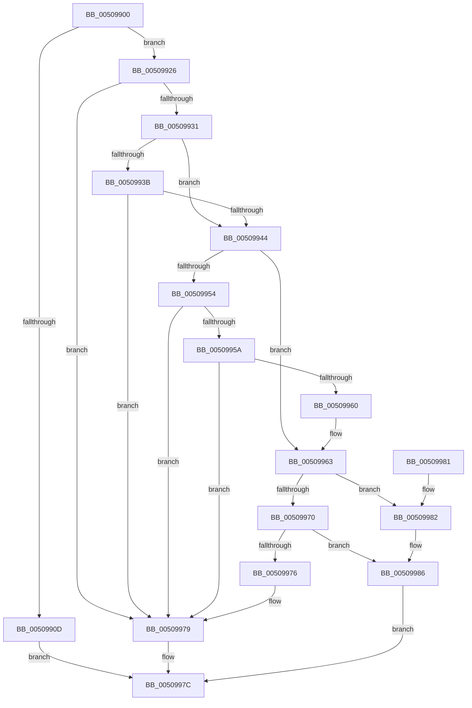

# ungetwc_nolock

- RVA: `0x00509900`–`0x0050999C` (길이 `156` bytes)
- VA: `0x0000000140509900`
- 실행 섹션: `.text`
- PDB 이름 있음: `예`; PDB Function 태그: `아니요`
- unwind 정보 RVA: `0x00069AC4`
- 디코드: `50`개 명령, `156/156` bytes 표시
- 미해석 바이트: `0` (있으면 어셈블리에 `.byte`로 보존)

> 이 문서는 커널 이미지의 기계어와 PDB 기호를 분석해 생성했습니다. 4번과 5번은 함수 원형과 자료형을 바이너리 사용 방식에서 추정한 C 해석이며 원본 소스 복구 결과는 아닙니다.

## 1. Dependencies

- 직접 호출 지점: **1**; 고유 호출 대상: **1**
- 직접 호출자로 확인된 함수: **2**
- RIP 상대 이미지 참조: **0**

### Outgoing calls
- `0x0050991A` → [EmpCheckErrataList](../49/EmpCheckErrataList_function_0049E550.md) (function, `0x0049E550`)

### Direct callers
- [ReadString](ReadString_function_005089B0.md) at `0x00508A08`
- [ReadString](ReadString_function_005089B0.md) at `0x00508BB4`
- [winput_s](winput_s_function_00508E78.md) at `0x00508F24`
- [winput_s](winput_s_function_00508E78.md) at `0x00509377`
- [winput_s](winput_s_function_00508E78.md) at `0x00509500`
- [winput_s](winput_s_function_00508E78.md) at `0x0050960C`
- [winput_s](winput_s_function_00508E78.md) at `0x00509788`
- [winput_s](winput_s_function_00508E78.md) at `0x005097A5`

### Static image references
- 디코드된 RIP-relative 메모리 참조가 없습니다.

## 2. Other-region calls and transfers

- 다른 실행 섹션으로 향하는 call: **0**
- 별도 외부 분기/꼬리 이동을 확인하지 못했습니다.

## 3. Assembly (complete function range)

```asm
00509900  48 83 EC 38                     sub rsp, 0x38
00509904  44 0F B7 C1                     movzx r8d, cx
00509908  48 85 D2                        test rdx, rdx
0050990B  75 19                           jne 0x140509926
0050990D  48 21 54 24 20                  and qword ptr [rsp + 0x20], rdx
00509912  45 33 C9                        xor r9d, r9d
00509915  45 33 C0                        xor r8d, r8d
00509918  33 C9                           xor ecx, ecx
0050991A  E8 31 4C F9 FF                  call 0x14049e550
0050991F  B8 FF FF 00 00                  mov eax, 0xffff
00509924  EB 56                           jmp 0x14050997c
00509926  B9 FF FF 00 00                  mov ecx, 0xffff
0050992B  66 44 3B C1                     cmp r8w, cx
0050992F  74 48                           je 0x140509979
00509931  44 8B 52 18                     mov r10d, dword ptr [rdx + 0x18]
00509935  41 F6 C2 01                     test r10b, 1
00509939  75 09                           jne 0x140509944
0050993B  41 8B C2                        mov eax, r10d
0050993E  24 82                           and al, 0x82
00509940  3C 80                           cmp al, 0x80
00509942  75 35                           jne 0x140509979
00509944  4C 8B 4A 10                     mov r9, qword ptr [rdx + 0x10]
00509948  48 8B 02                        mov rax, qword ptr [rdx]
0050994B  49 83 C1 02                     add r9, 2
0050994F  49 3B C1                        cmp rax, r9
00509952  73 0F                           jae 0x140509963
00509954  83 7A 08 00                     cmp dword ptr [rdx + 8], 0
00509958  75 1F                           jne 0x140509979
0050995A  83 7A 24 02                     cmp dword ptr [rdx + 0x24], 2
0050995E  72 19                           jb 0x140509979
00509960  49 8B C1                        mov rax, r9
00509963  4C 8D 48 FE                     lea r9, [rax - 2]
00509967  4C 89 0A                        mov qword ptr [rdx], r9
0050996A  41 F6 C2 40                     test r10b, 0x40
0050996E  74 12                           je 0x140509982
00509970  66 45 39 01                     cmp word ptr [r9], r8w
00509974  74 10                           je 0x140509986
00509976  48 89 02                        mov qword ptr [rdx], rax
00509979  0F B7 C1                        movzx eax, cx
0050997C  48 83 C4 38                     add rsp, 0x38
00509980  C3                              ret
00509981  CC                              int3
00509982  66 45 89 01                     mov word ptr [r9], r8w
00509986  8B 42 18                        mov eax, dword ptr [rdx + 0x18]
00509989  83 42 08 02                     add dword ptr [rdx + 8], 2
0050998D  83 E0 EF                        and eax, 0xffffffef
00509990  83 C8 01                        or eax, 1
00509993  89 42 18                        mov dword ptr [rdx + 0x18], eax
00509996  41 0F B7 C0                     movzx eax, r8w
0050999A  EB E0                           jmp 0x14050997c
```

## 4. C-style interpretation (structured pseudocode)

```c
__int64 __fastcall ungetwc_nolock(int a1, __int64 a2, __int64 a3, int a4)
{
    __int64 result;
    __int64 v_rsp;
    unsigned __int64 v_stack_m18;

    v_rsp = (v_rsp) - (56);
    if (a2 != 0) goto loc_00509926;
    a4 = 0;
    a3 = 0;
    a1 = 0;
    result = EmpCheckErrataList(a1, a2, a3, a4);
    goto loc_0050997C;
loc_00509926:
    if (0 == ((unsigned __int16)((unsigned int)(0xFFFFULL)))) goto loc_00509979;
    if ((((unsigned __int8)((unsigned int)(*(unsigned int *)(a2 + 24)))) & (1)) != 0) goto loc_00509944;
    result = (unsigned __int8)(((unsigned int)((unsigned int)((unsigned int)(*(unsigned int *)(a2 + 24))))) & (130));
    if (((unsigned __int8)(result)) != 128) goto loc_00509979;
loc_00509944:
    a4 = (*(unsigned __int64 *)(a2 + 16)) + (2);
    if ((*(unsigned __int64 *)(a2)) >= a4) goto loc_00509963;
    if ((*(unsigned int *)(a2 + 8)) != 0) goto loc_00509979;
    if ((*(unsigned int *)(a2 + 36)) < 2) goto loc_00509979;
loc_00509963:
    *(unsigned __int64 *)(a2) = a4 - 2;
    if ((((unsigned __int8)((unsigned int)(*(unsigned int *)(a2 + 24)))) & (64)) == 0) goto loc_00509982;
    if ((*(unsigned __int16 *)(a4 - 2)) == 0) goto loc_00509986;
    *(unsigned __int64 *)(a2) = a4;
loc_00509979:
loc_0050997C:
    v_rsp = (v_rsp) + (56);
    return (unsigned __int16)((unsigned int)(0xFFFFULL));
loc_00509982:
    *(unsigned __int16 *)(a4 - 2) = 0;
loc_00509986:
    result = (unsigned int)(((unsigned int)(*(unsigned int *)(a2 + 24))) & (0xFFFFFFEFULL));
    result = (unsigned int)((result) | (1));
    *(unsigned int *)(a2 + 24) = (unsigned int)(result);
    goto loc_0050997C;
}
```

## 5. (Beta) C Style

```c
int64_t ungetwc_nolock(int32_t Arg1, int64_t Arg2, int64_t Arg3, int32_t Arg4)
{
    int64_t result;
    int64_t local_rsp;
    uint64_t v_stack_m18;

    local_rsp = (local_rsp) - (56);
    if (Arg2 != 0) goto loc_00509926;
    Arg4 = 0;
    Arg3 = 0;
    Arg1 = 0;
    result = EmpCheckErrataList(Arg1, Arg2, Arg3, Arg4);
    goto loc_0050997C;
loc_00509926:
    if (0 == ((uint16_t)((uint32_t)(0xFFFFULL)))) goto loc_00509979;
    if ((((uint8_t)((uint32_t)(*(uint32_t *)(Arg2 + 0x18)))) & (1)) != 0) goto loc_00509944;
    result = (uint8_t)(((uint32_t)((uint32_t)((uint32_t)(*(uint32_t *)(Arg2 + 0x18))))) & (130));
    if (((uint8_t)(result)) != 128) goto loc_00509979;
loc_00509944:
    Arg4 = (*(uint64_t *)(Arg2 + 0x10)) + (2);
    if ((*(uint64_t *)(Arg2)) >= Arg4) goto loc_00509963;
    if ((*(uint32_t *)(Arg2 + 0x8)) != 0) goto loc_00509979;
    if ((*(uint32_t *)(Arg2 + 0x24)) < 2) goto loc_00509979;
loc_00509963:
    *(uint64_t *)(Arg2) = Arg4 - 2;
    if ((((uint8_t)((uint32_t)(*(uint32_t *)(Arg2 + 0x18)))) & (64)) == 0) goto loc_00509982;
    if ((*(uint16_t *)(Arg4 - 0x2)) == 0) goto loc_00509986;
    *(uint64_t *)(Arg2) = Arg4;
loc_00509979:
loc_0050997C:
    local_rsp = (local_rsp) + (56);
    return (uint16_t)((uint32_t)(0xFFFFULL));
loc_00509982:
    *(uint16_t *)(Arg4 - 0x2) = 0;
loc_00509986:
    result = (uint32_t)(((uint32_t)(*(uint32_t *)(Arg2 + 0x18))) & (0xFFFFFFEFULL));
    result = (uint32_t)((result) | (1));
    *(uint32_t *)(Arg2 + 0x18) = (uint32_t)(result);
    goto loc_0050997C;
}
```

## 6. Execution-region graph

[열기: 2D/3D 그래프와 함수 탐색 컨트롤 패널](../../../control-panel.html?section=text&rva=0x00509900&view=graph)

- 2D 그래프는 위에서 아래로 흐르고, 3D 그래프는 빈 공간을 드래그해 회전합니다. Shift+드래그는 이동, 휠은 확대·축소, 함수 노드 선택은 대상 보고서 이동입니다.

### Static fallback


