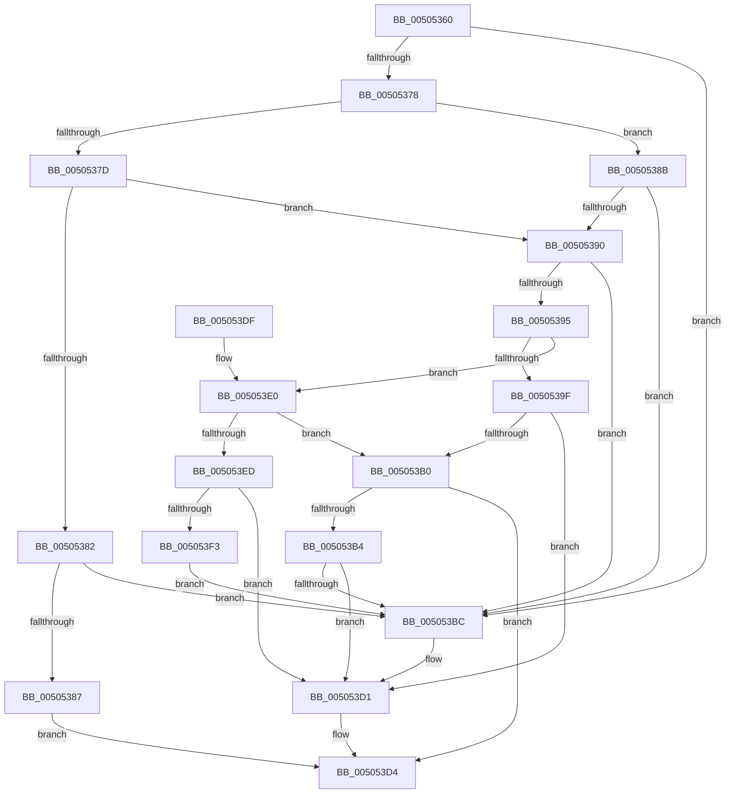

# vsnprintf_s

- RVA: `0x00505360`–`0x005053F8` (길이 `152` bytes)
- VA: `0x0000000140505360`
- 실행 섹션: `.text`
- PDB 이름 있음: `예`; PDB Function 태그: `아니요`
- unwind 정보 RVA: `0x000A3580`
- 디코드: `53`개 명령, `152/152` bytes 표시
- 미해석 바이트: `0` (있으면 어셈블리에 `.byte`로 보존)

> 이 문서는 커널 이미지의 기계어와 PDB 기호를 분석해 생성했습니다. 4번과 5번은 함수 원형과 자료형을 바이너리 사용 방식에서 추정한 C 해석이며 원본 소스 복구 결과는 아닙니다.

## 1. Dependencies

- 직접 호출 지점: **3**; 고유 호출 대상: **2**
- 직접 호출자로 확인된 함수: **1**
- RIP 상대 이미지 참조: **0**

### Outgoing calls
- `0x005053A6` → [soutput_s](soutput_s_function_00507184.md) (function, `0x00507184`)
- `0x005053CC` → [EmpCheckErrataList](../49/EmpCheckErrataList_function_0049E550.md) (function, `0x0049E550`)
- `0x005053E3` → [soutput_s](soutput_s_function_00507184.md) (function, `0x00507184`)

### Direct callers
- [snprintf_s](snprintf_s_function_00505330.md) at `0x00505343`

### Static image references
- 디코드된 RIP-relative 메모리 참조가 없습니다.

## 2. Other-region calls and transfers

- 다른 실행 섹션으로 향하는 call: **0**
- 별도 외부 분기/꼬리 이동을 확인하지 못했습니다.

## 3. Assembly (complete function range)

```asm
00505360  48 89 5C 24 08                  mov qword ptr [rsp + 8], rbx
00505365  57                              push rdi
00505366  48 83 EC 30                     sub rsp, 0x30
0050536A  49 8B C1                        mov rax, r9
0050536D  49 8B F8                        mov rdi, r8
00505370  48 8B D9                        mov rbx, rcx
00505373  4D 85 C9                        test r9, r9
00505376  74 44                           je 0x1405053bc
00505378  4D 85 C0                        test r8, r8
0050537B  75 0E                           jne 0x14050538b
0050537D  48 85 C9                        test rcx, rcx
00505380  75 0E                           jne 0x140505390
00505382  48 85 D2                        test rdx, rdx
00505385  75 35                           jne 0x1405053bc
00505387  33 C0                           xor eax, eax
00505389  EB 49                           jmp 0x1405053d4
0050538B  48 85 DB                        test rbx, rbx
0050538E  74 2C                           je 0x1405053bc
00505390  48 85 D2                        test rdx, rdx
00505393  74 27                           je 0x1405053bc
00505395  4C 8B 4C 24 60                  mov r9, qword ptr [rsp + 0x60]
0050539A  48 3B D7                        cmp rdx, rdi
0050539D  76 41                           jbe 0x1405053e0
0050539F  49 8D 50 01                     lea rdx, [r8 + 1]
005053A3  4C 8B C0                        mov r8, rax
005053A6  E8 D9 1D 00 00                  call 0x140507184
005053AB  83 F8 FE                        cmp eax, -2
005053AE  74 21                           je 0x1405053d1
005053B0  85 C0                           test eax, eax
005053B2  79 20                           jns 0x1405053d4
005053B4  C6 03 00                        mov byte ptr [rbx], 0
005053B7  83 F8 FE                        cmp eax, -2
005053BA  75 15                           jne 0x1405053d1
005053BC  48 83 64 24 20 00               and qword ptr [rsp + 0x20], 0
005053C2  45 33 C9                        xor r9d, r9d
005053C5  45 33 C0                        xor r8d, r8d
005053C8  33 D2                           xor edx, edx
005053CA  33 C9                           xor ecx, ecx
005053CC  E8 7F 91 F9 FF                  call 0x14049e550
005053D1  83 C8 FF                        or eax, 0xffffffff
005053D4  48 8B 5C 24 40                  mov rbx, qword ptr [rsp + 0x40]
005053D9  48 83 C4 30                     add rsp, 0x30
005053DD  5F                              pop rdi
005053DE  C3                              ret
005053DF  CC                              int3
005053E0  4C 8B C0                        mov r8, rax
005053E3  E8 9C 1D 00 00                  call 0x140507184
005053E8  83 F8 FE                        cmp eax, -2
005053EB  75 C3                           jne 0x1405053b0
005053ED  48 83 FF FF                     cmp rdi, -1
005053F1  74 DE                           je 0x1405053d1
005053F3  C6 03 00                        mov byte ptr [rbx], 0
005053F6  EB C4                           jmp 0x1405053bc
```

## 4. C-style interpretation (structured pseudocode)

```c
__int64 __fastcall vsnprintf_s(__int64 a1, __int64 a2, __int64 a3, __int64 a4, __int64 a5)
{
    __int64 result;
    __int64 v_rsp;
    unsigned __int64 v_stack_m18;
    unsigned __int64 v_stack_p8;

    v_stack_p8 = v_rbx;
    v_rsp = (v_rsp) - (48);
    if (a4 == 0) goto loc_005053BC;
    if (a3 != 0) goto loc_0050538B;
    if (a1 != 0) goto loc_00505390;
    if (a2 != 0) goto loc_005053BC;
    result = 0;
    goto loc_005053D4;
loc_0050538B:
    if (a1 == 0) goto loc_005053BC;
loc_00505390:
    if (a2 == 0) goto loc_005053BC;
    if (a2 <= a3) goto loc_005053E0;
    result = soutput_s(a1, a3 + 1, 0, a5);
    if (((unsigned int)(result)) == -2) goto loc_005053D1;
loc_005053B0:
    if (!sign_flag) goto loc_005053D4;
    *(unsigned __int8 *)(a1) = 0;
    if (((unsigned int)(result)) == -2) {
        a4 = 0;
        a3 = 0;
        a2 = 0;
        a1 = 0;
        result = EmpCheckErrataList(a1, a2, a3, a4);
    }
    result = (unsigned int)((result) | (0xFFFFFFFFULL));
loc_005053D4:
    v_rsp = (v_rsp) + (48);
    return result;
loc_005053E0:
    result = soutput_s(a1, a2, result, a4);
    if (((unsigned int)(result)) != -2) goto loc_005053B0;
    if (0 == -1) goto loc_005053D1;
    *(unsigned __int8 *)(v_stack_p8) = 0;
    goto loc_005053BC;
}
```

## 5. (Beta) C Style

```c
int64_t vsnprintf_s(int64_t Arg1, int64_t Arg2, int64_t Arg3, int64_t Arg4, int64_t Arg5)
{
    int64_t result;
    int64_t local_rsp;
    uint64_t v_stack_m18;
    uint64_t v_stack_p8;

    v_stack_p8 = local_rbx;
    local_rsp = (local_rsp) - (48);
    if (Arg4 == 0) goto loc_005053BC;
    if (Arg3 != 0) goto loc_0050538B;
    if (Arg1 != 0) goto loc_00505390;
    if (Arg2 != 0) goto loc_005053BC;
    result = 0;
    goto loc_005053D4;
loc_0050538B:
    if (Arg1 == 0) goto loc_005053BC;
loc_00505390:
    if (Arg2 == 0) goto loc_005053BC;
    if (Arg2 <= Arg3) goto loc_005053E0;
    result = soutput_s(Arg1, Arg3 + 1, 0, Arg5);
    if (((uint32_t)(result)) == -2) goto loc_005053D1;
loc_005053B0:
    if (!sign_flag) goto loc_005053D4;
    *(uint8_t *)(Arg1) = 0;
    if (((uint32_t)(result)) == -2) {
        Arg4 = 0;
        Arg3 = 0;
        Arg2 = 0;
        Arg1 = 0;
        result = EmpCheckErrataList(Arg1, Arg2, Arg3, Arg4);
    }
    result = (uint32_t)((result) | (0xFFFFFFFFULL));
loc_005053D4:
    local_rsp = (local_rsp) + (48);
    return result;
loc_005053E0:
    result = soutput_s(Arg1, Arg2, result, Arg4);
    if (((uint32_t)(result)) != -2) goto loc_005053B0;
    if (0 == -1) goto loc_005053D1;
    *(uint8_t *)(v_stack_p8) = 0;
    goto loc_005053BC;
}
```

## 6. Execution-region graph

[열기: 2D/3D 그래프와 함수 탐색 컨트롤 패널](../../../control-panel.html?section=text&rva=0x00505360&view=graph)

- 2D 그래프는 위에서 아래로 흐르고, 3D 그래프는 빈 공간을 드래그해 회전합니다. Shift+드래그는 이동, 휠은 확대·축소, 함수 노드 선택은 대상 보고서 이동입니다.

### Static fallback


