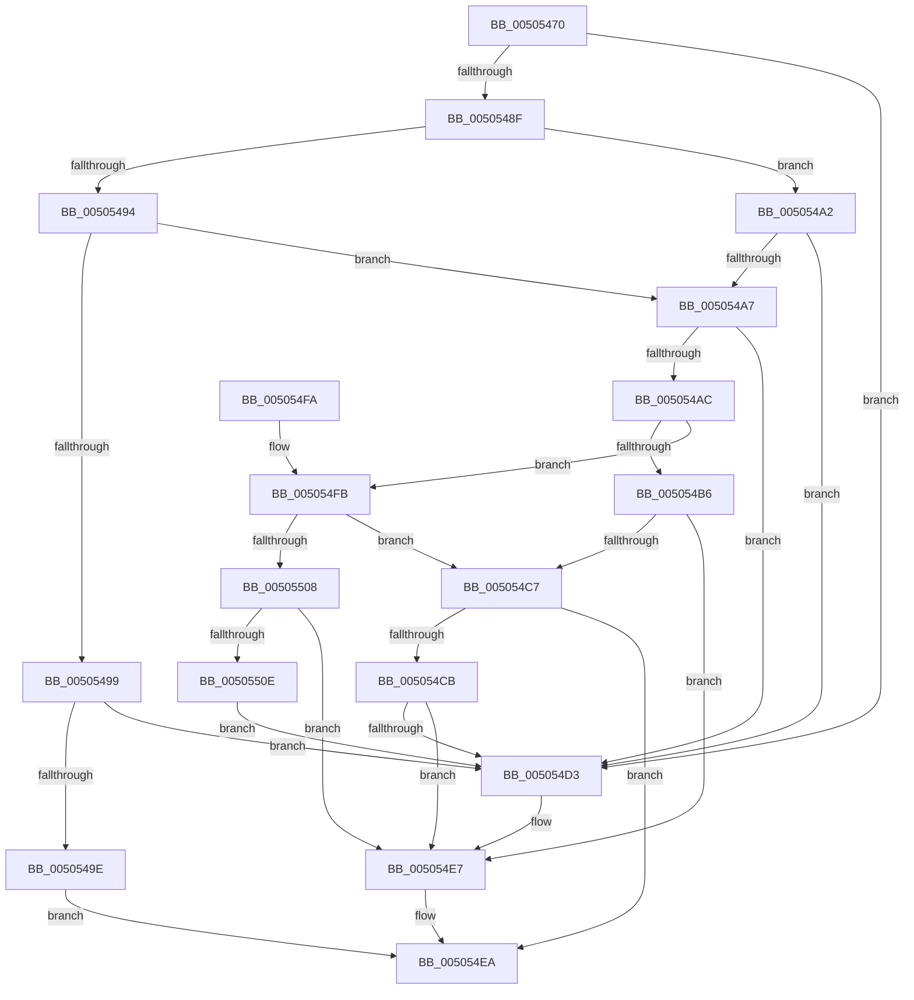

# vsnwprintf_s

- RVA: `0x00505470`–`0x00505513` (길이 `163` bytes)
- VA: `0x0000000140505470`
- 실행 섹션: `.text`
- PDB 이름 있음: `예`; PDB Function 태그: `아니요`
- unwind 정보 RVA: `0x000C28D0`
- 디코드: `56`개 명령, `163/163` bytes 표시
- 미해석 바이트: `0` (있으면 어셈블리에 `.byte`로 보존)

> 이 문서는 커널 이미지의 기계어와 PDB 기호를 분석해 생성했습니다. 4번과 5번은 함수 원형과 자료형을 바이너리 사용 방식에서 추정한 C 해석이며 원본 소스 복구 결과는 아닙니다.

## 1. Dependencies

- 직접 호출 지점: **3**; 고유 호출 대상: **2**
- 직접 호출자로 확인된 함수: **1**
- RIP 상대 이미지 참조: **0**

### Outgoing calls
- `0x005054BD` → [swoutput_s](swoutput_s_function_00507278.md) (function, `0x00507278`)
- `0x005054E2` → [EmpCheckErrataList](../49/EmpCheckErrataList_function_0049E550.md) (function, `0x0049E550`)
- `0x005054FE` → [swoutput_s](swoutput_s_function_00507278.md) (function, `0x00507278`)

### Direct callers
- [snwprintf_s](snwprintf_s_function_00505440.md) at `0x00505453`

### Static image references
- 디코드된 RIP-relative 메모리 참조가 없습니다.

## 2. Other-region calls and transfers

- 다른 실행 섹션으로 향하는 call: **0**
- 별도 외부 분기/꼬리 이동을 확인하지 못했습니다.

## 3. Assembly (complete function range)

```asm
00505470  48 89 5C 24 08                  mov qword ptr [rsp + 8], rbx
00505475  48 89 74 24 10                  mov qword ptr [rsp + 0x10], rsi
0050547A  57                              push rdi
0050547B  48 83 EC 30                     sub rsp, 0x30
0050547F  33 F6                           xor esi, esi
00505481  49 8B C1                        mov rax, r9
00505484  49 8B F8                        mov rdi, r8
00505487  48 8B D9                        mov rbx, rcx
0050548A  4D 85 C9                        test r9, r9
0050548D  74 44                           je 0x1405054d3
0050548F  4D 85 C0                        test r8, r8
00505492  75 0E                           jne 0x1405054a2
00505494  48 85 C9                        test rcx, rcx
00505497  75 0E                           jne 0x1405054a7
00505499  48 85 D2                        test rdx, rdx
0050549C  75 35                           jne 0x1405054d3
0050549E  33 C0                           xor eax, eax
005054A0  EB 48                           jmp 0x1405054ea
005054A2  48 85 DB                        test rbx, rbx
005054A5  74 2C                           je 0x1405054d3
005054A7  48 85 D2                        test rdx, rdx
005054AA  74 27                           je 0x1405054d3
005054AC  4C 8B 4C 24 60                  mov r9, qword ptr [rsp + 0x60]
005054B1  48 3B D7                        cmp rdx, rdi
005054B4  76 45                           jbe 0x1405054fb
005054B6  49 8D 50 01                     lea rdx, [r8 + 1]
005054BA  4C 8B C0                        mov r8, rax
005054BD  E8 B6 1D 00 00                  call 0x140507278
005054C2  83 F8 FE                        cmp eax, -2
005054C5  74 20                           je 0x1405054e7
005054C7  85 C0                           test eax, eax
005054C9  79 1F                           jns 0x1405054ea
005054CB  66 89 33                        mov word ptr [rbx], si
005054CE  83 F8 FE                        cmp eax, -2
005054D1  75 14                           jne 0x1405054e7
005054D3  45 33 C9                        xor r9d, r9d
005054D6  48 89 74 24 20                  mov qword ptr [rsp + 0x20], rsi
005054DB  45 33 C0                        xor r8d, r8d
005054DE  33 D2                           xor edx, edx
005054E0  33 C9                           xor ecx, ecx
005054E2  E8 69 90 F9 FF                  call 0x14049e550
005054E7  83 C8 FF                        or eax, 0xffffffff
005054EA  48 8B 5C 24 40                  mov rbx, qword ptr [rsp + 0x40]
005054EF  48 8B 74 24 48                  mov rsi, qword ptr [rsp + 0x48]
005054F4  48 83 C4 30                     add rsp, 0x30
005054F8  5F                              pop rdi
005054F9  C3                              ret
005054FA  CC                              int3
005054FB  4C 8B C0                        mov r8, rax
005054FE  E8 75 1D 00 00                  call 0x140507278
00505503  83 F8 FE                        cmp eax, -2
00505506  75 BF                           jne 0x1405054c7
00505508  48 83 FF FF                     cmp rdi, -1
0050550C  74 D9                           je 0x1405054e7
0050550E  66 89 33                        mov word ptr [rbx], si
00505511  EB C0                           jmp 0x1405054d3
```

## 4. C-style interpretation (structured pseudocode)

```c
__int64 __fastcall vsnwprintf_s(__int64 a1, __int64 a2, __int64 a3, __int64 a4, __int64 a5)
{
    __int64 result;
    __int64 v_rsi;
    __int64 v_rsp;
    unsigned __int64 v_stack_m18;
    unsigned __int64 v_stack_p10;
    unsigned __int64 v_stack_p8;

    v_stack_p8 = v_rbx;
    v_stack_p10 = v_rsi;
    v_rsp = (v_rsp) - (48);
    v_rsi = 0;
    if (a4 == 0) goto loc_005054D3;
    if (a3 != 0) goto loc_005054A2;
    if (a1 != 0) goto loc_005054A7;
    if (a2 != 0) goto loc_005054D3;
    result = 0;
    goto loc_005054EA;
loc_005054A2:
    if (a1 == 0) goto loc_005054D3;
loc_005054A7:
    if (a2 == 0) goto loc_005054D3;
    if (a2 <= a3) goto loc_005054FB;
    result = swoutput_s(a1, a3 + 1, 0, a5);
    if (((unsigned int)(result)) == -2) goto loc_005054E7;
loc_005054C7:
    if (!sign_flag) goto loc_005054EA;
    *(unsigned __int16 *)(a1) = 0;
    if (((unsigned int)(result)) == -2) {
        a4 = 0;
        v_stack_m18 = 0;
        a3 = 0;
        a2 = 0;
        a1 = 0;
        result = EmpCheckErrataList(a1, a2, a3, a4);
    }
    result = (unsigned int)((result) | (0xFFFFFFFFULL));
loc_005054EA:
    v_rsp = (v_rsp) + (48);
    return result;
loc_005054FB:
    result = swoutput_s(a1, a2, result, a4);
    if (((unsigned int)(result)) != -2) goto loc_005054C7;
    if (0 == -1) goto loc_005054E7;
    *(unsigned __int16 *)(v_stack_p8) = (unsigned __int16)(v_stack_p10);
    goto loc_005054D3;
}
```

## 5. (Beta) C Style

```c
int64_t vsnwprintf_s(int64_t Arg1, int64_t Arg2, int64_t Arg3, int64_t Arg4, int64_t Arg5)
{
    int64_t result;
    int64_t local_rsi;
    int64_t local_rsp;
    uint64_t v_stack_m18;
    uint64_t v_stack_p10;
    uint64_t v_stack_p8;

    v_stack_p8 = local_rbx;
    v_stack_p10 = local_rsi;
    local_rsp = (local_rsp) - (48);
    local_rsi = 0;
    if (Arg4 == 0) goto loc_005054D3;
    if (Arg3 != 0) goto loc_005054A2;
    if (Arg1 != 0) goto loc_005054A7;
    if (Arg2 != 0) goto loc_005054D3;
    result = 0;
    goto loc_005054EA;
loc_005054A2:
    if (Arg1 == 0) goto loc_005054D3;
loc_005054A7:
    if (Arg2 == 0) goto loc_005054D3;
    if (Arg2 <= Arg3) goto loc_005054FB;
    result = swoutput_s(Arg1, Arg3 + 1, 0, Arg5);
    if (((uint32_t)(result)) == -2) goto loc_005054E7;
loc_005054C7:
    if (!sign_flag) goto loc_005054EA;
    *(uint16_t *)(Arg1) = 0;
    if (((uint32_t)(result)) == -2) {
        Arg4 = 0;
        v_stack_m18 = 0;
        Arg3 = 0;
        Arg2 = 0;
        Arg1 = 0;
        result = EmpCheckErrataList(Arg1, Arg2, Arg3, Arg4);
    }
    result = (uint32_t)((result) | (0xFFFFFFFFULL));
loc_005054EA:
    local_rsp = (local_rsp) + (48);
    return result;
loc_005054FB:
    result = swoutput_s(Arg1, Arg2, result, Arg4);
    if (((uint32_t)(result)) != -2) goto loc_005054C7;
    if (0 == -1) goto loc_005054E7;
    *(uint16_t *)(v_stack_p8) = (uint16_t)(v_stack_p10);
    goto loc_005054D3;
}
```

## 6. Execution-region graph

[열기: 2D/3D 그래프와 함수 탐색 컨트롤 패널](../../../control-panel.html?section=text&rva=0x00505470&view=graph)

- 2D 그래프는 위에서 아래로 흐르고, 3D 그래프는 빈 공간을 드래그해 회전합니다. Shift+드래그는 이동, 휠은 확대·축소, 함수 노드 선택은 대상 보고서 이동입니다.

### Static fallback


