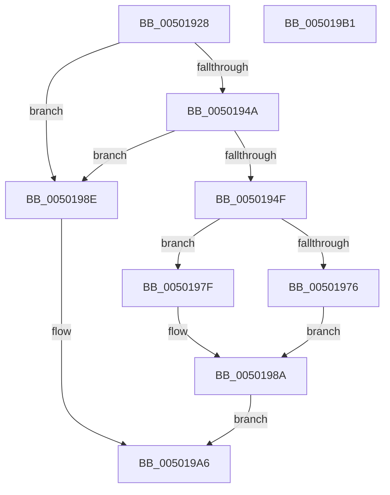

# vsprintf_l

- RVA: `0x00501928`–`0x005019B2` (길이 `138` bytes)
- VA: `0x0000000140501928`
- 실행 섹션: `.text`
- PDB 이름 있음: `예`; PDB Function 태그: `아니요`
- unwind 정보 RVA: `0x0009EAB4`
- 디코드: `41`개 명령, `138/138` bytes 표시
- 미해석 바이트: `0` (있으면 어셈블리에 `.byte`로 보존)

> 이 문서는 커널 이미지의 기계어와 PDB 기호를 분석해 생성했습니다. 4번과 5번은 함수 원형과 자료형을 바이너리 사용 방식에서 추정한 C 해석이며 원본 소스 복구 결과는 아닙니다.

## 1. Dependencies

- 직접 호출 지점: **3**; 고유 호출 대상: **3**
- 직접 호출자로 확인된 함수: **1**
- RIP 상대 이미지 참조: **0**

### Outgoing calls
- `0x00501969` → [output_l](output_l_function_00503368.md) (function, `0x00503368`)
- `0x00501985` → [flsbuf](flsbuf_function_0050292C.md) (function, `0x0050292C`)
- `0x0050199E` → [EmpCheckErrataList](../49/EmpCheckErrataList_function_0049E550.md) (function, `0x0049E550`)

### Direct callers
- [vsprintf](vsprintf_function_005019C0.md) at `0x005019CA`

### Static image references
- 디코드된 RIP-relative 메모리 참조가 없습니다.

## 2. Other-region calls and transfers

- 다른 실행 섹션으로 향하는 call: **0**
- 별도 외부 분기/꼬리 이동을 확인하지 못했습니다.

## 3. Assembly (complete function range)

```asm
00501928  48 89 5C 24 08                  mov qword ptr [rsp + 8], rbx
0050192D  55                              push rbp
0050192E  48 8B EC                        mov rbp, rsp
00501931  48 83 EC 60                     sub rsp, 0x60
00501935  83 65 DC 00                     and dword ptr [rbp - 0x24], 0
00501939  0F 57 C0                        xorps xmm0, xmm0
0050193C  83 65 FC 00                     and dword ptr [rbp - 4], 0
00501940  F3 0F 7F 45 EC                  movdqu xmmword ptr [rbp - 0x14], xmm0
00501945  48 85 D2                        test rdx, rdx
00501948  74 44                           je 0x14050198e
0050194A  48 85 C9                        test rcx, rcx
0050194D  74 3F                           je 0x14050198e
0050194F  48 89 4D E0                     mov qword ptr [rbp - 0x20], rcx
00501953  48 89 4D D0                     mov qword ptr [rbp - 0x30], rcx
00501957  48 8D 4D D0                     lea rcx, [rbp - 0x30]
0050195B  C7 45 D8 FF FF FF 7F            mov dword ptr [rbp - 0x28], 0x7fffffff
00501962  C7 45 E8 42 00 00 00            mov dword ptr [rbp - 0x18], 0x42
00501969  E8 FA 19 00 00                  call 0x140503368
0050196E  83 6D D8 01                     sub dword ptr [rbp - 0x28], 1
00501972  8B D8                           mov ebx, eax
00501974  78 09                           js 0x14050197f
00501976  48 8B 4D D0                     mov rcx, qword ptr [rbp - 0x30]
0050197A  C6 01 00                        mov byte ptr [rcx], 0
0050197D  EB 0B                           jmp 0x14050198a
0050197F  48 8D 55 D0                     lea rdx, [rbp - 0x30]
00501983  33 C9                           xor ecx, ecx
00501985  E8 A2 0F 00 00                  call 0x14050292c
0050198A  8B C3                           mov eax, ebx
0050198C  EB 18                           jmp 0x1405019a6
0050198E  48 83 64 24 20 00               and qword ptr [rsp + 0x20], 0
00501994  45 33 C9                        xor r9d, r9d
00501997  45 33 C0                        xor r8d, r8d
0050199A  33 D2                           xor edx, edx
0050199C  33 C9                           xor ecx, ecx
0050199E  E8 AD CB F9 FF                  call 0x14049e550
005019A3  83 C8 FF                        or eax, 0xffffffff
005019A6  48 8B 5C 24 70                  mov rbx, qword ptr [rsp + 0x70]
005019AB  48 83 C4 60                     add rsp, 0x60
005019AF  5D                              pop rbp
005019B0  C3                              ret
005019B1  CC                              int3
```

## 4. C-style interpretation (structured pseudocode)

```c
__int64 __fastcall vsprintf_l(__int64 a1, __int64 a2, int a3, int a4)
{
    __int64 result;
    __int64 v_rsp;
    unsigned __int64 v_stack_m1C;
    unsigned int v_stack_m20;
    unsigned __int64 v_stack_m28;
    unsigned int v_stack_m2C;
    unsigned int v_stack_m30;
    unsigned __int64 v_stack_m38;
    unsigned __int64 v_stack_m48;
    unsigned int v_stack_mC;
    unsigned __int64 v_stack_p8;

    v_stack_p8 = v_rbx;
    v_rsp = (v_rsp) - (96);
    v_stack_m1C = v_xmm0;
    if (a2 == 0) goto loc_0050198E;
    if (a1 == 0) goto loc_0050198E;
    v_stack_m28 = a1;
    v_stack_m38 = a1;
    v_stack_m30 = 0x7FFFFFFFULL;
    v_stack_m20 = 66;
    result = output_l(v_stack_m38, a2, a3, a4);
    if (sign_flag) goto loc_0050197F;
    *(unsigned __int8 *)(v_stack_m38) = 0;
    goto loc_0050198A;
loc_0050197F:
    a1 = 0;
    result = flsbuf(a1, v_stack_m38, a3, a4);
loc_0050198A:
    goto loc_005019A6;
loc_0050198E:
    a4 = 0;
    a3 = 0;
    a2 = 0;
    a1 = 0;
    result = EmpCheckErrataList(a1, a2, a3, a4);
    result = (unsigned int)((result) | (0xFFFFFFFFULL));
loc_005019A6:
    v_rsp = (v_rsp) + (96);
    return result;
}
```

## 5. (Beta) C Style

```c
int64_t vsprintf_l(int64_t Arg1, int64_t Arg2, int32_t Arg3, int32_t Arg4)
{
    int64_t result;
    int64_t local_rsp;
    uint64_t v_stack_m1C;
    uint32_t v_stack_m20;
    uint64_t v_stack_m28;
    uint32_t v_stack_m2C;
    uint32_t v_stack_m30;
    uint64_t v_stack_m38;
    uint64_t v_stack_m48;
    uint32_t v_stack_mC;
    uint64_t v_stack_p8;

    v_stack_p8 = local_rbx;
    local_rsp = (local_rsp) - (96);
    v_stack_m1C = v_xmm0;
    if (Arg2 == 0) goto loc_0050198E;
    if (Arg1 == 0) goto loc_0050198E;
    v_stack_m28 = Arg1;
    v_stack_m38 = Arg1;
    v_stack_m30 = 0x7FFFFFFFULL;
    v_stack_m20 = 66;
    result = output_l(v_stack_m38, Arg2, Arg3, Arg4);
    if (sign_flag) goto loc_0050197F;
    *(uint8_t *)(v_stack_m38) = 0;
    goto loc_0050198A;
loc_0050197F:
    Arg1 = 0;
    result = flsbuf(Arg1, v_stack_m38, Arg3, Arg4);
loc_0050198A:
    goto loc_005019A6;
loc_0050198E:
    Arg4 = 0;
    Arg3 = 0;
    Arg2 = 0;
    Arg1 = 0;
    result = EmpCheckErrataList(Arg1, Arg2, Arg3, Arg4);
    result = (uint32_t)((result) | (0xFFFFFFFFULL));
loc_005019A6:
    local_rsp = (local_rsp) + (96);
    return result;
}
```

## 6. Execution-region graph

[열기: 2D/3D 그래프와 함수 탐색 컨트롤 패널](../../../control-panel.html?section=text&rva=0x00501928&view=graph)

- 2D 그래프는 위에서 아래로 흐르고, 3D 그래프는 빈 공간을 드래그해 회전합니다. Shift+드래그는 이동, 휠은 확대·축소, 함수 노드 선택은 대상 보고서 이동입니다.

### Static fallback


