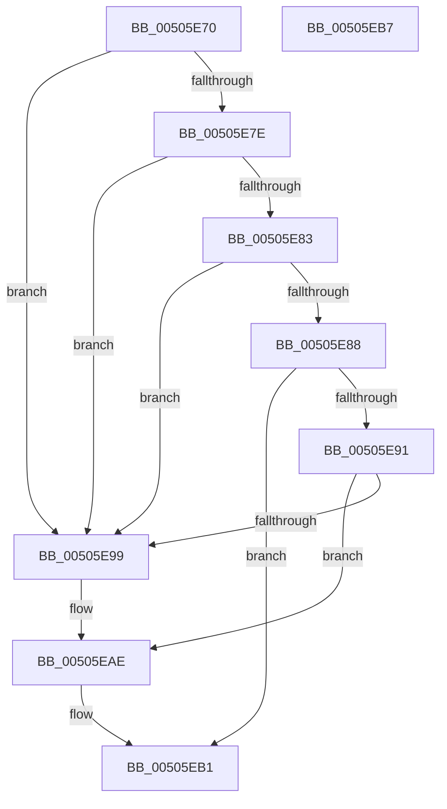

# vsprintf_s

- RVA: `0x00505E70`–`0x00505EB8` (길이 `72` bytes)
- VA: `0x0000000140505E70`
- 실행 섹션: `.text`
- PDB 이름 있음: `예`; PDB Function 태그: `아니요`
- unwind 정보 RVA: `0x00064C80`
- 디코드: `26`개 명령, `72/72` bytes 표시
- 미해석 바이트: `0` (있으면 어셈블리에 `.byte`로 보존)

> 이 문서는 커널 이미지의 기계어와 PDB 기호를 분석해 생성했습니다. 4번과 5번은 함수 원형과 자료형을 바이너리 사용 방식에서 추정한 C 해석이며 원본 소스 복구 결과는 아닙니다.

## 1. Dependencies

- 직접 호출 지점: **2**; 고유 호출 대상: **2**
- 직접 호출자로 확인된 함수: **1**
- RIP 상대 이미지 참조: **0**

### Outgoing calls
- `0x00505E88` → [soutput_s](soutput_s_function_00507184.md) (function, `0x00507184`)
- `0x00505EA9` → [EmpCheckErrataList](../49/EmpCheckErrataList_function_0049E550.md) (function, `0x0049E550`)

### Direct callers
- [sprintf_s](sprintf_s_function_00505E40.md) at `0x00505E53`

### Static image references
- 디코드된 RIP-relative 메모리 참조가 없습니다.

## 2. Other-region calls and transfers

- 다른 실행 섹션으로 향하는 call: **0**
- 별도 외부 분기/꼬리 이동을 확인하지 못했습니다.

## 3. Assembly (complete function range)

```asm
00505E70  40 53                           push rbx
00505E72  48 83 EC 30                     sub rsp, 0x30
00505E76  48 8B D9                        mov rbx, rcx
00505E79  48 85 C9                        test rcx, rcx
00505E7C  74 1B                           je 0x140505e99
00505E7E  48 85 D2                        test rdx, rdx
00505E81  74 16                           je 0x140505e99
00505E83  4D 85 C0                        test r8, r8
00505E86  74 11                           je 0x140505e99
00505E88  E8 F7 12 00 00                  call 0x140507184
00505E8D  85 C0                           test eax, eax
00505E8F  79 20                           jns 0x140505eb1
00505E91  C6 03 00                        mov byte ptr [rbx], 0
00505E94  83 F8 FE                        cmp eax, -2
00505E97  75 15                           jne 0x140505eae
00505E99  48 83 64 24 20 00               and qword ptr [rsp + 0x20], 0
00505E9F  45 33 C9                        xor r9d, r9d
00505EA2  45 33 C0                        xor r8d, r8d
00505EA5  33 D2                           xor edx, edx
00505EA7  33 C9                           xor ecx, ecx
00505EA9  E8 A2 86 F9 FF                  call 0x14049e550
00505EAE  83 C8 FF                        or eax, 0xffffffff
00505EB1  48 83 C4 30                     add rsp, 0x30
00505EB5  5B                              pop rbx
00505EB6  C3                              ret
00505EB7  CC                              int3
```

## 4. C-style interpretation (structured pseudocode)

```c
__int64 __fastcall vsprintf_s(__int64 a1, __int64 a2, __int64 a3, int a4)
{
    __int64 result;
    __int64 v_rsp;
    unsigned __int64 v_stack_m18;

    v_rsp = (v_rsp) - (48);
    if (a1 == 0) goto loc_00505E99;
    if (a2 == 0) goto loc_00505E99;
    if (a3 == 0) goto loc_00505E99;
    result = soutput_s(a1, a2, a3, a4);
    if (!sign_flag) goto loc_00505EB1;
    *(unsigned __int8 *)(a1) = 0;
    if (((unsigned int)(result)) == -2) {
        a4 = 0;
        a3 = 0;
        a2 = 0;
        a1 = 0;
        result = EmpCheckErrataList(a1, a2, a3, a4);
    }
    result = (unsigned int)((result) | (0xFFFFFFFFULL));
loc_00505EB1:
    v_rsp = (v_rsp) + (48);
    return result;
}
```

## 5. (Beta) C Style

```c
int64_t vsprintf_s(void *Arg1, int64_t Arg2, int64_t Arg3, int32_t Arg4)
{
    uint8_t *arg1 = (uint8_t *)Arg1;

    int64_t result;
    int64_t local_rsp;
    uint64_t v_stack_m18;

    local_rsp = (local_rsp) - (48);
    if (Arg1 == NULL) goto loc_00505E99;
    if (Arg2 == 0) goto loc_00505E99;
    if (Arg3 == 0) goto loc_00505E99;
    result = soutput_s(Arg1, Arg2, Arg3, Arg4);
    if (!sign_flag) goto loc_00505EB1;
    *(uint8_t *)(arg1) = 0;
    if (((uint32_t)(result)) == -2) {
        Arg4 = 0;
        Arg3 = 0;
        Arg2 = 0;
        Arg1 = 0;
        result = EmpCheckErrataList(Arg1, Arg2, Arg3, Arg4);
    }
    result = (uint32_t)((result) | (0xFFFFFFFFULL));
loc_00505EB1:
    local_rsp = (local_rsp) + (48);
    return result;
}
```

### 관측된 메모리 오프셋

구조체 형식이 확인되지 않은 접근은 인자 기준의 오프셋으로만 기록했습니다.

| 기준 인자 | 오프셋 표현 | 폭 (bit) | 접근 |
|---|---:|---:|---|
| `Arg1` | `+ 0x0` | `8` | `W` |

## 6. Execution-region graph

[열기: 2D/3D 그래프와 함수 탐색 컨트롤 패널](../../../control-panel.html?section=text&rva=0x00505E70&view=graph)

- 2D 그래프는 위에서 아래로 흐르고, 3D 그래프는 빈 공간을 드래그해 회전합니다. Shift+드래그는 이동, 휠은 확대·축소, 함수 노드 선택은 대상 보고서 이동입니다.

### Static fallback


