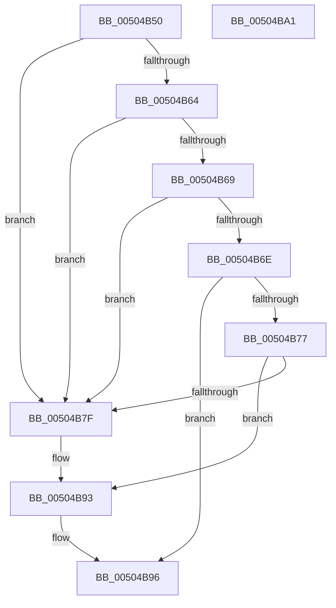

# vswprintf_s

- RVA: `0x00504B50`–`0x00504BA2` (길이 `82` bytes)
- VA: `0x0000000140504B50`
- 실행 섹션: `.text`
- PDB 이름 있음: `예`; PDB Function 태그: `아니요`
- unwind 정보 RVA: `0x0006E5F8`
- 디코드: `29`개 명령, `82/82` bytes 표시
- 미해석 바이트: `0` (있으면 어셈블리에 `.byte`로 보존)

> 이 문서는 커널 이미지의 기계어와 PDB 기호를 분석해 생성했습니다. 4번과 5번은 함수 원형과 자료형을 바이너리 사용 방식에서 추정한 C 해석이며 원본 소스 복구 결과는 아닙니다.

## 1. Dependencies

- 직접 호출 지점: **2**; 고유 호출 대상: **2**
- 직접 호출자로 확인된 함수: **1**
- RIP 상대 이미지 참조: **0**

### Outgoing calls
- `0x00504B6E` → [swoutput_s](swoutput_s_function_00507278.md) (function, `0x00507278`)
- `0x00504B8E` → [EmpCheckErrataList](../49/EmpCheckErrataList_function_0049E550.md) (function, `0x0049E550`)

### Direct callers
- [swprintf_s](swprintf_s_function_00504B20.md) at `0x00504B33`

### Static image references
- 디코드된 RIP-relative 메모리 참조가 없습니다.

## 2. Other-region calls and transfers

- 다른 실행 섹션으로 향하는 call: **0**
- 별도 외부 분기/꼬리 이동을 확인하지 못했습니다.

## 3. Assembly (complete function range)

```asm
00504B50  48 89 5C 24 08                  mov qword ptr [rsp + 8], rbx
00504B55  57                              push rdi
00504B56  48 83 EC 30                     sub rsp, 0x30
00504B5A  33 FF                           xor edi, edi
00504B5C  48 8B D9                        mov rbx, rcx
00504B5F  48 85 C9                        test rcx, rcx
00504B62  74 1B                           je 0x140504b7f
00504B64  48 85 D2                        test rdx, rdx
00504B67  74 16                           je 0x140504b7f
00504B69  4D 85 C0                        test r8, r8
00504B6C  74 11                           je 0x140504b7f
00504B6E  E8 05 27 00 00                  call 0x140507278
00504B73  85 C0                           test eax, eax
00504B75  79 1F                           jns 0x140504b96
00504B77  66 89 3B                        mov word ptr [rbx], di
00504B7A  83 F8 FE                        cmp eax, -2
00504B7D  75 14                           jne 0x140504b93
00504B7F  45 33 C9                        xor r9d, r9d
00504B82  48 89 7C 24 20                  mov qword ptr [rsp + 0x20], rdi
00504B87  45 33 C0                        xor r8d, r8d
00504B8A  33 D2                           xor edx, edx
00504B8C  33 C9                           xor ecx, ecx
00504B8E  E8 BD 99 F9 FF                  call 0x14049e550
00504B93  83 C8 FF                        or eax, 0xffffffff
00504B96  48 8B 5C 24 40                  mov rbx, qword ptr [rsp + 0x40]
00504B9B  48 83 C4 30                     add rsp, 0x30
00504B9F  5F                              pop rdi
00504BA0  C3                              ret
00504BA1  CC                              int3
```

## 4. C-style interpretation (structured pseudocode)

```c
__int64 __fastcall vswprintf_s(__int64 a1, __int64 a2, __int64 a3, int a4)
{
    __int64 result;
    __int64 v_rdi;
    __int64 v_rsp;
    unsigned __int64 v_stack_m18;
    unsigned __int64 v_stack_p8;

    v_stack_p8 = v_rbx;
    v_rsp = (v_rsp) - (48);
    v_rdi = 0;
    if (a1 == 0) goto loc_00504B7F;
    if (a2 == 0) goto loc_00504B7F;
    if (a3 == 0) goto loc_00504B7F;
    result = swoutput_s(a1, a2, a3, a4);
    if (!sign_flag) goto loc_00504B96;
    *(unsigned __int16 *)(a1) = 0;
    if (((unsigned int)(result)) == -2) {
        a4 = 0;
        v_stack_m18 = 0;
        a3 = 0;
        a2 = 0;
        a1 = 0;
        result = EmpCheckErrataList(a1, a2, a3, a4);
    }
    result = (unsigned int)((result) | (0xFFFFFFFFULL));
loc_00504B96:
    v_rsp = (v_rsp) + (48);
    return result;
}
```

## 5. (Beta) C Style

```c
int64_t vswprintf_s(void *Arg1, int64_t Arg2, int64_t Arg3, int32_t Arg4)
{
    uint8_t *arg1 = (uint8_t *)Arg1;

    int64_t result;
    int64_t local_rdi;
    int64_t local_rsp;
    uint64_t v_stack_m18;
    uint64_t v_stack_p8;

    v_stack_p8 = local_rbx;
    local_rsp = (local_rsp) - (48);
    local_rdi = 0;
    if (Arg1 == NULL) goto loc_00504B7F;
    if (Arg2 == 0) goto loc_00504B7F;
    if (Arg3 == 0) goto loc_00504B7F;
    result = swoutput_s(Arg1, Arg2, Arg3, Arg4);
    if (!sign_flag) goto loc_00504B96;
    *(uint16_t *)(arg1) = 0;
    if (((uint32_t)(result)) == -2) {
        Arg4 = 0;
        v_stack_m18 = 0;
        Arg3 = 0;
        Arg2 = 0;
        Arg1 = 0;
        result = EmpCheckErrataList(Arg1, Arg2, Arg3, Arg4);
    }
    result = (uint32_t)((result) | (0xFFFFFFFFULL));
loc_00504B96:
    local_rsp = (local_rsp) + (48);
    return result;
}
```

### 관측된 메모리 오프셋

구조체 형식이 확인되지 않은 접근은 인자 기준의 오프셋으로만 기록했습니다.

| 기준 인자 | 오프셋 표현 | 폭 (bit) | 접근 |
|---|---:|---:|---|
| `Arg1` | `+ 0x0` | `16` | `W` |

## 6. Execution-region graph

[열기: 2D/3D 그래프와 함수 탐색 컨트롤 패널](../../../control-panel.html?section=text&rva=0x00504B50&view=graph)

- 2D 그래프는 위에서 아래로 흐르고, 3D 그래프는 빈 공간을 드래그해 회전합니다. Shift+드래그는 이동, 휠은 확대·축소, 함수 노드 선택은 대상 보고서 이동입니다.

### Static fallback


