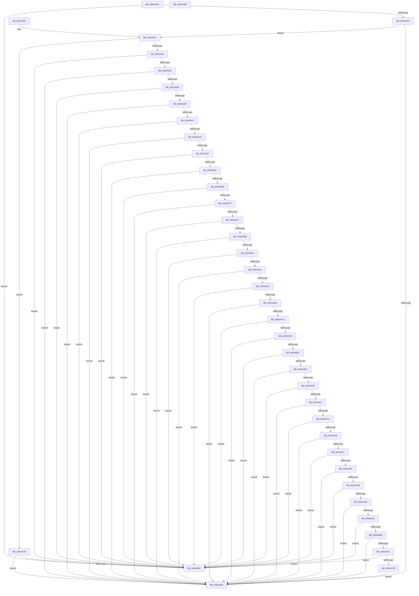

# wchartodigit

- RVA: `0x005042EC`–`0x0050448E` (길이 `418` bytes)
- VA: `0x00000001405042EC`
- 실행 섹션: `.text`
- PDB 이름 있음: `예`; PDB Function 태그: `아니요`
- unwind 정보 RVA: `0x000DB714`
- 디코드: `114`개 명령, `418/418` bytes 표시
- 미해석 바이트: `0` (있으면 어셈블리에 `.byte`로 보존)

> 이 문서는 커널 이미지의 기계어와 PDB 기호를 분석해 생성했습니다. 4번과 5번은 함수 원형과 자료형을 바이너리 사용 방식에서 추정한 C 해석이며 원본 소스 복구 결과는 아닙니다.

## 1. Dependencies

- 직접 호출 지점: **0**; 고유 호출 대상: **0**
- 직접 호출자로 확인된 함수: **2**
- RIP 상대 이미지 참조: **0**

### Outgoing calls
- 직접 디코드된 call 명령이 없습니다.

### Direct callers
- [wcstoxlX](wcstoxlX_function_00502214.md) at `0x005022AF`
- [wcstoxlX](wcstoxlX_function_00502214.md) at `0x005022E6`
- [wcstoxlX](wcstoxlX_function_00502214.md) at `0x00502312`
- [wcstoxq](wcstoxq_function_00502674.md) at `0x00502733`
- [wcstoxq](wcstoxq_function_00502674.md) at `0x0050276A`
- [wcstoxq](wcstoxq_function_00502674.md) at `0x0050279A`

### Static image references
- 디코드된 RIP-relative 메모리 참조가 없습니다.

## 2. Other-region calls and transfers

- 다른 실행 섹션으로 향하는 call: **0**
- 별도 외부 분기/꼬리 이동을 확인하지 못했습니다.

## 3. Assembly (complete function range)

```asm
005042EC  BA 30 00 00 00                  mov edx, 0x30
005042F1  66 3B CA                        cmp cx, dx
005042F4  0F 82 8F 01 00 00               jb 0x140504489
005042FA  66 83 F9 3A                     cmp cx, 0x3a
005042FE  73 07                           jae 0x140504307
00504300  0F B7 C1                        movzx eax, cx
00504303  2B C2                           sub eax, edx
00504305  C3                              ret
00504306  CC                              int3
00504307  BA 10 FF 00 00                  mov edx, 0xff10
0050430C  66 3B CA                        cmp cx, dx
0050430F  0F 83 66 01 00 00               jae 0x14050447b
00504315  BA 60 06 00 00                  mov edx, 0x660
0050431A  66 3B CA                        cmp cx, dx
0050431D  0F 82 66 01 00 00               jb 0x140504489
00504323  8D 42 0A                        lea eax, [rdx + 0xa]
00504326  66 3B C8                        cmp cx, ax
00504329  72 D5                           jb 0x140504300
0050432B  BA F0 06 00 00                  mov edx, 0x6f0
00504330  66 3B CA                        cmp cx, dx
00504333  0F 82 50 01 00 00               jb 0x140504489
00504339  8D 42 0A                        lea eax, [rdx + 0xa]
0050433C  66 3B C8                        cmp cx, ax
0050433F  72 BF                           jb 0x140504300
00504341  BA 66 09 00 00                  mov edx, 0x966
00504346  66 3B CA                        cmp cx, dx
00504349  0F 82 3A 01 00 00               jb 0x140504489
0050434F  8D 42 0A                        lea eax, [rdx + 0xa]
00504352  66 3B C8                        cmp cx, ax
00504355  72 A9                           jb 0x140504300
00504357  8D 50 76                        lea edx, [rax + 0x76]
0050435A  66 3B CA                        cmp cx, dx
0050435D  0F 82 26 01 00 00               jb 0x140504489
00504363  8D 42 0A                        lea eax, [rdx + 0xa]
00504366  66 3B C8                        cmp cx, ax
00504369  72 95                           jb 0x140504300
0050436B  8D 50 76                        lea edx, [rax + 0x76]
0050436E  66 3B CA                        cmp cx, dx
00504371  0F 82 12 01 00 00               jb 0x140504489
00504377  8D 42 0A                        lea eax, [rdx + 0xa]
0050437A  66 3B C8                        cmp cx, ax
0050437D  72 81                           jb 0x140504300
0050437F  8D 50 76                        lea edx, [rax + 0x76]
00504382  66 3B CA                        cmp cx, dx
00504385  0F 82 FE 00 00 00               jb 0x140504489
0050438B  8D 42 0A                        lea eax, [rdx + 0xa]
0050438E  66 3B C8                        cmp cx, ax
00504391  0F 82 69 FF FF FF               jb 0x140504300
00504397  8D 50 76                        lea edx, [rax + 0x76]
0050439A  66 3B CA                        cmp cx, dx
0050439D  0F 82 E6 00 00 00               jb 0x140504489
005043A3  8D 42 0A                        lea eax, [rdx + 0xa]
005043A6  66 3B C8                        cmp cx, ax
005043A9  0F 82 51 FF FF FF               jb 0x140504300
005043AF  BA 66 0C 00 00                  mov edx, 0xc66
005043B4  66 3B CA                        cmp cx, dx
005043B7  0F 82 CC 00 00 00               jb 0x140504489
005043BD  8D 42 0A                        lea eax, [rdx + 0xa]
005043C0  66 3B C8                        cmp cx, ax
005043C3  0F 82 37 FF FF FF               jb 0x140504300
005043C9  8D 50 76                        lea edx, [rax + 0x76]
005043CC  66 3B CA                        cmp cx, dx
005043CF  0F 82 B4 00 00 00               jb 0x140504489
005043D5  8D 42 0A                        lea eax, [rdx + 0xa]
005043D8  66 3B C8                        cmp cx, ax
005043DB  0F 82 1F FF FF FF               jb 0x140504300
005043E1  8D 50 76                        lea edx, [rax + 0x76]
005043E4  66 3B CA                        cmp cx, dx
005043E7  0F 82 9C 00 00 00               jb 0x140504489
005043ED  8D 42 0A                        lea eax, [rdx + 0xa]
005043F0  66 3B C8                        cmp cx, ax
005043F3  0F 82 07 FF FF FF               jb 0x140504300
005043F9  BA 50 0E 00 00                  mov edx, 0xe50
005043FE  66 3B CA                        cmp cx, dx
00504401  0F 82 82 00 00 00               jb 0x140504489
00504407  8D 42 0A                        lea eax, [rdx + 0xa]
0050440A  66 3B C8                        cmp cx, ax
0050440D  0F 82 ED FE FF FF               jb 0x140504300
00504413  8D 50 76                        lea edx, [rax + 0x76]
00504416  66 3B CA                        cmp cx, dx
00504419  72 6E                           jb 0x140504489
0050441B  8D 42 0A                        lea eax, [rdx + 0xa]
0050441E  66 3B C8                        cmp cx, ax
00504421  0F 82 D9 FE FF FF               jb 0x140504300
00504427  8D 50 46                        lea edx, [rax + 0x46]
0050442A  66 3B CA                        cmp cx, dx
0050442D  72 5A                           jb 0x140504489
0050442F  8D 42 0A                        lea eax, [rdx + 0xa]
00504432  66 3B C8                        cmp cx, ax
00504435  0F 82 C5 FE FF FF               jb 0x140504300
0050443B  BA 40 10 00 00                  mov edx, 0x1040
00504440  66 3B CA                        cmp cx, dx
00504443  72 44                           jb 0x140504489
00504445  8D 42 0A                        lea eax, [rdx + 0xa]
00504448  66 3B C8                        cmp cx, ax
0050444B  0F 82 AF FE FF FF               jb 0x140504300
00504451  BA E0 17 00 00                  mov edx, 0x17e0
00504456  66 3B CA                        cmp cx, dx
00504459  72 2E                           jb 0x140504489
0050445B  8D 42 0A                        lea eax, [rdx + 0xa]
0050445E  66 3B C8                        cmp cx, ax
00504461  0F 82 99 FE FF FF               jb 0x140504300
00504467  8D 50 26                        lea edx, [rax + 0x26]
0050446A  0F B7 C1                        movzx eax, cx
0050446D  66 2B C2                        sub ax, dx
00504470  66 83 F8 09                     cmp ax, 9
00504474  77 13                           ja 0x140504489
00504476  E9 85 FE FF FF                  jmp 0x140504300
0050447B  B8 1A FF 00 00                  mov eax, 0xff1a
00504480  66 3B C8                        cmp cx, ax
00504483  0F 82 77 FE FF FF               jb 0x140504300
00504489  83 C8 FF                        or eax, 0xffffffff
0050448C  C3                              ret
0050448D  CC                              int3
```

## 4. C-style interpretation (structured pseudocode)

```c
__int64 __fastcall wchartodigit(unsigned __int16 a1)
{
    __int64 result;

    if (a1 < 48) goto loc_00504489;
    if (a1 >= 58) goto loc_00504307;
loc_00504300:
    result = (unsigned int)((a1) - (48));
    return result;
loc_00504307:
    if (a1 >= ((unsigned __int16)((unsigned int)(0xFF10ULL)))) goto loc_0050447B;
    if (a1 < ((unsigned __int16)((unsigned int)(0x660ULL)))) goto loc_00504489;
    if (a1 < ((unsigned __int16)((unsigned int)(0x660ULL) + 10))) goto loc_00504300;
    if (a1 < ((unsigned __int16)((unsigned int)(0x6F0ULL)))) goto loc_00504489;
    if (a1 < ((unsigned __int16)((unsigned int)(0x6F0ULL) + 10))) goto loc_00504300;
    if (a1 < ((unsigned __int16)((unsigned int)(0x966ULL)))) goto loc_00504489;
    if (a1 < ((unsigned __int16)((unsigned int)(0x966ULL) + 10))) goto loc_00504300;
    if (a1 < ((unsigned __int16)((unsigned int)(0x966ULL) + 10 + 118))) goto loc_00504489;
    if (a1 < ((unsigned __int16)((unsigned int)(0x966ULL) + 10 + 118 + 10))) goto loc_00504300;
    if (a1 < ((unsigned __int16)((unsigned int)(0x966ULL) + 10 + 118 + 10 + 118))) goto loc_00504489;
    if (a1 < ((unsigned __int16)((unsigned int)(0x966ULL) + 10 + 118 + 10 + 118 + 10))) goto loc_00504300;
    if (a1 < ((unsigned __int16)((unsigned int)(0x966ULL) + 10 + 118 + 10 + 118 + 10 + 118))) goto loc_00504489;
    if (a1 < ((unsigned __int16)((unsigned int)(0x966ULL) + 10 + 118 + 10 + 118 + 10 + 118 + 10))) goto loc_00504300;
    if (a1 < ((unsigned __int16)((unsigned int)(0x966ULL) + 10 + 118 + 10 + 118 + 10 + 118 + 10 + 118))) goto loc_00504489;
    if (a1 < ((unsigned __int16)((unsigned int)(0x966ULL) + 10 + 118 + 10 + 118 + 10 + 118 + 10 + 118 + 10))) goto loc_00504300;
    if (a1 < ((unsigned __int16)((unsigned int)(0xC66ULL)))) goto loc_00504489;
    if (a1 < ((unsigned __int16)((unsigned int)(0xC66ULL) + 10))) goto loc_00504300;
    if (a1 < ((unsigned __int16)((unsigned int)(0xC66ULL) + 10 + 118))) goto loc_00504489;
    if (a1 < ((unsigned __int16)((unsigned int)(0xC66ULL) + 10 + 118 + 10))) goto loc_00504300;
    if (a1 < ((unsigned __int16)((unsigned int)(0xC66ULL) + 10 + 118 + 10 + 118))) goto loc_00504489;
    if (a1 < ((unsigned __int16)((unsigned int)(0xC66ULL) + 10 + 118 + 10 + 118 + 10))) goto loc_00504300;
    if (a1 < ((unsigned __int16)((unsigned int)(0xE50ULL)))) goto loc_00504489;
    if (a1 < ((unsigned __int16)((unsigned int)(0xE50ULL) + 10))) goto loc_00504300;
    if (a1 < ((unsigned __int16)((unsigned int)(0xE50ULL) + 10 + 118))) goto loc_00504489;
    if (a1 < ((unsigned __int16)((unsigned int)(0xE50ULL) + 10 + 118 + 10))) goto loc_00504300;
    if (a1 < ((unsigned __int16)((unsigned int)(0xE50ULL) + 10 + 118 + 10 + 70))) goto loc_00504489;
    if (a1 < ((unsigned __int16)((unsigned int)(0xE50ULL) + 10 + 118 + 10 + 70 + 10))) goto loc_00504300;
    if (a1 < ((unsigned __int16)((unsigned int)(0x1040ULL)))) goto loc_00504489;
    if (a1 < ((unsigned __int16)((unsigned int)(0x1040ULL) + 10))) goto loc_00504300;
    if (a1 < ((unsigned __int16)((unsigned int)(0x17E0ULL)))) goto loc_00504489;
    if (a1 < ((unsigned __int16)((unsigned int)(0x17E0ULL) + 10))) goto loc_00504300;
    result = (unsigned __int16)((a1) - ((unsigned __int16)((unsigned int)(0x17E0ULL) + 10 + 38)));
    if (((unsigned __int16)(result)) > 9) goto loc_00504489;
    goto loc_00504300;
loc_0050447B:
    if (a1 < ((unsigned __int16)((unsigned int)(0xFF1AULL)))) goto loc_00504300;
loc_00504489:
    result = (unsigned int)(((unsigned int)(0xFF1AULL)) | (0xFFFFFFFFULL));
    return result;
}
```

## 5. (Beta) C Style

```c
int64_t wchartodigit(uint16_t Arg1)
{
    int64_t result;

    if (Arg1 < 48) goto loc_00504489;
    if (Arg1 >= 58) goto loc_00504307;
loc_00504300:
    result = (uint32_t)((Arg1) - (48));
    return result;
loc_00504307:
    if (Arg1 >= ((uint16_t)((uint32_t)(0xFF10ULL)))) goto loc_0050447B;
    if (Arg1 < ((uint16_t)((uint32_t)(0x660ULL)))) goto loc_00504489;
    if (Arg1 < ((uint16_t)((uint32_t)(0x660ULL) + 10))) goto loc_00504300;
    if (Arg1 < ((uint16_t)((uint32_t)(0x6F0ULL)))) goto loc_00504489;
    if (Arg1 < ((uint16_t)((uint32_t)(0x6F0ULL) + 10))) goto loc_00504300;
    if (Arg1 < ((uint16_t)((uint32_t)(0x966ULL)))) goto loc_00504489;
    if (Arg1 < ((uint16_t)((uint32_t)(0x966ULL) + 10))) goto loc_00504300;
    if (Arg1 < ((uint16_t)((uint32_t)(0x966ULL) + 10 + 118))) goto loc_00504489;
    if (Arg1 < ((uint16_t)((uint32_t)(0x966ULL) + 10 + 118 + 10))) goto loc_00504300;
    if (Arg1 < ((uint16_t)((uint32_t)(0x966ULL) + 10 + 118 + 10 + 118))) goto loc_00504489;
    if (Arg1 < ((uint16_t)((uint32_t)(0x966ULL) + 10 + 118 + 10 + 118 + 10))) goto loc_00504300;
    if (Arg1 < ((uint16_t)((uint32_t)(0x966ULL) + 10 + 118 + 10 + 118 + 10 + 118))) goto loc_00504489;
    if (Arg1 < ((uint16_t)((uint32_t)(0x966ULL) + 10 + 118 + 10 + 118 + 10 + 118 + 10))) goto loc_00504300;
    if (Arg1 < ((uint16_t)((uint32_t)(0x966ULL) + 10 + 118 + 10 + 118 + 10 + 118 + 10 + 118))) goto loc_00504489;
    if (Arg1 < ((uint16_t)((uint32_t)(0x966ULL) + 10 + 118 + 10 + 118 + 10 + 118 + 10 + 118 + 10))) goto loc_00504300;
    if (Arg1 < ((uint16_t)((uint32_t)(0xC66ULL)))) goto loc_00504489;
    if (Arg1 < ((uint16_t)((uint32_t)(0xC66ULL) + 10))) goto loc_00504300;
    if (Arg1 < ((uint16_t)((uint32_t)(0xC66ULL) + 10 + 118))) goto loc_00504489;
    if (Arg1 < ((uint16_t)((uint32_t)(0xC66ULL) + 10 + 118 + 10))) goto loc_00504300;
    if (Arg1 < ((uint16_t)((uint32_t)(0xC66ULL) + 10 + 118 + 10 + 118))) goto loc_00504489;
    if (Arg1 < ((uint16_t)((uint32_t)(0xC66ULL) + 10 + 118 + 10 + 118 + 10))) goto loc_00504300;
    if (Arg1 < ((uint16_t)((uint32_t)(0xE50ULL)))) goto loc_00504489;
    if (Arg1 < ((uint16_t)((uint32_t)(0xE50ULL) + 10))) goto loc_00504300;
    if (Arg1 < ((uint16_t)((uint32_t)(0xE50ULL) + 10 + 118))) goto loc_00504489;
    if (Arg1 < ((uint16_t)((uint32_t)(0xE50ULL) + 10 + 118 + 10))) goto loc_00504300;
    if (Arg1 < ((uint16_t)((uint32_t)(0xE50ULL) + 10 + 118 + 10 + 70))) goto loc_00504489;
    if (Arg1 < ((uint16_t)((uint32_t)(0xE50ULL) + 10 + 118 + 10 + 70 + 10))) goto loc_00504300;
    if (Arg1 < ((uint16_t)((uint32_t)(0x1040ULL)))) goto loc_00504489;
    if (Arg1 < ((uint16_t)((uint32_t)(0x1040ULL) + 10))) goto loc_00504300;
    if (Arg1 < ((uint16_t)((uint32_t)(0x17E0ULL)))) goto loc_00504489;
    if (Arg1 < ((uint16_t)((uint32_t)(0x17E0ULL) + 10))) goto loc_00504300;
    result = (uint16_t)((Arg1) - ((uint16_t)((uint32_t)(0x17E0ULL) + 10 + 38)));
    if (((uint16_t)(result)) > 9) goto loc_00504489;
    goto loc_00504300;
loc_0050447B:
    if (Arg1 < ((uint16_t)((uint32_t)(0xFF1AULL)))) goto loc_00504300;
loc_00504489:
    result = (uint32_t)(((uint32_t)(0xFF1AULL)) | (0xFFFFFFFFULL));
    return result;
}
```

## 6. Execution-region graph

[열기: 2D/3D 그래프와 함수 탐색 컨트롤 패널](../../../control-panel.html?section=text&rva=0x005042EC&view=graph)

- 2D 그래프는 위에서 아래로 흐르고, 3D 그래프는 빈 공간을 드래그해 회전합니다. Shift+드래그는 이동, 휠은 확대·축소, 함수 노드 선택은 대상 보고서 이동입니다.

### Static fallback


