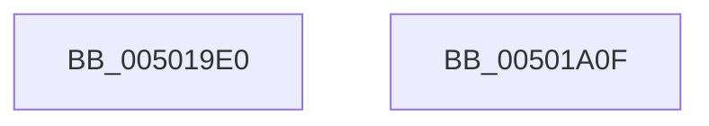

# wcscat

- RVA: `0x005019E0`–`0x00501A10` (길이 `48` bytes)
- VA: `0x00000001405019E0`
- 실행 섹션: `.text`
- PDB 이름 있음: `예`; PDB Function 태그: `아니요`
- unwind 정보 RVA: `0x0005CAAC`
- 디코드: `15`개 명령, `48/48` bytes 표시
- 미해석 바이트: `0` (있으면 어셈블리에 `.byte`로 보존)

> 이 문서는 커널 이미지의 기계어와 PDB 기호를 분석해 생성했습니다. 4번과 5번은 함수 원형과 자료형을 바이너리 사용 방식에서 추정한 C 해석이며 원본 소스 복구 결과는 아닙니다.

## 1. Dependencies

- 직접 호출 지점: **2**; 고유 호출 대상: **2**
- 직접 호출자로 확인된 함수: **0**
- RIP 상대 이미지 참조: **0**

### Outgoing calls
- `0x005019F0` → [wcslen](wcslen_function_00501BA0.md) (function, `0x00501BA0`)
- `0x005019FC` → [wcscpy](wcscpy_function_00501A20.md) (function, `0x00501A20`)

### Direct callers
- 이 함수 시작 RVA로 연결되는 직접 call은 확인되지 않았습니다. 간접 호출은 완전히 역산할 수 없습니다.

### Static image references
- 디코드된 RIP-relative 메모리 참조가 없습니다.

## 2. Other-region calls and transfers

- 다른 실행 섹션으로 향하는 call: **0**
- 별도 외부 분기/꼬리 이동을 확인하지 못했습니다.

## 3. Assembly (complete function range)

```asm
005019E0  48 89 5C 24 08                  mov qword ptr [rsp + 8], rbx
005019E5  57                              push rdi
005019E6  48 83 EC 20                     sub rsp, 0x20
005019EA  48 8B DA                        mov rbx, rdx
005019ED  48 8B F9                        mov rdi, rcx
005019F0  E8 AB 01 00 00                  call 0x140501ba0
005019F5  48 8B D3                        mov rdx, rbx
005019F8  48 8D 0C 47                     lea rcx, [rdi + rax*2]
005019FC  E8 1F 00 00 00                  call 0x140501a20
00501A01  48 8B 5C 24 30                  mov rbx, qword ptr [rsp + 0x30]
00501A06  48 8B C7                        mov rax, rdi
00501A09  48 83 C4 20                     add rsp, 0x20
00501A0D  5F                              pop rdi
00501A0E  C3                              ret
00501A0F  CC                              int3
```

## 4. C-style interpretation (structured pseudocode)

```c
__int64 __fastcall wcscat(__int64 a1, __int64 a2)
{
    __int64 result;
    __int64 v_rsp;
    unsigned __int64 v_stack_p8;

    v_stack_p8 = v_rbx;
    v_rsp = (v_rsp) - (32);
    result = wcslen(a1, a2, a3, a4);
    result = wcscpy(a1 + result * 2, a2, a3, a4);
    v_rsp = (v_rsp) + (32);
    return a1;
}
```

## 5. (Beta) C Style

```c
void *wcscat(void *Arg1, int64_t Arg2)
{
    uint8_t *arg1 = (uint8_t *)Arg1;

    int64_t result;
    int64_t local_rsp;
    uint64_t v_stack_p8;

    v_stack_p8 = local_rbx;
    local_rsp = (local_rsp) - (32);
    result = wcslen(Arg1, Arg2, a3, a4);
    result = wcscpy(Arg1 + result * 2, Arg2, a3, a4);
    local_rsp = (local_rsp) + (32);
    return Arg1;
}
```

### 관측된 메모리 오프셋

구조체 형식이 확인되지 않은 접근은 인자 기준의 오프셋으로만 기록했습니다.

| 기준 인자 | 오프셋 표현 | 폭 (bit) | 접근 |
|---|---:|---:|---|
| `Arg1` | `+ 0x0 + rax*2` | `64` | `R` |

## 6. Execution-region graph

[열기: 2D/3D 그래프와 함수 탐색 컨트롤 패널](../../../control-panel.html?section=text&rva=0x005019E0&view=graph)

- 2D 그래프는 위에서 아래로 흐르고, 3D 그래프는 빈 공간을 드래그해 회전합니다. Shift+드래그는 이동, 휠은 확대·축소, 함수 노드 선택은 대상 보고서 이동입니다.

### Static fallback


