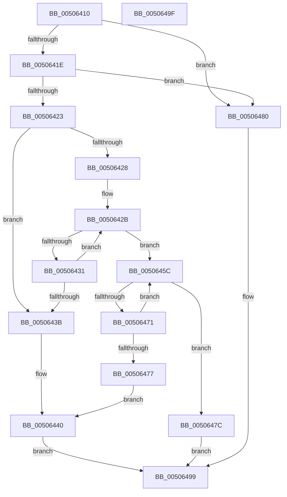

# wcscat_s

- RVA: `0x00506410`–`0x005064A0` (길이 `144` bytes)
- VA: `0x0000000140506410`
- 실행 섹션: `.text`
- PDB 이름 있음: `예`; PDB Function 태그: `아니요`
- unwind 정보 RVA: `0x00064C80`
- 디코드: `48`개 명령, `144/144` bytes 표시
- 미해석 바이트: `0` (있으면 어셈블리에 `.byte`로 보존)

> 이 문서는 커널 이미지의 기계어와 PDB 기호를 분석해 생성했습니다. 4번과 5번은 함수 원형과 자료형을 바이너리 사용 방식에서 추정한 C 해석이며 원본 소스 복구 결과는 아닙니다.

## 1. Dependencies

- 직접 호출 지점: **2**; 고유 호출 대상: **1**
- 직접 호출자로 확인된 함수: **8**
- RIP 상대 이미지 참조: **0**

### Outgoing calls
- `0x00506453` → [EmpCheckErrataList](../49/EmpCheckErrataList_function_0049E550.md) (function, `0x0049E550`)
- `0x0050648F` → [EmpCheckErrataList](../49/EmpCheckErrataList_function_0049E550.md) (function, `0x0049E550`)

### Direct callers
- [ExpWatchLicenseInfoWork](../../page/7C/ExpWatchLicenseInfoWork_function_007C6DB0.md) at `0x007C7056`
- [ExpWatchLicenseInfoWork](../../page/7C/ExpWatchLicenseInfoWork_function_007C6DB0.md) at `0x007C706A`
- [ExpCreateOutputSIGNATURE](../../page/7C/ExpCreateOutputSIGNATURE_function_007CB404.md) at `0x007CB4E5`
- [AslPathToNetworkPathNt](../../page/81/AslPathToNetworkPathNt_function_0081B2A4.md) at `0x0081B33D`
- [VhdiMountVhdFile](../../page/83/VhdiMountVhdFile_function_0083BED0.md) at `0x0083C16C`
- [sub_00927D0E](../../page/92/Unknown_function_00927D0E.md) at `0x00927D1F`
- [BcdGetSystemStorePath](../../page/A3/BcdGetSystemStorePath_function_00A3C340.md) at `0x00A3C3EC`
- [BcdGetSystemStorePath](../../page/A3/BcdGetSystemStorePath_function_00A3C340.md) at `0x00A3C505`
- [NtLockProductActivationKeys](../../page/A4/NtLockProductActivationKeys_function_00A492E0.md) at `0x00A495DB`
- [ExpWatchProductTypeInitialization](../../init/C5/ExpWatchProductTypeInitialization_function_00C52170.md) at `0x00C5294F`
- [ExpWatchProductTypeInitialization](../../init/C5/ExpWatchProductTypeInitialization_function_00C52170.md) at `0x00C52965`

### Static image references
- 디코드된 RIP-relative 메모리 참조가 없습니다.

## 2. Other-region calls and transfers

- 다른 실행 섹션으로 향하는 call: **0**
- 별도 외부 분기/꼬리 이동을 확인하지 못했습니다.

## 3. Assembly (complete function range)

```asm
00506410  40 53                           push rbx
00506412  48 83 EC 30                     sub rsp, 0x30
00506416  45 33 D2                        xor r10d, r10d
00506419  48 85 C9                        test rcx, rcx
0050641C  74 62                           je 0x140506480
0050641E  48 85 D2                        test rdx, rdx
00506421  74 5D                           je 0x140506480
00506423  4D 85 C0                        test r8, r8
00506426  74 13                           je 0x14050643b
00506428  4C 8B C9                        mov r9, rcx
0050642B  66 45 39 11                     cmp word ptr [r9], r10w
0050642F  74 2B                           je 0x14050645c
00506431  49 83 C1 02                     add r9, 2
00506435  48 83 EA 01                     sub rdx, 1
00506439  75 F0                           jne 0x14050642b
0050643B  BB 16 00 00 00                  mov ebx, 0x16
00506440  66 44 89 11                     mov word ptr [rcx], r10w
00506444  45 33 C9                        xor r9d, r9d
00506447  33 C9                           xor ecx, ecx
00506449  4C 89 54 24 20                  mov qword ptr [rsp + 0x20], r10
0050644E  45 33 C0                        xor r8d, r8d
00506451  33 D2                           xor edx, edx
00506453  E8 F8 80 F9 FF                  call 0x14049e550
00506458  8B C3                           mov eax, ebx
0050645A  EB 3D                           jmp 0x140506499
0050645C  41 0F B7 00                     movzx eax, word ptr [r8]
00506460  4D 8D 40 02                     lea r8, [r8 + 2]
00506464  66 41 89 01                     mov word ptr [r9], ax
00506468  4D 8D 49 02                     lea r9, [r9 + 2]
0050646C  66 85 C0                        test ax, ax
0050646F  74 0B                           je 0x14050647c
00506471  48 83 EA 01                     sub rdx, 1
00506475  75 E5                           jne 0x14050645c
00506477  8D 5A 22                        lea ebx, [rdx + 0x22]
0050647A  EB C4                           jmp 0x140506440
0050647C  33 C0                           xor eax, eax
0050647E  EB 19                           jmp 0x140506499
00506480  45 33 C9                        xor r9d, r9d
00506483  4C 89 54 24 20                  mov qword ptr [rsp + 0x20], r10
00506488  45 33 C0                        xor r8d, r8d
0050648B  33 D2                           xor edx, edx
0050648D  33 C9                           xor ecx, ecx
0050648F  E8 BC 80 F9 FF                  call 0x14049e550
00506494  B8 16 00 00 00                  mov eax, 0x16
00506499  48 83 C4 30                     add rsp, 0x30
0050649D  5B                              pop rbx
0050649E  C3                              ret
0050649F  CC                              int3
```

## 4. C-style interpretation (structured pseudocode)

```c
__int64 __fastcall wcscat_s(__int64 a1, __int64 a2, __int64 a3)
{
    __int64 result;
    __int64 v_r10;
    __int64 v_rsp;
    unsigned __int64 v_stack_m18;

    v_rsp = (v_rsp) - (48);
    v_r10 = 0;
    if (a1 == 0) goto loc_00506480;
    if (a2 == 0) goto loc_00506480;
    if (a3 == 0) goto loc_0050643B;
loc_0050642B:
    if ((*(unsigned __int16 *)(a1)) == 0) goto loc_0050645C;
    a4 = (a1) + (2);
    a2 = (a2) - (1);
    if (condition_is_not_equal) goto loc_0050642B;
loc_0050643B:
loc_00506440:
    *(unsigned __int16 *)(a1) = 0;
    a4 = 0;
    a1 = 0;
    v_stack_m18 = 0;
    a3 = 0;
    a2 = 0;
    result = EmpCheckErrataList(a1, a2, a3, a4);
    goto loc_00506499;
loc_0050645C:
    *(unsigned __int16 *)(a4) = (unsigned __int16)(*(unsigned __int16 *)(a3));
    if ((unsigned __int16)(*(unsigned __int16 *)(a3)) == 0) goto loc_0050647C;
    a2 = (a2) - (1);
    if (condition_is_not_equal) goto loc_0050645C;
    goto loc_00506440;
loc_0050647C:
    result = 0;
    goto loc_00506499;
loc_00506480:
    a4 = 0;
    v_stack_m18 = 0;
    a3 = 0;
    a2 = 0;
    a1 = 0;
    result = EmpCheckErrataList(a1, a2, a3, a4);
loc_00506499:
    v_rsp = (v_rsp) + (48);
    return 22;
}
```

## 5. (Beta) C Style

```c
int64_t wcscat_s(int64_t Arg1, int64_t Arg2, int64_t Arg3)
{
    int64_t result;
    int64_t local_r10;
    int64_t local_rsp;
    uint64_t v_stack_m18;

    local_rsp = (local_rsp) - (48);
    local_r10 = 0;
    if (Arg1 == 0) goto loc_00506480;
    if (Arg2 == 0) goto loc_00506480;
    if (Arg3 == 0) goto loc_0050643B;
loc_0050642B:
    if ((*(uint16_t *)(Arg1)) == 0) goto loc_0050645C;
    a4 = (Arg1) + (2);
    Arg2 = (Arg2) - (1);
    if (condition_is_not_equal) goto loc_0050642B;
loc_0050643B:
loc_00506440:
    *(uint16_t *)(Arg1) = 0;
    a4 = 0;
    Arg1 = 0;
    v_stack_m18 = 0;
    Arg3 = 0;
    Arg2 = 0;
    result = EmpCheckErrataList(Arg1, Arg2, Arg3, a4);
    goto loc_00506499;
loc_0050645C:
    *(uint16_t *)(a4) = (uint16_t)(*(uint16_t *)(Arg3));
    if ((uint16_t)(*(uint16_t *)(Arg3)) == 0) goto loc_0050647C;
    Arg2 = (Arg2) - (1);
    if (condition_is_not_equal) goto loc_0050645C;
    goto loc_00506440;
loc_0050647C:
    result = 0;
    goto loc_00506499;
loc_00506480:
    a4 = 0;
    v_stack_m18 = 0;
    Arg3 = 0;
    Arg2 = 0;
    Arg1 = 0;
    result = EmpCheckErrataList(Arg1, Arg2, Arg3, a4);
loc_00506499:
    local_rsp = (local_rsp) + (48);
    return 22;
}
```

## 6. Execution-region graph

[열기: 2D/3D 그래프와 함수 탐색 컨트롤 패널](../../../control-panel.html?section=text&rva=0x00506410&view=graph)

- 2D 그래프는 위에서 아래로 흐르고, 3D 그래프는 빈 공간을 드래그해 회전합니다. Shift+드래그는 이동, 휠은 확대·축소, 함수 노드 선택은 대상 보고서 이동입니다.

### Static fallback


