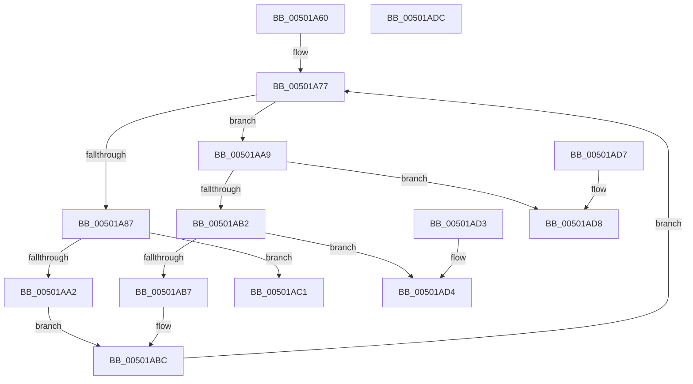

# wcschr

- RVA: `0x00501A60`–`0x00501ADD` (길이 `125` bytes)
- VA: `0x0000000140501A60`
- 실행 섹션: `.text`
- PDB 이름 있음: `예`; PDB Function 태그: `아니요`
- unwind 정보 RVA: `0x000DB714`
- 디코드: `41`개 명령, `125/125` bytes 표시
- 미해석 바이트: `0` (있으면 어셈블리에 `.byte`로 보존)

> 이 문서는 커널 이미지의 기계어와 PDB 기호를 분석해 생성했습니다. 4번과 5번은 함수 원형과 자료형을 바이너리 사용 방식에서 추정한 C 해석이며 원본 소스 복구 결과는 아닙니다.

## 1. Dependencies

- 직접 호출 지점: **0**; 고유 호출 대상: **0**
- 직접 호출자로 확인된 함수: **45**
- RIP 상대 이미지 참조: **0**

### Outgoing calls
- 직접 디코드된 call 명령이 없습니다.

### Direct callers
- [wcscspn](wcscspn_function_00501B30.md) at `0x00501B5A`
- [wcsspn](wcsspn_function_00501F10.md) at `0x00501F3A`
- [wcspbrk](wcspbrk_function_005025F0.md) at `0x00502610`
- [PiDevCfgParsePropertyKeyName](../5A/PiDevCfgParsePropertyKeyName_function_005A7E70.md) at `0x005A7F08`
- [SmUniqueIdParseProductName](../60/SmUniqueIdParseProductName_function_0060ECC0.md) at `0x0060ED15`
- [SmUniqueIdParseProductName](../60/SmUniqueIdParseProductName_function_0060ECC0.md) at `0x0060EDDD`
- [SmUniqueIdParseProductName](../60/SmUniqueIdParseProductName_function_0060ECC0.md) at `0x0060EE1C`
- [PiGetDeviceRegistryProperty](../../page/72/PiGetDeviceRegistryProperty_function_007280A8.md) at `0x0072826C`
- [PiDevCfgSplitDriverConfigurationId](../../page/73/PiDevCfgSplitDriverConfigurationId_function_00736568.md) at `0x007365B0`
- [PiDevCfgSplitDriverConfigurationId](../../page/73/PiDevCfgSplitDriverConfigurationId_function_00736568.md) at `0x00736648`
- [PiDevCfgSplitDriverConfigurationId](../../page/73/PiDevCfgSplitDriverConfigurationId_function_00736568.md) at `0x00736660`
- [PiDevCfgSplitDriverConfigurationId](../../page/73/PiDevCfgSplitDriverConfigurationId_function_00736568.md) at `0x0073669F`
- [EtwpCovSampSplitSegments](../../page/7C/EtwpCovSampSplitSegments_function_007C1C3C.md) at `0x007C1C6C`
- [MiFormDllRegistryPath](../../page/7F/MiFormDllRegistryPath_function_007F7E3C.md) at `0x007F7F5A`
- [SdbQueryDataExTagID](../../page/81/SdbQueryDataExTagID_function_008136E0.md) at `0x008137B1`
- [AslPathClean](../../page/81/AslPathClean_function_0081AB9C.md) at `0x0081ABE6`
- [AslPathClean](../../page/81/AslPathClean_function_0081AB9C.md) at `0x0081AC38`
- [BiCreateFileDeviceElement](../../page/82/BiCreateFileDeviceElement_function_00824B64.md) at `0x00824BAA`
- [BiCreatePartitionDevice](../../page/82/BiCreatePartitionDevice_function_00824D10.md) at `0x00824E63`
- [BiDoesHiveKeyExist](../../page/82/BiDoesHiveKeyExist_function_00826114.md) at `0x00826137`
- [CmGetMatchingDeviceListForSubkey](../../page/82/CmGetMatchingDeviceListForSubkey_function_0082D5A0.md) at `0x0082D632`
- [DrvDbDeleteObjectSubKey](../../page/83/DrvDbDeleteObjectSubKey_function_00832EEC.md) at `0x00833065`
- [DrvDbValidateDeviceIdName](../../page/83/DrvDbValidateDeviceIdName_function_00834E60.md) at `0x00834E92`
- [DrvDbValidateDeviceIdName](../../page/83/DrvDbValidateDeviceIdName_function_00834E60.md) at `0x00834EAE`
- [DrvDbValidateDriverDatabaseName](../../page/83/DrvDbValidateDriverDatabaseName_function_00834ED8.md) at `0x00834EF4`
- [DrvDbValidateDriverDatabaseName](../../page/83/DrvDbValidateDriverDatabaseName_function_00834ED8.md) at `0x00834F11`
- [DrvDbValidateDriverFileName](../../page/83/DrvDbValidateDriverFileName_function_00834F3C.md) at `0x00834F54`
- [DrvDbValidateDriverFileName](../../page/83/DrvDbValidateDriverFileName_function_00834F3C.md) at `0x00834F6F`
- [EtwpQueryTokenPackageInfo](../../page/8A/EtwpQueryTokenPackageInfo_function_008A5878.md) at `0x008A5930`
- [sub_008EDC5D](../../page/8E/Unknown_function_008EDC5D.md) at `0x008EDE96`
- [CmGetDeviceInterfaceSubkeyPath](../../page/8F/CmGetDeviceInterfaceSubkeyPath_function_008F1010.md) at `0x008F128C`
- [sub_008F229E](../../page/8F/Unknown_function_008F229E.md) at `0x008F23C2`
- [CmGetDeviceInterfaceReferenceString](../../page/8F/CmGetDeviceInterfaceReferenceString_function_008F5AF8.md) at `0x008F5B30`
- [PiPnpRtlGetFilteredDeviceList](../../page/8F/PiPnpRtlGetFilteredDeviceList_function_008FE9F8.md) at `0x008FEBB4`
- [LocalGetAclForString](../../page/92/LocalGetAclForString_function_00927F30.md) at `0x0092800D`
- [DrvDbGetDeviceIdMappedProperty](../../page/92/DrvDbGetDeviceIdMappedProperty_function_0092F690.md) at `0x0092F749`
- [DrvDbGetObjectDatabaseNode](../../page/93/DrvDbGetObjectDatabaseNode_function_00930228.md) at `0x009302BA`
- [sub_00931330](../../page/93/Unknown_function_00931330.md) at `0x009313CB`
- [RegRtlCreateTreeTransacted](../../page/93/RegRtlCreateTreeTransacted_function_00931D1C.md) at `0x00931F0A`
- [CmGetDeviceInterfaceSymbolicLinkName](../../page/95/CmGetDeviceInterfaceSymbolicLinkName_function_00951DA4.md) at `0x00951DD6`
- [SdbpCreateSearchPathPartsFromPath](../../page/95/SdbpCreateSearchPathPartsFromPath_function_0095A238.md) at `0x0095A276`
- [PiDevCfgQueryIncludedDriverConfigurations](../../page/97/PiDevCfgQueryIncludedDriverConfigurations_function_009754BC.md) at `0x00975562`
- [PiDevCfgQueryIncludedDriverConfigurations](../../page/97/PiDevCfgQueryIncludedDriverConfigurations_function_009754BC.md) at `0x009755FE`
- [PiDevCfgFindDeviceDriver](../../page/97/PiDevCfgFindDeviceDriver_function_0097602C.md) at `0x009762AE`
- [PiDevCfgFindDeviceDriver](../../page/97/PiDevCfgFindDeviceDriver_function_0097602C.md) at `0x009766EA`
- [PiDevCfgFindDeviceDriver](../../page/97/PiDevCfgFindDeviceDriver_function_0097602C.md) at `0x00976711`
- [PiNormalizeDeviceText](../../page/99/PiNormalizeDeviceText_function_0099A43C.md) at `0x0099A529`
- [PiNormalizeDeviceText](../../page/99/PiNormalizeDeviceText_function_0099A43C.md) at `0x0099A547`
- [LocalpConvertStringSidToSid](../../page/A1/LocalpConvertStringSidToSid_function_00A17490.md) at `0x00A17589`
- [PnpQueryDeviceID](../../page/A2/PnpQueryDeviceID_function_00A2B21C.md) at `0x00A2B29B`
- [DrvDbSetDeviceIdDriverInfMatches](../../page/A6/DrvDbSetDeviceIdDriverInfMatches_function_00A6251C.md) at `0x00A625AA`
- [DrvDbSplitDeviceIdDriverInfMatch](../../page/A6/DrvDbSplitDeviceIdDriverInfMatch_function_00A62808.md) at `0x00A62840`
- [DrvDbSplitDeviceIdDriverInfMatch](../../page/A6/DrvDbSplitDeviceIdDriverInfMatch_function_00A62808.md) at `0x00A628E0`
- [EtwpGenerateFileName](../../page/A9/EtwpGenerateFileName_function_00A962C8.md) at `0x00A962FE`
- [PiSwFindSwDevice](../../page/A9/PiSwFindSwDevice_function_00A9CA84.md) at `0x00A9CB5C`
- [SepParseElamCertResources](../../page/AA/SepParseElamCertResources_function_00AAC43C.md) at `0x00AAC6CE`
- [SepParseElamCertResources](../../page/AA/SepParseElamCertResources_function_00AAC43C.md) at `0x00AAC78C`
- [PiDevCfgResolveVariableKeyHandle](../../page/AB/PiDevCfgResolveVariableKeyHandle_function_00AB2A24.md) at `0x00AB2D27`
- [PiDevCfgResolveVariableKeyHandle](../../page/AB/PiDevCfgResolveVariableKeyHandle_function_00AB2A24.md) at `0x00AB2D41`
- [PiDevCfgResolveVariableKeyHandle](../../page/AB/PiDevCfgResolveVariableKeyHandle_function_00AB2A24.md) at `0x00AB2DB4`
- [PiDevCfgResolveVariableKeyHandle](../../page/AB/PiDevCfgResolveVariableKeyHandle_function_00AB2A24.md) at `0x00AB2F7B`
- [CmSplitDevicePanelId](../../page/AC/CmSplitDevicePanelId_function_00ACEA18.md) at `0x00ACEAF4`
- [sub_00B1F532](../../page/B1/Unknown_function_00B1F532.md) at `0x00B1F537`

### Static image references
- 디코드된 RIP-relative 메모리 참조가 없습니다.

## 2. Other-region calls and transfers

- 다른 실행 섹션으로 향하는 call: **0**
- 별도 외부 분기/꼬리 이동을 확인하지 못했습니다.

## 3. Assembly (complete function range)

```asm
00501A60  0F B7 C2                        movzx eax, dx
00501A63  4C 8B C1                        mov r8, rcx
00501A66  45 33 C9                        xor r9d, r9d
00501A69  66 0F 6E C0                     movd xmm0, eax
00501A6D  F2 0F 70 C8 00                  pshuflw xmm1, xmm0, 0
00501A72  66 0F 70 D1 00                  pshufd xmm2, xmm1, 0
00501A77  49 8B C0                        mov rax, r8
00501A7A  25 FF 0F 00 00                  and eax, 0xfff
00501A7F  48 3D F0 0F 00 00               cmp rax, 0xff0
00501A85  77 22                           ja 0x140501aa9
00501A87  F3 41 0F 6F 00                  movdqu xmm0, xmmword ptr [r8]
00501A8C  0F 57 C9                        xorps xmm1, xmm1
00501A8F  66 0F 75 C8                     pcmpeqw xmm1, xmm0
00501A93  66 0F 75 C2                     pcmpeqw xmm0, xmm2
00501A97  0F 56 C8                        orps xmm1, xmm0
00501A9A  66 0F D7 C1                     pmovmskb eax, xmm1
00501A9E  85 C0                           test eax, eax
00501AA0  75 1F                           jne 0x140501ac1
00501AA2  B8 10 00 00 00                  mov eax, 0x10
00501AA7  EB 13                           jmp 0x140501abc
00501AA9  41 0F B7 00                     movzx eax, word ptr [r8]
00501AAD  66 3B C2                        cmp ax, dx
00501AB0  74 26                           je 0x140501ad8
00501AB2  66 85 C0                        test ax, ax
00501AB5  74 1D                           je 0x140501ad4
00501AB7  B8 02 00 00 00                  mov eax, 2
00501ABC  4C 03 C0                        add r8, rax
00501ABF  EB B6                           jmp 0x140501a77
00501AC1  0F BC C8                        bsf ecx, eax
00501AC4  4C 03 C1                        add r8, rcx
00501AC7  66 41 39 10                     cmp word ptr [r8], dx
00501ACB  4D 0F 44 C8                     cmove r9, r8
00501ACF  49 8B C1                        mov rax, r9
00501AD2  C3                              ret
00501AD3  CC                              int3
00501AD4  33 C0                           xor eax, eax
00501AD6  C3                              ret
00501AD7  CC                              int3
00501AD8  49 8B C0                        mov rax, r8
00501ADB  C3                              ret
00501ADC  CC                              int3
```

## 4. C-style interpretation (structured pseudocode)

```c
__int64 __fastcall wcschr(__int64 a1, unsigned __int16 a2, __int64 a3, int a4)
{
    __int64 result;

    a4 = 0;
loc_00501A77:
    result = (unsigned int)((a1) & (0xFFFULL));
    if (result > 0xFF0ULL) goto loc_00501AA9;
    if ((unsigned int)(result) != 0) goto loc_00501AC1;
    goto loc_00501ABC;
loc_00501AA9:
    if (((unsigned __int16)(*(unsigned __int16 *)(a1))) == a2) goto loc_00501AD8;
    if ((unsigned __int16)(*(unsigned __int16 *)(a1)) == 0) goto loc_00501AD4;
loc_00501ABC:
    a3 = (a1) + (2);
    goto loc_00501A77;
loc_00501AC1:
    a3 = (a3) + (a1);
    if ((*(unsigned __int16 *)(a3)) == a2) { a4 = a3; }
    return a4;
loc_00501AD4:
    result = 0;
    return result;
loc_00501AD8:
    return a3;
}
```

## 5. (Beta) C Style

```c
int64_t wcschr(void *Arg1, uint16_t Arg2, int64_t Arg3, int32_t Arg4)
{
    uint8_t *arg1 = (uint8_t *)Arg1;

    int64_t result;

    Arg4 = 0;
loc_00501A77:
    result = (uint32_t)((Arg1) & (0xFFFULL));
    if (result > 0xFF0ULL) goto loc_00501AA9;
    if ((uint32_t)(result) != 0) goto loc_00501AC1;
    goto loc_00501ABC;
loc_00501AA9:
    if (((uint16_t)(*(uint16_t *)(arg1))) == Arg2) goto loc_00501AD8;
    if ((uint16_t)(*(uint16_t *)(arg1)) == 0) goto loc_00501AD4;
loc_00501ABC:
    Arg3 = (Arg1) + (2);
    goto loc_00501A77;
loc_00501AC1:
    Arg3 = (Arg3) + (Arg1);
    if ((*(uint16_t *)(Arg3)) == Arg2) { Arg4 = Arg3; }
    return Arg4;
loc_00501AD4:
    result = 0;
    return result;
loc_00501AD8:
    return Arg3;
}
```

### 관측된 메모리 오프셋

구조체 형식이 확인되지 않은 접근은 인자 기준의 오프셋으로만 기록했습니다.

| 기준 인자 | 오프셋 표현 | 폭 (bit) | 접근 |
|---|---:|---:|---|
| `Arg1` | `+ 0x0` | `16` | `R` |
| `Arg1` | `+ 0x0` | `128` | `R` |

## 6. Execution-region graph

[열기: 2D/3D 그래프와 함수 탐색 컨트롤 패널](../../../control-panel.html?section=text&rva=0x00501A60&view=graph)

- 2D 그래프는 위에서 아래로 흐르고, 3D 그래프는 빈 공간을 드래그해 회전합니다. Shift+드래그는 이동, 휠은 확대·축소, 함수 노드 선택은 대상 보고서 이동입니다.

### Static fallback


