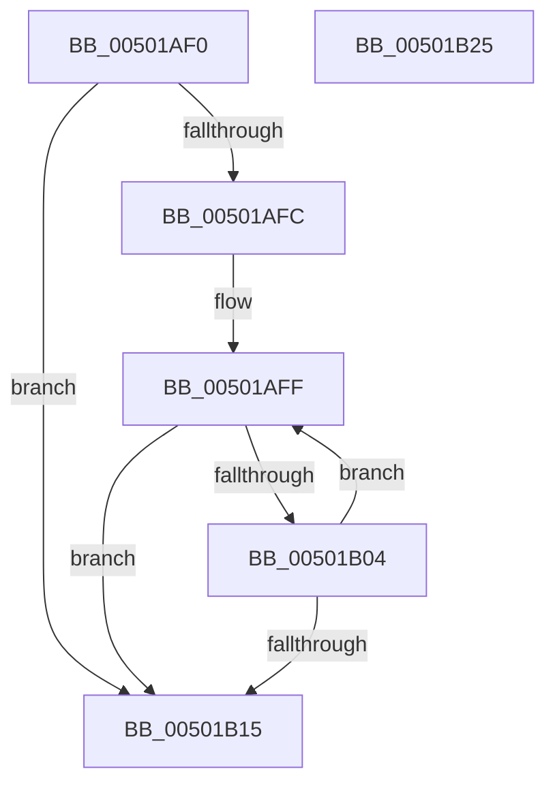

# wcscmp

- RVA: `0x00501AF0`–`0x00501B26` (길이 `54` bytes)
- VA: `0x0000000140501AF0`
- 실행 섹션: `.text`
- PDB 이름 있음: `예`; PDB Function 태그: `아니요`
- unwind 정보 RVA: `0x000DB714`
- 디코드: `19`개 명령, `54/54` bytes 표시
- 미해석 바이트: `0` (있으면 어셈블리에 `.byte`로 보존)

> 이 문서는 커널 이미지의 기계어와 PDB 기호를 분석해 생성했습니다. 4번과 5번은 함수 원형과 자료형을 바이너리 사용 방식에서 추정한 C 해석이며 원본 소스 복구 결과는 아닙니다.

## 1. Dependencies

- 직접 호출 지점: **0**; 고유 호출 대상: **0**
- 직접 호출자로 확인된 함수: **9**
- RIP 상대 이미지 참조: **0**

### Outgoing calls
- 직접 디코드된 call 명령이 없습니다.

### Direct callers
- [EtwStartAutoLogger](../../page/7B/EtwStartAutoLogger_function_007BD2F8.md) at `0x007BE02B`
- [PiDqDispatch](../../page/8D/PiDqDispatch_function_008DC8A0.md) at `0x008DC9AE`
- [PiDqDispatch](../../page/8D/PiDqDispatch_function_008DC8A0.md) at `0x008DCA4B`
- [CmValidateDeviceContainerName](../../page/8F/CmValidateDeviceContainerName_function_008F48B8.md) at `0x008F48DD`
- [PiDcUpdateDeviceContainerMembership](../../page/8F/PiDcUpdateDeviceContainerMembership_function_008FD0A8.md) at `0x008FD1F7`
- [_CmGetDeviceContainerIdFromBase](../../page/8F/_CmGetDeviceContainerIdFromBase_function_008FD2B4.md) at `0x008FD30E`
- [_CmGetDeviceContainerIdFromBase](../../page/8F/_CmGetDeviceContainerIdFromBase_function_008FD2B4.md) at `0x008FD3E3`
- [_CmGetDeviceMappedPropertyFromComposite](../../page/9D/_CmGetDeviceMappedPropertyFromComposite_function_009D1684.md) at `0x009D2926`
- [PiDcContainerRequiresConfiguration](../../page/AB/PiDcContainerRequiresConfiguration_function_00AB6004.md) at `0x00AB6027`
- [sub_00B47F58](../../page/B4/Unknown_function_00B47F58.md) at `0x00B47F94`
- [HdlspAddLogEntry](../../pagehdls/BB/HdlspAddLogEntry_function_00BBD008.md) at `0x00BBD126`

### Static image references
- 디코드된 RIP-relative 메모리 참조가 없습니다.

## 2. Other-region calls and transfers

- 다른 실행 섹션으로 향하는 call: **0**
- 별도 외부 분기/꼬리 이동을 확인하지 못했습니다.

## 3. Assembly (complete function range)

```asm
00501AF0  0F B7 02                        movzx eax, word ptr [rdx]
00501AF3  44 0F B7 01                     movzx r8d, word ptr [rcx]
00501AF7  44 2B C0                        sub r8d, eax
00501AFA  75 19                           jne 0x140501b15
00501AFC  48 2B CA                        sub rcx, rdx
00501AFF  66 85 C0                        test ax, ax
00501B02  74 11                           je 0x140501b15
00501B04  48 83 C2 02                     add rdx, 2
00501B08  0F B7 02                        movzx eax, word ptr [rdx]
00501B0B  44 0F B7 04 11                  movzx r8d, word ptr [rcx + rdx]
00501B10  44 2B C0                        sub r8d, eax
00501B13  74 EA                           je 0x140501aff
00501B15  41 8B C0                        mov eax, r8d
00501B18  41 C1 E8 1F                     shr r8d, 0x1f
00501B1C  F7 D8                           neg eax
00501B1E  C1 E8 1F                        shr eax, 0x1f
00501B21  41 2B C0                        sub eax, r8d
00501B24  C3                              ret
00501B25  CC                              int3
```

## 4. C-style interpretation (structured pseudocode)

```c
__int64 __fastcall wcscmp(__int64 a1, __int64 a2)
{
    __int64 result;

    a3 = (unsigned int)((*(unsigned __int16 *)(a1)) - ((unsigned int)(*(unsigned __int16 *)(a2))));
    if (condition_is_not_equal) goto loc_00501B15;
    a1 = (a1) - (a2);
loc_00501AFF:
    if ((unsigned __int16)(*(unsigned __int16 *)(a2)) == 0) goto loc_00501B15;
    a2 = (a2) + (2);
    a3 = (unsigned int)((*(unsigned __int16 *)(a1 + a2 * 1)) - ((unsigned int)(*(unsigned __int16 *)(a2))));
    if (condition_is_equal) goto loc_00501AFF;
loc_00501B15:
    a3 = (unsigned int)((a3) >> (31));
    result = (unsigned int)(-((unsigned int)((unsigned int)(a3))));
    result = (unsigned int)((result) >> (31));
    result = (unsigned int)((result) - ((unsigned int)(a3)));
    return result;
}
```

## 5. (Beta) C Style

```c
int64_t wcscmp(void *Arg1, void *Arg2)
{
    uint8_t *arg1 = (uint8_t *)Arg1;
    uint8_t *arg2 = (uint8_t *)Arg2;

    int64_t result;

    a3 = (uint32_t)((*(uint16_t *)(arg1)) - ((uint32_t)(*(uint16_t *)(arg2))));
    if (condition_is_not_equal) goto loc_00501B15;
    Arg1 = (Arg1) - (Arg2);
loc_00501AFF:
    if ((uint16_t)(*(uint16_t *)(arg2)) == 0) goto loc_00501B15;
    Arg2 = (Arg2) + (2);
    a3 = (uint32_t)((*(uint16_t *)(arg1 + arg2 * 1)) - ((uint32_t)(*(uint16_t *)(arg2))));
    if (condition_is_equal) goto loc_00501AFF;
loc_00501B15:
    a3 = (uint32_t)((a3) >> (31));
    result = (uint32_t)(-((uint32_t)((uint32_t)(a3))));
    result = (uint32_t)((result) >> (31));
    result = (uint32_t)((result) - ((uint32_t)(a3)));
    return result;
}
```

### 관측된 메모리 오프셋

구조체 형식이 확인되지 않은 접근은 인자 기준의 오프셋으로만 기록했습니다.

| 기준 인자 | 오프셋 표현 | 폭 (bit) | 접근 |
|---|---:|---:|---|
| `Arg1` | `+ 0x0` | `16` | `R` |
| `Arg1` | `+ 0x0 + rdx*1` | `16` | `R` |
| `Arg2` | `+ 0x0` | `16` | `R` |

## 6. Execution-region graph

[열기: 2D/3D 그래프와 함수 탐색 컨트롤 패널](../../../control-panel.html?section=text&rva=0x00501AF0&view=graph)

- 2D 그래프는 위에서 아래로 흐르고, 3D 그래프는 빈 공간을 드래그해 회전합니다. Shift+드래그는 이동, 휠은 확대·축소, 함수 노드 선택은 대상 보고서 이동입니다.

### Static fallback


