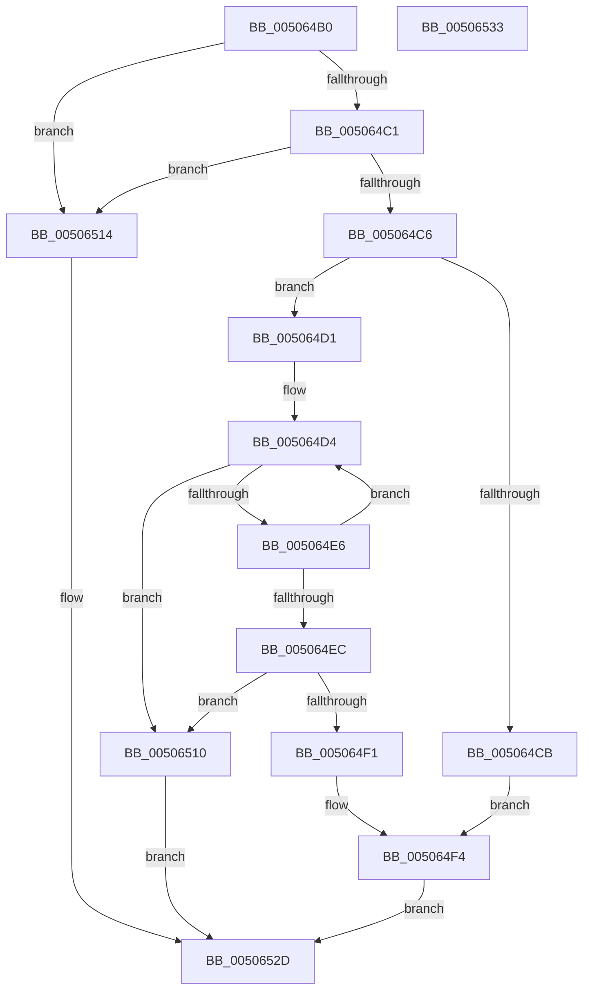

# wcscpy_s

- RVA: `0x005064B0`–`0x00506534` (길이 `132` bytes)
- VA: `0x00000001405064B0`
- 실행 섹션: `.text`
- PDB 이름 있음: `예`; PDB Function 태그: `아니요`
- unwind 정보 RVA: `0x00064C80`
- 디코드: `45`개 명령, `132/132` bytes 표시
- 미해석 바이트: `0` (있으면 어셈블리에 `.byte`로 보존)

> 이 문서는 커널 이미지의 기계어와 PDB 기호를 분석해 생성했습니다. 4번과 5번은 함수 원형과 자료형을 바이너리 사용 방식에서 추정한 C 해석이며 원본 소스 복구 결과는 아닙니다.

## 1. Dependencies

- 직접 호출 지점: **2**; 고유 호출 대상: **1**
- 직접 호출자로 확인된 함수: **31**
- RIP 상대 이미지 참조: **0**

### Outgoing calls
- `0x00506507` → [EmpCheckErrataList](../49/EmpCheckErrataList_function_0049E550.md) (function, `0x0049E550`)
- `0x00506523` → [EmpCheckErrataList](../49/EmpCheckErrataList_function_0049E550.md) (function, `0x0049E550`)

### Direct callers
- [HalpQueryProfileSourceList](../2D/HalpQueryProfileSourceList_function_002D1370.md) at `0x002D1443`
- [HalSetEnvironmentVariableEx](../44/HalSetEnvironmentVariableEx_function_00448EB0.md) at `0x00448F59`
- [HalGetEnvironmentVariableEx](../44/HalGetEnvironmentVariableEx_function_00449100.md) at `0x0044919E`
- [PnprGetPluginDriverImagePath](../../page/73/PnprGetPluginDriverImagePath_function_007398E8.md) at `0x00739A9D`
- [ExpWatchLicenseInfoWork](../../page/7C/ExpWatchLicenseInfoWork_function_007C6DB0.md) at `0x007C703F`
- [ExpConvertArcName](../../page/7C/ExpConvertArcName_function_007CAF04.md) at `0x007CAF72`
- [ExpConvertArcName](../../page/7C/ExpConvertArcName_function_007CAF04.md) at `0x007CB04B`
- [ExpConvertArcName](../../page/7C/ExpConvertArcName_function_007CAF04.md) at `0x007CB076`
- [ExpCreateOutputARC](../../page/7C/ExpCreateOutputARC_function_007CB30C.md) at `0x007CB3B7`
- [ExpCreateOutputARC](../../page/7C/ExpCreateOutputARC_function_007CB30C.md) at `0x007CB3D6`
- [ExpCreateOutputSIGNATURE](../../page/7C/ExpCreateOutputSIGNATURE_function_007CB404.md) at `0x007CB4A0`
- [ExpCreateOutputSIGNATURE](../../page/7C/ExpCreateOutputSIGNATURE_function_007CB404.md) at `0x007CB59B`
- [ExpFindArcName](../../page/7C/ExpFindArcName_function_007CB5CC.md) at `0x007CB64B`
- [ExpFindArcName](../../page/7C/ExpFindArcName_function_007CB5CC.md) at `0x007CB7AD`
- [ExpParseArcPathName](../../page/7C/ExpParseArcPathName_function_007CB908.md) at `0x007CB965`
- [CmDeleteKeyRecursive](../../page/7E/CmDeleteKeyRecursive_function_007E23F8.md) at `0x007E2500`
- [CmpCreateHwProfileFriendlyName](../../page/7E/CmpCreateHwProfileFriendlyName_function_007E3840.md) at `0x007E3A75`
- [AslPathToNetworkPathNt](../../page/81/AslPathToNetworkPathNt_function_0081B2A4.md) at `0x0081B32E`
- [BiConvertBootEnvironmentDeviceToNt](../../page/82/BiConvertBootEnvironmentDeviceToNt_function_00823E44.md) at `0x0082431C`
- [BiCreateFileDeviceElement](../../page/82/BiCreateFileDeviceElement_function_00824B64.md) at `0x00824C8C`
- [BiCreateFileDeviceElement](../../page/82/BiCreateFileDeviceElement_function_00824B64.md) at `0x00824CB2`
- [LocalConvertSDToStringSD_Rev1](../../page/92/LocalConvertSDToStringSD_Rev1_function_00924428.md) at `0x009245A7`
- [LocalConvertSDToStringSD_Rev1](../../page/92/LocalConvertSDToStringSD_Rev1_function_00924428.md) at `0x009246C9`
- [sub_00927B7F](../../page/92/Unknown_function_00927B7F.md) at `0x00927B91`
- [LocalConvertAclToString](../../page/A0/LocalConvertAclToString_function_00A00408.md) at `0x00A0089A`
- [LocalConvertAclToString](../../page/A0/LocalConvertAclToString_function_00A00408.md) at `0x00A00A14`
- [LocalConvertAclToString](../../page/A0/LocalConvertAclToString_function_00A00408.md) at `0x00A00AB4`
- [LocalConvertAclToString](../../page/A0/LocalConvertAclToString_function_00A00408.md) at `0x00A00B80`
- [LocalConvertAclToString](../../page/A0/LocalConvertAclToString_function_00A00408.md) at `0x00A00C1C`
- [LocalConvertAclToString](../../page/A0/LocalConvertAclToString_function_00A00408.md) at `0x00A00CD0`
- [LocalConvertAclToString](../../page/A0/LocalConvertAclToString_function_00A00408.md) at `0x00A00FB5`
- [LocalConvertAclToString](../../page/A0/LocalConvertAclToString_function_00A00408.md) at `0x00A0102F`
- [BcdGetSystemStorePath](../../page/A3/BcdGetSystemStorePath_function_00A3C340.md) at `0x00A3C3DA`
- [BcdGetSystemStorePath](../../page/A3/BcdGetSystemStorePath_function_00A3C340.md) at `0x00A3C4F7`
- [BiConvertNtDeviceToBootEnvironment](../../page/A4/BiConvertNtDeviceToBootEnvironment_function_00A41760.md) at `0x00A41D3B`
- [NtLockProductActivationKeys](../../page/A4/NtLockProductActivationKeys_function_00A492E0.md) at `0x00A495A1`
- [LocalGetStringForControl](../../page/A5/LocalGetStringForControl_function_00A55674.md) at `0x00A5575F`
- [ExpTranslateEfiPath](../../page/A7/ExpTranslateEfiPath_function_00A7AF84.md) at `0x00A7B087`
- [ExpCreateOutputNT](../../page/A7/ExpCreateOutputNT_function_00A7B53C.md) at `0x00A7B5A6`
- [ExpCreateOutputNT](../../page/A7/ExpCreateOutputNT_function_00A7B53C.md) at `0x00A7B5C1`
- [sub_00B327AA](../../page/B3/Unknown_function_00B327AA.md) at `0x00B327AA`
- [sub_00B327B6](../../page/B3/Unknown_function_00B327B6.md) at `0x00B328AE`
- [sub_00B327B6](../../page/B3/Unknown_function_00B327B6.md) at `0x00B328DF`
- [HalpQueryDebuggerInformation](../../pagekd/B8/HalpQueryDebuggerInformation_function_00B85B70.md) at `0x00B85C3F`
- [HalpRegisterDeviceInUse](../../pagekd/B8/HalpRegisterDeviceInUse_function_00B85C94.md) at `0x00B85DC9`
- [HdlspKernelAddLogEntry](../../pagehdls/BB/HdlspKernelAddLogEntry_function_00BBDD70.md) at `0x00BBDF11`
- [BgpFwLibraryInitialize](../../pagebgfx/BC/BgpFwLibraryInitialize_function_00BC5400.md) at `0x00BC5AA1`
- [ExpWatchProductTypeInitialization](../../init/C5/ExpWatchProductTypeInitialization_function_00C52170.md) at `0x00C52936`
- [ExpWatchProductTypeInitialization](../../init/C5/ExpWatchProductTypeInitialization_function_00C52170.md) at `0x00C52A3F`

### Static image references
- 디코드된 RIP-relative 메모리 참조가 없습니다.

## 2. Other-region calls and transfers

- 다른 실행 섹션으로 향하는 call: **0**
- 별도 외부 분기/꼬리 이동을 확인하지 못했습니다.

## 3. Assembly (complete function range)

```asm
005064B0  40 53                           push rbx
005064B2  48 83 EC 30                     sub rsp, 0x30
005064B6  45 33 D2                        xor r10d, r10d
005064B9  4C 8B C9                        mov r9, rcx
005064BC  48 85 C9                        test rcx, rcx
005064BF  74 53                           je 0x140506514
005064C1  48 85 D2                        test rdx, rdx
005064C4  74 4E                           je 0x140506514
005064C6  4D 85 C0                        test r8, r8
005064C9  75 06                           jne 0x1405064d1
005064CB  41 8D 5A 16                     lea ebx, [r10 + 0x16]
005064CF  EB 23                           jmp 0x1405064f4
005064D1  49 2B C8                        sub rcx, r8
005064D4  41 0F B7 00                     movzx eax, word ptr [r8]
005064D8  66 42 89 04 01                  mov word ptr [rcx + r8], ax
005064DD  4D 8D 40 02                     lea r8, [r8 + 2]
005064E1  66 85 C0                        test ax, ax
005064E4  74 2A                           je 0x140506510
005064E6  48 83 EA 01                     sub rdx, 1
005064EA  75 E8                           jne 0x1405064d4
005064EC  48 85 D2                        test rdx, rdx
005064EF  75 1F                           jne 0x140506510
005064F1  8D 5A 22                        lea ebx, [rdx + 0x22]
005064F4  66 45 89 11                     mov word ptr [r9], r10w
005064F8  45 33 C0                        xor r8d, r8d
005064FB  45 33 C9                        xor r9d, r9d
005064FE  4C 89 54 24 20                  mov qword ptr [rsp + 0x20], r10
00506503  33 D2                           xor edx, edx
00506505  33 C9                           xor ecx, ecx
00506507  E8 44 80 F9 FF                  call 0x14049e550
0050650C  8B C3                           mov eax, ebx
0050650E  EB 1D                           jmp 0x14050652d
00506510  33 C0                           xor eax, eax
00506512  EB 19                           jmp 0x14050652d
00506514  45 33 C9                        xor r9d, r9d
00506517  4C 89 54 24 20                  mov qword ptr [rsp + 0x20], r10
0050651C  45 33 C0                        xor r8d, r8d
0050651F  33 D2                           xor edx, edx
00506521  33 C9                           xor ecx, ecx
00506523  E8 28 80 F9 FF                  call 0x14049e550
00506528  B8 16 00 00 00                  mov eax, 0x16
0050652D  48 83 C4 30                     add rsp, 0x30
00506531  5B                              pop rbx
00506532  C3                              ret
00506533  CC                              int3
```

## 4. C-style interpretation (structured pseudocode)

```c
__int64 __fastcall wcscpy_s(__int64 a1, __int64 a2, __int64 a3)
{
    __int64 result;
    __int64 v_r10;
    __int64 v_rsp;
    unsigned __int64 v_stack_m18;

    v_rsp = (v_rsp) - (48);
    v_r10 = 0;
    if (a1 == 0) goto loc_00506514;
    if (a2 == 0) goto loc_00506514;
    if (a3 != 0) goto loc_005064D1;
    goto loc_005064F4;
loc_005064D1:
    a1 = (a1) - (a3);
loc_005064D4:
    *(unsigned __int16 *)(a1 + a3 * 1) = (unsigned __int16)(*(unsigned __int16 *)(a3));
    if ((unsigned __int16)(*(unsigned __int16 *)(a3)) == 0) goto loc_00506510;
    a2 = (a2) - (1);
    if (condition_is_not_equal) goto loc_005064D4;
    if (a2 != 0) goto loc_00506510;
loc_005064F4:
    *(unsigned __int16 *)(a1) = 0;
    a3 = 0;
    a4 = 0;
    v_stack_m18 = 0;
    a2 = 0;
    a1 = 0;
    result = EmpCheckErrataList(a1, a2, a3, a4);
    goto loc_0050652D;
loc_00506510:
    result = 0;
    goto loc_0050652D;
loc_00506514:
    a4 = 0;
    v_stack_m18 = 0;
    a3 = 0;
    a2 = 0;
    a1 = 0;
    result = EmpCheckErrataList(a1, a2, a3, a4);
loc_0050652D:
    v_rsp = (v_rsp) + (48);
    return 22;
}
```

## 5. (Beta) C Style

```c
int64_t wcscpy_s(void *Arg1, int64_t Arg2, int64_t Arg3)
{
    uint8_t *arg1 = (uint8_t *)Arg1;

    int64_t result;
    int64_t local_r10;
    int64_t local_rsp;
    uint64_t v_stack_m18;

    local_rsp = (local_rsp) - (48);
    local_r10 = 0;
    if (Arg1 == NULL) goto loc_00506514;
    if (Arg2 == 0) goto loc_00506514;
    if (Arg3 != 0) goto loc_005064D1;
    goto loc_005064F4;
loc_005064D1:
    Arg1 = (Arg1) - (Arg3);
loc_005064D4:
    *(uint16_t *)(arg1 + Arg3 * 1) = (uint16_t)(*(uint16_t *)(Arg3));
    if ((uint16_t)(*(uint16_t *)(Arg3)) == 0) goto loc_00506510;
    Arg2 = (Arg2) - (1);
    if (condition_is_not_equal) goto loc_005064D4;
    if (Arg2 != 0) goto loc_00506510;
loc_005064F4:
    *(uint16_t *)(arg1) = 0;
    Arg3 = 0;
    a4 = 0;
    v_stack_m18 = 0;
    Arg2 = 0;
    Arg1 = 0;
    result = EmpCheckErrataList(Arg1, Arg2, Arg3, a4);
    goto loc_0050652D;
loc_00506510:
    result = 0;
    goto loc_0050652D;
loc_00506514:
    a4 = 0;
    v_stack_m18 = 0;
    Arg3 = 0;
    Arg2 = 0;
    Arg1 = 0;
    result = EmpCheckErrataList(Arg1, Arg2, Arg3, a4);
loc_0050652D:
    local_rsp = (local_rsp) + (48);
    return 22;
}
```

### 관측된 메모리 오프셋

구조체 형식이 확인되지 않은 접근은 인자 기준의 오프셋으로만 기록했습니다.

| 기준 인자 | 오프셋 표현 | 폭 (bit) | 접근 |
|---|---:|---:|---|
| `Arg1` | `+ 0x0` | `16` | `W` |

## 6. Execution-region graph

[열기: 2D/3D 그래프와 함수 탐색 컨트롤 패널](../../../control-panel.html?section=text&rva=0x005064B0&view=graph)

- 2D 그래프는 위에서 아래로 흐르고, 3D 그래프는 빈 공간을 드래그해 회전합니다. Shift+드래그는 이동, 휠은 확대·축소, 함수 노드 선택은 대상 보고서 이동입니다.

### Static fallback


