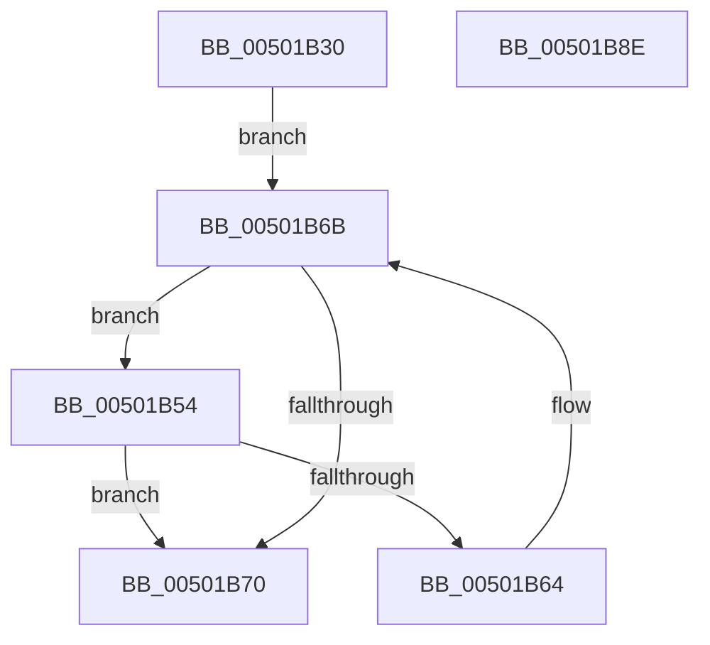

# wcscspn

- RVA: `0x00501B30`–`0x00501B8F` (길이 `95` bytes)
- VA: `0x0000000140501B30`
- 실행 섹션: `.text`
- PDB 이름 있음: `예`; PDB Function 태그: `아니요`
- unwind 정보 RVA: `0x0005C954`
- 디코드: `30`개 명령, `95/95` bytes 표시
- 미해석 바이트: `0` (있으면 어셈블리에 `.byte`로 보존)

> 이 문서는 커널 이미지의 기계어와 PDB 기호를 분석해 생성했습니다. 4번과 5번은 함수 원형과 자료형을 바이너리 사용 방식에서 추정한 C 해석이며 원본 소스 복구 결과는 아닙니다.

## 1. Dependencies

- 직접 호출 지점: **1**; 고유 호출 대상: **1**
- 직접 호출자로 확인된 함수: **0**
- RIP 상대 이미지 참조: **0**

### Outgoing calls
- `0x00501B5A` → [wcschr](wcschr_function_00501A60.md) (function, `0x00501A60`)

### Direct callers
- 이 함수 시작 RVA로 연결되는 직접 call은 확인되지 않았습니다. 간접 호출은 완전히 역산할 수 없습니다.

### Static image references
- 디코드된 RIP-relative 메모리 참조가 없습니다.

## 2. Other-region calls and transfers

- 다른 실행 섹션으로 향하는 call: **0**
- 별도 외부 분기/꼬리 이동을 확인하지 못했습니다.

## 3. Assembly (complete function range)

```asm
00501B30  48 89 5C 24 08                  mov qword ptr [rsp + 8], rbx
00501B35  48 89 6C 24 10                  mov qword ptr [rsp + 0x10], rbp
00501B3A  48 89 74 24 18                  mov qword ptr [rsp + 0x18], rsi
00501B3F  57                              push rdi
00501B40  48 83 EC 20                     sub rsp, 0x20
00501B44  0F B7 01                        movzx eax, word ptr [rcx]
00501B47  48 8B F2                        mov rsi, rdx
00501B4A  48 8B F9                        mov rdi, rcx
00501B4D  48 8B D9                        mov rbx, rcx
00501B50  33 ED                           xor ebp, ebp
00501B52  EB 17                           jmp 0x140501b6b
00501B54  0F B7 D0                        movzx edx, ax
00501B57  48 8B CE                        mov rcx, rsi
00501B5A  E8 01 FF FF FF                  call 0x140501a60
00501B5F  48 85 C0                        test rax, rax
00501B62  75 0C                           jne 0x140501b70
00501B64  48 83 C3 02                     add rbx, 2
00501B68  0F B7 03                        movzx eax, word ptr [rbx]
00501B6B  66 85 C0                        test ax, ax
00501B6E  75 E4                           jne 0x140501b54
00501B70  48 8B 6C 24 38                  mov rbp, qword ptr [rsp + 0x38]
00501B75  48 2B DF                        sub rbx, rdi
00501B78  48 8B 74 24 40                  mov rsi, qword ptr [rsp + 0x40]
00501B7D  48 D1 FB                        sar rbx, 1
00501B80  48 8B C3                        mov rax, rbx
00501B83  48 8B 5C 24 30                  mov rbx, qword ptr [rsp + 0x30]
00501B88  48 83 C4 20                     add rsp, 0x20
00501B8C  5F                              pop rdi
00501B8D  C3                              ret
00501B8E  CC                              int3
```

## 4. C-style interpretation (structured pseudocode)

```c
__int64 __fastcall wcscspn(__int64 a1, __int64 a2)
{
    __int64 result;
    __int64 v_rbp;
    __int64 v_rbx;
    __int64 v_rsp;
    unsigned __int64 v_stack_p10;
    unsigned __int64 v_stack_p18;
    unsigned __int64 v_stack_p8;

    v_stack_p8 = v_rbx;
    v_stack_p10 = v_rbp;
    v_stack_p18 = v_rsi;
    v_rsp = (v_rsp) - (32);
    v_rbp = 0;
    goto loc_00501B6B;
loc_00501B54:
    result = wcschr(a2, (unsigned __int16)(*(unsigned __int16 *)(a1)), a3, a4);
    if (result != 0) goto loc_00501B70;
    v_rbx = (a1) + (2);
loc_00501B6B:
    if ((unsigned __int16)(*(unsigned __int16 *)(v_rbx)) != 0) goto loc_00501B54;
loc_00501B70:
    v_rbx = (v_rbx) - (a1);
    v_rbx = (v_rbx) >> (1);
    v_rsp = (v_rsp) + (32);
    return v_rbx;
}
```

## 5. (Beta) C Style

```c
int64_t wcscspn(void *Arg1, int64_t Arg2)
{
    uint8_t *arg1 = (uint8_t *)Arg1;

    int64_t result;
    int64_t local_rbp;
    int64_t local_rbx;
    int64_t local_rsp;
    uint64_t v_stack_p10;
    uint64_t v_stack_p18;
    uint64_t v_stack_p8;

    v_stack_p8 = local_rbx;
    v_stack_p10 = local_rbp;
    v_stack_p18 = local_rsi;
    local_rsp = (local_rsp) - (32);
    local_rbp = 0;
    goto loc_00501B6B;
loc_00501B54:
    result = wcschr(Arg2, (uint16_t)(*(uint16_t *)(arg1)), a3, a4);
    if (result != 0) goto loc_00501B70;
    local_rbx = (Arg1) + (2);
loc_00501B6B:
    if ((uint16_t)(*(uint16_t *)(local_rbx)) != 0) goto loc_00501B54;
loc_00501B70:
    local_rbx = (local_rbx) - (Arg1);
    local_rbx = (local_rbx) >> (1);
    local_rsp = (local_rsp) + (32);
    return local_rbx;
}
```

### 관측된 메모리 오프셋

구조체 형식이 확인되지 않은 접근은 인자 기준의 오프셋으로만 기록했습니다.

| 기준 인자 | 오프셋 표현 | 폭 (bit) | 접근 |
|---|---:|---:|---|
| `Arg1` | `+ 0x0` | `16` | `R` |

## 6. Execution-region graph

[열기: 2D/3D 그래프와 함수 탐색 컨트롤 패널](../../../control-panel.html?section=text&rva=0x00501B30&view=graph)

- 2D 그래프는 위에서 아래로 흐르고, 3D 그래프는 빈 공간을 드래그해 회전합니다. Shift+드래그는 이동, 휠은 확대·축소, 함수 노드 선택은 대상 보고서 이동입니다.

### Static fallback


