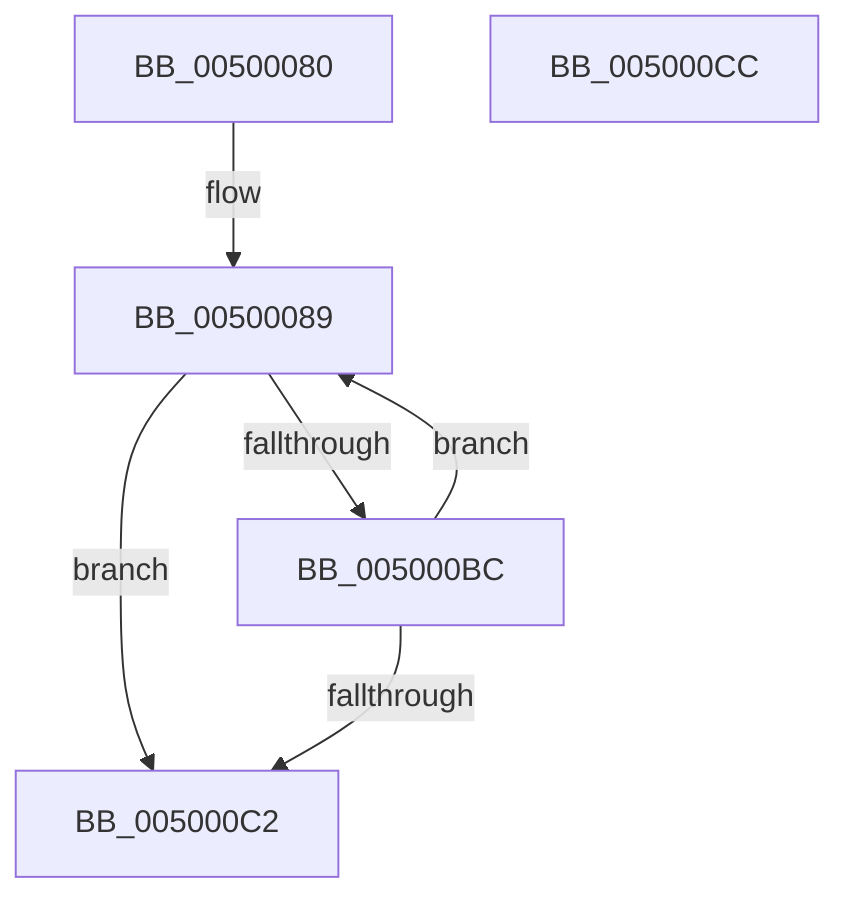

# wcsicmp

- RVA: `0x00500080`–`0x005000CD` (길이 `77` bytes)
- VA: `0x0000000140500080`
- 실행 섹션: `.text`
- PDB 이름 있음: `예`; PDB Function 태그: `아니요`
- unwind 정보 RVA: `0x000DB714`
- 디코드: `23`개 명령, `77/77` bytes 표시
- 미해석 바이트: `0` (있으면 어셈블리에 `.byte`로 보존)

> 이 문서는 커널 이미지의 기계어와 PDB 기호를 분석해 생성했습니다. 4번과 5번은 함수 원형과 자료형을 바이너리 사용 방식에서 추정한 C 해석이며 원본 소스 복구 결과는 아닙니다.

## 1. Dependencies

- 직접 호출 지점: **0**; 고유 호출 대상: **0**
- 직접 호출자로 확인된 함수: **108**
- RIP 상대 이미지 참조: **0**

### Outgoing calls
- 직접 디코드된 call 명령이 없습니다.

### Direct callers
- [VfUpdateWhitelist](../3E/VfUpdateWhitelist_function_003EF628.md) at `0x003EF66B`
- [VfAssignRuleClassIdToClassDriver](../3E/VfAssignRuleClassIdToClassDriver_function_003EF6B4.md) at `0x003EF6F7`
- [LdrpResSearchResourceMappedFile](../45/LdrpResSearchResourceMappedFile_function_00454C98.md) at `0x00454DCA`
- [LdrRscIsTypeExist](../45/LdrRscIsTypeExist_function_00455BBC.md) at `0x00455CBD`
- [LdrRscIsTypeExist](../45/LdrRscIsTypeExist_function_00455BBC.md) at `0x00455D52`
- [PopFxIsDevicePotentialDripsConstraint](../4A/PopFxIsDevicePotentialDripsConstraint_function_004A5D34.md) at `0x004A5E9A`
- [PiDevCfgGetMigrationDeviceIdScore](../4A/PiDevCfgGetMigrationDeviceIdScore_function_004A6888.md) at `0x004A68E8`
- [PiDevCfgGetMigrationDeviceIdScore](../4A/PiDevCfgGetMigrationDeviceIdScore_function_004A6888.md) at `0x004A698C`
- [PipUpdateDeviceProducts](../5A/PipUpdateDeviceProducts_function_005A46C0.md) at `0x005A4979`
- [PiDevCfgGetDriverConfigurationKeyScope](../5A/PiDevCfgGetDriverConfigurationKeyScope_function_005A7D68.md) at `0x005A7DA0`
- [LdrpVerifyAlternateResourceModuleEx](../5E/LdrpVerifyAlternateResourceModuleEx_function_005E5F24.md) at `0x005E6014`
- [RtlpMuiRegAddAlternateCodePage](../6A/RtlpMuiRegAddAlternateCodePage_function_006A8EE4.md) at `0x006A8FFE`
- [sub_006F98F4](../6F/Unknown_function_006F98F4.md) at `0x006F9966`
- [BiIsValidDiskDevice](../../page/70/BiIsValidDiskDevice_function_00703190.md) at `0x007031B7`
- [BiIsValidDiskDevice](../../page/70/BiIsValidDiskDevice_function_00703190.md) at `0x007031CC`
- [ArbShareDriverExclusive](../../page/70/ArbShareDriverExclusive_function_0070FB1C.md) at `0x0070FB9B`
- [ArbShareDriverExclusive](../../page/70/ArbShareDriverExclusive_function_0070FB1C.md) at `0x0070FC6A`
- [PnpCheckDriverDependencies](../../page/72/PnpCheckDriverDependencies_function_0072C3C4.md) at `0x0072C447`
- [IopIsPciRootBus](../../page/72/IopIsPciRootBus_function_0072EF40.md) at `0x0072EFDE`
- [IopIsPciRootBus](../../page/72/IopIsPciRootBus_function_0072EF40.md) at `0x0072EFF1`
- [PiDcResetChildDeviceContainerCallback](../../page/73/PiDcResetChildDeviceContainerCallback_function_00730DE0.md) at `0x00730ED6`
- [PiDcResetChildDeviceContainerCallback](../../page/73/PiDcResetChildDeviceContainerCallback_function_00730DE0.md) at `0x00730F70`
- [PiDcResetChildDeviceContainers](../../page/73/PiDcResetChildDeviceContainers_function_00731030.md) at `0x00731085`
- [PiDevCfgFindDeviceMigrationNode](../../page/73/PiDevCfgFindDeviceMigrationNode_function_00732920.md) at `0x00732BCD`
- [PiDevCfgQueryIncludedDriverNode](../../page/73/PiDevCfgQueryIncludedDriverNode_function_00734D88.md) at `0x00734DDE`
- [PiDevCfgQueryIncludedDriverNode](../../page/73/PiDevCfgQueryIncludedDriverNode_function_00734D88.md) at `0x00734EC6`
- [PiDevCfgResetDeviceKeyCallback](../../page/73/PiDevCfgResetDeviceKeyCallback_function_007358C0.md) at `0x007358DA`
- [IopFileUtilWalkDirectoryTreeHelper](../../page/73/IopFileUtilWalkDirectoryTreeHelper_function_0073FD40.md) at `0x0073FEFB`
- [IopFileUtilWalkDirectoryTreeHelper](../../page/73/IopFileUtilWalkDirectoryTreeHelper_function_0073FD40.md) at `0x0073FF0E`
- [PiDrvDbOverlayNodeHive](../../page/74/PiDrvDbOverlayNodeHive_function_00741990.md) at `0x00741A07`
- [PiDrvDbOverlayNodeHive](../../page/74/PiDrvDbOverlayNodeHive_function_00741990.md) at `0x00741A99`
- [PiDrvDbRegisterNodeCallback](../../page/74/PiDrvDbRegisterNodeCallback_function_00742B00.md) at `0x00742B28`
- [PiDrvDbResolveFilePathKeyValues](../../page/74/PiDrvDbResolveFilePathKeyValues_function_00742C00.md) at `0x00742FB7`
- [PiDrvDbSetupNodeHive](../../page/74/PiDrvDbSetupNodeHive_function_00743884.md) at `0x00743907`
- [PiDrvDbSetupNodeHive](../../page/74/PiDrvDbSetupNodeHive_function_00743884.md) at `0x00743C0D`
- [PiDrvDbSetupNodeHive](../../page/74/PiDrvDbSetupNodeHive_function_00743884.md) at `0x00743C2E`
- [RtlpLangNameInMultiSzString](../../page/79/RtlpLangNameInMultiSzString_function_00791AE8.md) at `0x00791B19`
- [SLQueryLicenseValueInternal](../../page/7C/SLQueryLicenseValueInternal_function_007C93EC.md) at `0x007C991A`
- [SdbpGetManifestedMergeStubAlloc](../../page/81/SdbpGetManifestedMergeStubAlloc_function_0081275C.md) at `0x0081285D`
- [SdbpGetManifestedMergeStubAlloc](../../page/81/SdbpGetManifestedMergeStubAlloc_function_0081275C.md) at `0x0081292A`
- [SdbpGetMergeRedirectPathInternal](../../page/81/SdbpGetMergeRedirectPathInternal_function_00812B00.md) at `0x00812D19`
- [SdbpGetMergeRedirectPathInternal](../../page/81/SdbpGetMergeRedirectPathInternal_function_00812B00.md) at `0x00812D3C`
- [SdbpCheckMatchingRegistryValue](../../page/81/SdbpCheckMatchingRegistryValue_function_0081462C.md) at `0x00814686`
- [SdbpGetVelocityState](../../page/81/SdbpGetVelocityState_function_00816088.md) at `0x008160C3`
- [SdbpGetVelocityState](../../page/81/SdbpGetVelocityState_function_00816088.md) at `0x008161D2`
- [SdbpMatchDeviceString](../../page/81/SdbpMatchDeviceString_function_008166C4.md) at `0x0081670C`
- [SdbpFindNextNamedTagHelper](../../page/81/SdbpFindNextNamedTagHelper_function_00816DF8.md) at `0x00816EC8`
- [AslpFileGetVersionBlock](../../page/81/AslpFileGetVersionBlock_function_0081FA50.md) at `0x0081FE4A`
- [BiGetNtPartitionPath](../../page/82/BiGetNtPartitionPath_function_0082546C.md) at `0x00825861`
- [BiGetNtPartitionPath](../../page/82/BiGetNtPartitionPath_function_0082546C.md) at `0x00825907`
- [SiGetEspFromFirmware](../../page/82/SiGetEspFromFirmware_function_008280C0.md) at `0x00828326`
- [SiIsValidDiskDevice](../../page/82/SiIsValidDiskDevice_function_00828470.md) at `0x0082848F`
- [SiIsValidDiskDevice](../../page/82/SiIsValidDiskDevice_function_00828470.md) at `0x008284A4`
- [SiIsValidWindowsBootEntry](../../page/82/SiIsValidWindowsBootEntry_function_0082851C.md) at `0x0082856D`
- [CmGetDeclarativeFilterList](../../page/82/CmGetDeclarativeFilterList_function_0082FE7C.md) at `0x0082FF2A`
- [PnpMultiSzFind](../../page/83/PnpMultiSzFind_function_0083243C.md) at `0x00832486`
- [DrvDbSetDriverDatabaseMappedProperty](../../page/83/DrvDbSetDriverDatabaseMappedProperty_function_00834014.md) at `0x00834061`
- [DrvDbSetDriverPackageMappedProperty](../../page/83/DrvDbSetDriverPackageMappedProperty_function_00834848.md) at `0x00834AF2`
- [DrvDbSetDriverPackageMappedProperty](../../page/83/DrvDbSetDriverPackageMappedProperty_function_00834848.md) at `0x00834C54`
- [DrvDbSuspendDatabase](../../page/83/DrvDbSuspendDatabase_function_0083522C.md) at `0x00835266`
- [VhdVerifyBootDisk](../../page/83/VhdVerifyBootDisk_function_0083BB84.md) at `0x0083BC8F`
- [RtlpMuiRegConfigMatchesInstalled](../../page/83/RtlpMuiRegConfigMatchesInstalled_function_0083DA08.md) at `0x0083DC35`
- [RtlpMuiRegGetOrAddStringToPool](../../page/83/RtlpMuiRegGetOrAddStringToPool_function_0083E970.md) at `0x0083E9D0`
- [RtlpMuiRegLangInfoMatchesSpec](../../page/83/RtlpMuiRegLangInfoMatchesSpec_function_0083EBD0.md) at `0x0083ED4F`
- [ConstraintEval](../../page/8D/ConstraintEval_function_008DC1D0.md) at `0x008DC4E6`
- [ConstraintEval](../../page/8D/ConstraintEval_function_008DC1D0.md) at `0x008DC554`
- [PiDqQueryApplyObjectEvent](../../page/8D/PiDqQueryApplyObjectEvent_function_008DDACC.md) at `0x008DDF6A`
- [PiDqQueryApplyObjectEvent](../../page/8D/PiDqQueryApplyObjectEvent_function_008DDACC.md) at `0x008DE0AB`
- [PiDqQueryApplyObjectEvent](../../page/8D/PiDqQueryApplyObjectEvent_function_008DDACC.md) at `0x008DE14C`
- [PiDqQueryApplyObjectEvent](../../page/8D/PiDqQueryApplyObjectEvent_function_008DDACC.md) at `0x008DE170`
- [PiDqPropertyCallback](../../page/8D/PiDqPropertyCallback_function_008DF580.md) at `0x008DF74B`
- [PiUEventNotifyTargetDeviceChange](../../page/8E/PiUEventNotifyTargetDeviceChange_function_008E65B0.md) at `0x008E6682`
- [PiPnpRtlObjectEventWorker](../../page/8F/PiPnpRtlObjectEventWorker_function_008F8630.md) at `0x008F88DE`
- [PiSwStopDestroy](../../page/8F/PiSwStopDestroy_function_008FCA68.md) at `0x008FCB77`
- [PiDcUpdateDeviceContainerMembership](../../page/8F/PiDcUpdateDeviceContainerMembership_function_008FD0A8.md) at `0x008FD240`
- [DrvDbGetDriverDatabaseMappedProperty](../../page/92/DrvDbGetDriverDatabaseMappedProperty_function_0092EE28.md) at `0x0092EE79`
- [PiSwDeviceMakeCompatibleIds](../../page/94/PiSwDeviceMakeCompatibleIds_function_0094DA8C.md) at `0x0094DB93`
- [PiSwDeviceMakeCompatibleIds](../../page/94/PiSwDeviceMakeCompatibleIds_function_0094DA8C.md) at `0x0094DBB4`
- [PiSwDeviceMakeCompatibleIds](../../page/94/PiSwDeviceMakeCompatibleIds_function_0094DA8C.md) at `0x0094DBDE`
- [PiSwDeviceMakeCompatibleIds](../../page/94/PiSwDeviceMakeCompatibleIds_function_0094DA8C.md) at `0x0094DBF1`
- [PiSwUpdateArrayProperties](../../page/94/PiSwUpdateArrayProperties_function_0094EBAC.md) at `0x0094ECDF`
- [PiSwDeviceFindInterfaceEntry](../../page/94/PiSwDeviceFindInterfaceEntry_function_0094F498.md) at `0x0094F4C7`
- [PipCheckForDenyExecute](../../page/94/PipCheckForDenyExecute_function_0094F880.md) at `0x0094F8B9`
- [PiPnpRtlApplyMandatoryDeviceContainerFilters](../../page/95/PiPnpRtlApplyMandatoryDeviceContainerFilters_function_00950874.md) at `0x009508AB`
- [PiDevCfgMigrateDevice](../../page/96/PiDevCfgMigrateDevice_function_00963E60.md) at `0x009640B4`
- [RtlLookupAtomInAtomTable](../../page/99/RtlLookupAtomInAtomTable_function_00992DF0.md) at `0x00992FCE`
- [LdrpSearchResourceSection_U](../../page/99/LdrpSearchResourceSection_U_function_0099B2DC.md) at `0x0099BC4D`
- [RtlpHashStringToAtom](../../page/99/RtlpHashStringToAtom_function_0099E760.md) at `0x0099E851`
- [PiDmCompareObjects](../../page/9A/PiDmCompareObjects_function_009A2AD0.md) at `0x009A2AF7`
- [PiUEventNotifyDeviceInstancePropertyChange](../../page/9C/PiUEventNotifyDeviceInstancePropertyChange_function_009C3C04.md) at `0x009C3CC6`
- [PiUEventNotifyDeviceInstanceChange](../../page/9C/PiUEventNotifyDeviceInstanceChange_function_009C3E2C.md) at `0x009C3F1E`
- [PropertyEval](../../page/9C/PropertyEval_function_009CB300.md) at `0x009CFD66`
- [PnpMultiSzDeleteString](../../page/9D/PnpMultiSzDeleteString_function_009D0C8C.md) at `0x009D0CCC`
- [_CmGetInstallerClassMappedPropertyFromRegValue](../../page/9D/_CmGetInstallerClassMappedPropertyFromRegValue_function_009D4058.md) at `0x009D440B`
- [WmipPrepareWnodeSI](../../page/9E/WmipPrepareWnodeSI_function_009E1740.md) at `0x009E19AE`
- [PiBuildDeviceNodeInstancePath](../../page/A0/PiBuildDeviceNodeInstancePath_function_00A08DEC.md) at `0x00A08F37`
- [_CmUpdateDevicePanel](../../page/A0/_CmUpdateDevicePanel_function_00A0A16C.md) at `0x00A0AB87`
- [PiPnpRtlObjectEventCompareObjects](../../page/A1/PiPnpRtlObjectEventCompareObjects_function_00A11280.md) at `0x00A112BA`
- [DrvDbGetObjectSubKeyCallback](../../page/A1/DrvDbGetObjectSubKeyCallback_function_00A11300.md) at `0x00A11364`
- [StringListContains](../../page/A2/StringListContains_function_00A22E24.md) at `0x00A22EFD`
- [GetPropertyFromPropArray](../../page/A5/GetPropertyFromPropArray_function_00A51A30.md) at `0x00A51B29`
- [IopErrorLogThread](../../page/A5/IopErrorLogThread_function_00A5DC80.md) at `0x00A5DFF9`
- [PiDqActionDataGetChangedProperties](../../page/A6/PiDqActionDataGetChangedProperties_function_00A61F10.md) at `0x00A622DD`
- [PiDqActionDataGetChangedProperties](../../page/A6/PiDqActionDataGetChangedProperties_function_00A61F10.md) at `0x00A622FE`
- [PiSwDeviceCompareObjects](../../page/A7/PiSwDeviceCompareObjects_function_00A7E5C0.md) at `0x00A7E5DD`
- [PiSwDeviceCompareObjects](../../page/A7/PiSwDeviceCompareObjects_function_00A7E5C0.md) at `0x00A7E5F0`
- [PiDevCfgResolveVariable](../../page/A8/PiDevCfgResolveVariable_function_00A81AB8.md) at `0x00A81C65`
- [PiDevCfgResolveVariable](../../page/A8/PiDevCfgResolveVariable_function_00A81AB8.md) at `0x00A81CC0`
- [PiHotSwapGetDefaultBusRemovalPolicy](../../page/A8/PiHotSwapGetDefaultBusRemovalPolicy_function_00A85F8C.md) at `0x00A860B9`
- [CmMatchLastKnownParentCallback](../../page/A8/CmMatchLastKnownParentCallback_function_00A89E50.md) at `0x00A89EFA`
- [CmIsLocalMachineContainer](../../page/A8/CmIsLocalMachineContainer_function_00A8EA34.md) at `0x00A8EAD0`
- [PiDevCfgConfigureDeviceInterfaces](../../page/A9/PiDevCfgConfigureDeviceInterfaces_function_00A90060.md) at `0x00A90230`
- [SdbpFindMatchingName](../../page/A9/SdbpFindMatchingName_function_00A91508.md) at `0x00A91561`
- [SdbpFindMatchingName](../../page/A9/SdbpFindMatchingName_function_00A91508.md) at `0x00A91599`
- [PiDevCfgConfigureDeviceKeyCallback](../../page/A9/PiDevCfgConfigureDeviceKeyCallback_function_00A99890.md) at `0x00A998DA`
- [EtwpStartLogger](../../page/A9/EtwpStartLogger_function_00A99D80.md) at `0x00A9A43A`
- [DrvDbOpenDriverDatabaseRegKey](../../page/AA/DrvDbOpenDriverDatabaseRegKey_function_00AA0FB8.md) at `0x00AA0FEE`
- [PiSwDoesCreateChangesRequireReEnum](../../page/AA/PiSwDoesCreateChangesRequireReEnum_function_00AAE658.md) at `0x00AAE6BF`
- [PiSwDoesCreateChangesRequireReEnum](../../page/AA/PiSwDoesCreateChangesRequireReEnum_function_00AAE658.md) at `0x00AAE6EB`
- [PiSwDoesCreateChangesRequireReEnum](../../page/AA/PiSwDoesCreateChangesRequireReEnum_function_00AAE658.md) at `0x00AAE70F`
- [PiDevCfgResolveVariableKeyHandle](../../page/AB/PiDevCfgResolveVariableKeyHandle_function_00AB2A24.md) at `0x00AB2AF2`
- [PiDevCfgResolveVariableKeyHandle](../../page/AB/PiDevCfgResolveVariableKeyHandle_function_00AB2A24.md) at `0x00AB2C47`
- [PiDevCfgResolveVariableKeyHandle](../../page/AB/PiDevCfgResolveVariableKeyHandle_function_00AB2A24.md) at `0x00AB2C6D`
- [PiDevCfgResolveVariableKeyHandle](../../page/AB/PiDevCfgResolveVariableKeyHandle_function_00AB2A24.md) at `0x00AB2C89`
- [PiCreateDriverSwDeviceCallback](../../page/AB/PiCreateDriverSwDeviceCallback_function_00ABB420.md) at `0x00ABB92F`
- [PiCreateDriverSwDeviceCallback](../../page/AB/PiCreateDriverSwDeviceCallback_function_00ABB420.md) at `0x00ABB944`
- [CmFindFilterListInflectionPoint](../../page/AC/CmFindFilterListInflectionPoint_function_00ACC9D8.md) at `0x00ACCA34`
- [SdbpFindFirstNamedTagHelper](../../page/AD/SdbpFindFirstNamedTagHelper_function_00AD4D2C.md) at `0x00AD4DB6`
- [AslpFileVerQueryBlock](../../page/AF/AslpFileVerQueryBlock_function_00AF9694.md) at `0x00AF981B`
- [CmMergeFilterLists](../../page/AF/CmMergeFilterLists_function_00AFA2CC.md) at `0x00AFA375`
- [CmMergeFilterLists](../../page/AF/CmMergeFilterLists_function_00AFA2CC.md) at `0x00AFA38A`
- [CmMergeFilterLists](../../page/AF/CmMergeFilterLists_function_00AFA2CC.md) at `0x00AFA46A`
- [CmMergeFilterLists](../../page/AF/CmMergeFilterLists_function_00AFA2CC.md) at `0x00AFA536`
- [sub_00B1C4F6](../../page/B1/Unknown_function_00B1C4F6.md) at `0x00B1C6BF`
- [sub_00B1CD26](../../page/B1/Unknown_function_00B1CD26.md) at `0x00B1CD51`
- [sub_00B1CE1E](../../page/B1/Unknown_function_00B1CE1E.md) at `0x00B1CE53`
- [sub_00B1CE1E](../../page/B1/Unknown_function_00B1CE1E.md) at `0x00B1CECD`
- [sub_00B1D252](../../page/B1/Unknown_function_00B1D252.md) at `0x00B1D2EB`
- [sub_00B266CA](../../page/B2/Unknown_function_00B266CA.md) at `0x00B267C9`
- [sub_00B266CA](../../page/B2/Unknown_function_00B266CA.md) at `0x00B268EB`
- [sub_00B3023C](../../page/B3/Unknown_function_00B3023C.md) at `0x00B3024E`
- [sub_00B453C2](../../page/B4/Unknown_function_00B453C2.md) at `0x00B454CA`
- [sub_00B453C2](../../page/B4/Unknown_function_00B453C2.md) at `0x00B45502`
- [sub_00B453C2](../../page/B4/Unknown_function_00B453C2.md) at `0x00B455C9`
- [sub_00B453C2](../../page/B4/Unknown_function_00B453C2.md) at `0x00B4560E`
- [sub_00B453C2](../../page/B4/Unknown_function_00B453C2.md) at `0x00B456DB`
- [sub_00B453C2](../../page/B4/Unknown_function_00B453C2.md) at `0x00B4571F`
- [VfIsPCIBus](../../pagevrfy/B9/VfIsPCIBus_function_00B97274.md) at `0x00B972C8`
- [BgpFoGetFontHandle](../../pagebgfx/BC/BgpFoGetFontHandle_function_00BC52B0.md) at `0x00BC5347`
- [PipMigrateResetDeviceCallback](../../init/C3/PipMigrateResetDeviceCallback_function_00C31D40.md) at `0x00C31D6A`
- [PipPendingServicesFilter](../../init/C3/PipPendingServicesFilter_function_00C35ED0.md) at `0x00C35EE4`
- [CmSelectQualifiedInstallLanguage](../../init/C5/CmSelectQualifiedInstallLanguage_function_00C58F58.md) at `0x00C5940C`

### Static image references
- 디코드된 RIP-relative 메모리 참조가 없습니다.

## 2. Other-region calls and transfers

- 다른 실행 섹션으로 향하는 call: **0**
- 별도 외부 분기/꼬리 이동을 확인하지 못했습니다.

## 3. Assembly (complete function range)

```asm
00500080  4C 8B C9                        mov r9, rcx
00500083  4C 8B D2                        mov r10, rdx
00500086  4C 2B CA                        sub r9, rdx
00500089  47 0F B7 04 11                  movzx r8d, word ptr [r9 + r10]
0050008E  41 0F B7 0A                     movzx ecx, word ptr [r10]
00500092  4D 8D 52 02                     lea r10, [r10 + 2]
00500096  41 8D 40 BF                     lea eax, [r8 - 0x41]
0050009A  66 83 F8 19                     cmp ax, 0x19
0050009E  41 8D 50 20                     lea edx, [r8 + 0x20]
005000A2  8D 41 BF                        lea eax, [rcx - 0x41]
005000A5  66 41 0F 47 D0                  cmova dx, r8w
005000AA  66 83 F8 19                     cmp ax, 0x19
005000AE  44 8D 41 20                     lea r8d, [rcx + 0x20]
005000B2  66 44 0F 47 C1                  cmova r8w, cx
005000B7  66 85 D2                        test dx, dx
005000BA  74 06                           je 0x1405000c2
005000BC  66 41 3B D0                     cmp dx, r8w
005000C0  74 C7                           je 0x140500089
005000C2  41 0F B7 C8                     movzx ecx, r8w
005000C6  0F B7 C2                        movzx eax, dx
005000C9  2B C1                           sub eax, ecx
005000CB  C3                              ret
005000CC  CC                              int3
```

## 4. C-style interpretation (structured pseudocode)

```c
__int64 __fastcall wcsicmp(__int64 a1, __int64 a2)
{
    __int64 result;

    a4 = (a1) - (a2);
loc_00500089:
    a2 = *(unsigned __int16 *)(a4 + a2 * 1) + 32;
    if (((unsigned __int16)(*(unsigned __int16 *)(a4 + a2 * 1) - 65)) > 25) { a2 = (unsigned __int16)(*(unsigned __int16 *)(a4 + a2 * 1)); }
    a3 = *(unsigned __int16 *)(a2) + 32;
    if (((unsigned __int16)(*(unsigned __int16 *)(a2) - 65)) > 25) { a3 = (unsigned __int16)(*(unsigned __int16 *)(a2)); }
    if ((unsigned __int16)(a2) == 0) goto loc_005000C2;
    if (((unsigned __int16)(a2)) == ((unsigned __int16)(a3))) goto loc_00500089;
loc_005000C2:
    result = (unsigned int)(((unsigned __int16)(a2)) - ((unsigned int)((unsigned __int16)(a3))));
    return result;
}
```

## 5. (Beta) C Style

```c
int64_t wcsicmp(void *Arg1, void *Arg2)
{
    uint8_t *arg1 = (uint8_t *)Arg1;
    uint8_t *arg2 = (uint8_t *)Arg2;

    int64_t result;

    a4 = (Arg1) - (Arg2);
loc_00500089:
    Arg2 = *(uint16_t *)(a4 + arg2 * 1) + 32;
    if (((uint16_t)(*(uint16_t *)(a4 + arg2 * 1) - 65)) > 25) { Arg2 = (uint16_t)(*(uint16_t *)(a4 + arg2 * 1)); }
    a3 = *(uint16_t *)(arg2) + 32;
    if (((uint16_t)(*(uint16_t *)(arg2) - 65)) > 25) { a3 = (uint16_t)(*(uint16_t *)(arg2)); }
    if ((uint16_t)(Arg2) == 0) goto loc_005000C2;
    if (((uint16_t)(Arg2)) == ((uint16_t)(a3))) goto loc_00500089;
loc_005000C2:
    result = (uint32_t)(((uint16_t)(Arg2)) - ((uint32_t)((uint16_t)(a3))));
    return result;
}
```

### 관측된 메모리 오프셋

구조체 형식이 확인되지 않은 접근은 인자 기준의 오프셋으로만 기록했습니다.

| 기준 인자 | 오프셋 표현 | 폭 (bit) | 접근 |
|---|---:|---:|---|
| `Arg1` | `+ 0x0 + r10*1` | `16` | `R` |
| `Arg2` | `+ 0x0` | `16` | `R` |
| `Arg2` | `+ 0x2` | `64` | `R` |

## 6. Execution-region graph

[열기: 2D/3D 그래프와 함수 탐색 컨트롤 패널](../../../control-panel.html?section=text&rva=0x00500080&view=graph)

- 2D 그래프는 위에서 아래로 흐르고, 3D 그래프는 빈 공간을 드래그해 회전합니다. Shift+드래그는 이동, 휠은 확대·축소, 함수 노드 선택은 대상 보고서 이동입니다.

### Static fallback


