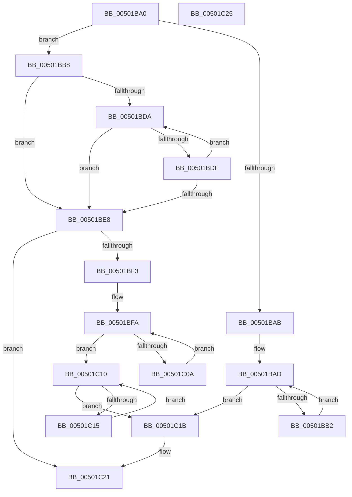

# wcslen

- RVA: `0x00501BA0`–`0x00501C26` (길이 `134` bytes)
- VA: `0x0000000140501BA0`
- 실행 섹션: `.text`
- PDB 이름 있음: `예`; PDB Function 태그: `아니요`
- unwind 정보 RVA: `0x000DB714`
- 디코드: `47`개 명령, `134/134` bytes 표시
- 미해석 바이트: `0` (있으면 어셈블리에 `.byte`로 보존)

> 이 문서는 커널 이미지의 기계어와 PDB 기호를 분석해 생성했습니다. 4번과 5번은 함수 원형과 자료형을 바이너리 사용 방식에서 추정한 C 해석이며 원본 소스 복구 결과는 아닙니다.

## 1. Dependencies

- 직접 호출 지점: **0**; 고유 호출 대상: **0**
- 직접 호출자로 확인된 함수: **23**
- RIP 상대 이미지 참조: **0**

### Outgoing calls
- 직접 디코드된 call 명령이 없습니다.

### Direct callers
- [sub_002F1861](../2F/Unknown_function_002F1861.md) at `0x002F19FF`
- [SepVerifyDesktopAppxPackageName](../3A/SepVerifyDesktopAppxPackageName_function_003A9728.md) at `0x003A9791`
- [RtlAppendUnicodeToString](../40/RtlAppendUnicodeToString_function_0040F990.md) at `0x0040F9AD`
- [PopFxStopDeviceAccounting](../42/PopFxStopDeviceAccounting_function_004261D8.md) at `0x004265B6`
- [PopDiagTraceFxDeviceAccounting](../42/PopDiagTraceFxDeviceAccounting_function_00426614.md) at `0x00426663`
- [PopDiagTraceFxDeviceAccounting](../42/PopDiagTraceFxDeviceAccounting_function_00426614.md) at `0x00426687`
- [RtlInitUnicodeString](../42/RtlInitUnicodeString_function_0042A780.md) at `0x0042A79C`
- [RtlInitUnicodeStringEx](../46/RtlInitUnicodeStringEx_function_00463960.md) at `0x00463979`
- [PiUEventHashStringIntoBucket](../48/PiUEventHashStringIntoBucket_function_00486690.md) at `0x004866A9`
- [BapdWriteEtwEvents](../4A/BapdWriteEtwEvents_function_004AE884.md) at `0x004AEA8C`
- [PopOpenKey](../4B/PopOpenKey_function_004B4330.md) at `0x004B43B7`
- [PopReadRegKeyValue](../4B/PopReadRegKeyValue_function_004B5F64.md) at `0x004B5FAE`
- [PnpMultiSzContainsString](../4C/PnpMultiSzContainsString_function_004C2740.md) at `0x004C2770`
- [PnpMultiSzContainsString](../4C/PnpMultiSzContainsString_function_004C2740.md) at `0x004C27A5`
- [PopQueryPowerButtonConfiguration](../4C/PopQueryPowerButtonConfiguration_function_004CA6EC.md) at `0x004CA741`
- [PopQueryPowerButtonConfiguration](../4C/PopQueryPowerButtonConfiguration_function_004CA6EC.md) at `0x004CA779`
- [PopQueryPowerButtonConfiguration](../4C/PopQueryPowerButtonConfiguration_function_004CA6EC.md) at `0x004CA7A3`
- [PopQueryPowerButtonConfiguration](../4C/PopQueryPowerButtonConfiguration_function_004CA6EC.md) at `0x004CA7CD`
- [RtlpMuiRegLoadLicInformation](../4C/RtlpMuiRegLoadLicInformation_function_004CB26C.md) at `0x004CB62B`
- [PrpWriteLogsToRegistry](../4C/PrpWriteLogsToRegistry_function_004CC288.md) at `0x004CC346`
- [PrpWriteLogsToRegistry](../4C/PrpWriteLogsToRegistry_function_004CC288.md) at `0x004CC3A9`
- [PrpWriteLogsToRegistry](../4C/PrpWriteLogsToRegistry_function_004CC288.md) at `0x004CC3F7`
- [PrpWriteLogsToRegistry](../4C/PrpWriteLogsToRegistry_function_004CC288.md) at `0x004CC445`
- [PrpWriteLogsToRegistry](../4C/PrpWriteLogsToRegistry_function_004CC288.md) at `0x004CC493`
- [PrpWriteLogsToRegistry](../4C/PrpWriteLogsToRegistry_function_004CC288.md) at `0x004CC4E1`
- [PrpWriteLogsToRegistry](../4C/PrpWriteLogsToRegistry_function_004CC288.md) at `0x004CC52F`
- [PrpWriteLogsToRegistry](../4C/PrpWriteLogsToRegistry_function_004CC288.md) at `0x004CC57E`
- [PrpWriteLogsToRegistry](../4C/PrpWriteLogsToRegistry_function_004CC288.md) at `0x004CC5CD`
- [PrpWriteLogsToRegistry](../4C/PrpWriteLogsToRegistry_function_004CC288.md) at `0x004CC61F`
- [PrpWriteLogsToRegistry](../4C/PrpWriteLogsToRegistry_function_004CC288.md) at `0x004CC66E`
- [PrpWriteLogsToRegistry](../4C/PrpWriteLogsToRegistry_function_004CC288.md) at `0x004CC6BD`
- [PrpWriteLogsToRegistry](../4C/PrpWriteLogsToRegistry_function_004CC288.md) at `0x004CC70A`
- [PrpWriteLogsToRegistry](../4C/PrpWriteLogsToRegistry_function_004CC288.md) at `0x004CC752`
- [IopAllowRemoteDASD](../4D/IopAllowRemoteDASD_function_004D5BAC.md) at `0x004D5BCA`
- [IopAllowRemoteDASD](../4D/IopAllowRemoteDASD_function_004D5BAC.md) at `0x004D5BDD`
- [wcscat](wcscat_function_005019E0.md) at `0x005019F0`
- [wcscpy](wcscpy_function_00501A20.md) at `0x00501A33`
- [wcsncat](wcsncat_function_00501C30.md) at `0x00501C4E`
- [RtlCreateUnicodeString](../../page/9B/RtlCreateUnicodeString_function_009BD860.md) at `0x009BD882`
- [QueryRegistryHideMachine](../../init/C6/QueryRegistryHideMachine_function_00C6FC84.md) at `0x00C6FCB0`
- [PopSleepstudyInitialize](../../init/C7/PopSleepstudyInitialize_function_00C76C60.md) at `0x00C76D6A`
- [PopSleepstudyInitialize](../../init/C7/PopSleepstudyInitialize_function_00C76C60.md) at `0x00C76DB7`
- [PopSleepstudyInitialize](../../init/C7/PopSleepstudyInitialize_function_00C76C60.md) at `0x00C76DFA`
- [PopSleepstudyInitialize](../../init/C7/PopSleepstudyInitialize_function_00C76C60.md) at `0x00C76E36`
- [PopSleepstudyInitialize](../../init/C7/PopSleepstudyInitialize_function_00C76C60.md) at `0x00C76E72`
- [PopPowerAggregatorInitialize](../../init/C7/PopPowerAggregatorInitialize_function_00C77B94.md) at `0x00C77D1B`

### Static image references
- 디코드된 RIP-relative 메모리 참조가 없습니다.

## 2. Other-region calls and transfers

- 다른 실행 섹션으로 향하는 call: **0**
- 별도 외부 분기/꼬리 이동을 확인하지 못했습니다.

## 3. Assembly (complete function range)

```asm
00501BA0  4C 8B C1                        mov r8, rcx
00501BA3  48 8B D1                        mov rdx, rcx
00501BA6  F6 C1 01                        test cl, 1
00501BA9  74 0D                           je 0x140501bb8
00501BAB  33 C9                           xor ecx, ecx
00501BAD  66 39 0A                        cmp word ptr [rdx], cx
00501BB0  74 69                           je 0x140501c1b
00501BB2  48 83 C2 02                     add rdx, 2
00501BB6  EB F5                           jmp 0x140501bad
00501BB8  83 E1 0F                        and ecx, 0xf
00501BBB  B8 10 00 00 00                  mov eax, 0x10
00501BC0  48 2B C1                        sub rax, rcx
00501BC3  48 F7 D9                        neg rcx
00501BC6  4D 1B C9                        sbb r9, r9
00501BC9  33 C9                           xor ecx, ecx
00501BCB  4C 23 C8                        and r9, rax
00501BCE  49 D1 E9                        shr r9, 1
00501BD1  4B 8D 04 48                     lea rax, [r8 + r9*2]
00501BD5  4C 3B C0                        cmp r8, rax
00501BD8  74 0E                           je 0x140501be8
00501BDA  66 39 0A                        cmp word ptr [rdx], cx
00501BDD  74 09                           je 0x140501be8
00501BDF  48 83 C2 02                     add rdx, 2
00501BE3  48 3B D0                        cmp rdx, rax
00501BE6  75 F2                           jne 0x140501bda
00501BE8  49 2B D0                        sub rdx, r8
00501BEB  48 D1 FA                        sar rdx, 1
00501BEE  49 3B D1                        cmp rdx, r9
00501BF1  75 2E                           jne 0x140501c21
00501BF3  49 8D 14 50                     lea rdx, [r8 + rdx*2]
00501BF7  0F 57 C9                        xorps xmm1, xmm1
00501BFA  66 0F 6F C1                     movdqa xmm0, xmm1
00501BFE  66 0F 75 02                     pcmpeqw xmm0, xmmword ptr [rdx]
00501C02  66 0F D7 C0                     pmovmskb eax, xmm0
00501C06  85 C0                           test eax, eax
00501C08  75 06                           jne 0x140501c10
00501C0A  48 83 C2 10                     add rdx, 0x10
00501C0E  EB EA                           jmp 0x140501bfa
00501C10  66 39 0A                        cmp word ptr [rdx], cx
00501C13  74 06                           je 0x140501c1b
00501C15  48 83 C2 02                     add rdx, 2
00501C19  EB F5                           jmp 0x140501c10
00501C1B  49 2B D0                        sub rdx, r8
00501C1E  48 D1 FA                        sar rdx, 1
00501C21  48 8B C2                        mov rax, rdx
00501C24  C3                              ret
00501C25  CC                              int3
```

## 4. C-style interpretation (structured pseudocode)

```c
__int64 __fastcall wcslen(__int64 a1, __int64 a2, __int64 a3, __int64 a4)
{
    __int64 result;

    if ((((unsigned __int8)(a1)) & (1)) == 0) goto loc_00501BB8;
    a1 = 0;
loc_00501BAD:
    if ((*(unsigned __int16 *)(a1)) == 0) goto loc_00501C1B;
    a2 = (a1) + (2);
    goto loc_00501BAD;
loc_00501BB8:
    a1 = (unsigned int)((a1) & (15));
    result = (16) - (a1);
    a1 = -(a1);
    a1 = 0;
    a4 = (a4) & (result);
    a4 = (a4) >> (1);
    if (0 == (a1 + a4 * 2)) goto loc_00501BE8;
loc_00501BDA:
    if ((*(unsigned __int16 *)(a2)) == 0) goto loc_00501BE8;
    a2 = (a2) + (2);
    if (a2 != (a1 + a4 * 2)) goto loc_00501BDA;
loc_00501BE8:
    a2 = (a2) - (0);
    a2 = (a2) >> (1);
    if (a2 != a4) goto loc_00501C21;
loc_00501BFA:
    if ((unsigned int)(a1 + a4 * 2) != 0) goto loc_00501C10;
    a2 = (a1 + a2 * 2) + (16);
    goto loc_00501BFA;
loc_00501C10:
    if ((*(unsigned __int16 *)(a2)) == 0) goto loc_00501C1B;
    a2 = (a2) + (2);
    goto loc_00501C10;
loc_00501C1B:
    a2 = (a2) - (0);
    a2 = (a2) >> (1);
loc_00501C21:
    return a2;
}
```

## 5. (Beta) C Style

```c
int64_t wcslen(void *Arg1, int64_t Arg2, int64_t Arg3, int64_t Arg4)
{
    uint8_t *arg1 = (uint8_t *)Arg1;

    int64_t result;

    if ((((uint8_t)(Arg1)) & (1)) == 0) goto loc_00501BB8;
    Arg1 = 0;
loc_00501BAD:
    if ((*(uint16_t *)(arg1)) == 0) goto loc_00501C1B;
    Arg2 = (Arg1) + (2);
    goto loc_00501BAD;
loc_00501BB8:
    Arg1 = (uint32_t)((Arg1) & (15));
    result = (16) - (Arg1);
    Arg1 = -(Arg1);
    Arg1 = 0;
    Arg4 = (Arg4) & (result);
    Arg4 = (Arg4) >> (1);
    if (0 == (Arg1 + Arg4 * 2)) goto loc_00501BE8;
loc_00501BDA:
    if ((*(uint16_t *)(Arg2)) == 0) goto loc_00501BE8;
    Arg2 = (Arg2) + (2);
    if (Arg2 != (Arg1 + Arg4 * 2)) goto loc_00501BDA;
loc_00501BE8:
    Arg2 = (Arg2) - (0);
    Arg2 = (Arg2) >> (1);
    if (Arg2 != Arg4) goto loc_00501C21;
loc_00501BFA:
    if ((uint32_t)(Arg1 + Arg4 * 2) != 0) goto loc_00501C10;
    Arg2 = (Arg1 + Arg2 * 2) + (16);
    goto loc_00501BFA;
loc_00501C10:
    if ((*(uint16_t *)(Arg2)) == 0) goto loc_00501C1B;
    Arg2 = (Arg2) + (2);
    goto loc_00501C10;
loc_00501C1B:
    Arg2 = (Arg2) - (0);
    Arg2 = (Arg2) >> (1);
loc_00501C21:
    return Arg2;
}
```

### 관측된 메모리 오프셋

구조체 형식이 확인되지 않은 접근은 인자 기준의 오프셋으로만 기록했습니다.

| 기준 인자 | 오프셋 표현 | 폭 (bit) | 접근 |
|---|---:|---:|---|
| `Arg1` | `+ 0x0` | `16` | `R` |
| `Arg1` | `+ 0x0 + r9*2` | `64` | `R` |

## 6. Execution-region graph

[열기: 2D/3D 그래프와 함수 탐색 컨트롤 패널](../../../control-panel.html?section=text&rva=0x00501BA0&view=graph)

- 2D 그래프는 위에서 아래로 흐르고, 3D 그래프는 빈 공간을 드래그해 회전합니다. Shift+드래그는 이동, 휠은 확대·축소, 함수 노드 선택은 대상 보고서 이동입니다.

### Static fallback


