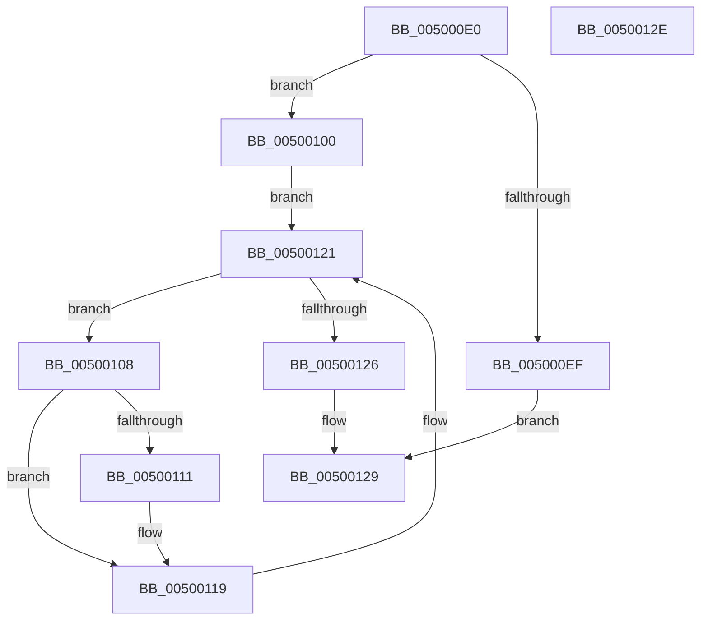

# wcslwr

- RVA: `0x005000E0`–`0x0050012F` (길이 `79` bytes)
- VA: `0x00000001405000E0`
- 실행 섹션: `.text`
- PDB 이름 있음: `예`; PDB Function 태그: `아니요`
- unwind 정보 RVA: `0x0005D2F4`
- 디코드: `26`개 명령, `79/79` bytes 표시
- 미해석 바이트: `0` (있으면 어셈블리에 `.byte`로 보존)

> 이 문서는 커널 이미지의 기계어와 PDB 기호를 분석해 생성했습니다. 4번과 5번은 함수 원형과 자료형을 바이너리 사용 방식에서 추정한 C 해석이며 원본 소스 복구 결과는 아닙니다.

## 1. Dependencies

- 직접 호출 지점: **1**; 고유 호출 대상: **1**
- 직접 호출자로 확인된 함수: **2**
- RIP 상대 이미지 참조: **0**

### Outgoing calls
- `0x005000F7` → [EmpCheckErrataList](../49/EmpCheckErrataList_function_0049E550.md) (function, `0x0049E550`)

### Direct callers
- [EtwpCovSampSplitSegments](../../page/7C/EtwpCovSampSplitSegments_function_007C1C3C.md) at `0x007C1C56`
- [SiGetBootDeviceNameFromRegistry](../../page/A3/SiGetBootDeviceNameFromRegistry_function_00A37B68.md) at `0x00A37BCC`

### Static image references
- 디코드된 RIP-relative 메모리 참조가 없습니다.

## 2. Other-region calls and transfers

- 다른 실행 섹션으로 향하는 call: **0**
- 별도 외부 분기/꼬리 이동을 확인하지 못했습니다.

## 3. Assembly (complete function range)

```asm
005000E0  48 83 EC 38                     sub rsp, 0x38
005000E4  45 33 C9                        xor r9d, r9d
005000E7  48 8B D1                        mov rdx, rcx
005000EA  48 85 C9                        test rcx, rcx
005000ED  75 11                           jne 0x140500100
005000EF  45 33 C0                        xor r8d, r8d
005000F2  4C 89 4C 24 20                  mov qword ptr [rsp + 0x20], r9
005000F7  E8 54 E4 F9 FF                  call 0x14049e550
005000FC  33 C0                           xor eax, eax
005000FE  EB 29                           jmp 0x140500129
00500100  0F B7 09                        movzx ecx, word ptr [rcx]
00500103  4C 8B C2                        mov r8, rdx
00500106  EB 19                           jmp 0x140500121
00500108  8D 41 BF                        lea eax, [rcx - 0x41]
0050010B  66 83 F8 19                     cmp ax, 0x19
0050010F  77 08                           ja 0x140500119
00500111  66 83 C1 20                     add cx, 0x20
00500115  66 41 89 08                     mov word ptr [r8], cx
00500119  49 83 C0 02                     add r8, 2
0050011D  41 0F B7 08                     movzx ecx, word ptr [r8]
00500121  66 85 C9                        test cx, cx
00500124  75 E2                           jne 0x140500108
00500126  48 8B C2                        mov rax, rdx
00500129  48 83 C4 38                     add rsp, 0x38
0050012D  C3                              ret
0050012E  CC                              int3
```

## 4. C-style interpretation (structured pseudocode)

```c
__int64 __fastcall wcslwr(__int64 a1, __int64 a2, int a3, int a4)
{
    __int64 result;
    __int64 v_rsp;
    unsigned __int64 v_stack_m18;

    v_rsp = (v_rsp) - (56);
    a4 = 0;
    if (a1 != 0) goto loc_00500100;
    a3 = 0;
    v_stack_m18 = 0;
    result = EmpCheckErrataList(a1, a1, a3, a4);
    result = 0;
    goto loc_00500129;
loc_00500100:
    goto loc_00500121;
loc_00500108:
    if (((unsigned __int16)(*(unsigned __int16 *)(a1) - 65)) <= 25) {
        a1 = (unsigned __int16)((*(unsigned __int16 *)(a1)) + (32));
        *(unsigned __int16 *)(a1) = (unsigned __int16)(a1);
    }
    a3 = (a1) + (2);
loc_00500121:
    if ((unsigned __int16)(*(unsigned __int16 *)(a3)) != 0) goto loc_00500108;
loc_00500129:
    v_rsp = (v_rsp) + (56);
    return a1;
}
```

## 5. (Beta) C Style

```c
void *wcslwr(void *Arg1, int64_t Arg2, int32_t Arg3, int32_t Arg4)
{
    uint8_t *arg1 = (uint8_t *)Arg1;

    int64_t result;
    int64_t local_rsp;
    uint64_t v_stack_m18;

    local_rsp = (local_rsp) - (56);
    Arg4 = 0;
    if (Arg1 != NULL) goto loc_00500100;
    Arg3 = 0;
    v_stack_m18 = 0;
    result = EmpCheckErrataList(Arg1, Arg1, Arg3, Arg4);
    result = 0;
    goto loc_00500129;
loc_00500100:
    goto loc_00500121;
loc_00500108:
    if (((uint16_t)(*(uint16_t *)(arg1) - 65)) <= 25) {
        Arg1 = (uint16_t)((*(uint16_t *)(arg1)) + (32));
        *(uint16_t *)(arg1) = (uint16_t)(Arg1);
    }
    Arg3 = (Arg1) + (2);
loc_00500121:
    if ((uint16_t)(*(uint16_t *)(Arg3)) != 0) goto loc_00500108;
loc_00500129:
    local_rsp = (local_rsp) + (56);
    return Arg1;
}
```

### 관측된 메모리 오프셋

구조체 형식이 확인되지 않은 접근은 인자 기준의 오프셋으로만 기록했습니다.

| 기준 인자 | 오프셋 표현 | 폭 (bit) | 접근 |
|---|---:|---:|---|
| `Arg1` | `+ 0x0` | `16` | `R` |
| `Arg1` | `+ 0x0` | `16` | `W` |

## 6. Execution-region graph

[열기: 2D/3D 그래프와 함수 탐색 컨트롤 패널](../../../control-panel.html?section=text&rva=0x005000E0&view=graph)

- 2D 그래프는 위에서 아래로 흐르고, 3D 그래프는 빈 공간을 드래그해 회전합니다. Shift+드래그는 이동, 휠은 확대·축소, 함수 노드 선택은 대상 보고서 이동입니다.

### Static fallback


